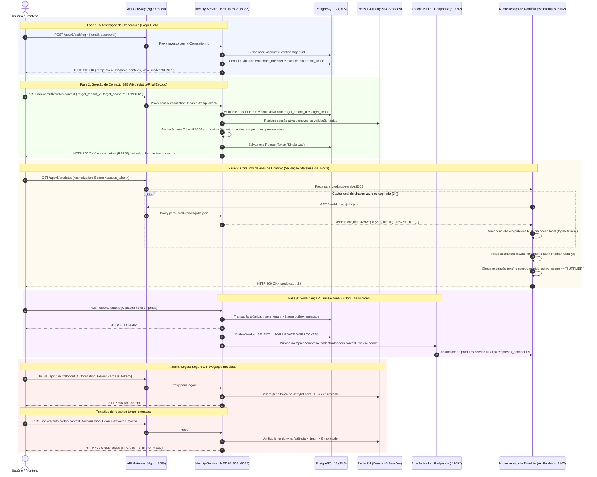

# Alinhamento Técnico Inter-Equipes: Respostas, Contratos e Diagramas
## Identity-Service B2B Multi-Tenant (.NET 10, RS256, RLS, Redis Denylist, RFC 9457)

> **Documento Oficial de Alinhamento Técnico e Resolução de Pendências**  
> **Serviço Responsável:** `Identity-Service` (Autoridade de Autenticação e Multi-Tenancy)  
> **Destinatários:**  
> - **Grupo 2 (Produtos e Fornecimentos):** `davicalvarenga/Sistema-MicServ-SD` (Issues #2 e #13)  
> - **Equipe 9 (Infraestrutura e DevOps):** `Printf-PedroCardoso/portal-b2b-kit-infra`  
> - **Grupo 8 (QA e Testes de Aceitação):** `AmandaBfa/AED---Processo-e-Artefato-SD-`  
> **Data:** 2026-11-09 · **Status:** Homologado  

---

## 1. Diagrama Entidade-Relacionamento (MER) do Identity-Service

O modelo de dados relacional foi concebido sob **PostgreSQL 17** com particionamento lógico estanque (*Schema-per-Service* no schema `usuarios`), chaves primárias em **UUIDv7** ordenadas temporalmente, integridade referencial rigorosa e suporte a **Row-Level Security (RLS)**.

```mermaid
erDiagram
    ECONOMIC_GROUP ||--o{ TENANT : "possui"
    TENANT ||--o{ TENANT_SCOPE : "habilita"
    TENANT ||--o{ TENANT_MEMBER : "vincula"
    USER_ACCOUNT ||--o{ TENANT_MEMBER : "pertence"
    TENANT_MEMBER ||--o{ MEMBER_ROLE : "possui"
    ROLE ||--o{ MEMBER_ROLE : "atribuído_a"
    USER_ACCOUNT ||--o{ REFRESH_TOKEN : "gera_sessao"
    TENANT ||--o{ OUTBOX_MESSAGE : "origina_evento"
    TENANT ||--o{ AUTH_AUDIT_LOG : "registra_auditoria"

    ECONOMIC_GROUP {
        uuid id PK "UUIDv7"
        varchar name "Razão social da holding/grupo"
        varchar status "ACTIVE, SUSPENDED"
        timestamptz created_at
        timestamptz updated_at
    }

    TENANT {
        uuid id PK "UUIDv7"
        uuid group_id FK "Referência ao grupo econômico"
        varchar cnpj UK "14 dígitos sem formatação"
        varchar legal_name "Razão Social da empresa"
        varchar branch_type "HQ (Matriz) ou BRANCH (Filial)"
        numeric geo_lat "Latitude geográfica WGS84"
        numeric geo_lng "Longitude geográfica WGS84"
        varchar status "ACTIVE, SUSPENDED, BLOCKED"
        timestamptz created_at
        timestamptz updated_at
    }

    TENANT_SCOPE {
        uuid id PK "UUIDv7"
        uuid tenant_id FK "Vínculo ao tenant"
        varchar scope "BUYER, SUPPLIER, CARRIER, TENANT_ADMIN"
        boolean is_active "Indicador de ativação do escopo"
        timestamptz created_at
    }

    USER_ACCOUNT {
        uuid id PK "UUIDv7"
        varchar email UK "E-mail normalizado único"
        varchar password_hash "Argon2id (m=19456, t=2, p=1)"
        varchar name "Nome de exibição do usuário"
        varchar status "ACTIVE, SUSPENDED, LOCKED"
        varchar platform_role "Papel global (NONE, SUPPORT, ADMIN)"
        int failed_login_attempts "Contador para lockout"
        timestamptz locked_until "Bloqueio temporário por brute-force"
        timestamptz created_at
        timestamptz updated_at
    }

    TENANT_MEMBER {
        uuid id PK "UUIDv7"
        uuid tenant_id FK "Tenant do vínculo"
        uuid user_id FK "Usuário associado"
        boolean is_owner "Proprietário do tenant (acesso irrestrito)"
        boolean can_view_group "Permissão de visão consolidada"
        varchar status "ACTIVE, SUSPENDED, REVOKED"
        timestamptz created_at
        timestamptz updated_at
    }

    ROLE {
        uuid id PK "UUIDv7"
        varchar name UK "BUYER_OPERATOR, SUPPLIER_SALES, etc."
        varchar description "Descrição operacional"
        varchar scope "Escopo vinculado (BUYER, SUPPLIER, etc.)"
        boolean is_system "Papel protegido do sistema"
        timestamptz created_at
    }

    MEMBER_ROLE {
        uuid id PK "UUIDv7"
        uuid tenant_id FK "Contexto do tenant"
        uuid tenant_member_id FK "Vínculo do membro"
        uuid role_id FK "Papel atribuído"
        timestamptz created_at
    }

    REFRESH_TOKEN {
        uuid id PK "UUIDv7"
        uuid user_id FK "Usuário detentor da sessão"
        uuid session_family_id "Identificador de árvore de rotação"
        varchar token_hash "Hash SHA-256 do refresh token"
        timestamptz expires_at "Expiração (padrão: 8h)"
        boolean is_revoked "Marcador de consumo (Single-Use)"
        timestamptz created_at
    }

    OUTBOX_MESSAGE {
        uuid id PK "UUIDv7"
        varchar event_type "empresa_cadastrada, tenant_bloqueado, etc."
        uuid aggregate_id "ID do aggregate raiz (tenant_id)"
        text payload "Payload JSON do evento de domínio"
        timestamptz created_at
        timestamptz processed_at "Timestamp de publicação no Kafka"
        varchar status "PENDING, PUBLISHED, FAILED"
        int retry_count "Contador de retentativas"
    }

    AUTH_AUDIT_LOG {
        uuid id PK "UUIDv7"
        varchar event_type "LOGIN_SUCCESS, CONTEXT_SWITCH, LOGOUT"
        uuid user_id "ID do usuário (nulo em credenciais inválidas)"
        uuid tenant_id "ID do tenant se contextualizado"
        varchar ip_address "Endereço IP remoto de origem"
        uuid correlation_id "Rastreamento distribuído X-Correlation-Id"
        timestamptz timestamp "Momento do registro"
        text details "Metadados adicionais em JSON"
    }
```



---

## 2. Diagrama de Operação do Sistema (Arquitetura e Fluxos)

O diagrama abaixo demonstra o fluxo de autenticação em dois passos, a validação descentralizada (*stateless*) via JWKS pelos microsserviços de domínio, a revogação instantânea via Redis Denylist e a mensageria leste-oeste via Transactional Outbox.



---

## 3. Respostas Técnicas para as Outras Equipes

### 3.1 Grupo 2 (`davicalvarenga/Sistema-MicServ-SD` — Produtos e Fornecimentos)
**Referência:** Issues #2, #13, #23, #27, #28, #29, #30, #31, #32, #33, #34 e #35.

#### A. Como validar o token JWT RS256 (Substituição de HS256) e Códigos Oficiais de Erro (Issue #31)
O uso de HS256 exigia compartilhar o segredo `JWT_SECRET_KEY` entre todos os serviços, violando a integridade do sistema. O Identity-Service emite tokens assinados com **RS256** (RSA-2048) e disponibiliza as chaves públicas em `/.well-known/jwks.json`.

Conforme o catálogo canônico de erros da RFC 9457 adotado pela plataforma:
- **HTTP 401 Unauthorized:** Retorna o código oficial `ERR-AUTH-002` ("Token de acesso ausente, inválido, expirado ou revogado") em caso de ausência de cabeçalho, token malformado, chave não reconhecida ou assinatura expirada.
- **HTTP 403 Forbidden:** Retorna o código oficial `ERR-CTX-007` ("Violação de isolamento de contexto ou permissão insuficiente") quando o escopo ativo ou permissão do usuário não autoriza o acesso ao recurso.

**Solução Pronta em Python/FastAPI (`services/common/auth.py`):**
```python
import os
import logging
from typing import Any, Dict, List
import jwt
from jwt import PyJWKClient, InvalidTokenError, PyJWKClientError
from fastapi import HTTPException, Security, status
from fastapi.security import HTTPAuthorizationCredentials, HTTPBearer

logger = logging.getLogger("auth_middleware")

# JWKS URL: via Gateway oficial ou direto no serviço
JWKS_URL = os.getenv("AUTH_JWKS_URL", "http://gateway:8080/.well-known/jwks.json")

# Cliente com cache local em memória (elimina chamadas de rede repetidas)
jwks_client = PyJWKClient(
    JWKS_URL,
    cache_keys=True,
    max_cached_keys=10,
    cache_jwk_set=True,
    lifespan=3600,  # 1 hora de retenção de chaves públicas
    headers={"User-Agent": "PortalB2B-Client/1.0"}
)

security = HTTPBearer()

def get_current_token_payload(credentials: HTTPAuthorizationCredentials = Security(security)) -> Dict[str, Any]:
    """
    Decodifica e valida o Access Token RS256 do cabeçalho Authorization: Bearer.
    Lança HTTPException 401 (ERR-AUTH-002) caso o token esteja ausente, adulterado ou expirado.
    """
    token = credentials.credentials
    try:
        signing_key = jwks_client.get_signing_key_from_jwt(token)
        payload = jwt.decode(
            token,
            signing_key.key,
            algorithms=["RS256"],
            audience="b2b-platform",
            leeway=60,
            options={
                "verify_signature": True,
                "verify_exp": True,
                "verify_iat": True,
                "require": ["exp", "iat", "sub", "tenant_id", "active_scope"]
            }
        )
        return payload
    except jwt.ExpiredSignatureError:
        logger.warning("Token de acesso expirado.")
        raise HTTPException(
            status_code=status.HTTP_401_UNAUTHORIZED,
            detail={"code": "ERR-AUTH-002", "message": "Token de acesso expirado."},
            headers={"WWW-Authenticate": 'Bearer error="invalid_token", error_description="Token has expired"'}
        )
    except (PyJWKClientError, InvalidTokenError) as err:
        logger.warning(f"Falha na validação do token JWT: {err}")
        raise HTTPException(
            status_code=status.HTTP_401_UNAUTHORIZED,
            detail={"code": "ERR-AUTH-002", "message": "Token ausente, inválido ou assinatura não reconhecida."},
            headers={"WWW-Authenticate": 'Bearer error="invalid_token"'}
        )

def require_scope(allowed_scopes: List[str]):
    """
    Dependency do FastAPI para garantir que a requisição opera no escopo exigido.
    Exemplo: @app.post("/produtos", dependencies=[Depends(require_scope(["SUPPLIER"]))])
    """
    def scope_checker(payload: Dict[str, Any] = Security(get_current_token_payload)):
        active_scope = payload.get("active_scope")
        if active_scope not in allowed_scopes:
            raise HTTPException(
                status_code=status.HTTP_403_FORBIDDEN,
                detail={"code": "ERR-CTX-007", "message": f"Escopo ativo '{active_scope}' não autorizado para este recurso."}
            )
        return payload
    return scope_checker
```

> [!NOTE]
> **SDK Oficial e Completo:** Um SDK pronto para produção, com tipagem estrita (`AuthContext`), suporte completo ao catálogo de erros RFC 9457 (`ERR-AUTH-002` para 401 e `ERR-CTX-007` para 403), verificador de permissões (`require_permission`), decoradores e tratamento de `view_mode` já está disponível no repositório em [`Docs/sdks/b2b_auth_fastapi.py`](sdks/b2b_auth_fastapi.py). Recomendamos importar e utilizar diretamente o arquivo do SDK em vez de reimplementar a lógica manualmente.

#### B. Mapeamento de Claims e Resolução da Questão P-31 (Múltiplos Perfis) e Issue #27 (Escopo de Produtos)
Na vida real, uma empresa agrícola é fornecedora, compradora e contratante de frete simultaneamente. No Identity-Service:
1. O cadastro permite múltiplos escopos por CNPJ na tabela `tenant_scope`.
2. No login, o usuário recebe a lista de empresas e escopos disponíveis.
3. Para operar, o usuário chama `POST /api/v1/auth/switch-context` indicando o `target_scope` (`SUPPLIER`, `BUYER` ou `CARRIER`).
4. O token emitido traz:
   - `sub`: ID do usuário autenticado.
   - `tenant_id`: ID da empresa ativa (ex: `01900000-0000-7000-8000-000000000010`).
   - `active_scope`: Escopo ativo (`SUPPLIER`, `BUYER`, `CARRIER`, `TENANT_ADMIN`).
   - `roles`: Papéis atribuídos (ex: `["SUPPLIER_SALES"]` para fornecedor; ou `["BUYER_OPERATOR"]` para comprador).
   - `permissions`: Permissões granulares do escopo ativo:
     - Exemplo em fornecedores (`SUPPLIER_SALES` ou `SUPPLIER_OPERATOR`): `["produtos:criar", "fornecimento:publicar"]`.
     - Exemplo em compradores (`BUYER_OPERATOR`): `["demanda:criar", "demanda:listar", "leilao:participar", "pedido:visualizar"]`. Conforme acordado na **Issue #27**, o endpoint `POST /api/v1/produtos` é restrito a `["SUPPLIER"]`, de modo que compradores não possuem a permissão `produtos:criar`.

#### C. Contrato do Evento Kafka `empresa_cadastrada` emitido pelo Outbox (Issues #28 e #29)

O `Identity-Service` publica eventos através do padrão Transactional Outbox (`EventOutbox.cs`), gravando transacionalmente com o cadastro da empresa e despachando para o tópico `empresa_cadastrada`.

**Chave da Mensagem (Kafka Key):** String do `tenant_id` (UUID formatado com hífens).

**Corpo da Mensagem (Payload JSON direto em snake_case):**
Diferente de um modelo com envelope embutido no corpo, o `Identity-Service` emite o payload da entidade diretamente no corpo da mensagem em formato `snake_case`, em conformidade com o padrão de alta performance do ecossistema:
```json
{
  "event_id": "01900000-0000-7000-9000-000000000001",
  "tenant_id": "01900000-0000-7000-8000-000000000010",
  "group_id": "01900000-0000-7000-8000-000000000001",
  "cnpj": "11222333000181",
  "legal_name": "AgroBrasil Matriz e Exportadora S.A.",
  "branch_type": "HQ",
  "geo_lat": -15.794229,
  "geo_lng": -47.882166,
  "status": "ACTIVE",
  "scopes": ["BUYER", "SUPPLIER", "TENANT_ADMIN"],
  "created_at": "2026-11-09T20:00:00Z"
}
```

> **Enum `branch_type` (Issue #29):** O campo `branch_type` assume os valores canônicos `"HQ"` (matriz) e `"BRANCH"` (filial), de acordo com o enum `BranchType.cs` e a constraint relacional do banco. A denominação `"HEADQUARTERS"` não é utilizada.

**Cabeçalhos da Mensagem (Kafka Headers de Rastreabilidade):**
Todos os metadados de governança, correlação e integridade são enviados nos cabeçalhos nativos do Kafka:
- `event_id`: UUIDv7 único do evento.
- `tenant_id`: UUID do tenant cadastrado.
- `group_id`: UUID do grupo econômico.
- `initiator_user_id`: UUID do usuário que executou a operação.
- `actor_user_id`: UUID do operador em casos de suporte/impersonation (opcional).
- `acting_scope`: Escopo operacional da ação (`TENANT_ADMIN` ou `PLATFORM_ADMIN`).
- `correlation_id`: Identificador de correlação ponta a ponta (`X-Correlation-Id`).
- `context_jws`: Assinatura criptográfica JWS compacta (RS256) emitida pelo Identity-Service com claims de contexto, verificável via JWKS.

**Orientação para Consumidores que Adotam Padrão Envelope (Issue #28):**
Se o microsserviço consumidor (ex: `fornecimentos-service`, `demanda-service`) utiliza classes internas que esperam um envelope com campos como `eventId`, `eventType` e `payload`:
- **Opção 1 (Recomendada - Deserialização Direta):** Desserializar o JSON do body diretamente na classe/DTO do Tenant (`event_id`, `tenant_id`, `cnpj`, `legal_name`, `branch_type`, `scopes`, etc.), eliminando a camada intermediária de envelope.
- **Opção 2 (Adaptação para Envelope):** Caso a arquitetura do consumidor exija manter a estrutura de envelope, mapear os dados lendo os atributos de rastreabilidade diretamente dos **Kafka Headers** (`headers["event_id"]`, `headers["correlation_id"]`) e associar o corpo recebido ao campo `payload` do envelope.

#### D. Matriz Canônica de Respostas Técnicas Formais às Issues #23 a #35 (Homologação Inter-Serviços)

Em resposta à bateria de alinhamentos e revisões técnicas abertas pelo Grupo 2 no repositório `davicalvarenga/Sistema-MicServ-SD`, consolidamos abaixo as resoluções técnicas formais, decisões de arquitetura e orientações de interoperabilidade do `Identity-Service`:

##### 1. Issue #23: Confirmação de `iss`, `aud`, JWKS e Acesso ao Repositório
- **Claims Canônicas:** Confirmamos que os valores emitidos nos tokens JWT pelo Identity-Service são estritamente `iss = "identity-service"` e `aud = "b2b-platform"`.
- **Token Pré-Contexto no Login:** Confirmamos que o token emitido no `POST /api/v1/auth/login` (quando não utilizado o auto-contexto) carrega `tenant_id = null`, `active_scope = null` e `view_mode = "NONE"`. Elogiamos e validamos integralmente a postura técnica do `Produtos-Service` em recusar requisições de negócio com esse token retornando `HTTP 403 Forbidden` (`CONTEXTO_NAO_SELECIONADO`), pois nenhuma operação comercial ou de catálogo pode ser admitida sem a definição explícita do tenant e escopo de atuação do usuário.
- **Repositório Público:** O repositório oficial do serviço é [`https://github.com/Matheus-Allvz/Identity-Service`](https://github.com/Matheus-Allvz/Identity-Service), encontrando-se 100% público e acessível para consulta de código-fonte, contratos e documentações.
- **Disponibilidade do JWKS:** A rota `GET /.well-known/jwks.json` está plenamente operacional, servindo o conjunto de chaves públicas ativas com o identificador `kid: key-2026-01` e cabeçalho `Cache-Control: public, max-age=3600`, viabilizando cache público em gateways e validações offline de altíssimo desempenho.

##### 2. Issue #27: Restrição de Cadastro de Produtos Estritamente a `SUPPLIER`
- **Validação da Regra de Negócio:** Agradecemos profundamente a atenção aos detalhes e conferência dos contratos inter-serviços. Confirmamos que a regra implementada pelo `Produtos-Service` é a correta: **apenas o escopo `SUPPLIER` possui prerrogativa para cadastrar, alterar e excluir produtos**. O papel `BUYER_OPERATOR` opera estritamente como comprador, possuindo acesso exclusivo de consulta ao catálogo e à vitrine de ofertas para criação de demandas e participação em leilões.
- **Retificação Realizada:** A decisão D-ECO-11 em `Docs/Alinhamento-Ecossistema-B2B.md` e a carga demonstrativa `seed-demo.sql` foram formalmente retificadas no **PR #23 (commit `3cc4cce`)**, removendo em definitivo a permissão `produtos:criar` do perfil `BUYER_OPERATOR`.

##### 3. Issue #28: Arquitetura de Eventos Kafka e Formato de `empresa_cadastrada`
- **Padrão Transactional Outbox:** O Identity-Service adota arquitetura de mensageria baseada em Outbox Transacional com separação estrita de camadas. Todos os metadados de governança, correlação e auditoria criptográfica (`event_id`, `tenant_id`, `group_id`, `initiator_user_id`, `correlation_id`, `context_jws`) trafegam nos **Kafka Headers** nativos. O corpo da mensagem (`body`) trafega em JSON com nomenclatura `snake_case`, espelhando o schema relacional do banco de dados e otimizando a serialização.
- **Interoperabilidade:** O formato foi formalmente documentado na seção 3.5 do `Docs/Alinhamento-Ecossistema-B2B.md` (PR #23). Para consumidores que utilizam classes internas acopladas a envelopes padrão de kit (`eventId`, `eventType`, `payload`), recomendamos deserializar o payload diretamente dos dados de domínio ou extrair os metadados a partir dos headers nativos da mensagem Kafka.

##### 4. Issue #29: Enum `branch_type` (`HQ` vs `HEADQUARTERS`)
- **Valor Canônico:** Confirmamos que os valores válidos e canônicos no banco de dados e no evento `empresa_cadastrada` são estritamente **`HQ`** (Matriz) e **`BRANCH`** (Filial), conforme definido na entidade e no enum `BranchType.cs`.
- **Retificação Documental:** O exemplo de payload na documentação que continha `HEADQUARTERS` foi corrigido para `"branch_type": "HQ"` no **PR #23 (commit `3cc4cce`)**.

##### 5. Issue #30: Formato do Corpo de Erro (RFC 9457 vs Padrão do Kit)
- **Adoção do Padrão Internacional RFC 9457:** O Identity-Service padronizou suas respostas de erro sob a norma **RFC 9457 (`application/problem+json`)** da IETF, expondo os atributos estruturados `type`, `title`, `status`, `code`, `detail` e `correlation_id`.
- **Compatibilidade e Convergência:** Compreendemos a adoção do padrão do kit (`codigo` e `correlationId`) pelos demais serviços. Para assegurar interoperabilidade sem exigir retrabalho abrupto de contratos, recomendamos que os componentes clientes/gateways adotem tolerância ou fallback transparente em seus deserializadores. Mantemo-nos totalmente à disposição para colaborar com a equipe de Infraestrutura e QA na unificação formal dos contratos de erro da plataforma.

##### 6. Issue #31: Códigos de Erro no Exemplo FastAPI e SDK Oficial
- **Alinhamento com o Catálogo:** Agradecemos o apontamento técnico. Os códigos de erro exibidos no exemplo da seção 3.1 foram retificados para os códigos oficiais da plataforma: `ERR-AUTH-002` (401 Unauthorized / Token ausente, inválido, expirado ou revogado) e `ERR-CTX-007` (403 Forbidden / Violação de isolamento de contexto ou escopo insuficiente).
- **Disponibilidade do SDK:** O SDK oficial pronto para uso, devidamente validado e testado, encontra-se disponível em [`Docs/sdks/b2b_auth_fastapi.py`](sdks/b2b_auth_fastapi.py), contendo todas as tipagens, verificadores e mapeamentos RFC 9457 prontos para integração.

##### 7. Issue #32: Tolerância de Relógio na Validação do JWT (Clock Skew / Leeway)
- **Justificativa da Recomendação:** A sugestão de `leeway=60` no SDK foi concebida como salvaguarda operacional em ambientes distribuídos heterogêneos para evitar o descarte prematuro de tokens legítimos por milissegundos de dessincronização entre contêineres Docker.
- **Validação do Modelo Estrito:** Apoiamos integralmente a decisão do Grupo 2: caso os nós e contêineres do ambiente possuam sincronização de relógio rigorosa via NTP, manter `leeway=0` é seguro, restritivo e perfeitamente aceito pelo Identity-Service.

##### 8. Issue #33: Tratamento de Tokens com Visão de Grupo Econômico (`MACRO_GROUP`)
- **Validação da Proposta Técnica:** Parabenizamos o Grupo 2 pela proposta arquitetural, a qual consideramos excelente e totalmente aderente ao modelo multi-tenant:
  - **Consultas (Catálogo e Vitrine):** Devem aceitar tokens em visão `MACRO_GROUP`, permitindo à holding consolidar a visualização de produtos e ofertas de todas as empresas do grupo.
  - **Mutações (Cadastro e Alteração de Produtos e Ofertas):** Devem recusar tokens em visão `MACRO_GROUP` com `403 Forbidden` (código semântico sugerido: `CONTEXTO_DE_GRUPO_NAO_PERMITIDO` ou `ERR-CTX-007`), orientando o usuário a realizar o `switch-context` para uma filial específica (`SINGLE`), já que cada produto ou fornecimento exige responsabilidade fiscal, estoque e CNPJ proprietário estrito.

##### 9. Issue #34: Revogação Imediata de Tokens e Modelo de Validação Descentralizado
- **Tradeoff de Arquitetura:** A validação offline de tokens via chaves públicas (JWKS) foi intencionalmente priorizada para garantir **latência submilisegundo e zero dependência de rede inter-serviços**. Por projeto, tokens JWT possuem tempo de vida curto (TTL máximo de 15 minutos).
- **Estratégias de Revogação Imediata:** Para situações emergenciais que demandem bloqueio antes do término natural do TTL:
  1. **Consumo de Eventos de Bloqueio (Recomendado):** Os serviços podem subscrever o tópico Kafka `tenant_bloqueado` (ou `usuario_bloqueado`) emitido pelo Identity-Service, atualizando uma tabela local em memória de entidades suspensas.
  2. **Introspecção Síncrona via Redis (Alta Criticidade):** Para rotas de extrema sensibilidade financeira, os microsserviços podem invocar o endpoint síncrono `POST /api/v1/auth/introspect` (RFC 7662), que consulta em tempo real a denylist atômica do Redis no Identity-Service.

##### 10. Issue #35: Prevenção de Auto-Negociação (Self-Dealing) e Propagação de `grupoId`
- **Apoio à Inclusão de `grupoId`:** Apoiamos com entusiasmo a proposta do Grupo 2 de incluir o campo `grupoId` (extraído da claim `group_id` do token do fornecedor) no evento `fornecimento_criado` e persistência correspondente.
- **Separação de Responsabilidades:** Concordamos integralmente que as regras de matching, validação de regras antitruste e trava transacional de auto-negociação (impedindo que empresas do mesmo grupo econômico comprem e vendam entre si) pertencem estritamente aos microsserviços de Negociação, Leilão e Mercado, cabendo ao Identity-Service e ao Produtos-Service fornecer a rastreabilidade cadastral e a propagação confiável dos identificadores de grupo.

---

### 3.2 Equipe 9 (`Printf-PedroCardoso/portal-b2b-kit-infra` — Infraestrutura e DevOps)
**Solicitação:** Ajustes no Gateway Nginx, inclusão de container Redis, provisionamento de tópicos e correção de permissões no banco.

#### A. Ajuste em `gateway/nginx.conf`
```nginx
upstream usuarios_backend {
    server app1-usuarios:8080 max_fails=3 fail_timeout=10s;
    server app2-usuarios:8080 max_fails=3 fail_timeout=10s;
    keepalive 32;
}
```

#### B. Ajuste em `gateway/common_routes.conf`
```nginx
# 1. Autenticação, Sessão, Troca de Contexto e Logout
location /api/v1/auth/ {
    proxy_pass http://usuarios_backend;
    proxy_http_version 1.1;
    proxy_set_header Connection "";
    proxy_set_header Host $host;
    proxy_set_header X-Real-IP $remote_addr;
    proxy_set_header X-Forwarded-For $proxy_add_x_forwarded_for;
    proxy_set_header X-Forwarded-Proto $scheme;
    proxy_set_header X-Correlation-Id $correlation_id;
    proxy_set_header Authorization $http_authorization;
}

# 2. Governança de Tenants e Membros
location /api/v1/tenants {
    proxy_pass http://usuarios_backend;
    proxy_http_version 1.1;
    proxy_set_header Connection "";
    proxy_set_header Host $host;
    proxy_set_header X-Real-IP $remote_addr;
    proxy_set_header X-Forwarded-For $proxy_add_x_forwarded_for;
    proxy_set_header X-Forwarded-Proto $scheme;
    proxy_set_header X-Correlation-Id $correlation_id;
    proxy_set_header Authorization $http_authorization;
}

# 3. Governança de Usuários
location /api/v1/users/ {
    proxy_pass http://usuarios_backend;
    proxy_http_version 1.1;
    proxy_set_header Connection "";
    proxy_set_header Host $host;
    proxy_set_header X-Real-IP $remote_addr;
    proxy_set_header X-Forwarded-For $proxy_add_x_forwarded_for;
    proxy_set_header X-Forwarded-Proto $scheme;
    proxy_set_header X-Correlation-Id $correlation_id;
    proxy_set_header Authorization $http_authorization;
}

# 4. Exposição de Chaves Públicas para Validação Stateless (JWKS)
location = /.well-known/jwks.json {
    proxy_pass http://usuarios_backend;
    proxy_http_version 1.1;
    proxy_set_header Connection "";
    proxy_set_header Host $host;
    proxy_set_header X-Correlation-Id $correlation_id;
    proxy_cache_valid 200 1h;
}
```

#### C. Container Redis no `docker-compose.yml`
```yaml
  redis:
    image: redis:7.4.6-alpine
    container_name: portal_b2b_redis
    restart: unless-stopped
    ports:
      - "6379:6379"
    command: redis-server --appendonly yes --maxmemory 256mb --maxmemory-policy volatile-lru
    networks:
      - portal_b2b_net
    healthcheck:
      test: ["CMD", "redis-cli", "ping"]
      interval: 5s
      timeout: 3s
      retries: 5
```

#### D. Tópicos no `scripts/init_topics.sh`
```bash
TOPICOS_IDENTITY=(
    "empresa_cadastrada"
    "tenant_bloqueado"
    "usuario_bloqueado"
    "sessao_comprometida"
)

for topico in "${TOPICOS_IDENTITY[@]}"; do
    rpk topic create "$topico" -p 3 -r 1 --brokers localhost:19092 2>/dev/null || true
    echo "Tópico $topico provisionado com sucesso."
done
```

#### E. Correção do Bug K1 no PostgreSQL (`database/01-init.sql`)
```sql
-- Garante que tabelas criadas nas migrações herdem privilégios para a role do serviço
ALTER DEFAULT PRIVILEGES IN SCHEMA usuarios
    GRANT SELECT, INSERT, UPDATE, DELETE ON TABLES TO svc_usuarios;

ALTER DEFAULT PRIVILEGES IN SCHEMA usuarios
    GRANT USAGE, SELECT ON SEQUENCES TO svc_usuarios;
```

---

### 3.3 Grupo 8 (`AmandaBfa/AED---Processo-e-Artefato-SD-` — QA e Testes de Aceitação)
**Solicitação:** Orientações para a suíte de testes automatizados do Identity-Service.

1. **Fluxo de Autenticação em 2 Passos Obrigatório:**
   - Requisição 1: `POST /api/v1/auth/login` com email e senha. Retorna `tempToken` e lista `available_contexts`.
   - Requisição 2: `POST /api/v1/auth/switch-context` enviando no body `target_tenant_id` e `target_scope` e no cabeçalho `Authorization: Bearer <tempToken>`. Retorna o `access_token` contextualizado definitivo.
2. **Rastreabilidade por Correlation ID:**
   - Enviar cabeçalho `X-Correlation-Id` no formato UUID canônico de 36 caracteres com hífens (ex: `01900000-0000-7000-9000-000000000099`). O serviço reflete o mesmo valor na resposta.
3. **Asserções de Erro RFC 9457:**
   - O Content-Type de erro é estritamente `application/problem+json`.
   - Asserções devem validar os campos: `type`, `title`, `status`, `code`, `detail`, `correlation_id`.
4. **Recursos Prontos para Testes:**
   - Coleção Postman com variáveis dinâmicas e testes encadeados: [`Docs/postman-collection-b2b.json`](file:///c:/Users/ACT/Documents/Personal/Identity-Service/Docs/postman-collection-b2b.json)
   - Execução via Newman CLI em pipelines de CI:
     ```bash
     npm install -g newman
     newman run Docs/postman-collection-b2b.json --reporters cli
     ```
   - Playground Web Interativo em tempo real: [**`https://pages-identity.matheus-alves.dev`**](https://pages-identity.matheus-alves.dev)
