# Apresentação — Processo de Especificação para LLM e Conjunto de Modelos (v2.1)

> **Para quê:** material de apoio e guião para apresentar (oralmente ou numa defesa) o processo (E1), o conjunto de modelos (E2), o guia de preenchimento (E3) e a aplicação ao caso Identity-Service.
> **Data de referência:** 2026-10-19 (estado dos ficheiros nessa data).
> **Regra seguida neste documento:** todos os números vêm dos ficheiros citados. O que não existe nos ficheiros está marcado **Pendente** ou **Não encontrado**.

---

## 1. Resumo executivo

**Problema.** Uma LLM que gera código a partir de requisitos em linguagem natural preenche cada lacuna com uma decisão sua (alucinação de requisitos). Com uma especificação grande e difusa, o modelo também mistura regras de partes diferentes do sistema. As duas premissas estão em `Etapa1/01_processo_especificacao_requisitos_llm.md` §0.

**Objetivo.** Um sistema implementado por LLMs com **conformidade ≥ 90 %** face aos requisitos, medida de forma objetiva: a unidade é o critério de aceitação (CA), com pesos MoSCoW e veto dos CA `@critico` (E1 §7).

**Proposta.** Três entregáveis que funcionam juntos:

| Entregável | Ficheiro | O que é |
|---|---|---|
| E1 Processo (v2.1) | `Etapa1/01_processo_especificacao_requisitos_llm.md` | 5 fases, decompostas em **unidades de trabalho (UT)** num grafo de dependências; pacotes de contexto por agente; validação independente; implementação por fases com gates G1–G6 e veto |
| E2 Conjunto de modelos (v2.1) | `Etapa1/template/` (10 ficheiros) | Um ficheiro por tipo de conteúdo (núcleo, sistema existente, dados, contratos, módulos, plano, ambiente de teste, orquestração, registo), para que cada agente receba só a parte de que precisa |
| E3 Guia de preenchimento (v2.1) | `Etapa1/03_guia_preenchimento_template.md` | 12 regras anti-alucinação, termos proibidos (base do lint), instruções ficheiro a ficheiro (§G-nn), checklists DoR/DoD |
| E4 Relatório científico | **Não encontrado** (só o desenho estatístico em E1 §7.6) | Teste de hipótese sobre $C_w^{(1)}$ |

**Mensagem central.** A v1 especificava tudo num documento único (~215 KB) e gerava numa só passagem. A v2 corta a especificação em **15 módulos com pacotes ≤ 60 KiB, todos medidos por script**, congela primeiro o que é partilhado e só depois põe agentes a trabalhar em paralelo. Na aplicação ao Identity-Service, a fundação (Gate 2) foi aceite e congelada com hash ao 5.º ciclo, e 13 dos 15 módulos estão escritos e aceites. **A implementação (Fase 5) e a medição de conformidade ainda não começaram.**

---

## 2. O processo de ponta a ponta

### 2.1 Princípios (E1 §0.1)

| # | Princípio | Em uma frase |
|---|---|---|
| P1 | Mundo fechado | O que não está especificado não se implementa; na dúvida, regista-se e segue-se a hipótese mais simples, marcada |
| P2 | Determinismo | Uma só interpretação; valores concretos em vez de adjetivos |
| P3 | Atomicidade | Um ID = uma regra = um resultado verificável |
| P4 | Rastreabilidade bidirecional | RF ↔ RN ↔ EP/EV ↔ CA ↔ teste ↔ fase ↔ commit |
| P5 | Verificabilidade | Sem CA não há requisito; cada CA tem pelo menos uma borda |
| P6 | Linguagem normativa | DEVE / NÃO DEVE / DEVERIA / PODE (RFC 2119/8174) |
| P7 | Contexto mínimo | Cada agente recebe um pacote fechado com orçamento de tamanho |
| P8 | Contrato antes do paralelismo | Só se paraleliza depois de congelar o que é partilhado |
| P9 | Posse exclusiva | Cada ficheiro tem um único dono por UT |
| P10 | Validação independente | Validador novo a cada ciclo, sem ler o relato de quem produziu |
| P11 | Evidência etiquetada | `[MEDIDO]` (com script em `evidencias/`), `[CÓDIGO]`, `[DOC]`; o não verificado é lacuna `L-nn` |
| P12 | Humano nas decisões e nos merges | Decisões, aprovações e merges exigem mensagem literal do PO |

### 2.2 Papéis (E1 §1.4)

| Sigla | Papel | Pode | Não pode |
|---|---|---|---|
| PO | Product Owner (humano) | Decidir `D-nn`, responder `Q-nn`, aprovar PRS e CR, aceitar fases, merge | — |
| ORQ | Orquestrador (agente) | Manter grafo e registo, montar pacotes, lançar agentes, correr scripts | Escrever spec ou código; propor/decidir CR ou divisões de módulos; aceitar sem validador |
| AR / ARQ | Analista / Arquiteto | Escrever os ficheiros de que é dono; ARQ propõe `CR-nn` | Escrever fora da sua posse; alterar o congelado sem CR |
| RI | Revisor independente | Ler o pacote e apontar defeitos | Ler relatos ou defeitos anteriores |
| CON | Construtor | Implementar uma fase no seu worktree | Tocar fora da fase, fazer merge, mudar a spec |
| VAL | Validador (novo a cada ciclo) | Correr suite e roteiro, inspecionar o diff, dar score | Ler o relato do construtor; corrigir |
| REV | Revisor de causa raiz | Encontrar a classe do defeito | Implementar |
| AUD | Auditor | Escrever a suite antes da construção; medir a conformidade final | Ser autor da spec |

### 2.3 Fases, entradas, saídas e gates (E1 §2–§6, resumo do §10)

| Fase | UT (paralelo indicado com ∥) | Entrada | Saída (ficheiros do template) | Gate / critério de passagem |
|---|---|---|---|---|
| 1 Elicitação | UT-1-01 Núcleo → UT-1-02..n Sistemas externos (∥, 1 agente por `EXT`) → UT-1-90 Decomposição | Fontes, entrevistas, ambiente real | `10`, `20`, `00` §2 (mapa de módulos), `00` §4 (faixas de IDs), grafo em `90` | Gate 1: âmbito aprovado (`D-nn`), stack com versões exatas, ADR com consequência no código, evidência etiquetada, módulos dentro do orçamento, faixas de IDs atribuídas, nenhuma `Q` bloqueante |
| 2 Contratos partilhados | UT-2-01 Dados → UT-2-02 Interfaces ∥ UT-2-03 Ambiente de teste | Saídas da F1 | `30`, `40`, `70` congelados | Gate 2: dicionário físico completo, interfaces e tipos partilhados, matriz de autorização, catálogo de erros com tabela SQLSTATE, robustez, ambiente de teste com fakes e injeção de falhas, matriz de isolamento `[MEDIDO]`, pacotes verificados por script, **hash de `10`, `30`, `40`, `70`** |
| 3 Módulos | UT-3-nn, um agente por módulo, todos ∥ | Pacote do módulo | `50-modulos/M-nn.md` | Gate 3 (por módulo): cobertura mínima de CA com bordas, concorrência e retomada; RN canónicas; ordem de avaliação; só dados/interfaces congelados; pacote dentro do orçamento |
| 4 Validação pré-LLM | UT-4-nn revisão cega por módulo ∥ → UT-4-90 consistência → UT-4-91 ensaio | Pacotes dos módulos | Defeitos `DEF-nn`, Índice de Ambiguidade (IA), `spec.sha256` | Gate 4 = DoR (guia §6.1, grupos A–D) **e IA residual = 0** em todos os módulos |
| 5 Implementação | UT-5-00 Plano ∥ UT-5-01 Suite → F-00 → F-nn (∥ quando o grafo permite) → UT-5-90 Integração | Spec congelada, plano, suite | Código e PR por fase, folha de auditoria | Por fase: G1–G6 (abaixo); sistema: veredito §7.4 |
| ∥ transversal | Gestão de alterações | `D`, `Q`, achados, dúvidas | `CR-nn`, sub-fases (ex.: `F-03b`) | Decisão do PO; ARQ propõe, ORQ nunca decide |

**Aceite de uma fase de implementação (E1 §7.2):**

| # | Condição |
|---|---|
| G1 | Compila, arranca e migra numa base vazia |
| G2 | **Veto:** todos os CA `@critico` da fase passam |
| G3 | $C_w(CA(F)) \geq 90\%$ |
| G4 | Nenhum ficheiro do "Não tocar ainda" alterado (verificado no diff) |
| G5 | Regressão das fases já aceites |
| G6 | Checklist de robustez de entrada |

**Ciclo de vida de uma UT/fase:** Pendente → Pronta → EmCurso → EmValidação → Aceite, ou Retrabalho (novo validador, máximo 3 ciclos) → **DeadLetter** (o PO decide: dividir, `CR-nn` ou aceitar com débito). Retrabalho com três partes obrigatórias: conserto pontual, mudança que torna a classe do defeito impossível, débitos adjacentes (E1 §6.4).

### 2.4 Diagrama do fluxo (DAG de UT)

```mermaid
flowchart LR
    subgraph F1["Fase 1 · Elicitação"]
      U101["UT-1-01 Núcleo (10)"]
      U102["UT-1-02..n Sistemas externos (20)<br/>1 agente por EXT ∥"]
      U190["UT-1-90 Decomposição<br/>mapa de módulos + faixas de IDs (00)"]
    end
    subgraph F2["Fase 2 · Contratos partilhados"]
      U201["UT-2-01 Dados (30)"]
      U202["UT-2-02 Contratos (40)"]
      U203["UT-2-03 Ambiente de teste (70)"]
      FRZ{{"Gate 2: hash<br/>da fundação"}}
    end
    subgraph F3["Fase 3 · Módulos ∥"]
      M["UT-3-00..nn<br/>1 agente por M-nn<br/>pacote ≤ 60 KiB"]
    end
    subgraph F4["Fase 4 · Validação pré-LLM"]
      R["UT-4-nn revisão cega ∥<br/>+ interrogatório com o modelo alvo"]
      C["UT-4-90 consistência"]
      E["UT-4-91 ensaio"]
      G4{{"Gate 4: DoR<br/>IA residual = 0<br/>spec.sha256"}}
    end
    subgraph F5["Fase 5 · Implementação por fases"]
      P["UT-5-00 Plano (60)"]
      S["UT-5-01 Suite (AUD)<br/>oculta no 1.º ciclo"]
      F00["F-00 esqueleto<br/>+ laço mínimo"]
      FN["F-01..F-nn ∥<br/>CON → VAL novo<br/>G1–G6 + veto"]
      INT["UT-5-90 integração<br/>+ auditoria final"]
    end
    PO(["PO: D-nn, Q-nn, CR-nn, merges"])
    U101 --> U102 --> U190
    U101 --> U190
    U190 --> U201 --> U202 --> FRZ
    U201 --> U203 --> FRZ
    FRZ --> M --> R --> C --> E --> G4
    G4 --> P & S
    P & S --> F00 --> FN --> INT
    PO -.-> U190 & FRZ & G4 & FN
```



### 2.5 Evolução v1 → v2 (e porquê)

| Aspeto | v1.1 (`Etapa1/_versoes/v1.1/`) | v2.1 (atual) | Porquê (evidência) |
|---|---|---|---|
| Forma da spec | Um documento único (`template_requisitos_llm.md`); no caso: `Etapa2/spec_identity_service.md`, 2626 linhas, ~215 KB, ~55 000 tokens (`Etapa2/registo_ambiguidade.md` §1) | 10 ficheiros por tipo de conteúdo + 1 ficheiro por módulo | Premissa 2 do E1: contexto grande e difuso aumenta o erro |
| Contexto do agente | O documento inteiro | **Pacote de contexto** por UT, ≤ 60 KiB, com fecho de referências verificado por script | Na aplicação, validações cegas encontraram pacotes incompletos em 7 de 12 módulos antes de o script existir (E1 §9) |
| Execução | Sequencial, geração numa só passagem | Grafo de UT; UT prontas correm em paralelo; implementação por fases | Torna praticável $n \geq 10$ execuções completas (E1 §7.6) |
| Validação | Revisor único (crítica da avaliação: mesmo subagente fez verificação, RI e LLM-revisor) | Validador novo por ciclo, sem relatos; limite de 3 ciclos; dead letter | `Etapa2/avaliacao_independente.md` problema 7 |
| Medição de conformidade | Uma geração, uma medição | $C_w^{(1)}$ (suite oculta, só a spec) separado de $C_w^{final}$ (com retrabalho) | Separa qualidade da spec de eficácia do processo |
| Evidência sobre sistemas externos | Leitura | `[MEDIDO]` só com script versionado em `evidencias/` | Caso de referência: um fake herdou uma rota errada da documentação |

**Caso de referência que inspirou a v2** (E1 §9): projeto real 100 % por IA (o "ediz/onboardingservice" da memória do projeto; o E1 descreve-o como "um serviço .NET de importação em lote"): ~15 mil linhas, ~1400 testes, 29 PRs e 269 commits em duas semanas. Práticas importadas, com a evidência que o E1 cita:

| Prática | Evidência no caso de referência |
|---|---|
| Veto de falha crítica | Fases com 97 e 99 pontos reprovadas por duplicação de dados |
| Validador novo sem o relato | Um validador deu 95; um segundo deu 78, por uma falha de concorrência |
| Concorrência e retomada obrigatórias | Todas as falhas críticas vieram daqui |
| Checklist de robustez | Respostas 500 com entrada malformada repetiram-se em 6 fases |
| Ensaio por agente sem contexto | 20 correções num documento, 3 levariam o agente a erro |
| Gestão de alterações por sub-fase | 17 decisões novas e 7 sub-fases absorvidas |
| Evidência medida | Rota documentada `DELETE /recurso/{id}` era `DELETE /recurso?id=` |

E práticas acrescentadas pela aplicação ao Identity-Service (E1 §9, 2026-10-19): faixas de IDs antes do paralelismo (houve colisão PRS-46..52), script de fecho de referências, matriz de isolamento contra o SGBD real (três contradições só apanhadas por medição, uma só com `INSERT … RETURNING`), tipos partilhados em `40`, tabela SQLSTATE, divisão ARQ propõe / PO aprova.

---

## 3. O conjunto de modelos (E2) e a ligação ao guia (E3)

### 3.1 Estrutura

Convenções (`Etapa1/template/00-indice.md`): `<<texto>>` = placeholder obrigatório; `<!-- -->` = instrução ao analista, removida no congelamento. Cada ficheiro tem **dono, estado e data** no cabeçalho; um ficheiro "Defasado" ou sem data não entra em pacotes (guia §1). Célula vazia é lacuna: escreve-se "Nenhum" ou "Não se aplica".

| Ficheiro | Para que serve | Secções / campos obrigatórios | Regras-chave de preenchimento | Guia |
|---|---|---|---|---|
| `00-indice.md` | Porta de entrada; o ORQ monta pacotes a partir dele | §1 Mapa de documentos (Doc, Para quê, **Leia quando**, Dono, Estado, Atualizado em, Hash); §2 Mapa de módulos (Âmbito, RF, EP/EV, Tabelas que escreve, Depende de, **Pacote estimado**); §3 Precedência (regra única: RN > CA > Contratos > Dados > Núcleo > Plano); §4 IDs e **§4.1 faixas exclusivas por módulo/UT**; §5 etiquetas de evidência | "Leia quando" escrito como condição; teste do pacote já na Fase 1; uma só regra de precedência | §G-00, §3.1 |
| `10-nucleo.md` | Entra em **todos** os pacotes | §1 Instruções para a LLM (texto fixo, 9 regras, incl. "não invente"); §2 Propósito, Âmbito (Dentro/Fora), Atores, Glossário (com sinónimos proibidos); §3 ADR (com **consequência obrigatória no código**), estrutura, convenções, transversais; §4 Stack com versões exatas; §5 RNF (limiar, verificação, "Na métrica"); §6 Catálogo de erros + **§6.1 SQLSTATE → HTTP → ERR**; §7 Regras por omissão; §8 Proibido; §9 PRS | Manter curto (multiplica pelo nº de agentes); migração com mecanismo único; logging diz o que **não** se regista | §G-10 |
| `20-sistema-existente.md` | Um bloco por `EXT-nn` | Campo/valor (o que é, módulos, ambiente medido, autenticação); Contratos usados com Evidência; **Comportamentos que importam**; Concorrência e falhas; Lacunas `L-nn` | `[MEDIDO]` só com script em `evidencias/` e ficheiro de saída; o não verificado é lacuna, não pressuposto | §G-20 |
| `30-dados.md` | Modelo partilhado | ERD; `ENUM-nn` com transições **permitidas**; dicionário físico por `ENT-nn` (tipo, nulo, default, chave, `ON DELETE`, restrições) e índices; cache com TTL; cobertura de entrada; seed; dados de referência (oráculo) | Uma tabela = um módulo dono; matriz de isolamento executada contra o SGBD real (multi-tenant) | §G-30 |
| `40-contratos.md` | O que os módulos sabem uns dos outros | §1 Convenções da API; §2 **Validação em camadas (ordem fixa)**; §3 Checklist de robustez R1–R10; §4.1 **Tipos partilhados**; §4.2 Tabela de interfaces EP/EV/IF; §5 Matriz de autorização; §6 Eventos | Interfaces só com tipos de §4.1 ou primitivos; a ordem de camadas decide qual erro sai | §G-40 |
| `50-modulos/M-nn-modelo.md` | Um ficheiro por módulo | Cabeçalho "Pacote de contexto"; §1 Âmbito; §2 EP/EV em detalhe (request, **ordem de avaliação**, respostas, corpo com ordenação, efeitos, transação); §3 RF (prioridade MoSCoW, fluxo, EX, **tabela de concorrência/idempotência/retomada**); §4 RN SE/ENTÃO/SENÃO; §5 CA em Gherkin; §6 Rastreabilidade; §7 PRS do módulo | Uma consequência por RN; cada CA com borda; `@critico` só para segurança, isolamento, perda/duplicação de dados, segredo em log | §G-50 |
| `60-plano-de-fases.md` | Plano de implementação | Grafo; resumo (Nº CA, Σw, depende, paralelo, construtores, pacote); bloco por fase (Objetivo, Demo, Constrói, CA, **Não tocar ainda**, Pacote, Escreve, Riscos) | F-00 = laço mínimo ponta a ponta; cada CA numa só fase; 5–20 CA por fase; ramos paralelos em pastas disjuntas | §G-60, §3.3 |
| `70-ambiente-teste.md` | Contrato com a suite | Arranque e acesso (comando de G1, comando da suite); dados e estado (carga, cunhagem de tokens, relógio, inspeção, dados pessoais proibidos); fakes; **injeção de falhas**; convenções (`CA_<nn>_<m>_<descricao>`) | Fakes só do `[MEDIDO]`; sem falha descrita aqui, a LLM não a pode criar (mundo fechado); esperas ativas com teto | §G-70 |
| `80-orquestracao.md` | Regras e briefs | Papéis; protocolo pré-registado (modelo, ferramenta, agentes, orçamento, 3 ciclos, branches, merge pelo PO); regras; **briefs** 4.1 AR, 4.2 RI, 4.3 CON, 4.4 VAL, 4.5 Retrabalho; modelo de PR | O ORQ só preenche os campos `{ }`; nunca cola histórico; construtor sem suite no 1.º ciclo | §G-80 |
| `90-registo.md` | Estado vivo do projeto | UT e fases (estado, ciclo, score, achados); Decisões `D`; Perguntas `Q` (coluna **Bloqueia**); Lacunas `L`; Defeitos `DEF` + IA; `CR-nn`; Congelamentos; Auditoria final por execução | Atualizado em cada transição; PR sem a linha do registo não é aceite | §G-90 |

**Regras de escrita do guia (§2) que a banca vai querer ouvir:** 12 regras de ouro (valores concretos; um termo, um nome; listas fechadas; todos os status e erros; uma consequência por RN; SE/ENTÃO/SENÃO; dizer o que NÃO fazer; JSON coerente; ordem de efeitos e transação; referências por ID; etiqueta de evidência; escrever como se o leitor só tivesse o pacote). Os **termos proibidos** (§2.3: "adequado", "rápido", "seguro", "etc.", "e/ou", "TBD", …) são a base do lint da atividade 4.1.

**Checklists do guia (§6):** DoR da spec (A completude, B contratos partilhados — 12 itens, C cada módulo — 8 itens, D validação independente — 6 itens); DoR de uma fase (R1–R6, incluindo R3b suite fora do alcance do construtor); DoD de uma fase (O1–O7).

### 3.2 Exemplo curto do caso Identity-Service (módulo M-02, `Etapa2/spec-v2/50-modulos/M-02-sessao-refresh.md`)

**Ordem de avaliação do EP-03 `POST /api/v1/auth/refresh`** (excerto, linha 31): rota → corpo/Content-Type (413/415) → formato de 43 caracteres (400 `ERR-VAL-001`) → hash existe (401 `ERR-AUTH-005`) → `status ≠ CONSUMED` (401 `ERR-AUTH-006`, revoga a família) → revalidação via IF-09 (403) → `ACTIVE` e não expirado (401 `ERR-AUTH-005`) → UPDATE condicionado + insert (200).

**RN em forma canónica** (linha 80):

| ID | Tipo | Regra | Erro |
|---|---|---|---|
| RN-37 | Integridade | **SE** o UPDATE afetar 0 linhas ou lançar 23505 **ENTÃO** **DEVE** desfazer a transação e aplicar RN-32 em transação nova **SENÃO** prossegue | `ERR-AUTH-006` |

**CA de concorrência marcado como crítico** (linhas 130–134):

```gherkin
@CA-04.6 @RF-04 @RN-35 @RN-37 @MUST @critico
Cenário: Concorrência simultânea trata colisão de rotação como reuso
  Dado dois pedidos concorrentes com mesmo token ativo "RT_CONC"
  Quando ambos executam rotação concorrente
  Então um conclui 200 e outro falha no UPDATE, desfaz, retorna 401 "ERR-AUTH-006" e revoga família
```

Mostra, num só exemplo: ordem de avaliação explícita (§G-50), RN atómica com erro, tabela de concorrência obrigatória (atividade 3.5) e veto `@critico` sobre perda/duplicação de dados.

---

## 4. Walkthrough do caso Identity-Service

### 4.1 Fonte e âmbito

- **Fonte:** `Docs/Ideia Base.md` — especificação de arquitetura de identidade, autenticação, multi-tenancy (multi-CNPJ, 4 escopos), JWT + denylist Redis, rotação de refresh com deteção de reuso, impersonation (RFC 8693), Kafka com outbox, isolamento via `AuthContext`.
- **Stack fixada** (`Etapa2/spec-v2/10-nucleo.md` §4): .NET SDK 10.0.402 / ASP.NET Core 10.0.13; PostgreSQL 17.6; Redis 7.4.6; Kafka 3.9.1 (KRaft); Docker 29.7.2.
- **Modelo alvo:** `claude-opus-5-5` (D-12).

### 4.2 Linha temporal

| Momento | O que aconteceu | Artefacto |
|---|---|---|
| 2026-10-18 | Spec monolítica v1.0-baseline segundo o processo v1.1 | `Etapa2/spec_identity_service.md` (+ `.sha256`, hash `4d7adbb7…`, verificado OK) |
| 2026-10-18 | Fase 4 da v1: IA de 33/106 = 31,13 % → 0/106 | `Etapa2/registo_ambiguidade.md` |
| 2026-10-18 | Avaliação independente: E1 7,5; E2 7,0; E3 7,0; Spec 6,0; Registo de ambiguidade 4,0. Três problemas críticos (CA-03.1 impossível de passar; registo declara resolvidas correções ausentes; Gate 4 não cumprido) | `Etapa2/avaliacao_independente.md` |
| 2026-10-19 | Processo, template e guia passam a v2.1 | `Etapa1/` (v1.1 arquivada em `Etapa1/_versoes/v1.1/`) |
| 2026-10-19 | Aplicação da v2: Fases 1 e 2 em 5 ciclos; Gate 1 aceite no ciclo 4, Gate 2 no ciclo 5; fundação congelada | `Etapa2/spec-v2/`, `Etapa2/validacoes/`, `spec-fundacao.sha256` |
| 2026-10-19 | Orquestração passa do Claude Code para o agente "Carcará" (Antigravity) por limite de uso | `Etapa2/HANDOFF-ORQ.md`, D-24, D-25 |
| 2026-10-19 | Onda 3 (Fase 3): 15 módulos escritos em paralelo por 4 agentes | `Etapa2/spec-v2/50-modulos/` |

### 4.3 Artefactos produzidos (caminhos reais em `Etapa2/spec-v2/`)

| Artefacto | Conteúdo |
|---|---|
| `00-indice.md` | 15 módulos (M-00 a M-14), mapa de EP-01..EP-10, EV-01..EV-04, IF-01..IF-12; pacote por módulo; faixas de IDs por UT |
| `10-nucleo.md` | Núcleo base + extras por módulo; ADR, RG (regras globais), stack, catálogo de erros, PRS globais |
| `20-sistema-existente.md` | PostgreSQL, Redis, Kafka medidos; Gateway e consumidores como contratos |
| `30-dados.md` | Posse das tabelas, ENT-01..ENT-10, ENUM-01..ENUM-10, Redis, RLS, matriz de isolamento §5.1 |
| `40-contratos.md` | Convenções, interfaces EP/EV/IF, tipos partilhados, matriz de autorização, camadas, robustez |
| `70-ambiente-teste.md` | Kestrel + Testcontainers, cunhagem de tokens, relógio, injeção de falhas |
| `80-orquestracao.md` | Papéis concretos (PO Matheus; ORQ Carcará; AR/ARQ Claude e terminais Sabiá, Ipê, Jatobá, Antigravity), protocolo das Fases 3–4 |
| `90-registo.md` | Estado de todas as UT, PRS, D-03..D-25, Q-01..Q-17, L-01..L-06, mapeamento v1.0 → v2, CR-01..CR-16, achados por ciclo |
| `50-modulos/M-00..M-14` | 15 ficheiros de módulo |
| `pacotes/pacote-M-00..14.md` | Pacotes montados por `medir-pacotes.py --extrair` (o único material que o AR recebe) |
| `briefs/brief-M-00..14.txt` | Briefs da Onda 3 |
| `evidencias/` | Scripts e saídas: `medir-pacotes.py`, `medir-postgres.sh` + `matriz-isolamento.sql`, `pg-ddl.sql`, `pg-rls.sql`, `medir-env70.sh` + `env70/`, `medir-redis.sh`, `medir-kafka.sh`, `medir-pins.sh` + `pins/`, e respetivos `*.out.txt`, incluindo saídas de mutações |
| `spec-fundacao.sha256` | Hashes de `00`, `10`, `20`, `30`, `40`, `70` (verificados OK em 2026-10-19) |
| `../validacoes/val-gate2-ciclo3.md`, `-ciclo4.md`, `-ciclo5.md` | Relatórios dos validadores independentes |

### 4.4 Estado atual segundo `90-registo.md`

**Fundação (Fases 1–2):**

| UT | Resultado |
|---|---|
| UT-1-01, UT-1-02, UT-1-90 | DeadLetter após 3 ciclos; aceites no ciclo 4 excecional (D-18) |
| UT-2-01, UT-2-02, UT-2-03, UT-2-90 | Gate 2 reprovado nos ciclos 1–4 |
| UT-2-91..UT-2-95 (redivisão em ficheiros disjuntos) | Aceites no ciclo 5 (D-20); Gate 2 aceite |

Achados por ciclo: ciclo 2 A-01..A-16; ciclo 3 A-30..A-54; ciclo 4 A-60..A-80 e A-100..A-118 (3 bloqueantes: A-100, A-101, A-102); ciclo 5 só A-130 (editorial).

**Módulos (Fase 3, Onda 3):**

| UT | Módulo | Estado | Tamanho / teto | Dados (registo) |
|---|---|---|---|---|
| UT-3-00 | M-00 Rotas e bypass | Aceite | 11 733 B ≤ 12,0 KiB | RF-15/17, CA-00.1..5, Σw=7 |
| UT-3-01 | M-01 Login | Aceite | 12 848 B ≤ 12,6 KiB | 8 CA, @critico=4, Σw=24 |
| UT-3-02 | M-02 Sessão e refresh | Aceite | 10 819 B ≤ 10,6 KiB | CA-04.1..8, @critico=3, Σw=24 |
| UT-3-03 | M-03 Troca de contexto | **EmCurso** | em compactação (ficheiro atual 16 226 B; teto ≤ 15,1 KiB) | — |
| UT-3-04 | M-04 Criar tenant | Aceite | 14 480 B ≤ 14,5 KiB | CA-07.1..8, Σw=18 |
| UT-3-05 | M-05 Membros | Aceite | 10 863 B ≤ 10,7 KiB | CA-08.1..8, Σw=18, Q-70 |
| UT-3-06 | M-06 Impersonation | Aceite | 15 494 B ≤ 15,2 KiB | CA-06.1..7, @critico=3, Σw=10 |
| UT-3-07 | M-07 Chaves | Aceite | 21 382 B ≤ 21,0 KiB | CA-11.1..8, Σw=24 |
| UT-3-08 | M-08 Acessos | Aceite | 11 098 B ≤ 11,8 KiB | CA-18.1..5, Σw=8 |
| UT-3-09 | M-09 Logout | Aceite | 20 599 B ≤ 21,1 KiB | CA-05.1..8, Σw=24, Q-110..111 |
| UT-3-10 | M-10 Estado do utilizador | **EmCurso** | teto ≤ 10,7 KiB (ficheiro atual 10 893 B) | — |
| UT-3-11 | M-11 Esquema | Aceite | 7 162 B ≤ 7,3 KiB | CA-19.1..3, Σw=5 |
| UT-3-12 | M-12 Estado do tenant | Aceite | 14 805 B ≤ 14,8 KiB | Σw=10 |
| UT-3-13 | M-13 Isolamento | Aceite | 17 203 B ≤ 18,4 KiB | CA-16.1..8, Σw=24 |
| UT-3-14 | M-14 Eventos | Aceite | 17 400 B ≤ 19,0 KiB | CA-14.1..8, Σw=24 |

Total: **13 Aceite, 2 EmCurso**. Os "Aceite" do registo apoiam-se em tamanho ≤ teto e lint 0 (coluna "Score / Gate").

**Fases 4 e 5:** UT-4-00..14, UT-4-90, UT-4-91, UT-5-*, F-00..F-nn: **Pendente**. `60-plano-de-fases.md` ainda é o modelo por preencher. Auditoria final: "Não se aplica".

**Decisões, perguntas, lacunas e alterações:**
- Decisões do PO: D-03 a D-25 (D-01, D-02 removidas por falta de mensagem literal do PO — A-43). Destaques: D-18 e D-20 (ciclos excecionais), D-21 (módulos escritos sem acesso à v1.0), D-24 (validador muda de Claude para Gemini).
- Perguntas abertas: **Q-16** (aprovar PRS-80..84 e PRS-86; bloqueia Gate 4) e **Q-17** (repetir o estado reemite EV-02/EV-03?; bloqueia UT-3-10 e UT-3-12).
- Lacunas: L-01 (API Gateway) e L-02 (consumidores) abertas; L-05 parcial; L-03, L-04, L-06 fechadas com `[MEDIDO]`.
- Pedidos de alteração: CR-01 a CR-16, todos aplicados (CR-12 a CR-16 aprovados por D-14, D-15, D-23).
- Defeitos de ambiguidade da Fase 4 na v2: nenhum registado (a Fase 4 não começou).

### 4.5 Evidências medidas (scripts em `Etapa2/spec-v2/evidencias/`)

| Script | Resultado registado | Ficheiro de saída |
|---|---|---|
| `medir-pacotes.py` | 15/15 pacotes OK, entre 58,8 e 59,7 KiB (orçamento 60 KiB), fecho de referências OK | `medir-pacotes.out.txt` |
| `medir-postgres.sh` | Medições M: 22 OK; matriz de isolamento: 33 OK, 0 falhas | `medir-postgres.out.txt`, `matriz-isolamento.out.txt` |
| `medir-env70.sh` | 11/11 testes; tabela de exceções medida (42501 → 403, 23505 → 409, falhas de ligação → 503 via cadeia de `InnerException`) | `medir-env70.out.txt`, `medir-env70.trx` |
| `medir-pins.sh` | restore + build com 0 avisos/0 erros, `dotnet test` 1/1, sem pacotes vulneráveis, `docker build` OK | `medir-pins.out.txt` |
| `medir-redis.sh`, `medir-kafka.sh` | Comportamento do Redis; tempos de envio Kafka (ex.: 1688 ms e 1570 ms) | `medir-redis.out.txt`, `medir-kafka.out.txt` |
| Mutações | Cada script falha (exit 1) quando se injeta um defeito: ex.: remover `app.write_tenants` do `USING` → matriz 32 OK / 1 FALHA | `*-mutacoes.out.txt`, `val-gate2-ciclo5.md` §2.2 |

---

## 5. Medição e avaliação

### 5.1 Métricas definidas (E1 §5 e §7)

| Métrica | Definição | Mede |
|---|---|---|
| $C_w(X) = \frac{\sum w_a s_a}{\sum w_a}$ | $s_a \in \{0,1\}$ por CA; $w$: MUST 3, SHOULD 2, COULD 1 | Conformidade ponderada |
| $C_w^{(1)}$ | 1.º ciclo de cada fase, **suite oculta** ao construtor | Qualidade da especificação |
| $C_w^{final}$ | Auditoria final do sistema integrado | Eficácia do processo completo |
| $\bar k$, dead letters | Ciclos médios por fase | Custo do retrabalho |
| $C_u$, $C_{RF}$ | Não ponderado; RF completos | Transparência |
| $TA$ | Elementos não especificados ÷ (EP + EV + ENT) | Mundo fechado |
| $IA_m = D_m / N_m$ | Defeitos ÷ (RF + RN + EP + EV + CA); inicial e residual | Ambiguidade da escrita |
| $DFD$ | Decisões fora dos docs + dúvidas por fase | Lacunas não apanhadas |
| Causas E/L/T/P | Spec, LLM, Teste, Pacote; dois auditores com kappa de Cohen | Onde melhorar |

**Veredito do sistema:** Conforme ⇔ todas as fases aceites ∧ todos os `@critico` passam ∧ $C_w^{final} \geq 90\%$.
**Exemplo trabalhado no E1 §7.5:** $C_w^{(1)} = 89{,}4\%$ (spec sozinha abaixo de 90 %), $C_w^{final} = 98{,}5\%$ → Conforme; $\bar k \approx 1{,}33$. É um exemplo ilustrativo, **não** um resultado.

### 5.2 Hipótese do E4 (E1 §7.6)

| Endpoint | Hipóteses (α = 0,05, unilateral) | Teste |
|---|---|---|
| Principal | $H_0: \tilde\mu_{C_w^{(1)}} \leq 90\%$ · $H_1: \tilde\mu_{C_w^{(1)}} > 90\%$ | Wilcoxon de postos sinalizados contra 90; IC 95 % bootstrap BCa |
| Secundário | Igual, sobre $C_w^{final}$ | Wilcoxon contra 90 |
| Veredito | $p_{conf} > p_0$ (pré-registado) | Binomial exato |
| Custo | Descritivo | $\bar k$, dead letters, tempo e tokens |

- **Unidade estatística:** uma execução completa do pipeline (não o CA, que não é independente dentro de uma execução).
- **Amostra:** análise de potência com piloto de 2 execuções; recomendado $n \geq 10$.
- **Condições:** C0 (Ideia Base sem template, uma geração), C1 (spec monolítica, processo v1.1), C2 (spec modular por fases, v2). Kruskal-Wallis + Mann-Whitney com Holm.
- **Ameaças à validade obrigatórias:** revisor = mesmo modelo que constrói; acumulação de papéis; uma spec e um modelo; CA fora da métrica; dependência do validador; fuga da suite oculta; kappa.

### 5.3 Resultados disponíveis vs. pendentes

| Item | Estado | Fonte |
|---|---|---|
| IA da v1 (33/106 → 0) | Disponível, **mas contestado**: a avaliação independente diz que o registo declara resolvidas correções inexistentes, que o RI não era independente e que IA final = 0 por construção | `Etapa2/registo_ambiguidade.md`; `Etapa2/avaliacao_independente.md` problemas 2, 7, 15 |
| Dimensão da v1 | 11 RF, 18 RN, 10 EP, 4 EV, 10 ENT, 53 CA (34 `@critico`), Σw = 154 | `Etapa2/registo_ambiguidade.md` §2.1 |
| Métricas de processo da v2 (ciclos, achados, dead letters na fundação) | Disponível: 2 dead letters (UT-1 e UT-2), 5 ciclos até ao Gate 2, achados por ciclo (§4.4) | `90-registo.md` §1, §7 |
| Pacotes dentro do orçamento e fechados | Disponível: 15/15 | `medir-pacotes.out.txt` |
| Matriz de isolamento / exceções / pins | Disponível (§4.5) | `evidencias/` |
| IA inicial e residual da v2 | **Pendente** (Fase 4 não começou) | `90-registo.md` §9 |
| Total de CA e Σw da v2 consolidados | **Pendente** (plano de fases por preencher; M-03 e M-10 em curso) | `60-plano-de-fases.md` |
| $C_w^{(1)}$, $C_w^{final}$, $\bar k$ de implementação, TA, DFD, causas | **Pendente** (Fase 5 não começou) | — |
| Execuções C0/C1/C2, teste de Wilcoxon, p-valor | **Pendente** | — |
| Relatório E4 | **Não encontrado** | — |

---

## 6. Guião de apresentação (≈ 20 minutos + perguntas)

| # | Bloco / slide | Tempo | Conteúdo | Mensagem-chave |
|---|---|---|---|---|
| 1 | Problema | 1,5 min | LLM preenche lacunas; contexto grande mistura regras | "Cada lacuna é uma decisão que a LLM toma sozinha." |
| 2 | Objetivo e métrica | 1,5 min | ≥ 90 % de $C_w$, veto `@critico`; $C_w^{(1)}$ vs. $C_w^{final}$ | Medir a spec e o processo separadamente |
| 3 | Princípios | 1,5 min | P1, P7, P8, P10, P11, P12 (tabela §2.1) | Mundo fechado + contexto mínimo + validação independente |
| 4 | De v1 para v2 | 2 min | Tabela §2.5; caso de referência (97/99 vetados; 95 vs 78) | A v2 nasce de falhas observadas, não de teoria |
| 5 | O processo (DAG) | 2,5 min | Diagrama §2.4; fases, gates, papéis | Partilhado congelado primeiro, depois paralelo |
| 6 | Pacote de contexto | 1,5 min | ≤ 60 KiB, fecho de referências por script, 15/15 OK | O agente só sabe o que está no pacote, e isso é verificado |
| 7 | Implementação por fases | 1,5 min | G1–G6, suite oculta no 1.º ciclo, retrabalho em 3 partes, dead letter | O validador nunca lê o relato do construtor |
| 8 | O template | 2 min | Tabela §3.1 (10 ficheiros) | Um ficheiro por tipo de conteúdo = pacotes montáveis |
| 9 | O guia | 1 min | 12 regras, termos proibidos/lint, DoR/DoD | O guia transforma regras em verificações |
| 10 | Exemplo M-02 | 1,5 min | Ordem de avaliação, RN-37, CA-04.6 (§3.2) | Concorrência é especificada e vetada, não "tratada" |
| 11 | Caso Identity-Service | 2 min | Linha temporal e estado (§4.2, §4.4) | 5 ciclos até ao Gate 2; 13/15 módulos aceites |
| 12 | Evidências medidas | 1 min | Matriz 33/33, env70 11/11, mutações detetadas | `[MEDIDO]` só com script; os scripts apanham defeitos injetados |
| 13 | Avaliação e E4 | 1,5 min | Hipótese, Wilcoxon, C0/C1/C2; o que está pendente (§5.3) | Desenho pré-registado; resultados ainda por obter |
| 14 | Limitações e próximos passos | 1 min | Ameaças (D-18, D-20, D-24), Q-16/Q-17, Fase 4 → Gate 4 → Fase 5 | Transparência sobre desvios |

### 6.1 Perguntas prováveis da banca e respostas com dados

| Pergunta | Resposta apoiada nos ficheiros |
|---|---|
| "Já atingiram os 90 %?" | Não há ainda medição de conformidade: a Fase 5 não começou (`90-registo.md` §1, UT-5 Pendente). O que existe é a spec com fundação congelada e 13/15 módulos aceites. O critério e o teste estão pré-definidos (E1 §7). |
| "Porque não usar um único documento, como na v1?" | A v1 tinha ~215 KB / ~55 000 tokens (`registo_ambiguidade.md`). Validações cegas encontraram pacotes incompletos em 7 de 12 módulos antes do script de fecho (E1 §9). Com pacotes ≤ 60 KiB e fecho verificado, cada agente recebe o que precisa e nada mais. |
| "Como sabem que o pacote está completo?" | Script `medir-pacotes.py`: falha se o pacote passar 60 KiB ou se um ID/secção citado não estiver no pacote. 15/15 OK; mutações (ex.: `ENT-99` inexistente) fazem-no falhar com exit 1 (`val-gate2-ciclo5.md` §2.2). A categoria (e) do interrogatório 4.3 confirma-o com o modelo alvo — **Pendente**. |
| "O validador é mesmo independente?" | Validador novo por ciclo, sem relatos (P10). Limitação: no ciclo 5 o validador foi Gemini em vez de Claude (D-24), registado como ameaça; deu 1 achado contra 16–25 nos ciclos anteriores, e não se distingue se foi limpeza ou menor rigor (`90-registo.md`, nota da UT-2-9x). Mitigação prevista: revisão cega por Claude dos módulos escritos por Gemini. |
| "Excederam o limite de 3 ciclos. O processo falhou?" | O processo previu o caso: dead letter → decisão do PO. D-18 e D-20 autorizaram ciclos 4 e 5 com a carga redividida em ficheiros disjuntos; ambos registados como desvio e ameaça à validade. É evidência de que a fundação é a parte mais cara. |
| "Os resultados da v1 (IA = 0) não provam já que funciona?" | Não. A avaliação independente mostrou um CA `@critico` impossível de passar (CA-03.1), correções declaradas mas ausentes e IA final = 0 por construção (`avaliacao_independente.md` problemas 1, 2, 15). Foi isso que motivou a v2. |
| "Como evitam que a LLM 'passe nos testes' sem a spec ser boa?" | Suite oculta no 1.º ciclo: $C_w^{(1)}$ mede só a spec; a suite só chega no retrabalho e mede-se à parte ($C_w^{final}$). O ORQ verifica que a suite não está no worktree (E1 §6.3; DoR R3b). |
| "O que é medido e o que é lido?" | Etiquetas P11. Medido com script: RLS (matriz 33 casos contra PostgreSQL 17.6), exceções do EF Core/Npgsql/Redis, pins, Kafka. Lacunas abertas: L-01 (Gateway), L-02 (consumidores). |
| "Porquê tanta importância à concorrência?" | No caso de referência, todas as falhas críticas vieram daí; daí a tabela obrigatória (atividade 3.5) e CA críticos como CA-04.6. |
| "Qual é o tamanho da amostra?" | Unidade = execução completa do pipeline; $n \geq 10$ recomendado, a fixar por análise de potência com piloto de 2 execuções (E1 §7.6). Nenhuma execução feita — **Pendente**. |
| "Quem decide alterações?" | ARQ propõe `CR-nn`, PO aprova por mensagem literal; o ORQ nunca decide (E1 §8). Exemplo: CR-15 dividiu M-07 em Chaves e Eventos por orçamento, aprovado em D-15. |
| "Uma pessoa a fazer de PO e ARQ não compromete?" | E1 §1.4 permite acumular papéis humanos em contexto académico, mas nunca papéis de validação com o de produção; exceções vão para ameaças à validade. |

---

## 7. Lacunas e inconsistências encontradas nos ficheiros (para não ser apanhado de surpresa)

| # | Lacuna / inconsistência | Onde |
|---|---|---|
| 1 | E4 (relatório científico) não existe; nenhuma execução da Fase 5 nem dados de $C_w$ | — |
| 2 | Fase 4 da v2 (revisão cega, interrogatório 4.3, IA) não iniciada; `60-plano-de-fases.md` ainda é o modelo | `90-registo.md` §1, §9; `Etapa2/spec-v2/60-plano-de-fases.md` |
| 3 | M-03 e M-10 "EmCurso"; o ficheiro de M-03 (16 226 B) ainda está acima do teto | `90-registo.md` §1; `50-modulos/` |
| 4 | Q-17 bloqueia UT-3-12, mas UT-3-12 está "Aceite" | `90-registo.md` §1 e §4 |
| 5 | `00-indice.md` (congelado com hash) mostra estados desatualizados: ficheiros "Rascunho (ciclo 3)" e módulos "Por escrever" | `Etapa2/spec-v2/00-indice.md` §1 |
| 6 | Os "Aceite" das UT-3 baseiam-se em tamanho e lint; não há relatório de validador por módulo (o Gate 3 é verificado de novo na Fase 4) | `90-registo.md` §1 |
| 7 | `val-gate2-ciclo5.md` diz que os pacotes variam "entre 38.9 e 59.7 KiB"; 38,9 é a parte fixa do M-09 — o pacote total varia entre 58,8 e 59,7 KiB | `medir-pacotes.out.txt` |
| 8 | Contagens de CA nos módulos não estão consolidadas (total e Σw da v2) | — |
| 9 | Relatórios dos validadores dos ciclos 1 e 2 não estão em `validacoes/` (só os achados no `90` §7.1) | `Etapa2/validacoes/` |
| 10 | O nome "ediz/onboardingservice" do caso de referência não aparece nos entregáveis (o E1 descreve-o como "serviço .NET de importação em lote"); dados do caso só no E1 §9, sem fonte primária no repositório | E1 §9 |
| 11 | PDFs de `Docs/` não analisados neste documento (sem ferramenta de extração disponível) | `Docs/*.pdf` |

---

## 8. Anexo — índice de ficheiros-fonte

| Caminho (relativo à raiz do projeto) | Conteúdo |
|---|---|
| `Docs/Ideia Base.md` | Fonte do caso: arquitetura de identidade e multi-tenancy |
| `Docs/Arquitetura Base do Projeto.pdf` | Referência (não analisado) |
| `Docs/Modelos para inspiração no processo de Design/` (`42010 Normas.pdf`, `Modelo de arquitetura geral - Sugestão.pdf`, `Modelo Dicionário de Dados.pdf`) | Modelos de inspiração (não analisados) |
| `Etapa1/01_processo_especificacao_requisitos_llm.md` | E1 Processo v2.1 |
| `Etapa1/03_guia_preenchimento_template.md` | E3 Guia v2.1 |
| `Etapa1/template/00-indice.md` … `90-registo.md`, `50-modulos/M-nn-modelo.md` | E2 Conjunto de modelos v2.1 |
| `Etapa1/_versoes/v1.1/` | Processo, guia e template monolítico v1.1 |
| `Etapa2/spec_identity_service.md` (+ `.sha256`) | Spec monolítica v1.0-baseline |
| `Etapa2/registo_ambiguidade.md` | Fase 4 da v1 e IA |
| `Etapa2/avaliacao_independente.md` | Avaliação independente da v1 e dos entregáveis |
| `Etapa2/HANDOFF-ORQ.md` | Passagem de orquestração e estado em 2026-10-19 |
| `Etapa2/validacoes/val-gate2-ciclo3.md`, `val-gate2-ciclo4.md`, `val-gate2-ciclo5.md` | Validações independentes da fundação |
| `Etapa2/spec-v2/00-indice.md` … `90-registo.md` | Spec modular v2 |
| `Etapa2/spec-v2/50-modulos/M-00-rotas-bypass.md` … `M-14-eventos.md` | 15 módulos |
| `Etapa2/spec-v2/pacotes/pacote-M-00.md` … `pacote-M-14.md` | Pacotes de contexto |
| `Etapa2/spec-v2/briefs/brief-M-00.txt` … `brief-M-14.txt` | Briefs da Onda 3 |
| `Etapa2/spec-v2/evidencias/` | Scripts, SQL, esqueletos `env70/` e `pins/`, saídas `*.out.txt` e `medir-env70.trx` |
| `Etapa2/spec-v2/spec-fundacao.sha256` | Hashes da fundação congelada |
