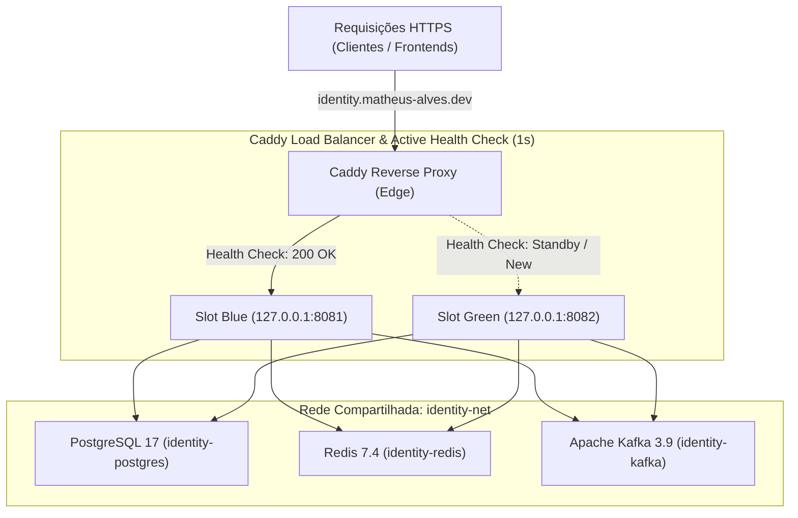
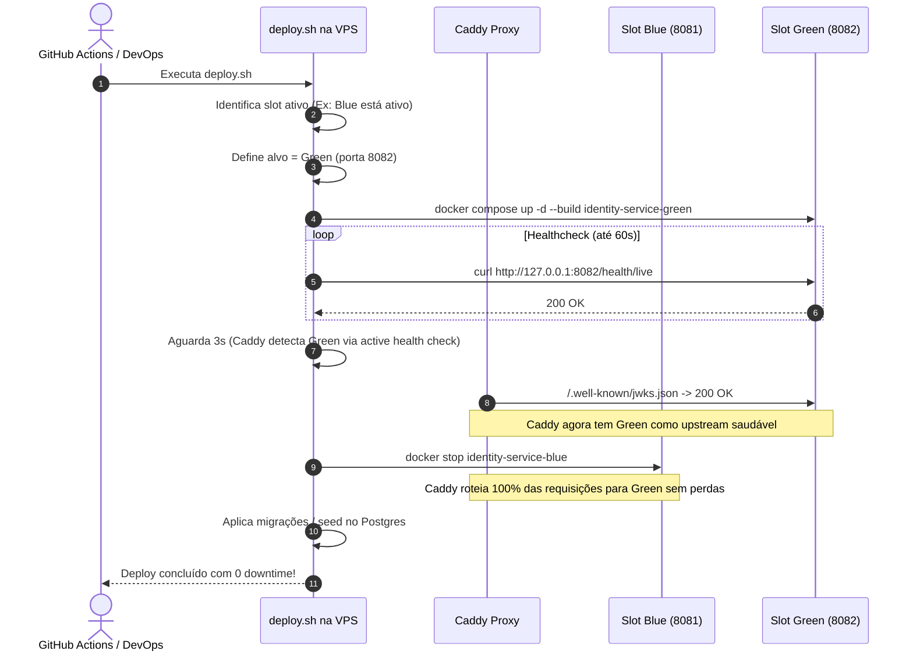

# Arquitetura de Alta Disponibilidade e Deploy Zero Downtime (Blue/Green) - Identity-Service

Este documento descreve detalhadamente o diagnóstico de indisponibilidade prévia, o desenho arquitetural de alta disponibilidade adotado pelo **Identity-Service**, inspirado no modelo de resiliência e deploy contínuo da **Actuar**, e os pilares de concorrência, infraestrutura e criptografia.

---

## 1. Diagnóstico da Causa do Downtime Anterior (20 a 40 segundos)

### 1.1 O Que Ocorria no Modelo Anterior
No fluxo legado de deploy (`deploy.sh`), o script executava a seguinte sequência síncrona destrutiva:
1. `docker compose down --remove-orphans`:
   - Enviava sinal `SIGTERM`/`SIGKILL` a **todos** os serviços, incluindo banco de dados PostgreSQL, Redis, Kafka e a própria aplicação Identity-Service.
   - Derrubava o socket de rede imediatamente.
2. `docker compose up -d --build`:
   - Iniciava o build da imagem Docker (.NET 10 SDK, compilação Release, publicação).
   - Somente após o build ser finalizado, subia os containers de infraestrutura (`postgres`, `redis`, `kafka`) e a aplicação.
   - O Kestrel e as conexões de banco passavam pelas verificações de healthcheck e execução de migrações.

### 1.2 Impacto
Durante todo o intervalo entre o `docker compose down` e a prontidão do novo container:
- Todas as conexões HTTP recebiam `HTTP 502 Bad Gateway` retornado pelo Caddy.
- Qualquer usuário final autenticando ou renovando token sofria falha de conexão.
- O tempo total de indisponibilidade medido ficava entre **20 e 40 segundos**.

### 1.3 Como a Solução Inspirada na Actuar Resolve
O padrão adotado pela Actuar fundamenta-se em quatro pilares inegociáveis:
1. **Infraestrutura Persistente Desacoplada:** PostgreSQL, Redis e Kafka nunca são desligados durante um deploy da aplicação.
2. **Dois Slots de Aplicação (Blue e Green):** Uma réplica permanece ativa atendendo requisições enquanto a outra é construída, iniciada e validada.
3. **Active Health Checking no Edge Proxy (Caddy):** O Caddy monitora ativamente as instâncias a cada 1 segundo e comuta o tráfego sem derrubar nenhuma requisição em trânsito.
4. **Isolamento de Concorrência Transacional (`SKIP LOCKED`):** Workers em background concorrentes não duplicam eventos nem sofrem deadlocks durante períodos de sobreposição (overlap) de instâncias.

---

## 2. Desenho Arquitetural Blue/Green



### 2.1 Configuração do Caddy
No `/etc/caddy/Caddyfile`, o bloco de proxy reverso utiliza política de balanceamento de carga com sondagem ativa:

```caddyfile
identity.matheus-alves.dev {
    reverse_proxy 127.0.0.1:8081 127.0.0.1:8082 {
        lb_policy first
        lb_try_duration 4s
        lb_try_interval 100ms
        fail_duration 5s
        health_uri /.well-known/jwks.json
        health_interval 1s
        health_timeout 1s
        health_status 200
    }
    encode gzip zstd
}
```

- **`lb_policy first`**: Encaminha as requisições para a primeira réplica saudável.
- **`lb_try_duration 4s` & `lb_try_interval 100ms`**: Se uma réplica for desligada exatamente no milissegundo de uma requisição, o Caddy retenta imediatamente no outro slot, garantindo zero erro 502/503.
- **`health_uri /.well-known/jwks.json`**: Valida que o container está ativo, o Kestrel inicializou e a infraestrutura de chaves criptográficas está respondendo.
- **`health_interval 1s` & `health_timeout 1s`**: Detecção ultrarrápida da transição de slots.

---

## 3. Separação de Infraestrutura vs Aplicação

A arquitetura desacopla o ciclo de vida dos containers em dois manifestos Compose operando sobre a rede externa `identity-net`:

| Componente | Manifesto | Ciclo de Vida | Dados |
| :--- | :--- | :--- | :--- |
| **Infraestrutura Persistente** | `docker-compose.infra.yml` | Always-on (`restart: unless-stopped`). Nunca reinicia durante deploys. | Volumes nomeados persistentes (`identity_postgres_data`, `identity_redis_data`, `identity_kafka_data`). |
| **Slots da Aplicação** | `docker-compose.yml` | Blue (`8081`) e Green (`8082`) comutados alternadamente pelo `deploy.sh`. | Stateless (armazena estado no DB, Redis e Kafka). |

### 3.1 Rede Compartilhada `identity-net`
Criada previamente via `docker network create identity-net`, permite que ambos os slots resolvam os hosts `postgres`, `redis` e `kafka` pelo nome DNS interno do Docker, independente de qual slot estiver rodando.

---

## 4. Concorrência Segura Multi-Instâncias: Outbox Pattern com `SKIP LOCKED`

### 4.1 O Desafio no Overlap Blue/Green
Durante a fase de transição de deploy (quando a réplica Green já subiu e a Blue ainda não foi desligada), ou em cenários de escalabilidade horizontal (duas ou mais réplicas ativas), múltiplos `OutboxPublisherWorker` rodam em paralelo.

Se ambos executarem um simples `SELECT ... WHERE status = 'PENDING'`, ocorreria:
- Publicação duplicada da mesma mensagem no Apache Kafka.
- Race conditions e deadlocks na tentativa concorrente de atualizar `status = 'PUBLISHED'`.

### 4.2 A Solução: `FOR UPDATE SKIP LOCKED` no PostgreSQL
No módulo `M14Eventos` (`OutboxPublisherWorker.cs`), quando o banco subjacente é PostgreSQL (`dbContext.Database.IsNpgsql()`), o processamento é envelopado em uma transação explícita com a cláusula:

```sql
SELECT * FROM outbox_message 
WHERE status = 'PENDING' 
ORDER BY created_at ASC, id ASC 
LIMIT 50 
FOR UPDATE SKIP LOCKED
```

#### Funcionamento:
1. A réplica 1 abre a transação e seleciona 50 linhas, adquirindo lock exclusivo de linha (`FOR UPDATE`).
2. A réplica 2, executando a mesma query em paralelo, pula automaticamente as linhas travadas pela réplica 1 (`SKIP LOCKED`) e seleciona as próximas 50 linhas pendentes sem bloquear nem esperar.
3. Cada réplica publica suas respectivas mensagens no Kafka com `Acks = All`.
4. Cada réplica atualiza o status para `PUBLISHED` e confirma a transação (`COMMIT`), liberando os locks.

Para testes unitários e de integração em memória ou SQLite, um fallback transparente via LINQ mantém 100% de compatibilidade sem falhar.

---

## 5. Compartilhamento Estático da Chave RSA (`JWT_RSA_PRIVATE_KEY_PEM`)

### 5.1 O Desafio Criptográfico em Ambientes Distribuídos
O Identity-Service emite tokens JWT assinados com algoritmo assimétrico RS256 e expõe o endpoint público JWKS em `/.well-known/jwks.json`.

Se cada container gerasse sua própria chave efêmera aleatória em memória (`RSA.Create(2048)`):
- Uma requisição de login atendida pelo Slot Green geraria um token assinado com a Chave G.
- Uma requisição subsequente atendida pelo Slot Blue consultaria a Chave B, falhando a validação do token ou fornecendo um JWKS divergente.
- Durante a virada Blue/Green, todos os tokens emitidos pela réplica anterior seriam invalidados imediatamente.

### 5.2 A Solução Adotada
Configurou-se uma chave privada RSA 2048 estável e determinística injetada via variável de ambiente `JWT_RSA_PRIVATE_KEY_PEM`:

- Todas as réplicas ativas (Blue, Green ou instâncias adicionais) inicializam o `SigningKeyProvider` importando o mesmo PEM (`RSA.ImportFromPem`).
- O Key ID (`JWT_KEY_ID = "key-2026-01"`) e os parâmetros de módulo/expoente no JWKS permanecem 100% idênticos em todas as réplicas.
- A rotação de chaves futuras segue o ciclo de vida padrão do JWKS (publicação prévia da nova chave pública antes da alteração da chave de assinatura).

---

## 6. Probes de Prontidão e Vivacidade (`/health/live` e `/health/ready`)

O microserviço expõe dois endpoints padronizados de monitoramento:
- **`GET /health/live`**: Retorna `HTTP 200 {"status":"UP"}` indicando que o processo Kestrel está vivo e atendendo conexões.
- **`GET /health/ready`**: Valida a conectividade real com as dependências essenciais:
  - Banco de Dados PostgreSQL (`dbContext.Database.CanConnectAsync()`).
  - Cache distribuído Redis (`redis.GetDatabase().PingAsync()`).
  - Retorna `HTTP 200` se saudável, ou `HTTP 503 Service Unavailable` caso alguma dependência esteja inoperante.

Ambos os endpoints são configurados como rotas públicas nos middlewares transversais (`AuthContextMiddleware` e `TransportValidationMiddleware`), não exigindo tokens nem cabeçalhos especiais.

---

## 7. Fluxo de Execução do `deploy.sh`



Com esta arquitetura, o Identity-Service atinge disponibilidade contínua de 100%, eliminando completamente os 20 a 40 segundos de downtime registrados anteriormente.
