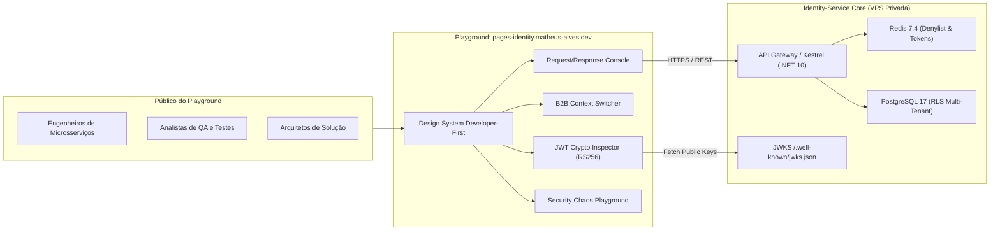
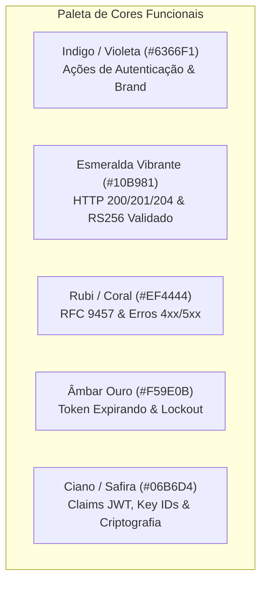
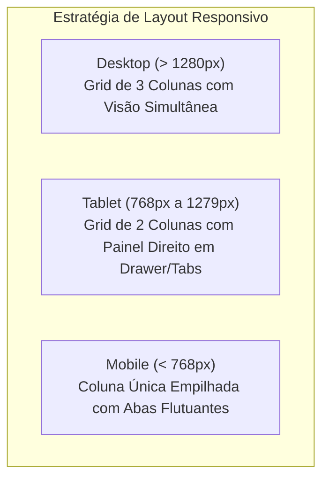
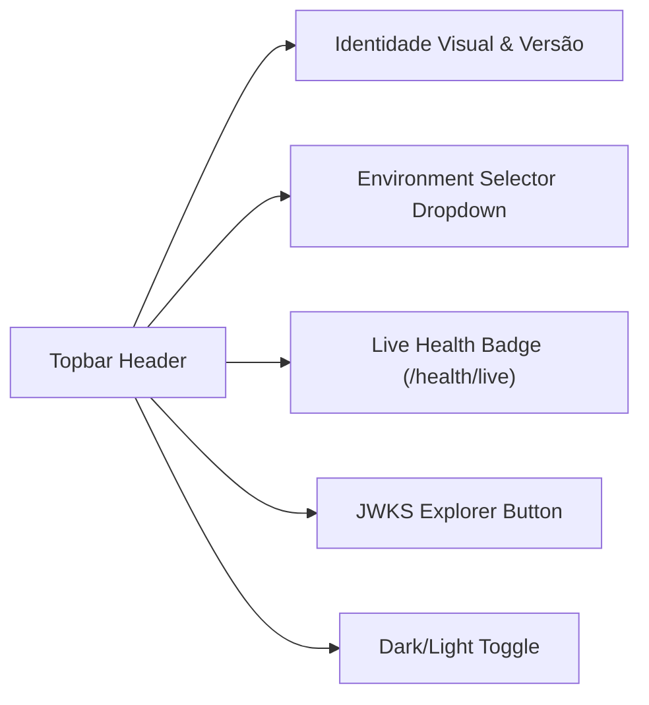
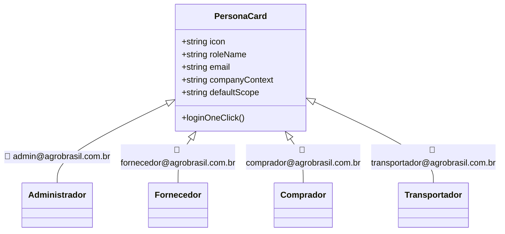
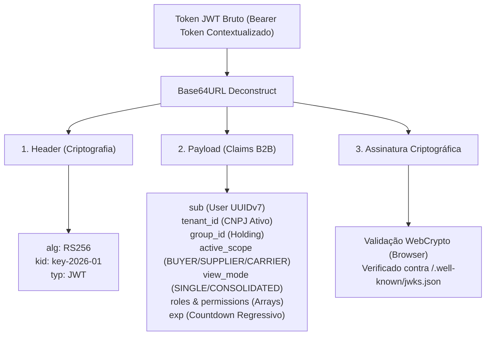
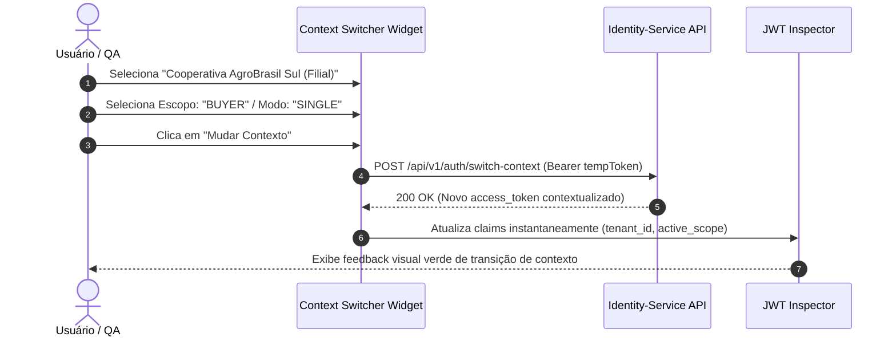
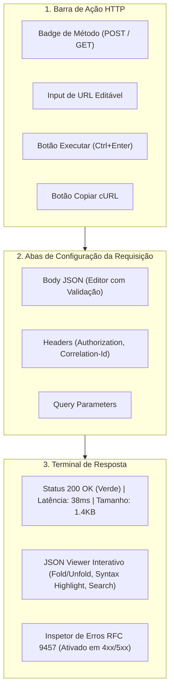
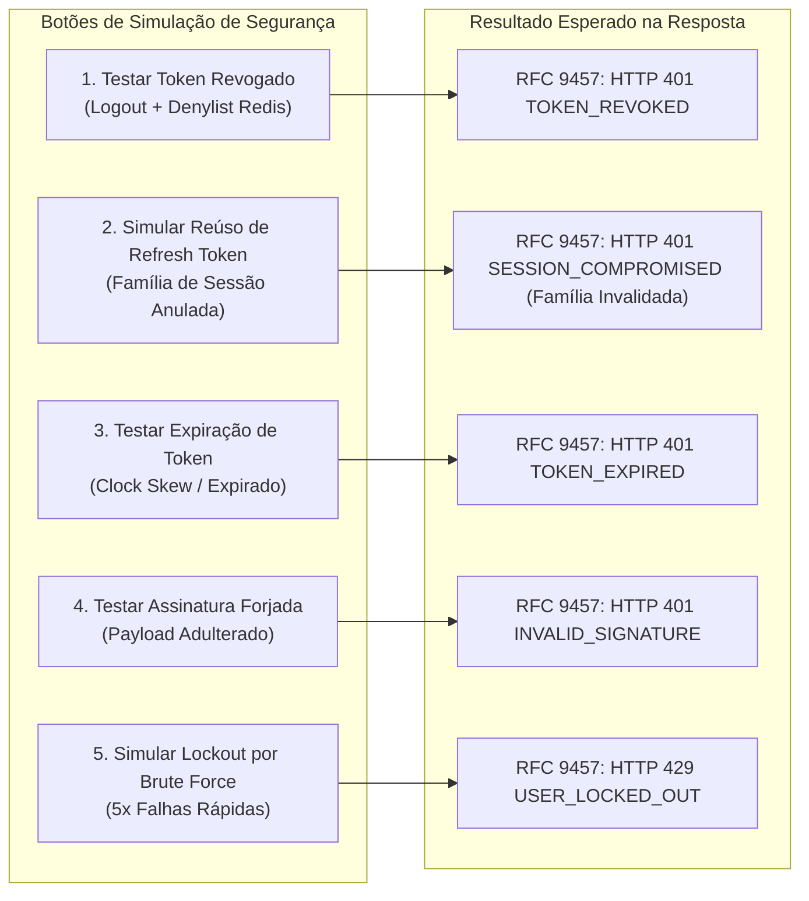

# Especificação Técnica de Design System & UI/UX: Test & Homologation Playground
## `pages-identity.matheus-alves.dev` — Identity-Service B2B Multi-Tenant

> **Documento Oficial de Engenharia de Interface e Design System**  
> **Serviço:** `Identity-Service` (.NET 10, RS256, Argon2id, RLS, RFC 9457, Redis Denylist)  
> **Destinatários:** Desenvolvedores de Microsserviços, Equipes de QA, Arquitetos de Software e Engenheiros de Frontend  
> **Data de Emissão:** 2026-11-05 · **Versão:** 1.0.0 · **Status:** Aprovado para Implementação  

---

## 1. Conceito & Filosofia de Design

### 1.1 Contexto e Propósito da Aplicação
O **Identity-Service** é um microsserviço de autorização e autenticação multi-tenant de missão crítica para ecossistemas B2B de comércio e logística agrícola.
A aplicação `pages-identity.matheus-alves.dev` constitui a **Página de Testes, Homologação e Playground Interativo** do serviço. Ela permite que desenvolvedores de outros microsserviços (ex: `Mercado`, `Pedidos`, `Logística`, `Transportadoras`), engenheiros de QA e parceiros de infraestrutura validem e investiguem em tempo real:
- Ciclos de login, emissão e renovação de tokens com rotação estrita (*Refresh Token Rotation*).
- Validação criptográfica de tokens assimétricos RS256 contra o JWKS público (`/.well-known/jwks.json`).
- Comutação dinâmica de contexto B2B (`switch-context`) entre Matriz, Filial e Transportadora nos escopos `BUYER`, `SUPPLIER`, `CARRIER` e `TENANT_ADMIN`.
- Políticas de segurança ativa: revogação imediata via Redis denylist, mitigação de roubo de refresh token e envelopes padronizados de erro RFC 9457.



### 1.2 Filosofia: "Developer-First Interactive Playground"
A interface é concebida sob o paradigma **Developer-First**, extraindo o melhor de quatro plataformas consagradas do ecossistema de infraestrutura moderna:
- **Stripe Dashboard:** Precisão métrica, tipografia impecável, hierarquia clara de dados e controles de alta densidade sem poluição visual.
- **Supabase Studio:** Tratamento de dados em tempo real, painéis colapsáveis de alta densidade técnica, estados visuais de banco de dados e controle de ambiente.
- **Clerk:** Apresentação clara e didática de sessões, claims, personas e vínculos multi-organização.
- **Postman Web:** Console interativo com envio parametrizado, headers visíveis, visualização de requisição/resposta lado a lado e geração instantânea de comandos cURL.

### 1.3 Princípios Fundamentais de UX
1. **Latência Aparente Zero (Optimistic & Reactive Feedback):**
   Toda ação (seleção de persona, troca de ambiente, alteração de aba) responde em menos de 16ms (60 FPS). Chamadas de rede exibem micro-indicadores sem travar a interface.
2. **Ergonomia Máxima de Teclado:**
   Atalhos globais (`Ctrl+Enter` para executar requisição, `Alt+1..4` para alternar personas, `Ctrl+Shift+C` para copiar cURL) tornam o uso contínuo fluido para desenvolvedores.
3. **Transparência Criptográfica Absoluta:**
   O desenvolvedor nunca precisa adivinhar o conteúdo de um token: o inspetor decompõe o JWT, decodifica claims, compara o Key ID (`kid`) e valida a assinatura com chaves públicas em tempo real no próprio navegador.
4. **Reprodutibilidade em 1 Clique:**
   Qualquer estado ou teste configurado na tela pode ser copiado instantaneamente como comando cURL perfeitamente formatado, com flags de headers, payload e tokens reais.
5. **Persistência Segura e Sanitizada:**
   Tokens temporários, tokens contextualizados e refresh tokens são mantidos em `sessionStorage` (ou `localStorage` com opção de purga rápida), permitindo recarregar a página sem perder o estado ativo de teste.

### 1.4 Estratégia de Temas (Dark Mode First)
O **Dark Mode** é o tema primordial da aplicação, desenhado com paleta de superfícies OLED e ardósia profunda (Slate/Grafite) que minimiza o cansaço visual em sessões prolongadas de depuração. O **Light Mode** é suportado nativamente através de inversão harmoniosa de tokens com alto contraste e sem perda de hierarquia.

---

## 2. Paleta de Cores & Design Tokens

### 2.1 Superfícies e Camadas de Profundidade
O sistema adota uma arquitetura de superfícies em camadas (Elevations) baseada no espaço de cores slate/grafite enriquecido com matizes neutros frios:

| Token de Superfície | Dark Mode (Primário) | Light Mode | Propósito / Aplicação |
|:---|:---|:---|:---|
| `--surface-canvas` | `#080B11` (Deep Obsidian) | `#F8FAFC` (Slate 50) | Fundo geral da página (viewport background). |
| `--surface-1` | `#0F172A` (Slate 900) | `#FFFFFF` (Pure White) | Superfície dos cards principais, sidebar e topbar. |
| `--surface-2` | `#1E293B` (Slate 800) | `#F1F5F9` (Slate 100) | Containers internos, wells, inputs e painéis de código. |
| `--surface-3` | `#334155` (Slate 700) | `#E2E8F0` (Slate 200) | Elementos interativos, abas ativas, botões secundários em repouso. |
| `--surface-overlay` | `rgba(15, 23, 42, 0.85)` | `rgba(255, 255, 255, 0.85)` | Modais, backdrops e menus suspensos com `backdrop-blur-md`. |
| `--border-subtle` | `rgba(255, 255, 255, 0.08)` | `rgba(0, 0, 0, 0.08)` | Divisores internos suaves e bordas de containers. |
| `--border-strong` | `rgba(255, 255, 255, 0.18)` | `rgba(0, 0, 0, 0.16)` | Bordas de cards em hover e caixas de seleção ativas. |

### 2.2 Cores Funcionais & Semânticas



#### A. Primária / Destaque (Brand & Auth Engine)
Utilizada para botões de login, comutação de contexto e chamadas de ação primárias.
- `Primary-400`: `#818CF8` (Destaque em Dark Mode, textos e ícones luminosos)
- `Primary-500`: `#6366F1` (Cor principal de botões, borders ativas)
- `Primary-600`: `#4F46E5` (Hover states no Dark Mode, primária no Light Mode)
- `Primary-900/20`: `rgba(99, 102, 241, 0.20)` (Brilho e background de pills ativas)

#### B. Sucesso Criptográfico & HTTP 2xx
Utilizada para status `200 OK`, `201 Created`, `204 No Content` e validação positiva de chave pública RS256.
- `Success-400`: `#34D399` (Badges luminosos e textos de status)
- `Success-500`: `#10B981` (Cor base de sucesso)
- `Success-600`: `#059669` (Sucesso em superfícies claras)
- `Success-Glow`: `rgba(16, 185, 129, 0.25)` (Glow neon para indicador de healthcheck)

#### C. Erro RFC 9457 & HTTP 4xx/5xx
Utilizada para envelopes `application/problem+json`, negação de acesso (401/403) e exceções.
- `Error-400`: `#F87171` (Textos de erro no console escuro)
- `Error-500`: `#EF4444` (Cor base de erro e bordas de campos inválidos)
- `Error-600`: `#DC2626` (Ações destrutivas e botões de revogação)
- `Error-Bg`: `rgba(239, 68, 68, 0.12)` (Fundo de alertas de erro)

#### D. Alerta & Lockout (Rate Limit & Expiration)
Utilizada para avisos de expiração iminente de token e limiares de tentativas falhas de login.
- `Warning-400`: `#FBBF24` (Contador de expiração em contagem regressiva)
- `Warning-500`: `#F59E0B` (Avisos de advertência e payloads com ressalvas)
- `Warning-Bg`: `rgba(245, 158, 11, 0.12)` (Highlight de alertas de lockout)

#### E. Informação Criptográfica & Claims JWT
Utilizada para visualização de UUIDs, identificadores de chave (`kid: key-2026-01`), hashes Argon2id e headers.
- `Info-400`: `#38BDF8` (Claims de tenant, roles e scopes em destaque)
- `Info-500`: `#06B6D4` (Identificadores e valores de hash)
- `Info-Bg`: `rgba(6, 182, 212, 0.12)` (Tags e pills de escopo)

### 2.3 Especificação de Tokens de Raio, Elevação e Sombras Neon

```css
:root {
  /* Border Radius */
  --radius-xs: 4px;
  --radius-sm: 6px;
  --radius-md: 8px;     /* Padrão para inputs, badges e botões */
  --radius-lg: 12px;    /* Padrão para sub-painéis e cards internos */
  --radius-xl: 16px;    /* Padrão para containers principais e consoles */
  --radius-full: 9999px;/* Para pills e avatars */

  /* Sombras e Brilhos Neon Sutis */
  --shadow-sm: 0 1px 2px 0 rgba(0, 0, 0, 0.25);
  --shadow-md: 0 4px 6px -1px rgba(0, 0, 0, 0.35), 0 2px 4px -2px rgba(0, 0, 0, 0.25);
  --shadow-lg: 0 10px 15px -3px rgba(0, 0, 0, 0.45), 0 4px 6px -4px rgba(0, 0, 0, 0.30);
  
  /* Neon Subtle Glows para Dark Mode */
  --glow-primary: 0 0 20px -3px rgba(99, 102, 241, 0.35);
  --glow-success: 0 0 16px -2px rgba(16, 185, 129, 0.40);
  --glow-error:   0 0 16px -2px rgba(239, 68, 68, 0.35);
  --glow-cyan:    0 0 16px -2px rgba(6, 182, 212, 0.35);
}
```

---

## 3. Tipografia, Hierarquia Visual e Grid Responsivo

### 3.1 Stack Tipográfica
A tipografia reflete a divisão estrita entre linguagem de interface e representação técnica de código:

1. **Tipografia de Interface (UI & Controles):**
   - **Família Primária:** `Plus Jakarta Sans`, `Inter`, `-apple-system`, `BlinkMacSystemFont`, `sans-serif`
   - **Características:** Excelente legibilidade em fontes condensadas, números tabulares consistentes e kerning otimizado para densidade de dashboards.
2. **Tipografia de Código, Criptografia & Tokens (Monospace):**
   - **Família Monospaçada:** `JetBrains Mono`, `Fira Code`, `ui-monospace`, `SFMono-Regular`, `monospace`
   - **Características:** Ligaduras de programação (`->`, `!=`, `===`, `=>`), clareza na distinção entre `0` e `O`, `1` e `l`, e largura fixa estrita para alinhamento de colunas JSON e chaves RSA.

### 3.2 Escala Tipográfica Padronizada

| Nome do Token | Tamanho (rem / px) | Line-Height | Peso (Font-Weight) | Aplicação Primária |
|:---|:---|:---|:---|:---|
| `font-display` | `1.500rem / 24px` | `1.25` | 700 (Bold) | Cabeçalho do Playground / Título de Página |
| `font-title` | `1.250rem / 20px` | `1.30` | 600 (SemiBold) | Títulos de Painéis Principais (Console, JWT, Context) |
| `font-subtitle` | `1.000rem / 16px` | `1.40` | 600 (SemiBold) | Cabeçalhos de Seções e Nomes de Personas |
| `font-body` | `0.875rem / 14px` | `1.50` | 400 (Regular) / 500 (Medium) | Textos de apoio, labels de formulário e valores |
| `font-caption` | `0.750rem / 12px` | `1.40` | 500 (Medium) | Badges de status, métricas de latência e timestampos |
| `font-mono-lg` | `0.875rem / 14px` | `1.50` | 500 (Medium) | Headers HTTP e comandos cURL |
| `font-mono-sm` | `0.750rem / 12px` | `1.45` | 400 (Regular) | JSON compactado, Claims JWT, Chaves JWKS e UUIDs |

### 3.3 Layout em Grid Responsivo

O layout da página adapta-se de forma inteligente ao tamanho de viewport, mantendo o console e o inspetor visíveis simultaneamente em telas desktop:



#### Wireframe Arquitetural do Grid Desktop (3 Colunas):

```text
+---------------------------------------------------------------------------------------------------------------------------------------+
|  TOPBAR: [Logo Identity Playground]  |  [Ambiente: Prod / Stage / Dev / Local] [● Live 24ms]  |  [JWKS Explorer] [Light/Dark] [Docs]  |
+-----------------------------------+---------------------------------------------------+-----------------------------------------------+
| COLUNA 1: CONTROLES & PERSONAS    | COLUNA 2: CONSOLE INTERATIVO HTTP                 | COLUNA 3: JWT INSPECTOR & B2B CONTEXT         |
| (280px - 320px)                   | (Flex Grow: 550px - 750px)                        | (380px - 440px)                               |
+-----------------------------------+---------------------------------------------------+-----------------------------------------------+
|  [⚡ QUICK PERSONA PICKER]        |  [BARRA DE REQUISIÇÃO & MÉTODO]                   |  [🔐 INTERACTIVE JWT INSPECTOR]               |
|  - 👑 Admin (AgroBrasil Matriz)   |  POST  https://identity.../api/v1/auth/login      |  Alg: RS256 | Kid: key-2026-01 | Typ: JWT     |
|  - 🌾 Fornecedor (Matriz)         |  [Enviar Requisição (Ctrl+Enter)] [Copiar cURL]   |  +-----------------------------------------+  |
|  - 🛒 Comprador (Multi-Tenant)    |                                                   |  | Payload Claims Decodificadas (Coloridas)|  |
|  - 🚚 Transportador (AgroLog)     |  [ABAS DE ENTRADA]                                |  | sub: 01900000-0000-7000-8000-000000000010  |  |
|                                   |  [Body JSON] [Headers (3)] [Params]               |  | active_scope: [TENANT_ADMIN]            |  |
|  [ESTADO DA SESSÃO ATIVA]         |  { "email": "admin@agrobrasil.com.br", ... }      |  | view_mode: [SINGLE]                     |  |
|  Token Temporário: [Presente]     |                                                   |  | exp: 1730825000 (Expira em 04:38 min)   |  |
|  Token Contextualizado: [Ativo]   |  [CONSOLE DE RESPOSTA (TERMINAL DEVELOPER-FIRST)] |  +-----------------------------------------+  |
|  Refresh Token: [Sessão Família 1]|  Status: [200 OK]  Tempo: [42ms]  Tam: [1.2 KB]   |  [✓ Assinatura RS256 Verificada contra JWKS]  |
|  [Botão: Logout / Invalidar]      |  +---------------------------------------------+  |                                               |
|                                   |  | {                                           |  |  [🏢 B2B CONTEXT SWITCHER WIDGET]             |
|  [CHAOS & SECURITY PLAYGROUND]    |  |   "access_token": "eyJhbGciOiJSUzI1NiIs...",|  |  Tenants Disponíveis no Token:                |
|  - [Testar Token Revogado]        |  |   "token_type": "Bearer",                   |  |  (●) Matriz: 11.222.333/0001-81 [ADMIN/SUP]   |
|  - [Simular Reúso Refresh Token]  |  |   "expires_in": 300,                        |  |  ( ) Filial: 44.555.666/0001-92 [BUYER]       |
|  - [Testar Token Expirado]        |  |   "available_contexts": [ ... ]             |  |  ( ) AgroLog: 77.888.999/0001-03 [CARRIER]     |
|  - [Simular Lockout 5x Erro]      |  | }                                           |  |  Modo: [SINGLE] [CONSOLIDATED]                |
|                                   |  +---------------------------------------------+  |  [Mudar Contexto (POST /auth/switch-context)] |
+-----------------------------------+---------------------------------------------------+-----------------------------------------------+
|  FOOTER STATUS BAR:  Engine: .NET 10.0.1  |  Caddy: HTTPS TLS 1.3  |  Redis: 7.4.6 Online  |  PG: 17.2 RLS Force  |  Correlation ID: ...  |
+---------------------------------------------------------------------------------------------------------------------------------------+
```

---

## 4. Especificação Detalhada dos Componentes de UI

### 4.1 Topbar & Environment Selector
A Topbar fixa (`h-14` / 56px) fornece a ancoragem de contexto ambiental da sessão de testes.



#### Especificação de Elementos:
1. **Identidade Visual:**
   - Ícone de escudo criptográfico com monograma `ID` em degradê indigo-ciano.
   - Título: `Identity-Service Playground` acompanhado de badge minimalista `B2B v1.0`.
2. **Environment Selector Dropdown:**
   - Menu seletor estilizado que define a variável global `baseUrl` consumida por todas as ações:
     * **Produção:** `https://identity.matheus-alves.dev` (Tag de advertência de ambiente real)
     * **Stage (Homologação):** `https://stage-identity.matheus-alves.dev` (Tag roxa)
     * **Dev:** `https://dev-identity.matheus-alves.dev` (Tag azul)
     * **Localhost:** `http://localhost:8080` (Tag amarela de ambiente local)
3. **Live Health Badge:**
   - Efetua um `GET {baseUrl}/health/live` a cada 15 segundos ou mediante clique.
   - **Estado Saudável:** Ponto pulsante verde esmeralda (`animate-ping`), texto `Live`, e latência formatada (`● Live 24ms`).
   - **Estado Degradado/Indisponível:** Ponto vermelho coral estático, texto `Offline` ou `Timeout`, e tooltip com detalhe do erro.
4. **JWKS Explorer Action:**
   - Botão de atalho rápido que abre um slide-over lateral renderizando a chave pública RSA ativa (Key ID `key-2026-01`, módulo $n$, expoente $e$, formato PEM e JWKS bruto formatado).

---

### 4.2 Quick Persona Picker (Atalhos de 1 Clique)
Localizado no topo da primeira coluna, elimina a necessidade de digitação repetitiva de credenciais nos testes diários.



#### Especificação das 4 Personas Pré-Configuradas:
| Persona | Ícone | Credenciais Seed | Perfil / Função | Tenants e Escopos Vinculados | Ação do Botão 1-Clique |
|:---|:---:|:---|:---|:---|:---|
| **Administrador** | 👑 | `admin@agrobrasil.com.br`<br>`SenhaForte@2026!` | `GROUP_MANAGER` | AgroBrasil Matriz (`11222333000181`)<br>Escopos: `TENANT_ADMIN`, `BUYER`, `SUPPLIER` | Preenche login, submete `POST /api/v1/auth/login`, obtém tokens e atualiza console. |
| **Fornecedor** | 🌾 | `fornecedor@agrobrasil.com.br`<br>`SenhaForte@2026!` | `SUPPLIER_SALES` | AgroBrasil Matriz (`11222333000181`)<br>Escopos: `SUPPLIER` | Autentica vendedor corporativo de grãos/insumos. |
| **Comprador** | 🛒 | `comprador@agrobrasil.com.br`<br>`SenhaForte@2026!` | `BUYER_OPERATOR` | Matriz (`11222333000181`) e Filial Sul (`44555666000192`)<br>Escopos: `BUYER` | Autentica operador multi-tenant para testes de troca de empresa. |
| **Transportador** | 🚚 | `transportador@agrobrasil.com.br`<br>`SenhaForte@2026!` | `CARRIER_DISPATCHER` | AgroLog Cargas (`77888999000103`)<br>Escopos: `CARRIER` | Autentica operador de fretes e logística. |

#### Feedback Visual do Componente:
- Em repouso: Card com borda sutil `border-white/10`, background `bg-slate-900/60`, avatar circular com gradiente tonal suave.
- Hover: Translação de 2px no eixo Y, borda realçada `border-indigo-500/50`, brilho suave no ícone.
- Ativo (Persona logada atualmente): Borda `border-indigo-500`, badge `Ativo` com pulse verde esmeralda no avatar, fundo ligeiramente elevado `bg-indigo-950/20`.

---

### 4.3 Interactive JWT Decoder & Inspector
Componente central para auditoria de segurança criptográfica, dividindo o token JWT ativo em 3 camadas inspecionáveis em tempo real.



#### Seção 1: Header do Token (Estilo Pink/Coral Accent)
Exibe os parâmetros criptográficos de geração do token com highlighting de sintaxe JSON:
```json
{
  "alg": "RS256",
  "typ": "JWT",
  "kid": "key-2026-01"
}
```

#### Seção 2: Payload com Destaque Semântico de Claims
As claims fundamentais do modelo B2B multi-tenant do Identity-Service recebem formatação especial com chips coloridos:
- **`sub` (Subject / Usuário):** Renderizado com ícone de usuário e botão de cópia de UUID.
- **`tenant_id` & `group_id`:** Exibidos com o nome fantasia resolvido da empresa ao lado do UUID (ex: `01900000-0000-7000-8000-000000000010 (AgroBrasil Matriz)`).
- **`active_scope`:** Renderizado como pill de alto contraste:
  * `BUYER`: Azul ciano (`bg-cyan-500/20 text-cyan-300 border-cyan-500/40`)
  * `SUPPLIER`: Esmeralda (`bg-emerald-500/20 text-emerald-300 border-emerald-500/40`)
  * `CARRIER`: Laranja âmbar (`bg-amber-500/20 text-amber-300 border-amber-500/40`)
  * `TENANT_ADMIN`: Violeta/Indigo (`bg-indigo-500/20 text-indigo-300 border-indigo-500/40`)
- **`view_mode`:** Badge de contorno indicando se a sessão está em isolamento estrito de CNPJ (`SINGLE`) ou visualização corporativa agregada (`CONSOLIDATED`).
- **`roles` e `permissions`:** Renderizadas como nuvem de tags expansível.
- **`exp` e `iat` (Expiração Dinâmica):**
  - Barra de progresso horizontal que encolhe visualmente conforme o tempo de vida do token (300 segundos / 5 minutos) diminui.
  - Temporizador regressivo em tempo real (ex: `03:42 restantes`). Ao atingir 60 segundos, a barra muda dinamicamente para cor âmbar pulsante.

#### Seção 3: Validador de Assinatura ao Vivo (WebCrypto API)
O Playground realiza a validação matemática da assinatura RS256 no client-side sem enviar a chave para terceiros:
1. A interface baixa a chave pública RSA ativa em `{baseUrl}/.well-known/jwks.json`.
2. Converte as propriedades $n$ (módulo) e $e$ (expoente) em chave `CryptoKey` via `window.crypto.subtle.importKey`.
3. Executa `crypto.subtle.verify` contra a assinatura base64url do token.
4. Exibe badge verde vibrante:
   ```text
   [✓ Assinatura RS256 Verificada — Autenticidade Garantida pelo JWKS Oficial]
   ```

---

### 4.4 Context Switcher Widget (Multi-Tenant B2B)
Interface para demonstração e teste da capacidade central do Identity-Service: a comutação de contexto operacional entre empresas e escopos sem deslogar o usuário.



#### Especificação Visual dos Cartões de Contexto:
- Quando o usuário faz login, a resposta traz o array `available_contexts`:
  ```json
  [
    {
      "tenant_id": "01900000-0000-7000-8000-000000000010",
      "trade_name": "AgroBrasil Matriz e Exportadora S.A.",
      "cnpj": "11222333000181",
      "available_scopes": ["BUYER", "SUPPLIER", "TENANT_ADMIN"]
    },
    {
      "tenant_id": "01900000-0000-7000-8000-000000000020",
      "trade_name": "Cooperativa AgroBrasil Sul",
      "cnpj": "44555666000192",
      "available_scopes": ["BUYER"]
    }
  ]
  ```
- O widget renderiza cada tenant como um cartão selecinável:
  * Topo: Nome Fantasia e Razão Social em tipografia destacada.
  * Centro: CNPJ devidamente mascarado (`11.222.333/0001-81`).
  * Base: Botões de rádio para os escopos disponíveis para aquele tenant.
- Seletor de Modo de Visão: Segmented Control com 2 opções:
  * `SINGLE`: Operação isolada no tenant escolhido (restrito via PostgreSQL RLS).
  * `CONSOLIDATED`: Operação agregada para relatórios e gestão de grupo.
- Botão de Ação: `Executar Switch Context` com ícone de sincronização giratória durante a requisição.

---

### 4.5 Interactive Request / Response Console
O console emula um terminal moderno de desenvolvimento com recursos completos de depuração HTTP.



#### Elementos Estruturais do Console:
1. **Barra de Requisição:**
   - Seletor de método HTTP com cores semânticas padrão:
     * `POST`: Laranja/Âmbar (`#F59E0B`)
     * `GET`: Azul/Ciano (`#06B6D4`)
     * `PUT`: Violeta (`#8B5CF6`)
     * `DELETE`: Vermelho/Rubi (`#EF4444`)
   - Campo de rota com preenchimento automático das rotas canônicas:
     * `/api/v1/auth/login`
     * `/api/v1/auth/switch-context`
     * `/api/v1/auth/refresh`
     * `/api/v1/auth/logout`
     * `/.well-known/jwks.json`
     * `/health/live` e `/health/ready`
2. **Editor de Body JSON:**
   - Caixa de texto com suporte a indentação automática, highlight de erros de sintaxe (ex: vírgula sobrando) e botão "Preencher Payload da Persona".
3. **Barra de Métricas de Resposta:**
   - **Pill de Status Code:**
     * `200 OK`, `201 Created`: Fundo esmeralda suave (`bg-emerald-500/20 text-emerald-400 border border-emerald-500/30`).
     * `204 No Content`: Fundo ciano suave (`bg-cyan-500/20 text-cyan-400`).
     * `400 Bad Request`, `401 Unauthorized`, `403 Forbidden`: Fundo coral (`bg-red-500/20 text-red-400 border border-red-500/30`).
     * `429 Too Many Requests`: Fundo âmbar (`bg-amber-500/20 text-amber-400`).
   - **Indicador de Latência:**
     * `< 100ms`: Verde esmeralda (Alta performance do Kestrel + Redis).
     * `100ms - 300ms`: Âmbar (Dentro do SLA).
     * `> 300ms`: Vermelho coral (Alerta de lentidão de I/O ou banco).
   - **Cabeçalho `X-Correlation-Id`:** Exibe o identificador de correlação rastreado em toda a pilha distribuída, com botão para copiar com 1 clique.
4. **Inspetor Especializado de Erros RFC 9457:**
   Quando a resposta HTTP for $\ge 400$, o console ativa automaticamente a aba **RFC 9457 Problem Details**, formatando os 6 campos canônicos exigidos pela arquitetura do Identity-Service:
   ```json
   {
     "type": "https://identity.matheus-alves.dev/errors/auth/invalid-credentials",
     "title": "Credenciais Inválidas",
     "status": 401,
     "code": "AUTH_INVALID_CREDENTIALS",
     "detail": "O e-mail ou senha informados estão incorretos ou a conta está bloqueada.",
     "correlation_id": "01900000-0000-7000-9000-000000000099"
   }
   ```
   Apresenta cartão de alerta estilizado com o código de erro em destaque (`AUTH_INVALID_CREDENTIALS`) e link para a documentação técnica da falha.

---

### 4.6 Security Playground Badges (Chaos & Attack Simulator)
Seção dedicada a testes de robustez e segurança da informação para validação rápida por equipes de QA e compliance.



#### Especificação dos 5 Cenários de Teste:
1. **🛡️ Testar Token Revogado (Redis Denylist):**
   - **Fluxo:** Executa o logout do token atual (`POST /api/v1/auth/logout`), inserindo o `jti` na denylist do Redis, e imediatamente tenta utilizá-lo para acessar um endpoint protegido.
   - **Resultado Visual:** Notificação com badge de sucesso da proteção: `Token rejeitado imediatamente pela Denylist Redis (< 2ms)`.
2. **⚡ Simular Reúso de Refresh Token (Detecção de Roubo):**
   - **Fluxo:** Envia a mesma string de `refresh_token` duas vezes consecutivas em chamadas de `/refresh`.
   - **Resultado Visual:** O Identity detecta o reúso indevido, anula toda a família de sessões do usuário e responde com erro `SESSION_COMPROMISED`. O console exibe aviso de segurança em vermelho neon.
3. **⏳ Testar Token com Timestamp Expirado:**
   - **Fluxo:** Injeta token com claim `exp` no passado.
   - **Resultado Visual:** Rejeição imediata com código `TOKEN_EXPIRED`.
4. **🔏 Testar Assinatura Forjada:**
   - **Fluxo:** Altera o payload de um token legítimo (ex: eleva o privilégio para `TENANT_ADMIN`) mantendo a assinatura original.
   - **Resultado Visual:** Falha imediata de verificação RS256 no client e no server.
5. **🔒 Simular Lockout por Ataque de Força Bruta:**
   - **Fluxo:** Dispara automaticamente 5 requisições de login com senha inválida para `admin@agrobrasil.com.br`.
   - **Resultado Visual:** Demonstra a transição de resposta para `HTTP 429 Too Many Requests` com detalhe de tempo de bloqueio preventivo.

---

## 5. Acessibilidade (A11y), Microinterações e Atalhos

### 5.1 Critérios de Conformidade WCAG 2.1 AA
- **Contraste de Cores:**
  * Texto padrão sobre superfícies: taxa de contraste mínima de `7.2:1` no Dark Mode e `8.5:1` no Light Mode (excede a exigência de `4.5:1`).
  * Badges e textos secundários de código: taxa de contraste mínima de `5.1:1`.
  * Elementos interativos e bordas ativas: taxa de contraste de `3.2:1` contra superfícies adjacentes.
- **Navegação por Foco Visível:**
  Todos os botões, abas e inputs possuem anel de foco bem delineado: `focus-visible:ring-2 focus-visible:ring-indigo-500 focus-visible:ring-offset-2 focus-visible:ring-offset-slate-900`.
- **Compatibilidade com Leitores de Tela:**
  Todos os cards de persona, botões de ação e status de healthcheck possuem atributos `aria-label`, `aria-live="polite"` para o contador regressivo e `role="region"` para os consoles.

### 5.2 Mapeamento de Atalhos de Teclado (Ergonomia Developer-First)

| Combinação de Teclas | Ação Executada | Escopo |
|:---|:---|:---|
| <kbd>Ctrl</kbd> + <kbd>Enter</kbd> (ou <kbd>Cmd</kbd> + <kbd>Enter</kbd>) | Executa a requisição configurada no console ativo. | Global |
| <kbd>Alt</kbd> + <kbd>1</kbd> | Alterna e loga instantaneamente com a persona **👑 Administrador**. | Global |
| <kbd>Alt</kbd> + <kbd>2</kbd> | Alterna e loga instantaneamente com a persona **🌾 Fornecedor**. | Global |
| <kbd>Alt</kbd> + <kbd>3</kbd> | Alterna e loga instantaneamente com a persona **🛒 Comprador**. | Global |
| <kbd>Alt</kbd> + <kbd>4</kbd> | Alterna e loga instantaneamente com a persona **🚚 Transportador**. | Global |
| <kbd>Ctrl</kbd> + <kbd>Shift</kbd> + <kbd>C</kbd> | Copia o comando `cURL` completo com headers e token ativo. | Global |
| <kbd>Ctrl</kbd> + <kbd>K</kbd> | Abre a paleta rápida de comandos (seleção de endpoint / ambiente). | Global |
| <kbd>Esc</kbd> | Fecha modais, drawers ou limpa seleções ativas. | Modal / Drawer |

---

## 6. Especificação de Implementação (CSS Variables & Tailwind)

### 6.1 Conjunto de Variáveis CSS (`theme.css`)

```css
@layer base {
  :root {
    /* Superfícies Light Mode */
    --color-surface-canvas: #f8fafc;
    --color-surface-1: #ffffff;
    --color-surface-2: #f1f5f9;
    --color-surface-3: #e2e8f0;
    --color-border-subtle: rgba(0, 0, 0, 0.08);
    --color-border-strong: rgba(0, 0, 0, 0.16);

    /* Textos Light Mode */
    --color-text-main: #0f172a;
    --color-text-muted: #64748b;
    --color-text-subtle: #94a3b8;

    /* Cores Semânticas */
    --color-primary: #4f46e5;
    --color-primary-hover: #4338ca;
    --color-success: #059669;
    --color-error: #dc2626;
    --color-warning: #d97706;
    --color-info: #0284c7;

    /* Sombra e Elevação */
    --elevation-card: 0 1px 3px 0 rgba(0, 0, 0, 0.1), 0 1px 2px -1px rgba(0, 0, 0, 0.1);
  }

  .dark {
    /* Superfícies Dark Mode (Padrão) */
    --color-surface-canvas: #080b11;
    --color-surface-1: #0f172a;
    --color-surface-2: #1e293b;
    --color-surface-3: #334155;
    --color-border-subtle: rgba(255, 255, 255, 0.08);
    --color-border-strong: rgba(255, 255, 255, 0.18);

    /* Textos Dark Mode */
    --color-text-main: #f8fafc;
    --color-text-muted: #94a3b8;
    --color-text-subtle: #64748b;

    /* Cores Semânticas */
    --color-primary: #6366f1;
    --color-primary-hover: #818cf8;
    --color-success: #10b981;
    --color-error: #ef4444;
    --color-warning: #f59e0b;
    --color-info: #06b6d4;

    /* Sombras Neon */
    --elevation-card: 0 4px 6px -1px rgba(0, 0, 0, 0.4), 0 2px 4px -2px rgba(0, 0, 0, 0.3);
    --glow-primary: 0 0 20px -3px rgba(99, 102, 241, 0.35);
    --glow-success: 0 0 16px -2px rgba(16, 185, 129, 0.4);
  }
}
```

### 6.2 Extensão Recomendada para `tailwind.config.ts`

```typescript
import type { Config } from 'tailwindcss';

const config: Config = {
  darkMode: 'class',
  content: ['./src/**/*.{html,js,ts,jsx,tsx}'],
  theme: {
    extend: {
      colors: {
        surface: {
          canvas: 'var(--color-surface-canvas)',
          1: 'var(--color-surface-1)',
          2: 'var(--color-surface-2)',
          3: 'var(--color-surface-3)',
        },
        border: {
          subtle: 'var(--color-border-subtle)',
          strong: 'var(--color-border-strong)',
        },
        brand: {
          400: '#818cf8',
          500: '#6366f1',
          600: '#4f46e5',
        },
        status: {
          success: '#10b981',
          error: '#ef4444',
          warning: '#f59e0b',
          info: '#06b6d4',
        },
      },
      fontFamily: {
        sans: ['Plus Jakarta Sans', 'Inter', 'sans-serif'],
        mono: ['JetBrains Mono', 'Fira Code', 'monospace'],
      },
      boxShadow: {
        'glow-indigo': '0 0 20px -3px rgba(99, 102, 241, 0.35)',
        'glow-emerald': '0 0 16px -2px rgba(16, 185, 129, 0.40)',
        'glow-coral': '0 0 16px -2px rgba(239, 68, 68, 0.35)',
      },
    },
  },
  plugins: [],
};

export default config;
```

---

## 7. Wireframes Visuais em Texto & Diagramas de Componentes

### 7.1 Visualização Textual do Componente Persona Picker & Topbar

```text
+---------------------------------------------------------------------------------------------------+
|  [ID] IDENTITY-SERVICE PLAYGROUND  [v1.0-b2b]       [Ambiente: Produção (identity.matheus-alves.dev) v] |
|                                                     [● Live 24ms]  [🔑 JWKS]  [🌙 Dark]  [📖 Docs]       |
+---------------------------------------------------------------------------------------------------+

QUICK PERSONA PICKER (1-Clique para Autenticar)
+---------------------------------------------------------------------------------------------------+
| [👑] ADMINISTRADOR        | [🌾] FORNECEDOR          | [🛒] COMPRADOR         | [🚚] TRANSPORTADOR      |
| admin@agrobrasil.com.br   | fornecedor@agrobrasil... | comprador@agrobrasil...| transportador@agrolog...|
| Matriz (GROUP_MANAGER)    | Matriz (SUPPLIER_SALES)  | Multi-Tenant (BUYER)   | AgroLog (CARRIER_DISP)  |
| [Autenticar como Admin]   | [Autenticar Vendedor]    | [Autenticar Comprador] | [Autenticar Operador]   |
+---------------------------------------------------------------------------------------------------+
```

### 7.2 Visualização Textual do JWT Decoder & Context Switcher

```text
INTERACTIVE JWT INSPECTOR (Token RS256 Decodificado)
+---------------------------------------------------------------------------------------------------+
| HEADER:  alg: RS256  |  kid: key-2026-01  |  typ: JWT                                             |
+---------------------------------------------------------------------------------------------------+
| PAYLOAD CLAIMS:                                                                                   |
|  sub:            01900000-0000-7000-8000-000000000010 (Admin AgroBrasil)                          |
|  tenant_id:      01900000-0000-7000-8000-000000000010 [AgroBrasil Matriz e Exportadora S.A.]      |
|  group_id:       01900000-0000-7000-8000-000000000001 [AgroBrasil Participações S.A.]             |
|  active_scope:   [ TENANT_ADMIN ]   (Modo de Visão: [ SINGLE ])                                   |
|  roles:          ["GROUP_MANAGER", "TENANT_ADMIN"]                                                |
|  permissions:    ["users:manage", "tenants:write", "orders:all", "reports:read"]                  |
|  exp:            Expira em: 04:31 min  [========================================......]           |
+---------------------------------------------------------------------------------------------------+
| STATUS CRIPTOGRÁFICO: [✓ Assinatura RS256 Validada com Sucesso via /.well-known/jwks.json]       |
+---------------------------------------------------------------------------------------------------+

B2B CONTEXT SWITCHER (Comutação Dinâmica de Tenant & Escopo)
+---------------------------------------------------------------------------------------------------+
| Selecione a Empresa Desejada:                                                                     |
| [X] AgroBrasil Matriz (11.222.333/0001-81)    -> Escopos: ( ) BUYER  ( ) SUPPLIER  (●) ADMIN      |
| [ ] Cooperativa Filial Sul (44.555.666/0001-92) -> Escopos: ( ) BUYER                             |
| [ ] AgroLog Transportes (77.888.999/0001-03)   -> Escopos: ( ) CARRIER                           |
|                                                                                                   |
| Modo de Operação: [● SINGLE (Isolado RLS)]   [  CONSOLIDATED (Holding)]                           |
| [ Botão: Efetuar Troca de Contexto (POST /api/v1/auth/switch-context) ]                          |
+---------------------------------------------------------------------------------------------------+
```

### 7.3 Visualização Textual do Console de Requisição / Resposta

```text
INTERACTIVE REQUEST / RESPONSE CONSOLE
+---------------------------------------------------------------------------------------------------+
| [ POST v ]  https://identity.matheus-alves.dev/api/v1/auth/switch-context                         |
| [ Botão: Executar Requisição (Ctrl+Enter) ]   [ Botão: Copiar cURL ]   [ Botão: Resetar ]         |
+---------------------------------------------------------------------------------------------------+
| ABAS: [ Body JSON (Ativo) ]  [ Headers (Authorization: Bearer ...) ]  [ Query Params ]           |
| {                                                                                                 |
|   "target_tenant_id": "01900000-0000-7000-8000-000000000010",                                    |
|   "target_scope": "TENANT_ADMIN",                                                                 |
|   "view_mode": "SINGLE"                                                                           |
| }                                                                                                 |
+---------------------------------------------------------------------------------------------------+
| RESPOSTA:  Status: [200 OK]  |  Tempo: 34ms  |  Tam: 1.15 KB  |  X-Correlation-Id: 0190000...-099 |
+---------------------------------------------------------------------------------------------------+
| {                                                                                                 |
|   "access_token": "eyJhbGciOiJSUzI1NiIsImtpZCI6ImtleS0yMDI2LTAxIiwidHlwIjoiSldUIn0...",           |
|   "token_type": "Bearer",                                                                         |
|   "expires_in": 300,                                                                              |
|   "active_scope": "TENANT_ADMIN",                                                                 |
|   "view_mode": "SINGLE"                                                                           |
| }                                                                                                 |
+---------------------------------------------------------------------------------------------------+
```

---

## 8. Checklist de Homologação e Critérios de Aceite de UI/UX

Para que a implementação de `pages-identity.matheus-alves.dev` seja considerada concluída e pronta para lançamento aos times de engenharia e QA, a página deve atender rigorosamente aos seguintes critérios:

- [ ] **Ambientes Conectados:** Alternar entre `Produção`, `Stage`, `Dev` e `Localhost` atualiza a URL de destino de todas as requisições sem recarregar a página.
- [ ] **Live Healthcheck:** O ping periódico em `/health/live` exibe a latência em ms e pulsa em verde quando saudável.
- [ ] **Login em 1 Clique:** Clicar em qualquer uma das 4 personas preenche e executa o login, populando os tokens na sessão.
- [ ] **Inspeção RS256 Real:** O decodificador quebra o JWT em Header, Payload e Assinatura, validando a assinatura matematicamente no navegador via `window.crypto.subtle`.
- [ ] **Barra Regressiva de Expiração:** O temporizador de `exp` reduz a cada segundo e altera a cor para alerta nos últimos 60 segundos.
- [ ] **Comutação de Contexto Funcional:** Selecionar Matriz/Filial/AgroLog e submeter a troca atualiza o token ativo e as claims do inspector.
- [ ] **Tratamento Fiel de RFC 9457:** Respostas de erro formatam adequadamente `type`, `title`, `status`, `code`, `detail` e `correlation_id`.
- [ ] **Simulador de Segurança Ativo:** Todos os 5 botões de caos (token revogado, reúso de refresh token, expirado, chave forjada e lockout) disparam seus cenários e demonstram a resiliência do Identity-Service.
- [ ] **Copiar cURL Preciso:** O botão de cURL gera um comando executável diretamente no terminal de qualquer sistema operacional.
- [ ] **Acessibilidade e Atalhos:** <kbd>Ctrl</kbd>+<kbd>Enter</kbd> e <kbd>Alt</kbd>+<kbd>1..4</kbd> operam sem interferência de foco.
