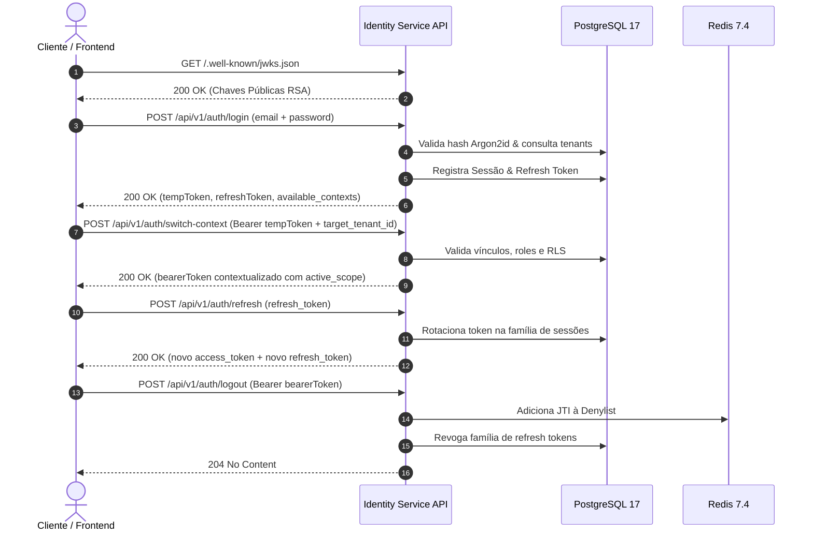

# Guia de Consumo e Testes Ponta a Ponta - Identity Service B2B

## 1. Visão Geral da Arquitetura & Infraestrutura

O **Identity-Service B2B** é um serviço de identidade, autenticação e autorização projetado para plataformas comerciais corporativas multi-tenant com grupos econômicos, suporte a múltiplos escopos operacionais (`BUYER`, `SUPPLIER`, `CARRIER`, `TENANT_ADMIN`) e isolamento estrito de dados através de Row Level Security (RLS) e Redis denylist.

### Dados do Ambiente de Produção (VPS Actuar):
- **URL Base Pública:** `https://identity.matheus-alves.dev`
- **Chaves Públicas (JWKS):** `https://identity.matheus-alves.dev/.well-known/jwks.json`
- **Algoritmo de Assinatura:** `RS256` (RSA 2048-bit, Key ID: `key-2026-01`)
- **Hash de Senha:** `Argon2id` ($m=19456, t=2, p=1$)
- **Reverse Proxy / TLS:** Caddy Web Server com certificados automatizados Let's Encrypt / ZeroSSL
- **Backing Services:** PostgreSQL 17, Redis 7.4, Apache Kafka 3.9 (KRaft mode)

---

## 2. Dados de Demonstração (Seed Provisionado)

### 2.1 Grupo Econômico
- **Nome:** `AgroBrasil Participações S.A.`
- **ID:** `01900000-0000-7000-8000-000000000001`

### 2.2 Tenants (Empresas / Unidades Operacionais)
| Tipo | Razão Social | CNPJ | ID | Escopos Habilitados |
|:---|:---|:---|:---|:---|
| **Matriz** | AgroBrasil Matriz e Exportadora S.A. | `11222333000181` | `01900000-0000-7000-8000-000000000010` | `BUYER`, `SUPPLIER`, `TENANT_ADMIN` |
| **Filial** | Cooperativa AgroBrasil Sul | `44555666000192` | `01900000-0000-7000-8000-000000000020` | `BUYER` |
| **Transportadora** | AgroLog Transportes e Cargas Ltda | `77888999000103` | `01900000-0000-7000-8000-000000000030` | `CARRIER` |

### 2.3 Usuários de Demonstração
> **Senha Padrão para Todos os Usuários:** `SenhaForte@2026!`

| E-mail | Nome | Perfil / Papel | Vínculos de Tenant |
|:---|:---|:---|:---|
| `admin@agrobrasil.com.br` | Administrador AgroBrasil | `GROUP_MANAGER` | Matriz (Proprietário / Gestor do Grupo) |
| `fornecedor@agrobrasil.com.br` | Vendedor AgroBrasil Matriz | `SUPPLIER_SALES` | Matriz |
| `comprador@agrobrasil.com.br` | Comprador AgroBrasil Grupo | `BUYER_OPERATOR` | Matriz e Filial (Multi-Tenant) |
| `transportador@agrobrasil.com.br` | Despachante AgroLog | `CARRIER_DISPATCHER` | Transportadora AgroLog |

---

## 3. Fluxo de Vida Completo da Autenticação



---

## 4. Como Executar os Testes via `curl`

### Passo 1: Consulta do JWKS (Chaves Públicas)
```bash
curl -s https://identity.matheus-alves.dev/.well-known/jwks.json | jq .
```

### Passo 2: Login com Administrador
```bash
curl -s -X POST https://identity.matheus-alves.dev/api/v1/auth/login \
  -H "Content-Type: application/json" \
  -d '{
    "email": "admin@agrobrasil.com.br",
    "password": "SenhaForte@2026!"
  }' | jq .
```
> O retorno contém `access_token` (token temporário), `refresh_token` e a lista `available_contexts` com os tenants vinculados.

### Passo 3: Troca de Contexto para a Matriz (SINGLE - TENANT_ADMIN)
Substitua `<TEMP_TOKEN>` pelo valor recebido no passo anterior:
```bash
curl -s -X POST https://identity.matheus-alves.dev/api/v1/auth/switch-context \
  -H "Authorization: Bearer <TEMP_TOKEN>" \
  -H "Content-Type: application/json" \
  -d '{
    "view_mode": "SINGLE",
    "target_scope": "TENANT_ADMIN",
    "target_tenant_id": "01900000-0000-7000-8000-000000000010"
  }' | jq .
```
> O retorno contém o `access_token` final com claims de `tenant_id`, `active_scope`, `roles` e `permissions`.

### Passo 4: Renovação de Token (Refresh Token Rotation)
Substitua `<REFRESH_TOKEN>` pelo refresh token ativo:
```bash
curl -s -X POST https://identity.matheus-alves.dev/api/v1/auth/refresh \
  -H "Content-Type: application/json" \
  -d '{
    "refresh_token": "<REFRESH_TOKEN>"
  }' | jq .
```

### Passo 5: Logout Seguro
Substitua `<BEARER_TOKEN>` pelo token contextualizado:
```bash
curl -s -i -X POST https://identity.matheus-alves.dev/api/v1/auth/logout \
  -H "Authorization: Bearer <BEARER_TOKEN>"
```
> Responde com `HTTP/2 204 No Content`.

---

## 5. Como Importar e Usar no Postman

1. Abra o Postman (ou Postman Web).
2. Clique no botão **Import** (canto superior esquerdo).
3. Selecione o arquivo `Docs/postman-collection-b2b.json` localizado neste repositório.
4. A coleção **Identity Service B2B API** será carregada com todas as variáveis predefinidas:
   - `baseUrl`: `https://identity.matheus-alves.dev`
   - Credenciais dos 4 usuários de demonstração
   - Variáveis dinâmicas: `tempToken`, `bearerToken`, `refreshToken`, que são atualizadas automaticamente via scripts de teste das requisições.
5. **Ordem recomendada de execução no Postman Runner:**
   1. `1. JWKS (Chaves Públicas)`
   2. `2. Autenticação (Login)` -> Requisição 1 (Admin Matriz)
   3. `3. Troca de Contexto` -> Requisição 1 (Matriz SINGLE - TENANT_ADMIN)
   4. `4. Renovação de Sessão (Refresh)` -> Requisição 1 (Renovação Válida)
   5. `5. Governança de Tenants` -> Criar e Alterar Status
   6. `6. Governança de Usuários` -> Suspender e Reativar
   7. `7. Encerramento de Sessão (Logout)` -> Logout Ativo

---

## 6. Testes Automatizados via Newman CLI

Para rodar a coleção completa automaticamente em pipelines ou terminal:
```bash
npm install -g newman
newman run Docs/postman-collection-b2b.json --reporters cli
```
