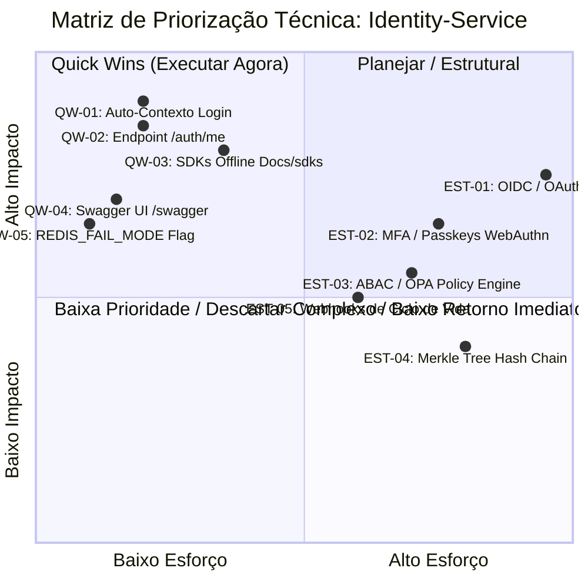
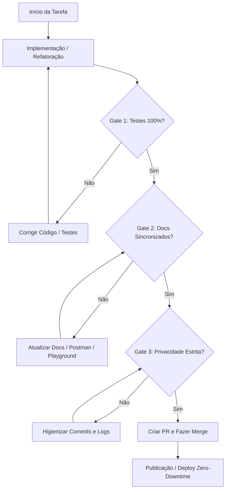

# Guia de Engenharia, Governança e Matriz de Melhorias do Identity-Service

> **Ecossistema:** Plataforma B2B Multi-Tenant  
> **Versão do Documento:** 1.0.0  
> **Data:** Novembro de 2026  
> **Status:** Canônico / Ativo  
> **Stack Base:** .NET 10, C# 13, PostgreSQL 17 (RLS), Redis 7.4 (Denylist Fail-Closed), RS256 (RSA-2048), Apache Kafka  

---

## Sumário Executivo

Este documento estabelece o padrão canônico de engenharia e governança para a continuidade do desenvolvimento, manutenção e evolução do **Identity-Service**. Ele está estruturado em duas partes complementares:

1. **Parte 1 — Matriz de Viabilidade e Priorização de Melhorias:** Avaliação técnica rigorosa de 14 iniciativas mapeadas (Quick Wins, Evoluções Estruturais e Entregas Recentes), analisadas sob 7 dimensões formais de viabilidade, esforço, risco e impacto arquitetural.
2. **Parte 2 — Guia Operacional de Continuidade e Engenharia (Onboarding de Agente/Dev):** Manual prático para que qualquer novo agente autônomo ou desenvolvedor assuma o ciclo de implementação, testes, garantia de conformidade, publicação de pull requests e governança contínua do ecossistema.

---

# PARTE 1: Matriz de Viabilidade e Priorização de Melhorias Mapeadas

Todas as melhorias foram extraídas do relatório canônico [[Relatorio-Analise-e-Melhorias-Identity.md](file:///c:/Users/ACT/Documents/Personal/Identity-Service/Docs/Relatorio-Analise-e-Melhorias-Identity.md)] e dos alinhamentos entre as equipes de microsserviços B2B.

---

### 1.1 Análise Individual dos Itens Catalogados

#### `QW-01: Auto-Contexto no Login`
- **Classificação:** Quick Win (Curto Prazo).
- **Status Atual:** Não iniciado.
- **Análise de Viabilidade Técnica:**
  - *Esforço Estimado:* 4 a 6 horas de engenharia.
  - *Complexidade:* Baixa.
  - *Dependências de Infraestrutura:* Nenhuma alteração em banco de dados ou Caddy. Ajuste restrito à camada de aplicação no endpoint `POST /api/v1/auth/login` em [[src/IdentityService/Modules/M01Login/](file:///c:/Users/ACT/Documents/Personal/Identity-Service/src/IdentityService/Modules/M01Login/)].
  - *Mecanismo:* Se o usuário pertencer a exatamente 1 tenant e tiver apenas 1 escopo (`CUSTOMER` ou `SUPPLIER`), o login já emite o token ativo final (`tenant_id`, `active_scope`, `roles`, `permissions` preenchidos), retornando `requires_context_switch: false`. Se possuir múltiplos tenants/escopos, mantém o comportamento atual com token temporário e `requires_context_switch: true`.
- **Impacto no Ecossistema:** Elevado ganho de DX (Developer Experience) para as equipes de Frontend e microsserviços. Reduz o número de chamadas HTTP no fluxo padrão de 2 (`login` + `switch-context`) para 1 requisição na maioria esmagadora dos usuários mono-tenant.
- **Riscos e Efeitos Colaterais:** **Zero breaking change** se o contrato de resposta mantiver compatibilidade com os campos existentes e a flag booleana `requires_context_switch`. O playground frontend e os clientes já devem checar `requires_context_switch`.
- **Recomendação Conclusiva:** **Implementar Imediatamente (Prioridade 1).**

---

#### `QW-02: Endpoint /api/v1/auth/me`
- **Classificação:** Quick Win (Curto Prazo).
- **Status Atual:** Não iniciado.
- **Análise de Viabilidade Técnica:**
  - *Esforço Estimado:* 4 a 6 horas.
  - *Complexidade:* Baixa.
  - *Dependências de Infraestrutura:* Nenhuma. Criação de endpoint GET autenticado em [[src/IdentityService/Modules/M03Contexto/](file:///c:/Users/ACT/Documents/Personal/Identity-Service/src/IdentityService/Modules/M03Contexto/)].
  - *Mecanismo:* Endpoint idempotente que valida o Bearer Token via middleware e retorna a projeção do estado atual: `user_id`, `email`, `name`, `platform_role`, `active_tenant_id`, `active_scope`, `view_mode`, lista de `allowed_tenants` com seus respectivos escopos e roles.
- **Impacto no Ecossistema:** Elimina a necessidade de decodificação manual de JWT no lado cliente para visualização de perfil de cabeçalho, além de permitir revalidação instantânea do estado de autenticação em SPAs (Single Page Applications).
- **Riscos e Efeitos Colaterais:** Nulo. Endpoint puramente de leitura, operando em memória a partir dos claims ou com leitura pontual no cache/banco.
- **Recomendação Conclusiva:** **Implementar Imediatamente (Prioridade 2).**

---

#### `QW-03: SDKs e Helpers de Validação Offline em Docs/sdks/`
- **Classificação:** Quick Win (Curto Prazo).
- **Status Atual:** Parcialmente documentado em [[Docs/Guia-Consumo-Testes-B2B.md](file:///c:/Users/ACT/Documents/Personal/Identity-Service/Docs/Guia-Consumo-Testes-B2B.md)], pendente empacotamento em diretório formal `Docs/sdks/`.
- **Análise de Viabilidade Técnica:**
  - *Esforço Estimado:* 8 a 12 horas.
  - *Complexidade:* Média.
  - *Dependências de Infraestrutura:* Nenhuma.
  - *Mecanismo:* Criação de exemplos executáveis e bibliotecas mínimas (helpers) em TypeScript/Node.js (`jose`), C# / .NET 10 (`Microsoft.IdentityModel.JsonWebTokens`), Python (`PyJWT` / `cryptography`) e Go (`golang-jwt/jwt/v5`).
- **Impacto no Ecossistema:** Aceleração massiva da adoção do modelo assíncrono RS256/JWKS pelas outras equipes da turma, prevenindo erros clássicos de verificação criptográfica, manuseio incorreto de cache de JWKS e falhas de validação de `iss` e `aud`.
- **Riscos e Efeitos Colaterais:** Nenhum no serviço principal; manutenção documental caso contratos mudem.
- **Recomendação Conclusiva:** **Implementar Imediatamente (Prioridade 3).**

---

#### `QW-04: Swagger UI / OpenAPI Spec em /swagger`
- **Classificação:** Quick Win (Curto Prazo).
- **Status Atual:** Não iniciado (atualmente utiliza OpenAPI gerado nativo sem UI interativa em ambiente produtivo).
- **Análise de Viabilidade Técnica:**
  - *Esforço Estimado:* 2 a 3 horas.
  - *Complexidade:* Baixa.
  - *Dependências de Infraestrutura:* Configuração de middleware em [[src/IdentityService/Program.cs](file:///c:/Users/ACT/Documents/Personal/Identity-Service/src/IdentityService/Program.cs)] usando `Microsoft.AspNetCore.OpenApi` e `Scalar.AspNetCore` ou `Swashbuckle.AspNetCore`.
- **Impacto no Ecossistema:** Permite exploração visual imediata de contratos, schemas RFC 9457 e documentação interativa para equipes parceiras sem necessidade de importar coleções Postman.
- **Riscos e Efeitos Colaterais:** Exposição de endpoints sensíveis em produção. Deve ser protegido por flag de ambiente (`ASPNETCORE_ENVIRONMENT != Production`) ou disponibilizado publicamente sem rotas de auditoria restrita.
- **Recomendação Conclusiva:** **Implementar com flag de ambiente (Prioridade 4).**

---

#### `QW-05: Configuração Explícita de REDIS_FAIL_MODE`
- **Classificação:** Quick Win (Curto Prazo).
- **Status Atual:** Implementado na arquitetura como **Fail-Closed** compulsório ([[src/IdentityService/Modules/M00Transversal/](file:///c:/Users/ACT/Documents/Personal/Identity-Service/src/IdentityService/Modules/M00Transversal/)]), pendente apenas flag explícita de override no `appsettings.json`.
- **Análise de Viabilidade Técnica:**
  - *Esforço Estimado:* 2 horas.
  - *Complexidade:* Mínima.
  - *Dependências de Infraestrutura:* Variável de ambiente `REDIS_FAIL_MODE=FAIL_CLOSED|FAIL_OPEN`.
- **Impacto no Ecossistema:** Permite que ambientes locais de desenvolvimento continuem funcionando sem Redis caso o desenvolvedor não suba o contêiner, enquanto ambientes de homologação e produção mantêm segurança máxima `FAIL_CLOSED` (rejeitando requisições com 503 caso a denylist esteja inacessível).
- **Riscos e Efeitos Colaterais:** Baixo. Risco apenas se configurado incorretamente como `FAIL_OPEN` em produção.
- **Recomendação Conclusiva:** **Implementar Imediatamente (Prioridade 5).**

---

#### `EST-01: Provedor OIDC / OAuth 2.1 Completo (Authorization Code Flow com PKCE)`
- **Classificação:** Evolução Estrutural (Médio a Longo Prazo).
- **Status Atual:** Não iniciado.
- **Análise de Viabilidade Técnica:**
  - *Esforço Estimado:* 3 a 5 semanas.
  - *Complexidade:* Muito Alta.
  - *Dependências de Infraestrutura:* Banco de dados (tabelas de `clients`, `redirect_uris`, `consent_grants`, `authorization_codes`), novos endpoints `/oauth/authorize`, `/oauth/token`, interface gráfica para login de terceiros e consentimento.
- **Impacto no Ecossistema:** Habilita integração federada padrão de mercado, Single Sign-On (SSO) empresarial e conformidade formal com os padrões de segurança OAuth 2.1 (RFC 7636).
- **Riscos e Efeitos Colaterais:** Aumento significativo na superfície de ataque, complexidade de sessão e gerenciamento de estado de navegador. Desnecessário para a comunicação intra-microsserviços do MVP atual.
- **Recomendação Conclusiva:** **Postergar para fase pós-MVP.**

---

#### `EST-02: Autenticação Multi-Fator (MFA) via TOTP / WebAuthn (Passkeys)`
- **Classificação:** Evolução Estrutural (Médio Prazo).
- **Status Atual:** Não iniciado.
- **Análise de Viabilidade Técnica:**
  - *Esforço Estimado:* 1 a 2 semanas.
  - *Complexidade:* Alta.
  - *Dependências de Infraestrutura:* Tabelas para segredos TOTP, recovery codes e credenciais FIDO2; suporte a desafios criptográficos no endpoint de login.
- **Impacto no Ecossistema:** Segurança crítica para contas de perfil corporativo e `PLATFORM_ADMIN`.
- **Riscos e Efeitos Colaterais:** Complexidade de suporte para recuperação de contas perdidas.
- **Recomendação Conclusiva:** **Postergar para fase pós-MVP.**

---

#### `EST-03: Autorização Fina ABAC / Integração com OPA (Open Policy Agent)`
- **Classificação:** Evolução Estrutural (Médio Prazo).
- **Status Atual:** Não iniciado (atualmente RBAC embutido com isolamento contextual por `active_scope`).
- **Análise de Viabilidade Técnica:**
  - *Esforço Estimado:* 2 semanas.
  - *Complexidade:* Alta.
  - *Dependências de Infraestrutura:* Servidor OPA local (sidecar) ou motor de avaliação Rego compilado em WebAssembly.
- **Impacto no Ecossistema:** Permite regras de permissão contextuais complexas (ex.: aprovação somente em horário comercial ou limites transacionais baseados no montante do pedido).
- **Riscos e Efeitos Colaterais:** Latência adicional em cada requisição de autorização e dependência de motor externo.
- **Recomendação Conclusiva:** **Postergar para fase pós-MVP (RBAC atual atende 100% dos requisitos vigentes).**

---

#### `EST-04: Auditoria Criptográfica Imutável (Merkle Tree / Hash Chains)`
- **Classificação:** Evolução Estrutural (Longo Prazo).
- **Status Atual:** Não iniciado.
- **Análise de Viabilidade Técnica:**
  - *Esforço Estimado:* 2 a 3 semanas.
  - *Complexidade:* Alta.
  - *Dependências de Infraestrutura:* Tabela append-only com hash chain encadeado SHA-256 e publicação periódica da raiz de Merkle.
- **Impacto no Ecossistema:** Conformidade e não-repúdio estrito de ações administrativas e auditoria forense.
- **Riscos e Efeitos Colaterais:** Custo computacional na escrita e validação em lote.
- **Recomendação Conclusiva:** **Postergar para fase pós-MVP.**

---

#### `EST-05: Webhooks de Notificação de Ciclo de Vida`
- **Classificação:** Evolução Estrutural (Médio Prazo).
- **Status Atual:** Não iniciado (atualmente dependente do Transactional Outbox e eventos Kafka em [[src/IdentityService/Modules/M14Eventos/](file:///c:/Users/ACT/Documents/Personal/Identity-Service/src/IdentityService/Modules/M14Eventos/)]).
- **Análise de Viabilidade Técnica:**
  - *Esforço Estimado:* 1 a 2 semanas.
  - *Complexidade:* Média-Alta.
  - *Dependências de Infraestrutura:* Tabela de subscrição de endpoints, worker com retry exponencial, dead-letter queue e assinatura HMAC-SHA256 no payload.
- **Impacto no Ecossistema:** Permite que serviços que não consom Kafka recebam notificações HTTP de eventos como revogação de tokens e bloqueio de tenants.
- **Riscos e Efeitos Colaterais:** Sobrecarga de rede e necessidade de controle de timeouts severos para evitar bloqueio do dispatcher.
- **Recomendação Conclusiva:** **Postergar (o cluster Kafka atende a propagação de eventos assíncronos no MVP).**

---

### 1.2 Itens Recentes Entregues e Homologados (Registro Canônico)

| Identificador | Descrição Técnica | PR / Commit | Status | Impacto / Resolução |
| :--- | :--- | :--- | :--- | :--- |
| **`AL-01`** | **Endpoint de Introspecção RFC 7662 (`POST /api/v1/auth/introspect`)** | PR #12 | **Implementado e Homologado** | Validação centralizada online de tokens, conferindo assinatura, claims e consulta atômica à denylist Redis. |
| **`AL-02`** | **Tolerância a Clock Skew (60s) e Cache-Control JWKS (1 hora)** | PR #11 / #12 | **Implementado e Homologado** | Resiliência contra dessincronização de relógios em clusters distribuídos e cache inteligente de chaves públicas. |
| **`AL-03`** | **Seed User `PLATFORM_ADMIN` com Escopo Global** | PR #13 | **Implementado e Homologado** | Provisão do usuário `admin@b2b.platform` com papéis para operações de governança e auditoria transversal. |
| **`FIX-01`** | **Sanitização de `tempToken` e Isolamento no Playground** | PR #14 / #15 | **Implementado e Homologado** | Correção de erro 401 em trocas consecutivas de contexto no Frontend web (`pages/js/app.js`), garantindo conformidade com RN-55. |

---

### 1.3 Matriz Consolidada de Priorização (Esforço vs. Impacto)



### Ordem de Execução Recomendada:

> **Revisão de 2026-11-16 (aprovada):** a ordem abaixo substitui a anterior. O ciclo em curso constrói seis itens, **do menos para o mais complexo**, cada um com PR próprio e especificação detalhada (contrato, regras, critérios de aceitação, tarefas e gates) em [Especificacao-Melhorias-Pos-MVP.md](Especificacao-Melhorias-Pos-MVP.md). Entraram dois itens novos, derivados dos alinhamentos inter-equipes: `NEW-06` e `NEW-07`.

1. **Ciclo em curso (ordem de construção):**
   - **1º:** `QW-02` (Endpoint `GET /api/v1/auth/me`) — projeção pura do contexto autenticado; 1–2 h.
   - **2º:** `QW-03` (SDKs em `Docs/sdks/`: Python, C#, Node.js e Go) — destrava a validação RS256 nos outros microsserviços; 2–3 h.
   - **3º:** `QW-04` (OpenAPI 3.1 em `/openapi.json` e Swagger UI em `/swagger`) — contrato importável; 2–3 h.
   - **4º:** `QW-01` (Auto-contexto no login, opt-in) — elimina o encadeamento de duas chamadas para clientes automatizados; 3–4 h.
   - **5º:** `NEW-06` (Client Credentials, `POST /api/v1/auth/token`) — identidade para serviços, workers e rotinas batch; 1–2 d.
   - **6º:** `NEW-07` (Métricas e tracing OpenTelemetry, exportação OTLP) — visibilidade operacional; 1–2 d.
2. **Fora do ciclo:**
   - `QW-05` (`REDIS_FAIL_MODE`): não construir agora. O comportamento fail-closed já está em vigor; uma flag de fail-open só acrescenta risco de configuração.
   - `EST-02` (MFA/Passkeys) e `EST-04` (auditoria com encadeamento criptográfico): **postergados para depois do MVP**. RLS, RBAC e a `auth_audit_log` atual cobrem a entrega.
   - `EST-01` (OIDC/OAuth 2.1), `EST-03` (ABAC/OPA) e `EST-05` (Webhooks): backlog, sem data.

| Item novo | Classificação | Esforço | Risco | Recomendação |
| :--- | :--- | :--- | :--- | :--- |
| **`NEW-06`** Client Credentials Flow (RFC 6749 §4.4) | Evolução de protocolo (curto-médio prazo) | 1–2 dias; tabela `service_account` e rota paralela | Baixo: não altera o ciclo de vida dos tokens de utilizadores | **Implementar agora (5º)** |
| **`NEW-07`** Métricas e tracing OpenTelemetry | Observabilidade (médio prazo) | 1–2 dias; APIs nativas `System.Diagnostics` + OTLP | Desprezável com amostragem; inerte sem endpoint configurado | **Implementar agora (6º)** |

---

# PARTE 2: Guia Operacional de Continuidade, Governança e Engenharia (Onboarding de Agente)

Este guia define as regras operacionais, ferramentas, padrões de commit, políticas de branches e invariantes de segurança para que um novo agente de software atue com autonomia no repositório.

---

### 2.1 Topologia do Repositório e Mapa Canônico de Diretórios

O projeto segue arquitetura modular verticalizada com isolamento estrito de responsabilidades:

```
Identity-Service/
├── Docs/                                    # Documentação Canônica, Guias e Contratos
│   ├── Alinhamento-Ecossistema-B2B.md       # Contrato público com os outros microsserviços
│   ├── Guia-Consumo-Testes-B2B.md           # Guia de validação offline RS256 e testes
│   ├── Relatorio-Analise-e-Melhorias-...md  # Relatório arquitetural e catálogo de regras
│   └── postman-collection-b2b.json          # Coleção Postman com cenários automatizados
├── pages/                                   # Playground Web Interativo (Frontend Vanilla)
│   ├── index.html                           # Interface visual de simulação de personas e cenários
│   ├── css/styles.css                       # Design System CSS do Playground
│   └── js/                                  # Motor client-side (app.js, api.js, runner.js)
├── src/
│   └── IdentityService/                     # Aplicação Principal .NET 10 (Minimal APIs)
│       ├── Program.cs                       # Entrypoint, injeção de dependência e middlewares
│       └── Modules/                         # Módulos Funcionais Isolados
│           ├── M00Transversal/              # Infraestrutura: RLS, Redis Denylist, Erros RFC 9457
│           ├── M01Login/                    # Autenticação de credenciais, MFA e emissão temporária
│           ├── M02Refresh/                  # Rotação atômica de refresh tokens e detecção de reuso
│           ├── M03Contexto/                 # Comutação de tenant/escopo (switch-context) e token ativo
│           ├── M04Tenants/                  # Gestão de organizações, isolamento e provisionamento
│           ├── M05Membros/                  # Vínculo usuário-tenant, papéis locais e convites
│           ├── M06Impersonation/            # Acesso assistido com restrições e auditoria
│           ├── M07Chaves/                   # Criptografia RS256, rotação de chaves e endpoint JWKS
│           ├── M08Acessos/                  # Consulta de permissões e autorização RBAC
│           ├── M09Logout/                   # Revogação voluntária e inclusão em denylist
│           ├── M10EstadoUsuario/            # Bloqueio, ativação e ciclo de vida de identidades
│           ├── M11Esquema/                  # Configurações dinâmicas de esquemas e atributos
│           ├── M12EstadoTenant/             # Suspensão, cancelamento e reativação de tenants
│           ├── M13Isolamento/               # Verificação de barreiras e políticas RLS
│           └── M14Eventos/                  # Transactional Outbox e publicação Apache Kafka
└── tests/
    ├── IdentityService.Tests/               # Testes unitários rápidos e isolamento de regras (208 testes)
    └── IdentityService.Acceptance/          # Testes de integração/aceitação via Testcontainers (211 testes)
```

#### Links Rápidos de Navegação:
- Diretório de Módulos: [[src/IdentityService/Modules/](file:///c:/Users/ACT/Documents/Personal/Identity-Service/src/IdentityService/Modules/)]
- Módulo Transversal (Infra/RLS/Redis): [[src/IdentityService/Modules/M00Transversal/](file:///c:/Users/ACT/Documents/Personal/Identity-Service/src/IdentityService/Modules/M00Transversal/)]
- Módulo de Chaves e JWKS: [[src/IdentityService/Modules/M07Chaves/](file:///c:/Users/ACT/Documents/Personal/Identity-Service/src/IdentityService/Modules/M07Chaves/)]
- Testes Unitários: [[tests/IdentityService.Tests/](file:///c:/Users/ACT/Documents/Personal/Identity-Service/tests/IdentityService.Tests/)]
- Testes de Aceitação: [[tests/IdentityService.Acceptance/](file:///c:/Users/ACT/Documents/Personal/Identity-Service/tests/IdentityService.Acceptance/)]
- Playground Web: [[pages/index.html](file:///c:/Users/ACT/Documents/Personal/Identity-Service/pages/index.html)]

---

### 2.2 Stack Tecnológica e Invariantes Arquiteturais Inegociáveis

1. **Linguagem e Framework:** C# 13, .NET 10, ASP.NET Core Minimal APIs, Entity Framework Core 10.
2. **Isolamento de Dados Multi-Tenant via RLS (Row-Level Security):**
   - O banco PostgreSQL 17 opera com políticas ativas de RLS em nível de conexão.
   - Cada sessão de banco deve definir obrigatoriamente as variáveis de contexto da transação:
     - `app.auth_flow`: Define o nível de privilégio da operação (`'true'` apenas em fluxos de autenticação do módulo M00/M01).
     - `app.allowed_tenants`: Lista delimitada por vírgula de IDs de tenants permitidos para leitura.
     - `app.write_tenants`: ID do tenant permitido para operações de gravação (`INSERT`/`UPDATE`/`DELETE`).
3. **Criptografia Assimétrica RS256 e JWKS:**
   - Assinatura obrigatória via **RS256** com chaves RSA de 2048 bits geradas nativamente.
   - Proibido uso de chaves simétricas (HS256) em contratos externos de microsserviços.
   - Exposição pública obrigatória em `GET /.well-known/jwks.json` com cabeçalho `Cache-Control: public, max-age=3600`.
   - Tolerância padrão de relógio (*clock skew*): **60 segundos** nos validadores.
4. **Denylist Instantânea com Redis 7.4 (Fail-Closed):**
   - Chaves de revogação imediata registradas no Redis com TTL sincronizado com a expiração do token:
     - `denylist:jti:<uuid>`: Revogação de token específico (ex.: no `switch-context` ou `logout`).
     - `denylist:user:<uuid>`: Revogação global de todas as sessões de um usuário emitidas antes de `revoked_at`.
     - `denylist:tenant:<uuid>`: Bloqueio imediato de qualquer token atrelado a um tenant suspenso.
   - Política de falha: **Fail-Closed** compulsório. Em caso de indisponibilidade do Redis, requisições que dependem da denylist devem falhar com HTTP 503 (`ERR-SEC-004`).
5. **Transactional Outbox Pattern e Apache Kafka:**
   - Nenhuma emissão de evento de domínio pode ocorrer diretamente para o broker durante a requisição HTTP.
   - Eventos são gravados atomicamente na tabela de `outbox_messages` dentro da mesma transação do banco.
   - O worker de despacho consome mensagens via `SELECT ... FOR UPDATE SKIP LOCKED`, garantindo entrega *at-least-once* e concorrência segura entre múltiplas réplicas da API.
6. **Contrato de Erros Padronizado (RFC 9457):**
   - Todas as respostas de erro devem retornar obrigatoriamente `Content-Type: application/problem+json`.
   - Campos mínimos obrigatórios: `type`, `title`, `status`, `detail`, `code` (ex.: `ERR-AUTH-002`) e `correlationId` (extraído do cabeçalho `X-Correlation-ID`).

---

### 2.3 Fluxo de Trabalho Git, Commits e Pull Requests

#### 1. Identidade e Conta GitHub Obrigatória
> [!IMPORTANT]
> **CONTA GITHUB OBRIGATÓRIA:** Todo commit, PR e operação no GitHub CLI deve ser executado exclusivamente através do usuário **`Matheus-Allvz`** (`normalaccont.matheus@gmail.com`). É estritamente proibido o uso de credenciais ou contas corporativas de terceiros.

Para garantir a identidade ativa no terminal antes de qualquer operação:
```powershell
# Verificar e trocar a conta ativa no GitHub CLI
gh auth switch -u Matheus-Allvz

# Configurar identidade local do repositório
git config user.name "Matheus-Allvz"
git config user.email "normalaccont.matheus@gmail.com"
```

#### 2. Política de Ramificação (Branching)
- A branch `main` é protegida e representa o estado estável de produção.
- Toda modificação deve nascer de uma branch secundária tipada:
  - Funcionalidades: `feat/ma/<nome-curto>`
  - Correções de bugs: `fix/ma/<nome-curto>`
  - Documentação: `docs/ma/<nome-curto>`
  - Refatorações: `refactor/ma/<nome-curto>`

#### 3. Padrão de Commits (Conventional Commits)
Mensagens de commit devem ser escritas em minúsculas e seguir estritamente o formato:
- `feat(auth): add auto-context detection on login endpoint`
- `fix(playground): clear tempToken state after successful switch-context`
- `docs(onboarding): document git workflow and quality gates`
- `test(acceptance): add test coverage for user denylist revocation`

#### 4. Fluxo de Submissão e Merge de Pull Requests via CLI
Para manter a rastreabilidade e integridade sem intervenção manual na interface gráfica:
```powershell
# 1. Enviar a branch para o repositório remoto
git push -u origin <nome-da-branch>

# 2. Criar o Pull Request
gh pr create --title "feat(escopo): descrição sucinta da entrega" `
             --body "## Resumo das Alterações`n- Detalhe 1`n- Detalhe 2`n`n## Testes Realizados`n- 419/419 testes aprovados."

# 3. Executar o merge administrativo com auto-delete da branch
gh pr merge --admin --merge --delete-branch

# 4. Sincronizar a branch main local
git checkout main
git pull origin main
```

---

### 2.4 Regras de Ouro e Gates de Qualidade

Antes de qualquer merge ou conclusão de tarefa, o agente deve auditar e cumprir 3 gates inegociáveis:



#### Gate 1: Garantia de Não-Regressão (100% dos Testes Aprovados)
- Nenhum commit ou PR é aceito com quebra de testes.
- Comando obrigatório de execução:
  ```powershell
  dotnet test --configuration Release
  ```
- A compilação do CI usa `dotnet build --warnaserror`: avisos quebram o pipeline.
- **Contagem Canônica Atual:** **428 testes aprovados** (217 unitários em `IdentityService.Tests` + 211 de integração em `IdentityService.Acceptance`), após a `QW-04`. Linha de base antes do ciclo pós-MVP: 419. Cada unidade de trabalho atualiza este número.
- Os testes usam Testcontainers (PostgreSQL, Redis e Kafka): o Docker precisa de estar em execução.

#### Gate 2: Obrigatoriedade de Documentação Sincronizada
- Qualquer novo endpoint, parâmetro de claim, código de erro ou mudança de comportamento exige atualização simultânea em:
  1. [[Docs/Alinhamento-Ecossistema-B2B.md](file:///c:/Users/ACT/Documents/Personal/Identity-Service/Docs/Alinhamento-Ecossistema-B2B.md)]: Contrato oficial para as outras equipes.
  2. [[Docs/Guia-Consumo-Testes-B2B.md](file:///c:/Users/ACT/Documents/Personal/Identity-Service/Docs/Guia-Consumo-Testes-B2B.md)]: Instruções práticas para consumidores da API.
  3. [[Docs/postman-collection-b2b.json](file:///c:/Users/ACT/Documents/Personal/Identity-Service/Docs/postman-collection-b2b.json)]: Atualização de rotas e scripts de teste automatizado.
  4. [[pages/js/catalog.js](file:///c:/Users/ACT/Documents/Personal/Identity-Service/pages/js/catalog.js)]: Catálogo de endpoints do Playground Frontend.
  5. `src/IdentityService/Modules/M15Docs/openapi.json` (a partir da `QW-04`): documento OpenAPI 3.1. Um teste de deriva falha se uma rota existir no código e não no documento, ou o inverso.
- Melhorias do ciclo pós-MVP seguem a definição de pronto e o quadro de acompanhamento de [Especificacao-Melhorias-Pos-MVP.md](Especificacao-Melhorias-Pos-MVP.md) §8 e §9; o estado de cada unidade de trabalho é espelhado em `Etapa2/spec-v2/90-registo.md` §12.

#### Gate 3: Isolamento de Ambiente e Privacidade Absoluta
- **Privacidade Operacional:** É terminantemente proibido expor nomes de infraestruturas privadas, detalhes de VPS proprietária ou referências internas a organizações terceiras nos commits, issues públicas ou documentação de alinhamento com a turma.
- Todas as interações com outras equipes devem ser estritamente pautadas pelos contratos públicos RFC, endpoints canônicos e padrões de segurança abertos.

---

### 2.5 Ambientes e Infraestrutura de Homologação

| Ambiente | URL Pública / Host | Descrição e Finalidade |
| :--- | :--- | :--- |
| **Produção / Stage API** | `https://identity.matheus-alves.dev` | Endpoint canônico da API com Caddy Reverse Proxy, terminação TLS automática e Blue/Green deployment com **Zero Downtime**. |
| **Playground Frontend** | `https://pages-identity.matheus-alves.dev` | Interface SPA desacoplada para testes manuais, auditoria de tokens, simulação de personas e cenários de ataque/caos. |
| **JWKS Público** | `https://identity.matheus-alves.dev/.well-known/jwks.json` | Ponto de distribuição de chaves públicas RSA-2048 para validação offline nos demais microsserviços. |
| **Desenvolvimento Local** | `http://localhost:5000` / `http://localhost:5001` | Ambiente local com orquestração via Docker Compose (`docker-compose.yml`) contendo PostgreSQL 17 e Redis 7.4. |

---

### 2.6 Checklist Rápido de Continuidade para o Agente

Ao iniciar uma nova sessão ou receber uma demanda de evolução do Identity-Service:
1. [ ] Verificar conta GitHub: `gh auth switch -u Matheus-Allvz`.
2. [ ] Sincronizar branch `main`: `git checkout main && git pull origin main`.
3. [ ] Criar branch de trabalho: `git checkout -b <tipo>/ma/<funcionalidade>`.
4. [ ] Executar suíte de testes inicial: `dotnet test`.
5. [ ] Implementar a alteração mantendo aderência ao módulo correspondente em `src/IdentityService/Modules/`.
6. [ ] Validar conformidade de RLS, RS256 e RFC 9457.
7. [ ] Executar a suíte de testes novamente e garantir 100% de aprovação.
8. [ ] Atualizar documentação canônica em `Docs/` e catálogo em `pages/js/`.
9. [ ] Submeter PR e aplicar merge via GitHub CLI.
