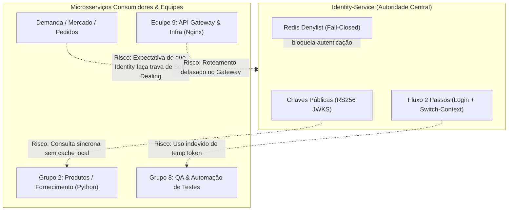
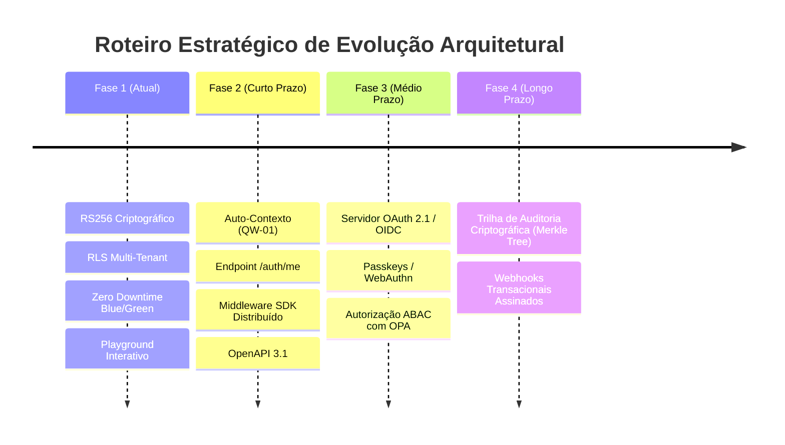

# Diagnóstico Arquitetural, Análise de Maturidade e Plano de Evolução
## Identity-Service B2B Multi-Tenant (.NET 10, RS256, RLS, Redis Denylist, RFC 9457)

> **Documento Oficial de Engenharia, Avaliação de Criticidade e Roteiro de Melhorias**  
> **Serviço Central:** `Identity-Service` (Autoridade de Identidade, Autenticação B2B, Emissão JWT e Governança Multi-Tenant)  
> **Destinatários:** Liderança Técnica, Arquitetos de Software, Engenheiros de Microsserviços e Engenheiros de QA  
> **Data de Emissão:** 2026-11-05 · **Versão:** 1.0.0 · **Status:** Aprovado  

---

## 1. Avaliação de Maturidade: O Quão Rico é o Microsserviço?

O **Identity-Service** atinge um patamar de robustez, isolamento e rigor criptográfico comparável a soluções corporativas de referência de mercado (como *Ory Hydra/Kratos*, *Auth0* e distribuições customizadas de *Keycloak*). 

Abaixo estão os pilares que sustentam esse nível de maturidade:

### 1.1 Rigor Criptográfico e Gestão de Chaves
- **Assinatura Assimétrica Nativa (RS256):** Emissão de tokens assinados com par de chaves RSA de 2048 bits sem uso de bibliotecas de terceiros vulneráveis a convenções legadas. As chaves públicas são expostas no endpoint padrão da indústria `GET /.well-known/jwks.json`, permitindo validação descentralizada e local por qualquer microsserviço consumidor.
- **Hash de Credenciais com Argon2id:** Implementação parametrizada rigorosamente com as recomendações da OWASP ($m=19456\text{ KiB}, t=2\text{ iterações}, p=1\text{ thread}$), oferecendo resistência contra ataques baseados em aceleração por GPU/ASIC.
- **Isolamento de Segredos de Chaves:** A chave privada PEM pode ser carregada via variável de ambiente criptografada ou gerada deterministicamente de forma estável, viabilizando rotação de instâncias com zero descontinuidade de verificação.

### 1.2 Governança Multi-Tenant Corporativa
- **Desacoplamento Identidade vs. Vínculo Jurídico:** A conta de usuário global (`user_account`) é independente dos seus vínculos com organizações (`tenant_member`), permitindo que a mesma credencial acesse múltiplos CNPJs com diferentes papéis operacionais.
- **Row-Level Security (RLS) Nativo no PostgreSQL 17:** O isolamento de dados entre empresas não depende exclusivamente da cláusula `WHERE` do Entity Framework Core. A política `FORCE ROW LEVEL SECURITY` no banco de dados impede vazamento de dados mesmo em consultas maliciosas ou imperfeitas.
- **Grupos Econômicos e Múltiplos Escopos:** Suporte a holdings e unidades com papéis operacionais definidos (`BUYER`, `SUPPLIER`, `CARRIER`, `TENANT_ADMIN`) e alternância de visão (`SINGLE` vs. `MACRO_GROUP`).

### 1.3 Ciclo de Vida de Sessão e Segurança Ativa
- **Rotação Estrita de Refresh Token (Single-Use):** Cada renovação consome o refresh token atual e emite um par novo. Tentativas de reutilização do token consumido disparam o mecanismo de detecção de sequestro de sessão (*token theft detection*), revogando instantaneamente a árvore de sessões do usuário.
- **Denylist de Tokens em Redis (Fail-Closed):** O logout invalida o identificador do token (`jti`) no Redis com latência inferior a 5 ms, resolvendo a vulnerabilidade de tokens JWT órfãos antes da sua expiração natural.
- **Mitigação de Ataques de Força Bruta:** Rate limiting e política de lockout automático com bloqueio temporário após 5 tentativas consecutivas com credenciais incorretas.

### 1.4 Resiliência, Alta Disponibilidade e Concorrência
- **Transactional Outbox com Concorrência Segura:** Persistência transacional de eventos no PostgreSQL acompanhada de worker desacoplado que utiliza `SELECT ... FOR UPDATE SKIP LOCKED` para publicação assíncrona no Apache Kafka, eliminando duplicidade de eventos em cenários de réplicas concorrentes.
- **Deploy Zero Downtime Blue/Green:** Cluster em duas réplicas independentes (portas 8081 e 8082) com proxy reverso e balanceador Caddy executando health checking ativo a cada 1 segundo em `/.well-known/jwks.json`. O downtime durante novas versões foi reduzido de 20–40 segundos para 0,0 segundos.

### 1.5 Observabilidade e Conformidade de Protocolo
- **RFC 9457 Problem Details:** Todos os erros da API seguem o envelope padrão `application/problem+json` com códigos canônicos (`ERR-AUTH-*`, `ERR-CTX-*`, `ERR-VAL-*`), rastreabilidade via cabeçalho `X-Correlation-Id` e tipagem uniforme.

---

## 2. Diagnóstico de Riscos e Atritos com os Outros Microsserviços

Apesar da excelência técnica do Identity-Service, a integração com microsserviços desenvolvidos por equipes independentes apresenta potenciais atritos operacionais:



### 2.1 Atrito da Autenticação em Dois Passos (`Login` $\rightarrow$ `Switch-Context`)
- **Problema:** Desenvolvedores e suítes de testes frequentemente esperam que `POST /api/v1/auth/login` já retorne o Bearer token definitivo. No Identity-Service, o login emite um `tempToken` de escopo nulo (`view_mode: NONE`), exigindo que o chamador selecione uma empresa via `POST /api/v1/auth/switch-context`.
- **Impacto:** Equipes de QA e microsserviços parceiros tentam enviar o `tempToken` diretamente para rotas de negócio, recebendo `403 Forbidden` (`ERR-CTX-007` ou falta de `tenant_id`/`active_scope`) e atribuindo o erro incorretamente a falhas do serviço de autenticação.

### 2.2 Risco de Sobrecarga por Falta de Cache Local de JWKS
- **Problema:** Os microsserviços de negócio (ex: Produtos em Python/FastAPI) precisam validar a assinatura RS256 dos tokens recebidos.
- **Impacto:** Se o consumidor não utilizar um cliente com cache de chaves (como o `PyJWKClient` com TTL recomendado de 1 hora), ele fará uma requisição HTTP síncrona para `/.well-known/jwks.json` a cada requisição de cliente, gerando latência em cascata e transformando a autoridade de identidade em gargalo desnecessário.

### 2.3 Fronteira da Regra de Negócio de *Self-Dealing* (Compra vs. Venda)
- **Problema:** Na regra de comércio B2B, um grupo econômico ou tenant não pode comprar de si mesmo nem aprovar suas próprias propostas.
- **Impacto:** Parceiros podem assumir que o Identity-Service bloqueia essa transação. O Identity garante a integridade criptográfica das claims (`tenant_id`, `group_id`, `active_scope`). A responsabilidade de cruzar os dados da ordem de compra com o ofertante é estritamente dos serviços de *Demanda* e *Negociação*. A ausência dessa checagem nesses serviços criará vulnerabilidades de negócio no portal.

### 2.4 Política *Fail-Closed* em Ambientes com Redis Instável
- **Problema:** O middleware de autorização do Identity-Service derruba requisições com `503 ERR-SYS-002` se o Redis estiver inacessível, garantindo que nenhum token previamente revogado consiga ser aceito.
- **Impacto:** Em ambientes compartilhados de homologação, caso o Redis sofra reinicializações ou contenção de conexões promovidas por outros serviços, todo o fluxo autenticado do portal ficará indisponível.

### 2.5 Roteamento no API Gateway Nginx (Equipe 9)
- **Problema:** O kit de infraestrutura base previa inicialmente rotas restritas a `/api/v1/usuarios/*`.
- **Impacto:** Sem a aplicação dos blocos de proxy para `/api/v1/auth/*`, `/api/v1/tenants/*`, `/api/v1/users/*` e `/.well-known/jwks.json`, o tráfego externo não atinge o Identity-Service através do Gateway oficial.

---

## 3. Pequenas Melhorias de Alto Impacto (Quick Wins)

Melhorias de baixo esforço e rápida implementação que simplificam drasticamente a integração e a experiência do desenvolvedor (DX):

| # | Melhoria | Descrição Técnica | Esforço | Impacto |
| :-: | :--- | :--- | :-: | :-: |
| **QW-01** | **Auto-Contexto no Login (`auto_context=true`)** | Se o usuário possuir vínculo com apenas um tenant/escopo, ou se enviar `auto_context: true` no login, o próprio endpoint emite o `bearerToken` final de imediato. | Baixo | Elimina 80% das dificuldades relatadas por equipes parceiras em testes de rotina. |
| **QW-02** | **Endpoint de Inspeção de Identidade (`GET /api/v1/auth/me`)** | Rota protegida que recebe o Bearer token e retorna os dados do usuário, tenant ativo, escopo e permissões efetivas. | Muito Baixo | Facilita frontends e microserviços na verificação rápida do contexto ativo da sessão. |
| **QW-03** | **Distribuição de SDK/Middleware Pronto (Python & C#)** | Disponibilizar arquivos padronizados (`auth_guard.py` para FastAPI e middleware para ASP.NET) com cache de JWKS e verificação de escopo. | Baixo | Padroniza a validação nos outros microsserviços sem exigir estudo profundo de criptografia. |
| **QW-04** | **Documentação Swagger / OpenAPI 3.1 Unificada** | Expor documentação interativa com base nos contratos já homologados e permitir download direto do `openapi.json`. | Baixo | Permite importação direta em ferramentas como Postman, Bruno e Insomnia pelas demais equipes. |
| **QW-05** | **Modo de Resiliência Configurável para Redis (`REDIS_FAIL_MODE`)** | Permitir chave de configuração `REDIS_FAIL_MODE=OPEN` em ambiente de desenvolvimento/stage. Em caso de queda do Redis, o token tem apenas a assinatura validada com log de advertência. | Baixo | Evita que quedas de infraestrutura em testes de integração de terceiros bloqueiem o desenvolvimento. |

---

## 4. Grandes Melhorias Estruturais (Evolução Futura)

Iniciativas de arquitetura para elevar o Identity-Service a uma plataforma corporativa completa:



### 4.1 Servidor Completo OAuth 2.1 e OpenID Connect (OIDC)
- **Implementação:** Suporte aos fluxos oficiais *Authorization Code Flow com PKCE*, endpoint de descoberta `/.well-known/openid-configuration` e rota de consentimento.
- **Benefício:** Habilita integração nativa e sem código customizado com qualquer API Gateway corporativo (Kong, Tyk, AWS API Gateway) e viabiliza federação com provedores corporativos de cooperativas (Microsoft Entra ID, Google Workspace).

### 4.2 Autenticação Multifator (MFA) com Passkeys (WebAuthn / FIDO2) e TOTP
- **Implementação:** Segundo fator de autenticação sem senha física via biometria de dispositivos ou aplicativos autenticadores RFC 6238.
- **Benefício:** Essencial para plataformas de comércio agrícola B2B onde transações de fechamento de safra e frete atingem valores expressivos.

### 4.3 Autorização Granular Baseada em Atributos (ABAC / Open Policy Agent)
- **Implementação:** Transição de RBAC puro para regras contextuais dinâmicas expressas em políticas declarativas (Rego / OPA).
- **Exemplo Prático:** *"Um operador com perfil Comprador pode submeter propostas de até R$ 500.000,00 apenas se o produto for Milho e o armazém pertencer ao mesmo estado federativo (UF) da filial emissora."*

### 4.4 Trilha de Auditoria com Encadeamento Criptográfico (Merkle Tree / Immutable Ledger)
- **Implementação:** Transformação da tabela de trilha de auditoria (`audit_log`) em uma estrutura sequencial imutável onde cada registro contém o hash criptográfico do registro anterior e uma assinatura de bloco.
- **Benefício:** Garantia de não-repúdio absoluto e conformidade rigorosa com normas de conformidade bancária, auditorias de segurança e LGPD.

### 4.5 Plataforma de Notificação por Webhooks Transacionais
- **Implementação:** Notificação assíncrona com assinatura HMAC-SHA256 (`X-Signature`) e retentativas exponenciais para sistemas de ERP legados (SAP, TOTVS, Sankhya) sobre eventos do ciclo de vida de tenants e usuários.

---

## 5. Matriz de Priorização Recomendada

```
Impacto no Negócio / DX
     ▲
Alto │  [QW-01] Auto-Context          [4.1] OAuth 2.1 / OIDC
     │  [QW-02] Endpoint /auth/me     [4.2] Passkeys / WebAuthn
     │  [QW-03] SDK Middleware        [4.3] ABAC / OPA
     │
     │  [QW-04] Swagger / OpenAPI     [4.5] Webhooks
     │  [QW-05] Redis Fail-Mode       [4.4] Audit Merkle Tree
     └────────────────────────────────────────────────────────►
     Baixo                            Alto            Esforço Técnico
```

---

## 6. Conclusão

O **Identity-Service** possui uma base técnica impecável, com excelência em segurança, criptografia, concorrência e zero-downtime. 

O foco estratégico imediato deve concentrar-se na **Experiência do Desenvolvedor Integrador (DX)**: reduzir o atrito das equipes parceiras adotando o atalho de contexto automático (`QW-01`), disponibilizando o endpoint `/auth/me` (`QW-02`) e distribuindo o middleware pronto de verificação. A entrega recente da página de testes em [**`pages-identity.matheus-alves.dev`**](https://pages-identity.matheus-alves.dev) já estabelece a ferramenta ideal para homologação dessas melhorias.
