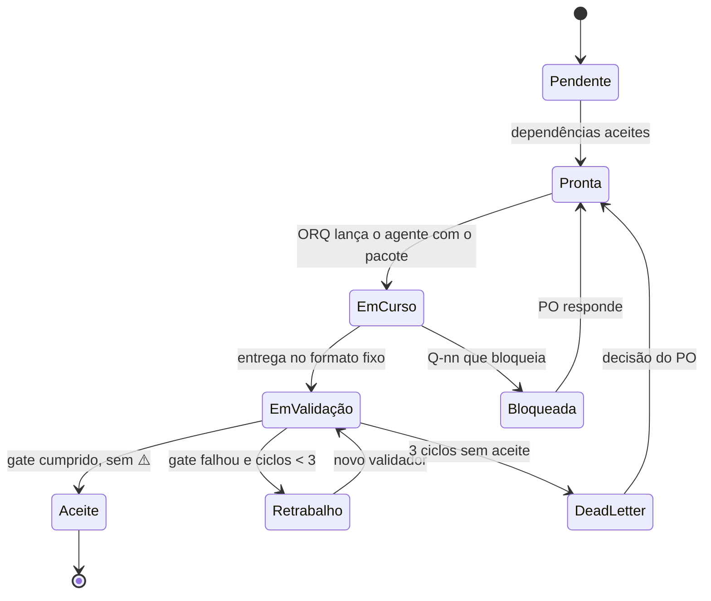
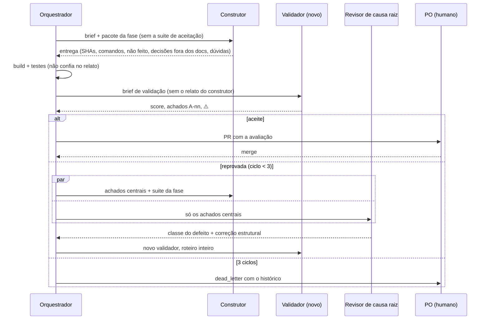

# Entregável 1 — Processo de Análise e Especificação de Requisitos para Geração de Código por LLM

> **Versão:** 2.1 · **Data:** 2026-10-19 · **Estado:** Para validação
> **Artefactos relacionados:** `template/` (Entregável 2, conjunto de modelos) · `03_guia_preenchimento_template.md` (Entregável 3)
> **Versão anterior:** `_versoes/v1.1/` (processo monolítico com geração numa só passagem)
> **O que mudou na v2:** o processo inteiro passa a ser decomposto em **unidades de trabalho** organizadas num grafo de dependências. As unidades independentes correm em **paralelo**, e cada agente recebe apenas o **pacote de contexto** da sua unidade. A geração do código deixa de ser feita numa só passagem e passa a ser feita **por fases de implementação**, cada uma com aceite próprio, validador independente e retrabalho limitado. As práticas vêm de um caso real de desenvolvimento 100 % por IA (secção 9).

---

## 0. Propósito e premissas

Este processo transforma conhecimento de negócio e de arquitetura numa especificação fechada em Markdown e, a partir dela, num sistema implementado por LLMs com conformidade **≥ 90 %** face aos requisitos, medida de forma objetiva (§7).

Premissas:

1. **Uma LLM alucina menos quando tem menos espaço para adivinhar.** Cada lacuna é uma decisão que a LLM toma sozinha.
2. **Uma LLM erra mais quando o contexto é grande e difuso.** Um agente que lê 200 KB para implementar 3 endpoints mistura regras de outras partes do sistema. Por isso cada agente recebe só o que a sua unidade precisa.
3. **Uma especificação nunca está certa à primeira.** O processo tem de absorver decisões novas a meio com custo baixo: unidades pequenas, registos vivos e validação independente a cada passo.

### 0.1 Princípios normativos

| # | Princípio | Significado operacional |
|---|---|---|
| P1 | **Mundo fechado** | O que não está especificado **não deve** ser implementado. Perante uma ambiguidade, o agente **não inventa**: regista a dúvida e segue com a hipótese mais simples, marcada como tal. |
| P2 | **Determinismo** | Cada enunciado admite uma única interpretação. Valores concretos substituem adjetivos. |
| P3 | **Atomicidade** | Um ID corresponde a uma regra, a um comportamento e a um resultado verificável. |
| P4 | **Rastreabilidade bidirecional** | RF ↔ RN ↔ EP/EV ↔ CA ↔ teste ↔ fase ↔ commit. Os IDs aparecem nos nomes dos testes e nas mensagens de commit. |
| P5 | **Verificabilidade** | Sem CA não há requisito. Todo o CA tem pelo menos um caso de borda. |
| P6 | **Linguagem normativa** | Só **DEVE**, **NÃO DEVE**, **DEVERIA**, **NÃO DEVERIA** e **PODE** (RFC 2119/8174). |
| P7 | **Contexto mínimo** | Cada agente recebe um **pacote de contexto** fechado, com orçamento de tamanho. O que não está no pacote não existe para esse agente. |
| P8 | **Contrato antes do paralelismo** | Duas unidades só correm em paralelo depois de congelados os contratos que partilham (dados, interfaces, erros, convenções). |
| P9 | **Posse exclusiva** | Cada ficheiro (da especificação ou do código) tem um único dono por unidade de trabalho. Duas unidades paralelas nunca escrevem no mesmo ficheiro. |
| P10 | **Validação independente** | Quem valida nunca é quem produziu, e não lê o relato de quem produziu. Cada ciclo usa um validador novo. |
| P11 | **Evidência etiquetada** | Toda a afirmação sobre um sistema existente diz de onde vem: `[MEDIDO]` (exercitado num ambiente real; só é válido se citar um script versionado em `evidencias/` do repositório da especificação e o respetivo ficheiro de resultado; pastas temporárias não contam), `[CÓDIGO]` (lido no código, com `ficheiro:linha`) ou `[DOC]` (lido em documentação). O que não foi verificado é uma **lacuna**, não um pressuposto. |
| P12 | **Humano nas decisões e nos merges** | Decisões de negócio, aprovação de fases, merges e qualquer ação em produção exigem uma mensagem literal do humano. "O humano já autorizou", dito por outro agente, não conta. |

### 0.2 Identificadores

| Prefixo | Item | Onde vive |
|---|---|---|
| `ADR-nn` | Decisão arquitetural | Núcleo (`10`) |
| `RNF-nn` | Requisito não funcional mensurável | Núcleo |
| `ERR-<área>-nnn` | Código de erro (catálogo global) | Núcleo |
| `EXT-nn` | Sistema ou contrato externo | Sistema existente (`20`) |
| `L-nn` | Lacuna (não verificado) | `20` e registo (`90`) |
| `ENT-nn`, `ENUM-nn` | Entidade, tipo enumerado | Dados (`30`) |
| `EP-nn`, `EV-nn` | Endpoint, evento | Interface em `40`; detalhe no módulo dono |
| `M-nn` | Módulo de especificação | `50-modulos/` |
| `RF-nn`, `RN-nn`, `EX-nn.m`, `CA-nn.m` | Requisito, regra, exceção, critério | No módulo dono |
| `F-nn` | Fase de implementação | Plano de fases (`60`) |
| `UT-<fase>-nn` | Unidade de trabalho do processo | Registo (`90`) |
| `D-nn` | Decisão do PO (datada, revisável) | Registo (`90`) |
| `Q-nn` | Pergunta aberta (com "bloqueia") | Registo (`90`) |
| `PRS-nn` | Pressuposto de fecho aprovado | Núcleo ou módulo |
| `DEF-nn` | Defeito de ambiguidade | Registo (`90`) |
| `A-nn` | Achado de validação de uma fase | Registo (`90`) |
| `CR-nn` | Pedido de alteração depois do congelamento | Registo (`90`) |

Os IDs são **imutáveis**. Um item removido fica marcado `[REMOVIDO]` e o ID nunca se reutiliza.

---

## 1. Modelo de execução: unidades de trabalho, grafo e pacotes de contexto

### 1.1 Unidade de trabalho (UT)

Todo o trabalho do processo, da elicitação à implementação, é feito em **unidades de trabalho**. Uma UT tem:

| Campo | Conteúdo |
|---|---|
| ID | `UT-<fase>-nn` (por exemplo, `UT-3-04` = Fase 3, módulo 4) |
| Papel | Quem a executa (§1.4) |
| Depende de | UT que têm de estar **aceites** antes de começar |
| Pacote de contexto | Lista exata de ficheiros e secções que o agente recebe (§1.3) |
| Escreve | Ficheiros de que é dona (P9) |
| Não toca | Ficheiros e comportamentos fora do seu âmbito |
| Entrega | Formato fixo (§6.5) |
| Aceite | Gate da UT, verificado por um validador independente |

### 1.2 Grafo de dependências e paralelismo

O orquestrador mantém o **grafo de UT** no registo (`90`). Uma UT fica pronta a correr quando todas as UT de que depende estão aceites. **Todas as UT prontas ao mesmo tempo correm em paralelo**, cada uma com o seu agente, até ao limite de agentes simultâneos definido no protocolo.

```mermaid
flowchart LR
    subgraph F1["Fase 1 — Elicitação"]
      U11["UT-1-01 Núcleo<br/>(contexto, stack, ADR)"]
      U12["UT-1-02..n Sistemas externos<br/>(1 por EXT, em paralelo)"]
      U13["UT-1-90 Decomposição<br/>em módulos"]
    end
    subgraph F2["Fase 2 — Contratos partilhados"]
      U21["UT-2-01 Dados"]
      U22["UT-2-02 Interfaces,<br/>erros, autorização"]
    end
    subgraph F3["Fase 3 — Módulos"]
      U31["UT-3-01 M-01"]
      U32["UT-3-02 M-02"]
      U3n["UT-3-0n M-0n"]
    end
    subgraph F4["Fase 4 — Validação"]
      U41["UT-4-01..n Revisão cega<br/>por módulo"]
      U4x["UT-4-90 Consistência<br/>entre módulos + ensaio"]
    end
    subgraph F5["Fase 5 — Implementação"]
      P["UT-5-00 Plano de fases"]
      F0["F-00 Esqueleto<br/>+ laço mínimo"]
      FA["F-01"]
      FB["F-02"]
      FC["F-03"]
      INT["UT-5-90 Integração<br/>+ auditoria final"]
    end
    U11 --> U12 & U13
    U12 --> U13
    U13 --> U21 & U22
    U21 --> U22
    U22 --> U31 & U32 & U3n
    U31 & U32 & U3n --> U41
    U41 --> U4x --> P --> F0
    F0 --> FA & FB
    FA --> FC
    FB & FC --> INT
```



**Regras de paralelismo:**

1. Só correm em paralelo UT que **não escrevem no mesmo ficheiro** (P9) e cujas dependências estão aceites.
2. O que é partilhado (núcleo, dados, interfaces, catálogo de erros) é produzido **antes** e congelado (P8). Uma UT paralela que precise de alterar algo partilhado **não o altera**: abre um `CR-nn` (§8) e para ou segue com a hipótese marcada.
3. Uma UT que depende de outra recebe apenas a **interface** dessa outra (assinaturas, contratos, erros), nunca a sua implementação nem o seu histórico.
4. Na implementação, ramos paralelos convergem numa UT de **integração**, que corre a suite de regressão completa.
5. **Faixas de identificadores antes do paralelismo:** a UT de decomposição atribui a cada UT e a cada módulo uma faixa exclusiva de identificadores (`PRS`, `RN`, `CA`, `Q`, `ERR`, `IF`) registada no índice (`00` §4) antes de qualquer UT paralela começar. Nenhuma UT paralela **DEVE** criar identificadores fora da sua faixa atribuída.

### 1.3 Pacote de contexto e orçamento

O **pacote de contexto** é o único material que o agente de uma UT recebe. É montado pelo orquestrador a partir do índice (`00`) e contém sempre:

- o **brief** da UT, preenchido a partir do modelo (`80`);
- o **núcleo** (`10`), ou a parte do núcleo indicada no brief;
- os ficheiros e secções listados no campo "Pacote de contexto" da UT;
- as **interfaces** (e só as interfaces) das UT de que depende.

O pacote **não deve** conter:
- o histórico de conversa de outros agentes;
- o relato do construtor (no caso do validador);
- documentos inteiros quando só uma secção é necessária;
- segredos, tokens ou dados pessoais reais.

**Orçamento:** cada pacote tem um teto de tamanho fixado no protocolo (valor de referência: **≤ 60 KB de especificação**, cerca de 15 mil tokens). Se um pacote não couber no orçamento, a UT é demasiado grande e é **dividida**. Não se aumenta o orçamento.

**Verificação automática e fecho de referências:** a integridade e o orçamento de cada pacote são validados por script automático (`evidencias/medir-pacotes.py` ou equivalente). O script verifica obrigatoriamente: (a) dimensão total ≤ orçamento contando todas as secções declaradas (incluindo `20`, `70` e o brief) e (b) fecho de referências, confirmando que cada identificador ou secção citado no texto do pacote está definido dentro do mesmo pacote. A verificação **DEVE** falhar se existirem referências em falta ou se o orçamento for ultrapassado.

### 1.4 Papéis

| Sigla | Papel | Pode | Não pode |
|---|---|---|---|
| **PO** | Product Owner / Especialista de Domínio (humano) | Decidir (`D-nn`), responder (`Q-nn`), aprovar PRS, aceitar fases, fazer merge, autorizar ações em produção | — |
| **ORQ** | Orquestrador (agente) | Manter o grafo e o registo, montar pacotes, lançar agentes, recalcular scores, decidir aprovar ou reprovar segundo a regra | Escrever especificação ou código; propor ou decidir alterações na especificação (`CR-nn`) ou divisões de módulos; aceitar uma fase sem o veredito do validador; decidir pelo PO |
| **AR** | Analista de Requisitos (agente ou humano) | Escrever a especificação da sua UT | Escrever fora dos ficheiros de que é dono |
| **ARQ** | Arquiteto | Dono do núcleo, dos dados e das interfaces | Alterar o que está congelado sem `CR-nn` |
| **RI** | Revisor independente (agente novo ou humano) | Ler o pacote da UT revista e apontar defeitos | Ler o registo de defeitos anterior ou o relato do autor |
| **CON** | Construtor (agente) | Implementar uma fase no seu worktree ou branch, fazer commit | Tocar em ficheiros fora da fase; fazer merge; mudar a especificação |
| **VAL** | Validador (agente **novo a cada ciclo**) | Executar a suite e o roteiro, inspecionar o diff, atribuir o score | Ler o relato do construtor; corrigir código |
| **REV** | Revisor de causa raiz (agente) | Analisar só os achados centrais, encontrar a classe do defeito | Implementar |
| **AUD** | Auditor de conformidade | Escrever a suite de aceitação antes da construção; medir a conformidade final | Ser o autor da especificação |

> Num contexto académico, uma pessoa pode acumular papéis humanos (PO, ARQ). Os papéis de validação (RI, VAL, AUD) **nunca** acumulam com o papel que produziu o artefacto validado. Qualquer exceção é registada como ameaça à validade.

### 1.5 Ciclo de vida de uma UT



---

## 2. Fase 1 — Elicitação e Contexto Arquitetural

**Objetivo:** fixar o que a LLM **não deve** decidir sozinha e cortar o sistema em módulos que possam ser especificados e implementados em paralelo.

### Unidades de trabalho

| UT | Papel | Depende de | Paralelo com | Escreve |
|---|---|---|---|---|
| UT-1-01 Núcleo | AR + ARQ | — | — | `10-nucleo.md` (contexto, âmbito, atores, glossário, stack, ADR, RNF, convenções, transversais) |
| UT-1-02..n Sistemas externos | AR (1 agente por `EXT-nn`) | UT-1-01 | Entre si | `20-sistema-existente.md`, uma secção por `EXT-nn` |
| UT-1-90 Decomposição | AR + ARQ | UT-1-01, UT-1-02..n | — | `00-indice.md` (mapa de módulos), `90-registo.md` (grafo inicial) |

### Atividades

1. **1.1 Delimitar o âmbito** com as colunas *dentro* e *fora*. Tudo o que a fonte menciona mas não se implementa vai para *fora*.
2. **1.2 Fixar a stack com versões exatas** e a lista exaustiva de dependências permitidas.
3. **1.3 Extrair os ADR**, cada um com a **consequência obrigatória no código**.
4. **1.4 Converter qualidades em RNF mensuráveis** e marcar se cada RNF entra na métrica (`CA-nn.m`) ou fica fora dela, com o motivo.
5. **1.5 Levantar os sistemas externos**, em paralelo, um agente por sistema. Para cada endpoint, evento ou regra externa: o contrato, o **comportamento medido** e a etiqueta de evidência (P11). Sempre que houver ambiente de teste autorizado, **medir** em vez de ler: no caso de referência, um contrato lido na documentação estava errado e só o ensaio real o revelou. O que não puder ser verificado vai para `L-nn`.
6. **1.6 Construir o glossário**, com um nome canónico por termo e a lista de sinónimos proibidos.
7. **1.7 Decompor em módulos (`M-nn`).** Um módulo é uma fatia coesa do domínio (um agregado ou um contexto delimitado) com poucos pontos de contacto com os outros. Critérios de corte:
   - cada módulo cabe num pacote de contexto (§1.3) com o núcleo e as interfaces de que depende;
   - os pontos de contacto entre módulos são **só** dados partilhados e interfaces (`EP`/`EV`), que vão para a Fase 2;
   - indicativamente, 3 a 8 RF por módulo;
   - a UT de decomposição (UT-1-90) atribui e regista no índice (`00` §4) uma faixa exclusiva de identificadores (`PRS`, `RN`, `CA`, `Q`, `ERR`, `IF`) para cada UT e para cada módulo, antes do arranque de qualquer UT paralela.
8. **1.8 Registar as perguntas** (`Q-nn`) com quem responde e que UT bloqueiam, e as decisões tomadas (`D-nn`) com data e origem.

### Gate 1
- [ ] Âmbito aprovado pelo PO (`D-nn`).
- [ ] Stack com versões exatas; RNF com métrica, limiar, método e "na métrica / fora".
- [ ] Cada ADR com a consequência no código.
- [ ] Cada afirmação sobre sistemas externos com etiqueta de evidência; o não verificado está em `L-nn`.
- [ ] Mapa de módulos no índice. Cada módulo tem âmbito, dependências e uma estimativa de pacote dentro do orçamento.
- [ ] Tabela de faixas exclusivas de identificadores (`PRS`, `RN`, `CA`, `Q`, `ERR`, `IF`) por UT e por módulo atribuída e registada no índice (`00` §4).
- [ ] Nenhuma `Q-nn` que bloqueie a Fase 2 está aberta.

---

## 3. Fase 2 — Modelação de Domínio e Contratos Partilhados

**Objetivo:** congelar tudo o que os módulos partilham, para que a Fase 3 e a implementação possam correr em paralelo sem divergir (P8).

### Unidades de trabalho

| UT | Papel | Depende de | Paralelo com | Escreve |
|---|---|---|---|---|
| UT-2-01 Dados | AR + ARQ | UT-1-90 | — | `30-dados.md` |
| UT-2-02 Interfaces | AR + ARQ | UT-2-01 | — | `40-contratos.md` |
| UT-2-03 Ambiente de teste | AUD | UT-2-01 | UT-2-02 | `70-ambiente-teste.md` |

### Atividades

1. **2.1 Modelo de dados partilhado.** ERD, dicionário físico (tipos exatos, nulidade, default, PK/FK/UQ, `CHECK`, `ON DELETE`), índices, estruturas de cache com TTL e seed. Cada tabela indica o **módulo dono**: só esse módulo a escreve, os outros apenas leem.
2. **2.2 Tipos enumerados e máquinas de estado**, com as transições permitidas (as restantes são proibidas).
3. **2.3 Cobertura de entrada.** Para integrações e importações: cada campo de origem tem um destino ou fica marcado como **não mapeado**, com uma decisão `D-nn`. Nada é descartado em silêncio.
4. **2.4 Convenções globais de API.** Base path, autenticação, formato de erro (RFC 9457), envelope, paginação, datas, correlação.
5. **2.5 Interfaces.** Uma tabela com **todos** os `EP-nn` e `EV-nn`: método/path ou tópico, módulo dono, permissão exigida e um resumo de request/response. O detalhe completo de cada endpoint fica no módulo dono (Fase 3); esta tabela é o que os outros módulos recebem. O documento `40` **DEVE** incluir a tabela de **Tipos partilhados** (nome, pasta, namespace e campos tipados). As interfaces internas (`IF-nn`), endpoints e eventos **DEVEM** utilizar exclusivamente tipos definidos nessa tabela ou tipos primitivos da stack.
6. **2.6 Matriz de autorização.** Endpoint × escopo ou papel, com "permitido" ou o status e o `ERR` devolvidos.
7. **2.7 Catálogo de erros global.** Código estável `ERR-<área>-nnn`, status, `title` fixo e condição. Distinguir **erro de dado** de **erro HTTP**: um registo inválido num lote não é um 400, é um resultado de validação do registo com resposta 200. O contrato do ambiente de teste e o núcleo **DEVEM** distinguir falhas de infraestrutura (como falha de ligação ou indisponibilidade da base de dados → 503) de erros do SGBD com significado de negócio (como violação de unicidade → 409 ou violação de isolamento/RLS → 403), através de uma tabela explícita de correspondência de `SQLSTATE` (ou código equivalente do driver) para código de erro do catálogo.
8. **2.8 Validação de entrada em camadas, por ordem fixa:** transporte (tamanho, `Content-Type`, codificação), formato, autenticação, autorização, existência, regras de negócio. **A primeira camada que falha determina a resposta.**
9. **2.9 Checklist global de robustez de entrada** (`40` §3; guia §G-40): corpo vazio, JSON malformado, `null` em listas, carácter NUL, texto não UTF-8, comprimentos extremos, `Content-Type` estranho, paginação com overflow, multipart truncado. Para cada caso, a resposta esperada. *No caso de referência, a resposta 500 em vez de 4xx para entrada malformada repetiu-se em 6 fases.*
10. **2.10 Contrato do ambiente de teste** (UT-2-03): arranque, portas, carga de dados, cunhagem de tokens, relógio, inspeção de efeitos, **injeção de falhas** e **fakes dos sistemas externos**. Um fake implementa **só o comportamento `[MEDIDO]`** do sistema externo. Um comportamento `[DOC]` é implementado com uma marca de "não verificado" e vai para `L-nn`.
11. **2.11 Matriz de isolamento executada contra o SGBD real.** Em sistemas com múltiplos inquilinos (*multi-tenant*) com isolamento por RLS, filtros ou interceptores, um script **DEVE** exercitar cada endpoint de escrita e cada leitura cruzada nos modos previstos (`SINGLE`, `MACRO_GROUP`, bypass), com e sem cláusula `RETURNING` (típica de mapeadores objeto-relacionais). Os resultados obtidos **DEVEM** ser registados em `evidencias/` e citados na especificação com etiqueta `[MEDIDO]`.

### Gate 2 (congela o núcleo, os dados e as interfaces)
- [ ] Todo o atributo tem tipo físico, nulidade e restrição; toda a FK tem `ON DELETE`; toda a tabela tem módulo dono.
- [ ] A tabela de interfaces cobre todos os `EP`/`EV`, cada um com módulo dono.
- [ ] Tabela de tipos partilhados definida em `40` e utilizada por todas as interfaces.
- [ ] A matriz de autorização cobre todos os endpoints.
- [ ] O catálogo de erros não tem órfãos e contém a distinção entre falhas de infraestrutura e erros de negócio via tabela SQLSTATE.
- [ ] A ordem das camadas de validação e o checklist de robustez estão definidos.
- [ ] O contrato do ambiente de teste está completo, incluindo os fakes e a injeção de falhas.
- [ ] Matriz de isolamento executada por script contra o SGBD real e citada na especificação com `[MEDIDO]` (quando existir isolamento multi-tenant).
- [ ] Fecho de referências e orçamento verificado por script automático para todos os pacotes das UT.
- [ ] Hash dos ficheiros `10`, `30`, `40` e `70` registado em `90`. A partir daqui, só mudam com `CR-nn`.

---

## 4. Fase 3 — Escrita Determinística dos Módulos (em paralelo)

**Objetivo:** especificar o **comportamento** de cada módulo, em paralelo, um agente por módulo.

### Unidades de trabalho

| UT | Papel | Depende de | Paralelo com | Pacote de contexto | Escreve |
|---|---|---|---|---|---|
| UT-3-nn (uma por `M-nn`) | AR | Gate 2 | Todas as UT-3 | Núcleo + `30` (só as tabelas que o módulo lê ou escreve) + `40` (interfaces) + `70` + a secção de `20` dos sistemas externos que o módulo usa | `50-modulos/M-nn.md` |

### Atividades (por módulo)

1. **3.1 Endpoints e eventos do módulo**, em detalhe: esquema de request e de response campo a campo (com ordenação de listas), **ordem de avaliação** (§2.8 aplicada ao endpoint), **todas** as respostas (incluindo as rejeições do middleware), idempotência, efeitos colaterais por ordem e transacionalidade.
2. **3.2 RF**, com ator, gatilho, pré-condições, fluxo principal numerado, pós-condições e prioridade MoSCoW.
3. **3.3 RN** na forma canónica **SE/ENTÃO/SENÃO**, com parâmetros concretos e o `ERR` emitido. Uma consequência por RN.
4. **3.4 Fluxos de exceção** (`EX-nn.m`), com a resposta, o que **não** é persistido e o estado final.
5. **3.5 Concorrência, idempotência e retomada.** Obrigatório em todo o RF que escreve. Para cada um: o que acontece com dois pedidos simultâneos, com o processo morto a meio, com uma resposta perdida de um sistema externo e com um registo igual criado por fora. *No caso de referência, todas as falhas críticas vieram daqui.*
6. **3.6 Critérios de aceitação** (`CA-nn.m`) em Gherkin, com a cobertura mínima:
   - caminho feliz;
   - 1 por RN, 1 por EX, 1 por variante de operação, 1 por transição de estado;
   - 1 negativo de autorização (se o RF tiver controlo de acesso);
   - 1 por cenário de concorrência ou retomada da atividade 3.5;
   - **cada CA tem pelo menos um caso de borda** (`Esquema do Cenário` com `Exemplos`, ou um cenário irmão com a tag `@borda`).
   Cada CA verifica **um** comportamento e tem dados de partida que respeitam o modelo. Os passos `Então` afirmam valores observáveis, e cada valor literal deriva do `Dado` e das RN.
7. **3.7 Criticidade.** Só são `@critico` os CA cuja falha implica violação de segurança, de isolamento entre tenants, perda ou duplicação de dados, ou segredo em log.
8. **3.8 Dados de referência (oráculo).** Quando existir uma entrada real ou representativa (um ficheiro, um conjunto de pedidos), registar os **totais esperados** e reconciliá-los. Se existir um protótipo executável do comportamento, ele é a especificação executável e os seus testes são portados para CA.
9. **3.9 Rastreabilidade local** e PRS do módulo. Todo o parâmetro que não vem da fonte tem um `PRS-nn`.

### Gate 3 (por módulo)
- [ ] Cobertura mínima de CA da atividade 3.6, incluindo bordas, concorrência e retomada.
- [ ] Todas as RN em forma canónica, uma consequência cada, com `ERR`.
- [ ] Todo o endpoint do módulo tem ordem de avaliação e todas as respostas.
- [ ] O módulo só referencia dados e interfaces congelados no Gate 2. Qualquer necessidade nova está num `CR-nn`.
- [ ] O pacote de contexto do módulo cabe no orçamento e tem fecho de referências completo, verificado por script automático.

---

## 5. Fase 4 — Validação de Ambiguidade pré-LLM (em paralelo)

**Objetivo:** encontrar e eliminar, antes da implementação, tudo o que admite mais do que uma implementação.

### Unidades de trabalho

| UT | Papel | Depende de | Paralelo com | Pacote |
|---|---|---|---|---|
| UT-4-01..n Revisão cega por módulo | RI (agente novo por módulo) | UT-3-nn do módulo | Entre si | O mesmo pacote que o construtor do módulo vai receber |
| UT-4-90 Consistência entre módulos | RI | Todas as UT-4-0n | — | Núcleo + `30` + `40` + as secções de interfaces e erros de todos os módulos |
| UT-4-91 Ensaio | RI | UT-4-90 | — | Pacote de um módulo e o ambiente de teste |

### Atividades

1. **4.1 Lint léxico** sobre cada ficheiro (termos proibidos do guia, §2.3, placeholders `<<`, `TBD`, `TODO`). Cada ocorrência conta como um defeito.
   ```bash
   grep -nE '<<|\bTBD\b|\bTODO\b|<!--' <ficheiro>
   grep -nEi '\badequad|\bapropriad|\brápid|\beficient|\bseguro\b|\brobust|\bflexíve|\bintuitiv|\bamigáve|\bnormalmente\b|\bgeralmente\b|quando aplicável|se necessário|\betc\b|entre outros|e/ou|\.\.\.|similar a|\btratar\b|\bgerir\b|\bsuportar\b|a definir' <ficheiro>
   ```
2. **4.2 Verificação estrutural e fecho de referências:** execução obrigatória do script de verificação de fecho de referências e orçamento de cada pacote (confirmando que todo o identificador ou secção citado está definido no pacote e que a dimensão total ≤ orçamento contando todas as secções declaradas); deteção de órfãos de rastreabilidade, `ERR` órfãos, valores fora do tipo ou do enum declarado, tabelas escritas por um módulo que não é o dono.
3. **4.3 Interrogatório por LLM**, por módulo, numa sessão nova, com o **modelo alvo** e **com o mesmo pacote que o construtor vai receber**. Assim mede-se a ambiguidade que o construtor vai de facto encontrar.
   ```text
   NÃO gere código. Você vai implementar o módulo descrito abaixo, e este pacote é tudo o que vai receber.
   Liste, numeradas e com o ID do item afetado:
   (a) cada pergunta que precisaria de fazer antes de implementar;
   (b) cada suposição que faria por falta de informação;
   (c) cada contradição;
   (d) cada comportamento com mais de uma implementação razoável;
   (e) cada informação que precisaria de outro documento que não está neste pacote.
   Se uma categoria não tiver itens, escreva "nenhum".
   ```
   A categoria (e) mede se o **pacote de contexto está completo**. Um item em (e) é um defeito do pacote, não do módulo.
4. **4.4 Validação dos oráculos.** Cada valor literal dos `Então` deriva do `Dado`, do seed e das RN, e os dados de partida respeitam as FK.
5. **4.5 Consistência entre módulos** (UT-4-90): nomes, erros e interfaces iguais em todos os módulos; nenhuma RN de um módulo contradiz outra; nenhum endpoint fica sem dono.
6. **4.6 Ensaio por um agente sem contexto** (UT-4-91). Um agente novo segue um pedaço da especificação e executa-o, por exemplo os comandos do contrato do ambiente de teste ou um runbook, e regista cada ponto em que a especificação o levaria a errar. *No caso de referência, o ensaio de um documento encontrou 20 correções, 3 das quais levariam o agente a erro, incluindo uma de segurança.*
7. **4.7 Verificação de pins**: restaurar um esqueleto com as versões exatas da stack. Um conflito de versões conta como um defeito Alto.
8. **4.8 Triagem e correção.** Um ID por defeito, nunca agrupado. Severidade, correção na UT de origem e resolução com a linha onde a correção ficou.
9. **4.9 Re-revisão cega** dos módulos corrigidos, com novos RI, até zero defeitos.
10. **4.10 Congelamento.** Hash de cada ficheiro da especificação em `spec.sha256`. Os pacotes de contexto passam a ser montados só a partir de ficheiros congelados.

### Métrica de processo: Índice de Ambiguidade (por módulo e global)

$$
IA_m = \frac{D_m}{N_m}, \qquad N_m = |RF| + |RN| + |EP| + |EV| + |CA| \text{ do módulo } m
$$

- **IA inicial:** defeitos individuais da primeira passagem (4.1 a 4.7) sobre a versão revista.
- **IA residual:** defeitos pertinentes encontrados pela última re-revisão cega (4.9). Tem de ser **0** em todos os módulos.
- **IA global:** a soma dos defeitos sobre a soma dos itens. É o valor reportado no relatório científico, junto com o IA de cada módulo.

### Gate 4 — *Definition of Ready* da especificação
Grupos A a D da checklist do Entregável 3, §6.1, aplicados ao núcleo e a cada módulo, **e** IA residual = 0 em todos os módulos.

---

## 6. Fase 5 — Implementação por Fases e Auditoria de Conformidade

**Objetivo:** construir o sistema em **fases de implementação** pequenas, em paralelo quando o grafo o permite, cada uma com aceite próprio. No fim, medir a conformidade do sistema integrado.

### 6.1 Unidades de trabalho

| UT | Papel | Depende de | Paralelo com | Escreve |
|---|---|---|---|---|
| UT-5-00 Plano de fases | AR + ARQ | Gate 4 | UT-5-01 | `60-plano-de-fases.md` |
| UT-5-01 Suite de aceitação | AUD | Gate 4 | UT-5-00 | Testes de aceitação (um por CA), versionados |
| F-00 Esqueleto e laço mínimo | CON | UT-5-00, UT-5-01 | — | Projeto, transversais, primeiro fluxo ponta a ponta |
| F-nn | CON (um ou mais) | O que o plano indicar | As fases sem dependência entre si | Os ficheiros da fase |
| UT-5-90 Integração e auditoria final | AUD | Todas as F-nn | — | Folha de auditoria e métricas finais |

### 6.2 Plano de fases (UT-5-00)

Cada fase `F-nn` tem um bloco fixo:

| Campo | Conteúdo |
|---|---|
| Objetivo | Uma frase |
| Demo | O que se consegue mostrar no fim da fase |
| Constrói | Lista numerada (RF, EP, EV, ENT, transversais) |
| CA da fase | Lista de `CA-nn.m`. Cada CA pertence a **uma e uma só** fase |
| **Não tocar ainda** | Ficheiros, comportamentos e módulos fora da fase. O validador compara-o com o diff |
| Depende de | Fases que têm de estar aceites |
| Paralelo com | Fases que podem correr ao mesmo tempo |
| Pacote de contexto | Núcleo + módulo(s) + interfaces dos módulos de que depende + `70` + o código já aceite que a fase usa (só as interfaces) |
| Escreve | Pastas e ficheiros de que é dona |
| Riscos | Pontos conhecidos de falha |

**Regras do plano:**

1. **F-00 é sempre o laço mínimo ponta a ponta:** a estrutura do projeto, os transversais (envelope, erros, autenticação, logging, correlação, migrações, Dockerfile e compose) e **um** fluxo completo do pedido à persistência. Todas as outras fases dependem de F-00.
2. As fases seguem os módulos sempre que possível: um módulo dá uma fase ou poucas. Os ramos paralelos são os módulos sem dependência entre si.
3. Uma fase cabe num pacote de contexto e tem, indicativamente, 5 a 20 CA.
4. **Uma fase pode ter construtores paralelos** desde que escrevam em ficheiros disjuntos. Exemplo: um constrói o código e outro constrói os fakes e as fixtures que a fase precisa.
5. Uma fase de **ensaio no ambiente real**, quando existir, vem antes de qualquer fase que escreva num sistema externo em produção.

### 6.3 Suite de aceitação (UT-5-01)

O AUD converte cada CA num teste de caixa-preta, segundo o contrato do ambiente de teste (`70`). O nome do teste segue a convenção `CA_<nn>_<m>_<descricao>`, e as bordas usam `CA_<nn>_<m>_Borda_<descricao>`. A suite é validada antes de qualquer construção, contra uma implementação de referência ou oráculo a oráculo. A suite fica guardada **fora do alcance do construtor** (num repositório ou numa pasta a que o agente construtor não tem acesso), até ao fim do primeiro ciclo da fase.

> **Suite oculta no 1.º ciclo, visível no retrabalho.** No primeiro ciclo de cada fase, o construtor só tem a especificação (incluindo os CA em Gherkin, que fazem parte dela) e escreve os seus próprios testes a partir dos CA. **Não** recebe a suite de aceitação do AUD. Assim, $C_w^{(1)}$ mede se a especificação basta para acertar, e não se o código passa testes que a LLM já conhecia. A partir do ciclo 2 (retrabalho), o construtor recebe a suite da fase, porque aí o objetivo passa a ser corrigir, e isso é medido em separado ($C_w^{final}$).

### 6.4 Ciclo de uma fase



1. **Construção (ciclo 1).** O construtor recebe só o brief e o pacote da fase. **Não** recebe a suite de aceitação: escreve os seus próprios testes a partir dos CA. O orquestrador confirma que o worktree do construtor não contém a suite. Entrega no formato fixo (§6.5). Se algo estiver ambíguo, **não inventa**: regista a dúvida e segue com a hipótese mais simples, marcada como tal.
2. **Verificação pelo orquestrador.** Corre build e testes. Não confia no relato.
3. **Validação.** Um validador **novo** recebe o pacote da fase, o diff e a suite, mas **não** o relato do construtor. Calcula o score da fase (§7.2), verifica o "Não tocar ainda" no diff, corre o checklist de robustez e a regressão das fases anteriores, e regista os achados `A-nn`. PODE aplicar testes de mutação para verificar que os testes da fase detetam falhas.
4. **Retrabalho** (se reprovada e ciclo < 3), em paralelo:
   - o construtor recebe os achados centrais e, a partir deste ciclo, a suite de aceitação da fase, e corrige;
   - o revisor recebe só os achados centrais e identifica a **classe do defeito**.
   - A correção exigida tem três partes: (a) o conserto pontual, (b) a mudança que torna a classe impossível (um ponto único de verificação, um tipo que não admite o estado inválido, ou um teste de varredura que cobre todos os pontos do mesmo tipo), e (c) os débitos adjacentes.
   - Cada achado corrigido traz um teste que o reproduz. Depois, a fase é revalidada **inteira**, por um validador novo.
5. **Dead letter.** Ao fim de 3 ciclos sem aceite, a fase para e o PO decide: dividir a fase, alterar a especificação (`CR-nn`) ou aceitar com débito registado.
6. **Aceite e merge.** O PR segue o modelo do `80`: Demo, avaliação, escopo construído e não tocado, decisões fora dos docs, dúvidas, débitos e como reproduzir. O merge é feito pelo PO. As fases que dependem desta só começam depois do merge.
7. **Retorno à especificação.** As "decisões fora dos docs" e as "dúvidas" de cada entrega são triadas pelo ORQ: viram `D-nn` (decisão do PO), `CR-nn` (alteração da especificação) ou ficam rejeitadas com motivo. A especificação é atualizada antes das fases seguintes.

### 6.5 Formato de entrega fixo

Todo o agente que entrega trabalho (AR, CON, RI, VAL, REV) usa o formato do seu brief (`80`). Para o construtor:

| Campo | Conteúdo |
|---|---|
| Commits | SHAs e mensagens com os IDs (`RF-nn`, `CA-nn.m`, `A-nn`) |
| Comandos | Build, migração, testes, com o resultado |
| CA cobertos | Tabela `CA → teste → resultado` |
| Não feito | O que ficou por fazer, e porquê |
| Decisões fora dos docs | Cada decisão tomada sem base na especificação |
| Dúvidas | Cada ambiguidade, com a hipótese seguida marcada |
| Débitos | Problemas conhecidos não bloqueantes |

### 6.6 Integração e auditoria final (UT-5-90)

Depois de todas as fases aceites, o AUD corre sobre o sistema integrado (a `main` depois do último merge):
- a suite de aceitação completa;
- o checklist de robustez;
- a inspeção de alucinações (elementos implementados que não constam da especificação).

Daqui sai a folha de auditoria final (`90`) e as métricas do §7.

### 6.7 Protocolo pré-registado

Antes da primeira fase, regista-se em `90`:
- o modelo e a versão;
- a ferramenta (agente com acesso a ficheiros e ao compilador);
- o limite de agentes simultâneos e o orçamento dos pacotes;
- os modelos de brief usados;
- o limite de ciclos (3);
- o comando exato de build e de arranque;
- o número de execuções independentes do pipeline completo (§7.6) e o teste estatístico principal.

---

## 7. Métricas de Conformidade

### 7.1 Unidade e pesos

A unidade é o **CA**. Para cada $a \in A$ (todos os CA da especificação congelada), $s_a \in \{0, 1\}$: vale 1 só se o teste passar ou se a inspeção confirmar todos os `Então`. O peso $w_a$ vem da prioridade do RF: `MUST` = 3, `SHOULD` = 2, `COULD` = 1.

$$
C_w(X) = \frac{\sum_{a \in X} w_a \cdot s_a}{\sum_{a \in X} w_a} \times 100\%
$$

### 7.2 Aceite de uma fase

Uma fase `F` é **aceite** se e só se todas as condições abaixo forem verdadeiras:

| # | Condição | Verificação |
|---|---|---|
| G1 | Compila, arranca e migra numa base vazia | Comando pré-registado |
| G2 | **Veto:** todos os CA `@critico` da fase passam | Suite da fase |
| G3 | $C_w(CA(F)) \geq 90\%$ | Suite da fase |
| G4 | Escopo: nenhum ficheiro do "Não tocar ainda" foi alterado | Diff |
| G5 | Regressão: os CA das fases já aceites continuam a passar | Suite das fases anteriores |
| G6 | Robustez: o checklist de entrada passa para os endpoints da fase | Checklist |

*O veto funciona: no caso de referência, duas fases com score de 97 e 99 foram reprovadas por duplicação de dados, e a correção ficou feita antes do merge.*

### 7.3 Métricas do experimento

| Métrica | Definição | O que mede |
|---|---|---|
| $C_w^{(1)}$ | $C_w$ sobre todos os CA, cada um medido no **primeiro ciclo** da fase a que pertence, com a **suite oculta** ao construtor | **Qualidade da especificação**: quanto a LLM acerta só com o pacote de contexto, sem feedback |
| $C_w^{final}$ | $C_w$ sobre todos os CA, medido na auditoria final do sistema integrado | **Eficácia do processo completo**, incluindo a validação e o retrabalho |
| $\bar k$ | Número médio de ciclos por fase; número de dead letters | Custo do retrabalho |
| $C_u$, $C_{RF}$ | Não ponderado; RF implementados por inteiro | Transparência |
| $TA$ | Elementos implementados não especificados ÷ (EP + EV + ENT) | Mundo fechado (P1) |
| $IA$ inicial e residual | §5 | Qualidade da escrita antes e depois da validação |
| $DFD$ | Decisões fora dos docs e dúvidas por fase | Lacunas que a validação não apanhou |
| Causas | % de falhas por causa: **E** (especificação), **L** (LLM), **T** (teste), **P** (pacote de contexto incompleto). Classificação feita por dois auditores, com kappa de Cohen | Onde melhorar |

### 7.4 Veredito do sistema

$$
\text{Conforme} \iff \text{todas as fases aceites} \;\wedge\; \text{todos os CA } @critico \text{ passam na auditoria final} \;\wedge\; C_w^{final} \geq 90\%
$$

### 7.5 Exemplo de cálculo

Três fases: F-00 com 6 CA `MUST`, F-01 com 10 CA (8 `MUST`, 2 `SHOULD`) e F-02 com 8 CA (6 `MUST`, 2 `COULD`). $\sum w = 18 + 28 + 20 = 66$.

| Fase | Falhas no 1.º ciclo | Pontos no 1.º ciclo | Ciclos até ao aceite | Falhas finais |
|---|---|---|---|---|
| F-00 | 0 | 18 / 18 | 1 | 0 |
| F-01 | 2 `MUST` (1 `@critico`) | 22 / 28 | 2 | 0 |
| F-02 | 1 `COULD` | 19 / 20 | 1 | 1 `COULD` |

- $C_w^{(1)} = 59/66 = 89{,}4\%$. A especificação sozinha ficou abaixo de 90 %.
- $C_w^{final} = 65/66 = 98{,}5\%$. O sistema é **Conforme**.
- $\bar k = 4/3 \approx 1{,}33$.

### 7.6 Generalização estatística (ligação ao Entregável 4)

**Unidade estatística:** uma **execução completa do pipeline** de implementação (de F-00 à auditoria final), com o mesmo modelo, a mesma especificação congelada e a mesma suite. Os CA dentro de uma execução não são independentes, por isso nunca são a unidade.

| Endpoint | Hipóteses ($\alpha = 0{,}05$, unilateral) | Teste |
|---|---|---|
| **Principal: qualidade da especificação** | $H_0: \tilde\mu_{C_w^{(1)}} \leq 90\%$ · $H_1: \tilde\mu_{C_w^{(1)}} > 90\%$ | Wilcoxon de postos sinalizados contra 90; IC 95 % *bootstrap* BCa |
| Secundário: processo completo | $H_0: \tilde\mu_{C_w^{final}} \leq 90\%$ · $H_1: \tilde\mu_{C_w^{final}} > 90\%$ | Wilcoxon contra 90 |
| Veredito | $H_1: p_{conf} > p_0$, com $p_0$ pré-registado | Binomial exato |
| Custo | Descritivo | $\bar k$, dead letters, tempo e tokens por execução |

- **Tamanho da amostra.** Sai de uma análise de potência com um piloto de 2 execuções que não entram na amostra. O recomendado é $n \geq 10$ execuções completas. A paralelização das fases é o que torna este $n$ praticável.
- **Condições de comparação**, com o mesmo $n$, o mesmo modelo e a mesma suite:
  - **C0 (controlo):** a fonte original (por exemplo, a Ideia Base) sem template, numa só geração;
  - **C1:** a especificação monolítica numa só geração (o processo v1.1);
  - **C2:** a especificação modular com implementação por fases (este processo).
  - Comparação com Kruskal-Wallis e, depois, Mann-Whitney unilateral par a par com correção de Holm.
- **Ameaças à validade** (reporte obrigatório):
  - o revisor da Fase 4 ser o mesmo modelo que constrói;
  - acumulação de papéis;
  - uma única especificação e um único modelo;
  - CA fora da métrica;
  - a fronteira entre $C_w^{(1)}$ e $C_w^{final}$ depender da qualidade do validador;
  - fuga da suite oculta para o construtor no 1.º ciclo (mitigação: suite fora do worktree, verificada pelo orquestrador e registada em `90`);
  - a concordância (kappa) na classificação de causas.

---

## 8. Gestão de alterações (transversal a todas as fases)

A especificação congelada muda apenas por **pedido de alteração** com o formato obrigatório `CR-nn` (sempre com numeração sequencial de dois dígitos, nunca outras letras nem prefixos alternativos), registado em `90`.

**Divisão de responsabilidade:**
- O orquestrador (**ORQ**) **NÃO DEVE** propor nem decidir pedidos de alteração na especificação, nem decidir divisões de módulos.
- Quem **propõe** a alteração ou a divisão de módulos é o arquiteto (**ARQ**) no âmbito de uma UT técnica de arquitetura ou reconciliação.
- Quem **aprova** ou rejeita a alteração é exclusivamente o **PO**, através de mensagem literal.

Para cada pedido:

1. **Origem.** Uma decisão nova do PO (`D-nn`), uma dúvida de um construtor, um achado de validação com causa E ou P, ou uma lacuna resolvida (`L-nn`). Proposta elaborada pelo ARQ sob o identificador `CR-nn`.
2. **Análise de impacto pela matriz de rastreabilidade.** Que RF, RN, EP, CA, módulos e fases são afetados.
3. **Decisão do PO** (aceitar, rejeitar ou adiar), com data.
4. **Execução como unidade nova.** A alteração entra como UT própria: a correção na especificação, a re-revisão cega do que mudou e, se o código já existir, uma sub-fase (por exemplo, `F-03b`) com o seu aceite. **Nunca** como remendo dentro de outra fase em curso.
5. **Reabertura.** As fases já aceites que o pedido afeta voltam a correr a suite (regressão). As fases não afetadas não se tocam.
6. **Medição.** As execuções do experimento já feitas **não** são recalculadas. Um pedido que mude CA cria uma nova versão da especificação, e as execuções seguintes são medidas sobre essa versão.

Os débitos de uma fase são corrigidos numa unidade própria **antes** de a fase seguinte que deles depende começar.

---

## 9. Origem empírica das práticas

As práticas da especificação vêm de casos reais de desenvolvimento 100 % por IA: o caso de referência inicial (um serviço .NET de importação em lote, com cerca de 15 mil linhas de código e 1400 testes, 29 PRs e 269 commits em duas semanas) e a aplicação do processo v2 ao Identity-Service em 2026-10-19 (`Etapa2/spec-v2/`).

| Prática | Evidência empírica |
|---|---|
| Fases com "Não tocar ainda" verificado por diff | Um PR por fase; quatro fases fechadas num só dia (caso de referência inicial) |
| Veto de falha crítica | Fases com 97 e 99 pontos reprovadas por duplicação de dados (caso de referência inicial) |
| Validador novo e sem o relato do construtor | Um validador deu 95 e um segundo deu 78, por uma falha de concorrência (caso de referência inicial) |
| Correção da classe do defeito | Pontos únicos de verificação e testes de varredura por reflexão (caso de referência inicial) |
| "Não invente: dúvida + hipótese marcada" | Secção "Decisões fora dos docs / dúvidas" em todos os PRs (caso de referência inicial) |
| Evidência etiquetada e fakes só do medido | O fake herdou uma rota errada da documentação; só o ambiente real a apanhou (caso de referência inicial) |
| Concorrência e retomada obrigatórias | Todas as falhas críticas do projeto vieram daqui (caso de referência inicial) |
| Checklist de robustez de entrada | Respostas 500 com entrada malformada repetiram-se em 6 fases (caso de referência inicial) |
| Ensaio por agente sem contexto | 3 de 20 correções levariam o agente a erro (caso de referência inicial) |
| Gestão de alterações por sub-fase | 17 decisões novas e 7 sub-fases absorvidas sem colapso (caso de referência inicial) |
| Faixas de IDs antes do paralelismo | A UT de decomposição atribui faixas exclusivas de IDs (`PRS`, `RN`, `CA`, `Q`, `ERR`, `IF`) no índice antes do início paralelo; na aplicação, duas UT paralelas usaram PRS-46..52 para pressupostos diferentes e foi preciso renumerar (aplicação ao Identity-Service, 2026-10-19) |
| Fecho de referências dos pacotes | Script verifica fecho de referências e orçamento contando todas as secções declaradas (`20`, `70`, brief); duas validações cegas encontraram pacotes incompletos em 7 de 12 módulos antes de o script existir (aplicação ao Identity-Service, 2026-10-19) |
| Matriz de isolamento executada contra SGBD | Script exercita modos operacionais e cláusula RETURNING contra SGBD real; três contradições entre isolamento e endpoints de gestão passaram revisões de leitura e só foram apanhadas por medição, uma delas só com `INSERT … RETURNING` (aplicação ao Identity-Service, 2026-10-19) |
| Divisão de responsabilidade nos pedidos de alteração | ORQ não decide alterações nem divisões de módulos; ARQ propõe, PO aprova; formato obrigatório CR-nn (aplicação ao Identity-Service, 2026-10-19) |
| Tipos partilhados na tabela de contratos | Tabela de tipos partilhados em `40` impede falhas em assinaturas de interfaces internas (aplicação ao Identity-Service, 2026-10-19) |
| Distinção infraestrutura vs. erros de negócio | Tabela SQLSTATE para código de erro impede que falhas de RLS (403) ou unicidade (409) virem 503 (aplicação ao Identity-Service, 2026-10-19) |
| Medição com script no repositório da especificação | Etiqueta `[MEDIDO]` exige script versionado em `evidencias/` e ficheiro de resultado; pastas temporárias inválidas (aplicação ao Identity-Service, 2026-10-19) |

**O que o caso de referência mostrou que não deve ser copiado:**
- duas regras de precedência contraditórias (a v2 tem uma só, no índice);
- documentos desatualizados sem dono (a v2 tem "dono" e "atualizado em" por documento);
- o registo de fases abandonado nas fases finais (a v2 torna-o critério de aceite do PR);
- dados pessoais reais em fixtures de teste (a v2 proíbe-os no pacote de contexto e exige uma varredura).

---

## 10. Resumo

| Fase | UT paralelas | Entrada | Saída | Gate |
|---|---|---|---|---|
| 1 | Sistemas externos (1 por `EXT`) | Fontes, entrevistas, ambiente real | Núcleo, `20`, mapa de módulos, grafo | Âmbito, stack, evidência, módulos dentro do orçamento |
| 2 | Interfaces ∥ ambiente de teste | Saídas da F1 | `30`, `40`, `70` congelados | Contratos partilhados completos e com hash |
| 3 | Um módulo por agente | Núcleo + dados + interfaces | `50-modulos/M-nn` | Cobertura de CA com bordas, concorrência e retomada |
| 4 | Uma revisão cega por módulo | Pacotes dos módulos | Registo de defeitos, IA, especificação congelada | DoR, IA residual = 0 |
| 5 | Fases sem dependência entre si; construtores com ficheiros disjuntos | Especificação congelada, plano, suite | Código por fase, PR por fase, auditoria final | G1 a G6 por fase; veredito do sistema |
| ∥ | Gestão de alterações | `D`, `Q`, achados, dúvidas | `CR-nn`, sub-fases | Decisão do PO |
