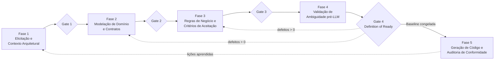

# Entregável 1 — Processo de Análise e Especificação de Requisitos para Geração de Código por LLM

> **Versão:** 1.1 · **Estado:** Revisto após a avaliação independente · **Data:** 2026-10-18
> **Artefactos relacionados:** `template_requisitos_llm.md` (Entregável 2) · `03_guia_preenchimento_template.md` (Entregável 3)

---

## 0. Propósito e premissa

Este processo transforma conhecimento de negócio e de arquitetura numa **especificação fechada** em Markdown, a partir da qual uma LLM gera código-fonte. O objetivo é que esse código cumpra **pelo menos 90 %** dos requisitos, medidos de forma objetiva (ver §7).

A premissa é a seguinte: **uma LLM não alucina menos por ser mais inteligente, alucina menos quando tem menos espaço para adivinhar.** Cada lacuna da especificação (um tipo em falta, um código HTTP omitido, uma regra com "etc.") é uma decisão que a LLM toma sozinha. O processo existe para eliminar essas decisões antes da geração.

### 0.1 Princípios normativos

| # | Princípio | Significado operacional |
|---|---|---|
| P1 | **Mundo fechado** | O que não está especificado **não deve** ser implementado. A LLM recebe essa instrução de forma explícita. |
| P2 | **Determinismo** | Cada enunciado admite uma única interpretação. Valores concretos (números, enums, formatos) substituem adjetivos. |
| P3 | **Atomicidade** | Um identificador corresponde a uma regra, a um comportamento e a um resultado verificável. |
| P4 | **Rastreabilidade bidirecional** | RF ↔ RN ↔ Endpoint/Evento ↔ CA ↔ Teste. Nenhum item fica órfão. |
| P5 | **Verificabilidade** | Um requisito sem pelo menos um Critério de Aceitação (CA) **não é** requisito: fica fora do âmbito ou volta para elicitação. |
| P6 | **Linguagem normativa (RFC 2119/8174)** | Usam-se apenas **DEVE**, **NÃO DEVE**, **DEVERIA**, **NÃO DEVERIA** e **PODE**, sempre com o mesmo significado. |
| P7 | **Congelamento antes da medição** | A especificação e os CA ficam congelados (versão + hash) **antes** da geração. Nada se altera depois de ver o código. |

### 0.2 Esquema de identificadores (usado em todos os artefactos)

| Prefixo | Item | Exemplo |
|---|---|---|
| `ADR-nn` | Decisão arquitetural | `ADR-06` |
| `RNF-nn` | Requisito não funcional mensurável | `RNF-03` |
| `ENT-nn` | Entidade do modelo de dados | `ENT-02 TENANT` |
| `ENUM-nn` | Tipo enumerado | `ENUM-01 SCOPE` |
| `EP-nn` | Endpoint REST | `EP-04 POST /auth/refresh` |
| `EV-nn` | Evento assíncrono (Kafka) | `EV-01 usuario_bloqueado` |
| `RF-nn` | Requisito funcional | `RF-03` |
| `RN-nn` | Regra de negócio | `RN-07` |
| `EX-nn.m` | Fluxo de exceção *m* do RF *nn* | `EX-03.2` |
| `ERR-xxx` | Código de erro do catálogo | `ERR-AUTH-004` |
| `CA-nn.m` | Critério de aceitação *m* do RF *nn* | `CA-03.4` |
| `PRS-nn` | Pressuposto/decisão de fecho | `PRS-02` |
| `QA-nn` | Questão em aberto (tem de estar vazia no envio) | `QA-01` |

Os identificadores são **imutáveis**. Se um item for removido, o ID é marcado `[REMOVIDO]` e nunca se reutiliza.

---

## 1. Visão geral do processo



O processo é **sequencial com retorno controlado**: um defeito encontrado numa fase posterior faz o trabalho voltar à fase onde o defeito nasceu. Não se remenda localmente. Na Fase 5, qualquer alteração à especificação gera uma **nova baseline** e a medição anterior fica invalidada.

### 1.1 Papéis

| Sigla | Papel | Responsabilidade central |
|---|---|---|
| **PO** | Product Owner / Especialista de Domínio | Fonte de verdade do negócio. Aprova RN e CA. |
| **AR** | Analista de Requisitos | Autor da especificação. Conduz as Fases 1 a 4. |
| **ARQ** | Arquiteto de Software | Dono da stack, dos ADR, dos RNF e dos contratos técnicos. |
| **RI** | Revisor Independente | Revê a ambiguidade sem ter escrito o documento. |
| **OP** | Operador da LLM | Executa o protocolo de geração sem intervenção criativa. |
| **AUD** | Auditor de Conformidade | Mede a conformidade. **Não deve** ser o autor da especificação nem o OP. |

> Num contexto académico, uma pessoa pode acumular papéis. Há uma exceção: **AUD não deve acumular com AR na mesma execução medida**. Se for inevitável, a auditoria passa a ser feita só por testes automáticos escritos antes da geração (§6, atividade 5.1), e essa limitação fica registada no relatório.

### 1.2 Matriz RACI resumida

| Fase | PO | AR | ARQ | RI | OP | AUD |
|---|---|---|---|---|---|---|
| 1. Elicitação e Contexto | A | R | C | – | – | I |
| 2. Domínio e Contratos | C | R | A | I | – | I |
| 3. RN e CA | A | R | C | C | – | C |
| 4. Validação de Ambiguidade | I | R | C | A | C | C |
| 5. Geração e Auditoria | I | I | I | – | R | A |

R = Responsável · A = Aprovador · C = Consultado · I = Informado

---

## 2. Fase 1 — Elicitação e Contexto Arquitetural

**Objetivo:** delimitar o âmbito do componente a gerar e fixar todas as decisões técnicas que a LLM **não deve** tomar.

### Entradas
- Documentos de visão e arquitetura (diagramas, ADR, estudos como a *Arquitetura Base* e a *Ideia Base*).
- Diretrizes organizacionais ou académicas.
- Sistemas legados ou de referência, se existirem (código, esquemas, APIs).
- Entrevistas e workshops com o PO e o ARQ.

### Atividades
1. **1.1 Delimitar o âmbito.** Listar de forma explícita *o que está dentro* e *o que está fora* (por exemplo, "o serviço emite JWT; não implementa o API Gateway"). Cada item fora do âmbito entra na secção *Fora de Âmbito* do template.
2. **1.2 Identificar atores e sistemas vizinhos.** Atores humanos, sistemas externos, serviços que consomem ou produzem eventos.
3. **1.3 Fixar a stack com versões exatas.** Linguagem, framework, ORM, base de dados, broker, bibliotecas de segurança e de testes. Registar também a lista de **dependências proibidas**.
4. **1.4 Extrair e consolidar ADR.** Cada decisão estrutural (por exemplo, "validação stateless via JWKS") recebe um ID, o enunciado e a **consequência para o código** (o que a LLM tem de fazer de diferente por causa dela).
5. **1.5 Converter qualidades em RNF mensuráveis.** "Rápido" passa a "p95 ≤ 200 ms com 100 req/s"; "seguro" passa a "hash de senha Argon2id m=19456, t=2, p=1".
6. **1.6 Construir o glossário.** Cada termo de domínio tem **um** nome canónico, que é o mesmo usado no código (por exemplo, `Tenant` = CNPJ; nunca alternar com "empresa" ou "cliente").
7. **1.7 Registar questões em aberto (`QA-nn`)** à medida que surgem, cada uma com responsável e prazo.

### Responsáveis
AR (R) · PO (A, para âmbito e glossário) · ARQ (A, para stack, ADR e RNF)

### Saídas
- Secções 1 a 4 do template preenchidas (Metadados, Instruções, Contexto, Stack, Restrições Arquiteturais, RNF).
- Glossário v1.
- Lista de `QA-nn`.

### Gate 1 (critério de saída)
- [ ] Âmbito *dentro* e *fora* aprovado pelo PO.
- [ ] Todas as tecnologias com versão `MAJOR.MINOR` no mínimo.
- [ ] Todos os RNF com métrica, limiar e método de medição.
- [ ] Todos os ADR com a coluna "Consequência no código" preenchida.

---

## 3. Fase 2 — Modelação de Domínio e Contratos

**Objetivo:** produzir as **estruturas** que o código vai materializar (dados e interfaces) com precisão de compilador.

### Entradas
- Saídas da Fase 1.
- ERD ou modelos conceptuais existentes, dicionários de dados de referência.
- Contratos de serviços vizinhos (OpenAPI, esquemas de eventos).

### Atividades
1. **2.1 Modelo conceptual.** Diagrama ER (Mermaid `erDiagram`) com entidades, cardinalidades e direção de leitura.
2. **2.2 Dicionário de dados físico.** Para cada entidade (`ENT-nn`): nome físico, tipo SQL exato (`VARCHAR(255)`, `UUID`, `TIMESTAMPTZ`), nulidade, default, PK/FK/UQ, `CHECK`, índices, regra de `ON DELETE` e invariantes da entidade.
3. **2.3 Tipos enumerados (`ENUM-nn`).** Lista **fechada** de valores, com o significado de cada um e as transições de estado permitidas (máquina de estados em tabela).
4. **2.4 Convenções globais de API.** Base path, versionamento, autenticação, formato de datas (ISO-8601 UTC), formato de erro (RFC 9457 *Problem Details*), paginação, *casing* de JSON e propagação de `X-Correlation-Id`.
5. **2.5 Contratos de endpoint (`EP-nn`).** Método, path, permissão exigida, headers, parâmetros, esquema de request (campo a campo, com tipo e validação), esquema de resposta (campo a campo), **todas** as respostas possíveis (status, corpo, código `ERR-*`), idempotência e efeitos colaterais (escritas, eventos, chaves Redis). As respostas incluem as rejeições feitas por componentes transversais (middleware, filtros): se o middleware pode devolver 403 numa rota, esse 403 aparece na tabela do endpoint.
   - **Ordem de avaliação:** tabela com a sequência exata das verificações (formato → autenticação → autorização → existência → regras de negócio). **A primeira verificação que falha determina a resposta.** Em operações sobre listas (por exemplo, vários tenants), declara-se se a verificação é feita regra a regra sobre a lista toda ou elemento a elemento.
6. **2.5b Matriz de autorização.** Tabela endpoint × escopo/papel/permissão → permitido ou recusado (com status e `ERR-*`).
6. **2.6 Contratos de evento (`EV-nn`).** Tópico, chave de partição, headers obrigatórios, esquema do payload, produtor, consumidores e semântica de entrega (*at-least-once*, *outbox*).
7. **2.7 Catálogo de erros (`ERR-*`).** Código estável, status HTTP, `title` fixo e condição de disparo.

### Responsáveis
AR (R) · ARQ (A) · PO (C, sobre nomes e semântica) · RI (I)

### Saídas
- Secções 5 (Modelo de Dados), 6 (Contratos, incluindo ordem de avaliação e matriz de autorização) e 9 (Catálogo de Erros) do template.
- Glossário v2, alinhado com os nomes físicos.

### Gate 2
- [ ] Todo o atributo tem tipo físico, nulidade e restrição (ou "nenhuma", de forma explícita).
- [ ] Todo o endpoint lista **todos** os status possíveis, incluindo 400, 401, 403, 404, 409 e 422 quando se aplicam, e incluindo os devolvidos por middleware.
- [ ] Todo o endpoint tem ordem de avaliação, e a matriz de autorização cobre todos os endpoints.
- [ ] Todo o valor usado num header, claim ou campo de evento pertence ao tipo ou enum declarado (nenhum valor fora do enum, nenhum `""` num campo UUID).
- [ ] Todo o campo de request indica obrigatoriedade, tipo, formato e limites.
- [ ] Todo o `ERR-*` é referenciado por pelo menos um endpoint ou RN, e vice-versa.
- [ ] Os nomes do glossário, das entidades e dos campos JSON são consistentes (mesma raiz lexical).

---

## 4. Fase 3 — Escrita Determinística de Regras de Negócio e Critérios de Aceitação

**Objetivo:** descrever o **comportamento** de forma que só exista uma implementação correta e que essa implementação possa ser verificada por máquina.

### Entradas
- Saídas das Fases 1 e 2.
- Casos de uso, histórias de utilizador e fluxos (como os de login, *switch-context* e *refresh*).
- Políticas de negócio e de segurança.

### Atividades
1. **3.1 Requisitos funcionais (`RF-nn`).** Para cada RF: ator, gatilho, pré-condições, **fluxo principal em passos numerados**, pós-condições, endpoints/eventos envolvidos e prioridade MoSCoW (`MUST`/`SHOULD`/`COULD`).
2. **3.2 Regras de negócio (`RN-nn`).** Cada regra é escrita na forma canónica **`SE <condição> ENTÃO <efeito> SENÃO <efeito alternativo>`**, com parâmetros numéricos explícitos, o tipo da regra (validação, autorização, cálculo, temporal, integridade) e o `ERR-*` emitido quando é violada.
3. **3.3 Fluxos de exceção (`EX-nn.m`).** Para cada passo do fluxo principal que pode falhar: condição, resposta (status + `ERR-*`), efeitos colaterais (o que **não** pode ser persistido, o que **deve** ser registado em auditoria) e estado final.
4. **3.4 Critérios de aceitação (`CA-nn.m`) em Gherkin.** Cobertura mínima obrigatória por RF:
   - ≥ 1 cenário de **caminho feliz**;
   - ≥ 1 cenário **por RN** aplicável ao RF;
   - ≥ 1 cenário **por EX** do RF;
   - para RF com controlo de acesso, ≥ 1 cenário **negativo de autorização** (401/403, ou isolamento de tenant);
   - ≥ 1 cenário **por variante de operação** (por exemplo, "suspender **e** reativar" dão dois cenários);
   - ≥ 1 cenário **por transição de estado** permitida.

   Fora dos RF, para que a métrica cubra a especificação inteira e não apenas os comportamentos HTTP:
   - cada **evento** (`EV-nn`) tem ≥ 1 CA que verifica o payload e os headers campo a campo;
   - cada **RNF** tem ≥ 1 CA ou um procedimento de inspeção com resultado binário. Os RNF que não se possam verificar desta forma (por exemplo, desempenho sob carga) são declarados **fora da métrica** na §4.5, e o relatório indica-o;
   - cada mecanismo de isolamento declarado num ADR (por exemplo, RLS) tem ≥ 1 CA que o exercite.

   Um CA verifica **um** comportamento: uma RN ou um EX. Não se juntam vários EX num único cenário binário.

   Cada cenário traz as tags `@CA-nn.m @RF-nn @RN-nn @MUST|@SHOULD|@COULD` e, quando se aplica, `@critico`. Os passos `Então` afirmam **valores observáveis** (status, campos, linhas na BD, chaves no Redis, eventos publicados).
5. **3.5 Marcação de criticidade.** São `@critico` os CA cuja falha implica violação de segurança, de isolamento multi-tenant ou perda de dados. Estes CA funcionam como *gate eliminatório* na métrica (§7.3).
6. **3.6 Contrato do ambiente de teste.** Definir como a suite de aceitação vai interagir com o código gerado: forma de arranque (por exemplo, `docker compose up`), portas, variáveis de ambiente, como se carregam os dados de partida (por exemplo, SQL direto), como se cunham tokens de teste (chave e `kid`), e como se injetam falhas quando um CA as exige. Sem este contrato, a suite escrita antes da geração não consegue correr contra o código.
7. **3.7 Matriz de rastreabilidade.** RF × RN × EP/EV × EX × CA.
8. **3.8 Pressupostos e regras por omissão.** Registar cada decisão de fecho como `PRS-nn` aprovado pelo PO. Todo o parâmetro numérico ou comportamento que **não** vem da fonte (Fase 1) tem de ter um `PRS-nn`.

### Responsáveis
AR (R) · PO (A, sobre RN, CA e PRS) · ARQ (C) · AUD (C, verifica que cada CA é testável) · RI (C)

### Saídas
- Secções 7 (RF), 8 (RN), 10 (CA e contrato do ambiente de teste), 11 (Rastreabilidade) e 12 (Pressupostos) do template.

### Gate 3
- [ ] 100 % dos RF com prioridade e com a cobertura mínima de CA da atividade 3.4.
- [ ] 100 % das RN em forma canónica, com parâmetros concretos e `ERR-*` associado.
- [ ] 100 % das RN cobertas por pelo menos um CA.
- [ ] 100 % dos EV, RNF (exceto os declarados fora da métrica) e mecanismos de isolamento cobertos por pelo menos um CA.
- [ ] Contrato do ambiente de teste completo.
- [ ] Nenhum passo `Então` usa verbos não observáveis ("o sistema processa", "trata corretamente").

---

## 5. Fase 4 — Validação de Ambiguidade pré-LLM

**Objetivo:** encontrar e eliminar tudo o que permite mais do que uma implementação **antes** que a LLM o encontre.

### Entradas
- Especificação completa (Fases 1 a 3), versão candidata.
- Checklist *Definition of Ready* (Entregável 3, §5).
- Lista de termos proibidos (Entregável 3, §2.3).

### Atividades
1. **4.1 Lint léxico (automático).** Procurar no documento os termos proibidos, os placeholders residuais `<<`, `TBD`, `TODO`, `...`, `etc.`, `e/ou` e comentários `<!--` restantes. Cada ocorrência conta como um defeito.
   ```bash
   A lista oficial de termos proibidos é a do Entregável 3, §2.3. Os padrões abaixo derivam dela; se a lista mudar, os padrões mudam com ela.
   ```bash
   # marcadores (sensível a maiúsculas: "TODO" não deve apanhar "todos")
   grep -nE '<<|\bTBD\b|\bTODO\b|<!--' template_preenchido.md
   # termos vagos (insensível a maiúsculas)
   grep -nEi '\badequad|\bapropriad|\brápid|\beficient|\bseguro\b|\brobust|\bflexíve|\bintuitiv|\bamigáve|\bnormalmente\b|\bgeralmente\b|quando aplicável|se necessário|\betc\b|entre outros|e/ou|\.\.\.|similar a|\btratar\b|\bgerir\b|\bsuportar\b|a definir' template_preenchido.md
   ```
   O termo `seguro` só é defeito quando não vem acompanhado de especificação concreta. Cada ocorrência é triada à mão, mas tem de ser registada.
2. **4.2 Verificação estrutural (rastreabilidade).** Confirmar que não existem RF sem CA, RN sem CA, CA sem RF, `ERR-*` órfãos, endpoints sem RF ou entidades não referenciadas. Cada órfão conta como um defeito.
3. **4.3 Revisão humana independente (RI).** O RI lê o documento **sem acesso ao autor** e regista cada ponto em que teria de perguntar ou supor algo. O RI **não deve** ser a mesma pessoa ou sessão que executa a atividade 4.4. Se o RI não puder ser humano, essa limitação é registada como ameaça à validade.
4. **4.4 Interrogatório por LLM (*LLM-as-reviewer*).** Numa **sessão nova**, com o mesmo modelo que vai gerar o código, submeter a especificação com o prompt abaixo. O modelo e a versão usados são registados. Cada pergunta ou suposição pertinente devolvida conta como um defeito.
   ```text
   NÃO gere código. Você vai implementar o sistema descrito abaixo.
   Liste, numeradas e com o ID do item afetado (RF/RN/EP/ENT/CA):
   (a) cada pergunta que precisaria de fazer ao autor antes de implementar;
   (b) cada suposição que faria por falta de informação;
   (c) cada contradição entre secções;
   (d) cada comportamento para o qual existe mais de uma implementação razoável.
   Se não houver itens numa categoria, escreva "nenhum".
   ```
5. **4.5 Teste de divergência (opcional, recomendado para RN críticas).** Pedir a duas sessões independentes o resultado esperado (status + corpo) de um mesmo cenário. Uma divergência entre as duas respostas indica ambiguidade.
6. **4.6 Triagem e correção.** Cada defeito é registado **individualmente** (um ID por defeito, nunca agrupado) e classificado (Alta: muda o comportamento ou a segurança; Média: muda a estrutura; Baixa: apenas redação). É **corrigido na fase de origem**, e a resolução cita a linha da especificação onde a correção está. Defeitos não pertinentes são rejeitados com justificação.
7. **4.7 Validação dos oráculos.** Para cada CA, confirmar que cada valor literal dos passos `Então` deriva dos dados de partida (`Dado`/`Contexto`, seed da §5.5) e das RN, e que esses dados de partida respeitam as FK e as restrições da §5. Um CA cujo oráculo não deriva da especificação conta como um defeito de severidade Alta.
8. **4.8 Re-revisão cega.** Depois da correção, repetir as atividades 4.1 a 4.4 sobre a versão candidata a baseline, numa sessão nova e sem acesso ao registo de defeitos. Os defeitos novos voltam à atividade 4.6. O ciclo termina quando a re-revisão não encontra nenhum defeito.
9. **4.9 Verificação de pins.** Restaurar um esqueleto de projeto apenas com as dependências e versões exatas da §3 (por exemplo, `dotnet restore`, `npm ci`). Um conflito de versões conta como um defeito de severidade Alta.
10. **4.10 Congelamento da baseline.** Com zero defeitos abertos, a especificação recebe a versão `vX.Y-baseline`. O hash fica **fora** do ficheiro (nunca dentro dele, porque alterá-lo mudaria o hash), num ficheiro `.sha256` ao lado. Congelam-se dois artefactos:
   - a **baseline completa** (`spec.md`), com a §14 e o Anexo A;
   - o **payload LLM** (`spec.payload.md`), igual à baseline mas sem comentários `<!-- -->`, sem a §14 e sem o Anexo A. É este o ficheiro enviado na Fase 5.
   ```bash
   sha256sum spec.md spec.payload.md > spec.sha256
   sha256sum -c spec.sha256
   ```

### Métrica de processo: Índice de Ambiguidade (IA)

$$
IA_v = \frac{D_v}{N_v}, \qquad N_v = |RF| + |RN| + |EP| + |EV| + |ENT| + |CA| \text{ da versão } v \text{ revista}
$$

- **IA inicial:** $D_v$ é o número de defeitos individuais encontrados na primeira passagem das atividades 4.1 a 4.7, e $N_v$ conta os itens **dessa** versão (não da versão final). Mede a qualidade da escrita das Fases 1 a 3 e é reportado no relatório científico.
- **IA residual:** $D_v$ é o número de defeitos pertinentes encontrados pela última re-revisão cega (atividade 4.8). Tem de ser **0** para passar o Gate 4. Ao contrário de "defeitos abertos após a triagem", que é 0 por construção, o IA residual mede de facto a ambiguidade que sobra.

### Responsáveis
AR (R, corrige) · RI (A) · OP (C, executa 4.4 e 4.5) · ARQ e AUD (C)

### Saídas
- Registo de defeitos de ambiguidade (um ID por defeito, origem 4.1–4.9, severidade, item, resolução com linha).
- Baseline e payload LLM congelados, com o ficheiro `.sha256`.
- IA inicial e IA residual.

### Gate 4 — *Definition of Ready*
Grupos A a D da checklist do Entregável 3, §5, com **todos** os itens marcados, **e** IA residual = 0. O grupo E é o gate da Fase 5 (atividade 5.2a) e é verificado antes de qualquer geração.

> O Gate 4 **não deve** acrescentar limiares próprios (por exemplo, "C_w ≥ 95 %"). Os limiares de aceitação do produto são exclusivamente os do §7.

---

## 6. Fase 5 — Geração de Código e Auditoria de Conformidade

**Objetivo:** gerar o código a partir da baseline em condições **controladas e reprodutíveis** e medir a conformidade com a fórmula do §7.

### Entradas
- Baseline e payload LLM congelados (com o ficheiro `.sha256`).
- Protocolo de geração pré-registado (atividade 5.2).
- Suite de testes de aceitação validada (atividade 5.1).

### Atividades
1. **5.1 Preparar e validar a suite de testes de aceitação ANTES da geração.** O AUD converte cada `CA-nn.m` num teste de caixa-preta executável (por exemplo, testes de API contra o serviço em contentor, com Testcontainers para PostgreSQL, Redis e Kafka), seguindo o contrato do ambiente de teste da §10. Cada teste tem o ID do CA no nome. CA que não possam ser automatizados recebem um **procedimento de inspeção manual** com resultado binário, escrito também antes da geração.
   - **Validação da suite:** cada teste é verificado contra uma implementação de referência ou, na falta dela, cada oráculo é verificado à mão contra o seed e as RN. Um teste que falharia com uma implementação correta é um defeito T e é corrigido **antes** da geração.
   - A suite é versionada e o hash é registado junto com o da baseline.
2. **5.2 Pré-registar o protocolo de geração** antes da primeira execução:
   | Parâmetro | Valor registado |
   |---|---|
   | Modelo e versão exata | por exemplo, `claude-opus-5-5` |
   | Condição de geração | **G-API** (passagem única por API, sem ferramentas) ou **G-AGT** (agente com acesso a ficheiros e ao compilador, por exemplo Claude Code). Cada condição é reportada em separado. |
   | Limite de saída (`max_tokens`) e política de continuação | por exemplo, continuação automática até o relatório de entrega (§13) aparecer |
   | Temperatura / parâmetros de amostragem | por exemplo, padrão do fornecedor |
   | Prompt de geração | texto integral, versionado |
   | Conteúdo do contexto | apenas o payload LLM (sem código prévio, sem a suite de testes) |
   | Ferramentas permitidas (G-AGT) | lista exata; a suite de aceitação **nunca** está acessível ao agente |
   | Comando exato de G1 | por exemplo, `docker compose up -d --build && ./wait-healthy.sh` |
   | Número de execuções independentes *n* por condição | determinado por análise de potência (§7.7), nunca inferior a 15 |
   | Teste estatístico principal | escolhido aqui, antes de ver os dados (§7.7) |
3. **5.2a Gate pré-geração.** O grupo E da *Definition of Ready* (Entregável 3, §5) está todo marcado. Sem isto, nenhuma geração começa.
4. **5.3 Executar a geração.** Uma sessão nova por execução. O payload é dado **integralmente**. O OP **não deve** corrigir, completar ou orientar o código.
   - **M0:** a primeira saída completa. Em G-API é a resposta, incluindo continuações automáticas. Em G-AGT é o estado dos ficheiros quando o agente declara a entrega terminada.
   - **M1 (opcional, com reparação):** até *k* iterações em que o OP apenas devolve à LLM mensagens de erro de compilação ou de arranque, sem dicas. M1 é sempre reportada em separado de M0 e nunca a substitui.
5. **5.4 Verificar os gates técnicos** (§7.3) com o comando pré-registado: compila, arranca e as migrações aplicam-se numa base vazia.
6. **5.5 Executar a suite de aceitação** e as inspeções manuais. Registar o resultado de cada CA (1 = cumprido, 0 = não cumprido) e a evidência (log do teste, captura, *commit*).
7. **5.6 Inspecionar alucinações.** Contar os elementos implementados que **não** constam da especificação: endpoints, campos, tabelas, dependências fora da lista permitida, comportamentos não pedidos.
8. **5.7 Calcular as métricas** (§7) e preencher a *Folha de Auditoria* (Anexo A do template).
9. **5.8 Análise de causa-raiz.** Para cada CA falhado, classificar a causa: **(E)** defeito da especificação (ambíguo ou incompleto), **(L)** erro da LLM com especificação clara, **(T)** defeito do teste. A classificação é feita por **dois auditores independentes**, e reporta-se a concordância (kappa de Cohen). As causas E e T alimentam o processo, mas **não alteram** a medição já feita.

### Responsáveis
OP (R, em 5.2 a 5.4) · AUD (R, em 5.1, 5.2a e 5.5 a 5.8; A da fase)

### Saídas
- Protocolo pré-registado e suite validada (com hashes).
- Código gerado por execução (arquivado e identificado).
- Folha de Auditoria por execução.
- Métricas: taxa de G1, C<sub>w</sub>, C<sub>u</sub>, C<sub>RF</sub>, TA e veredito.
- Relatório de causa-raiz e análise por item (insumo para o Entregável 4).

---

## 7. Métrica de Conformidade

### 7.1 Unidade de medição

A unidade atómica é o **Critério de Aceitação** (`CA-nn.m`). As RN e os fluxos de exceção entram na métrica através dos CA que os cobrem (a Fase 3 garante cobertura total). Seja $A$ o conjunto de CA da baseline congelada, com $|A| = N$.

Para cada $a \in A$:

- **Resultado** $s_a \in \{0, 1\}$. Vale $1$ apenas se o teste automático passar ou se a inspeção manual confirmar **todos** os passos `Então`. Não existe resultado parcial. Um CA que não se consegue executar (por exemplo, o endpoint não existe) vale $0$.
- **Peso** $w_a$, derivado da prioridade do RF a que o CA pertence:

| Prioridade do RF | `MUST` | `SHOULD` | `COULD` |
|---|---|---|---|
| $w_a$ | 3 | 2 | 1 |

### 7.2 Fórmula principal: Conformidade Ponderada

$$
\boxed{\;C_w = \frac{\sum_{a \in A} w_a \cdot s_a}{\sum_{a \in A} w_a} \times 100\%\;}
$$

### 7.3 Gates eliminatórios

| Gate | Condição | Efeito se falhar |
|---|---|---|
| **G1 — Executabilidade** | O código compila, a aplicação arranca e as migrações aplicam-se numa BD vazia | $s_a = 0$ para todo o $a$, logo $C_w = 0$ |
| **G2 — Criticidade** | $s_a = 1$ para **todo** o CA com a tag `@critico` | Execução **Não Conforme**, qualquer que seja $C_w$ |

### 7.4 Veredito da execução

$$
\text{Conforme} \iff G1 \;\wedge\; G2 \;\wedge\; C_w \geq 90\%
$$

### 7.5 Indicadores complementares (reportados, não decidem o veredito)

| Indicador | Fórmula | Finalidade |
|---|---|---|
| Conformidade não ponderada | $C_u = \frac{1}{N}\sum_{a} s_a \times 100\%$ | Transparência sobre o efeito dos pesos |
| Conformidade estrita por RF | $C_{RF} = \frac{\lvert\{RF_j : s_a = 1\ \forall a \in CA(RF_j)\}\rvert}{\lvert RF \rvert} \times 100\%$ | Percentagem de requisitos implementados por inteiro |
| Taxa de Alucinação | $TA = \frac{H}{\lvert EP\rvert + \lvert EV\rvert + \lvert ENT\rvert}$, onde $H$ é o número de elementos não especificados (atividade 5.6) | Avalia o princípio P1 (mundo fechado) |
| Índice de Ambiguidade inicial e residual | §5 | Qualidade da especificação antes e depois da validação |
| Distribuição de causas | % de falhas E / L / T (atividade 5.8) | Distingue falha da especificação de falha da LLM |

### 7.6 Exemplo de cálculo

Especificação com 20 CA: 12 de RF `MUST`, 6 de RF `SHOULD` e 2 de RF `COULD`. Nenhum dos CA falhados é `@critico`, e G1 passou.

| Grupo | Nº CA | Peso | Falhados | Pontos obtidos / possíveis |
|---|---|---|---|---|
| MUST | 12 | 3 | 1 | 33 / 36 |
| SHOULD | 6 | 2 | 1 | 10 / 12 |
| COULD | 2 | 1 | 1 | 1 / 2 |
| **Total** | **20** | | **3** | **44 / 50** |

$C_w = 44/50 = 88\%$ e $C_u = 17/20 = 85\%$. **Veredito: Não Conforme** (88 % < 90 %). Se o CA falhado de prioridade MUST fosse `@critico`, o veredito seria o mesmo, mas desta vez por G2.

### 7.7 Generalização estatística (ligação ao Entregável 4)

Como a geração por LLM é estocástica, uma única execução não sustenta conclusões. Por causa do G1, a distribuição de $C_w$ tem dois picos (0 quando o código não arranca, valores altos quando arranca), e uma média sobre essa mistura não diz nada de útil. Por isso medem-se **três endpoints separados**, cada um com o seu teste, todos **pré-registados** na atividade 5.2:

| # | Endpoint | Estatística | Hipóteses ($\alpha = 0{,}05$, unilateral) | Teste |
|---|---|---|---|---|
| E1 | Executabilidade | $\hat p_{G1}$ = proporção de execuções que passam G1 | Descritivo, com IC 95 % de Wilson | – |
| E2 | **Conformidade (principal)** | $C_w$ das execuções que passam G1 | $H_0: \tilde\mu_{C_w \mid G1} \leq 90\%$ · $H_1: \tilde\mu_{C_w \mid G1} > 90\%$ | Wilcoxon de postos sinalizados contra 90 (não exige normalidade). Complementar: IC 95 % *bootstrap* BCa da média. |
| E3 | Veredito | $\hat p_{conf}$ = proporção de execuções *Conforme* (§7.4) | $H_0: p_{conf} \leq p_0$ · $H_1: p_{conf} > p_0$, com $p_0$ fixado no pré-registo | Binomial exato |

O teste escolhe-se **antes** de ver os dados. É proibido escolher entre *t* e Wilcoxon consoante o resultado de um teste de normalidade, porque isso inflaciona o erro de tipo I.

**Tamanho da amostra.** O $n$ por condição sai de uma análise de potência feita no pré-registo, com um desvio-padrão estimado num piloto de 3 execuções (o piloto não entra na amostra). Como referência, com desvio-padrão ≈ 5 p.p. e efeito a detetar de 4 p.p., $n = 10$ dá potência ≈ 0,7. Por isso o mínimo é $n = 15$, e o recomendado é 20.

**Grupo de controlo.** Para atribuir o resultado ao **processo** e não a esta especificação em particular, executa-se uma condição de controlo com o mesmo $n$, o mesmo modelo e a mesma suite: a LLM recebe a fonte original (por exemplo, a Ideia Base) sem o template. As duas condições comparam-se com Mann-Whitney unilateral ($H_1$: template > controlo) sobre $C_w$, e com teste exato de Fisher sobre $\hat p_{G1}$.

**Análise por item.** Para cada CA, a taxa de falha ao longo das $n$ execuções. Um CA que falha em quase todas as execuções sugere um defeito E ou T, e não um erro da LLM. Esta suspeita é confirmada pela classificação de causas (atividade 5.8).

**Dependência entre CA.** Os CA não são independentes (por exemplo, um erro nos nomes das claims do JWT derruba muitos CA de uma vez). A unidade estatística é sempre a **execução**, nunca o CA.

**Âmbito da alegação.** $C_w$ mede a conformidade com os **CA da baseline**. A alegação "≥ 90 % dos requisitos" só é válida se a cobertura do Gate 3 estiver completa. Os RNF declarados fora da métrica são reportados à parte.

**Ameaças à validade** (a reportar obrigatoriamente no Entregável 4):
- **Validade interna:** o revisor da Fase 4 ser o mesmo modelo que gera o código; o autor da especificação acumular o papel de auditor; defeitos T ainda na suite.
- **Validade externa:** uma única especificação e um único modelo, por isso a generalização para outros domínios ou modelos não é testada.
- **Validade de construto:** cobertura dos CA face à especificação.
- **Fiabilidade:** a concordância (kappa) na classificação manual de causas e na contagem de alucinações.

---

## 8. Resumo das entradas e saídas por fase

| Fase | Entradas principais | Saídas principais | Gate |
|---|---|---|---|
| 1 | Documentos de arquitetura e visão, entrevistas | Âmbito, stack, ADR, RNF, glossário, QA | Âmbito aprovado, versões e RNF mensuráveis |
| 2 | Saídas da F1, ERD, contratos vizinhos | Dicionário de dados, ENUM, EP (com ordem de avaliação), matriz de autorização, EV, ERR | Tipos, status e erros completos |
| 3 | Saídas da F2, casos de uso, políticas | RF, RN, EX, CA Gherkin, contrato do ambiente de teste, matriz, PRS | Cobertura de CA (incluindo EV, RNF e isolamento), RN canónicas |
| 4 | Especificação candidata | Registo de defeitos, IA inicial e residual, baseline + payload + `.sha256` | DoR grupos A–D, IA residual = 0 |
| 5 | Payload, protocolo pré-registado, suite validada | Código, Folha de Auditoria, $C_w$, veredito, causas | 5.2a (DoR grupo E); por execução: G1, G2 e $C_w \geq 90\%$ |
