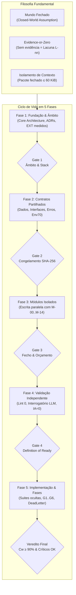
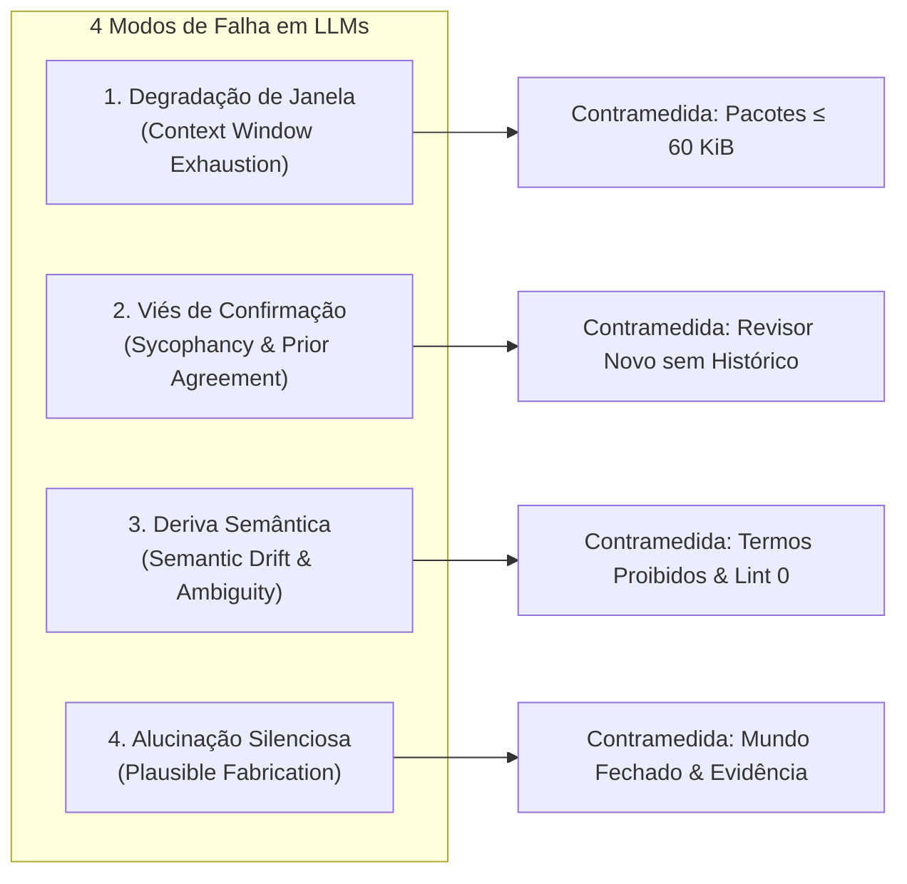
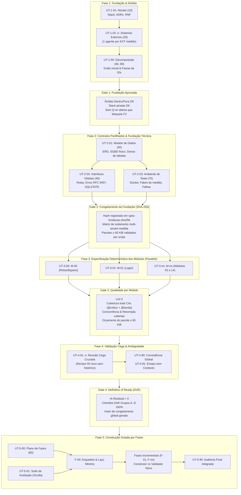
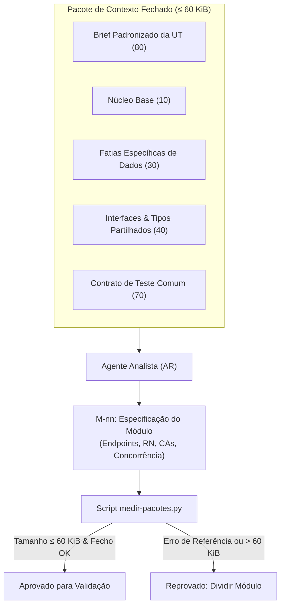
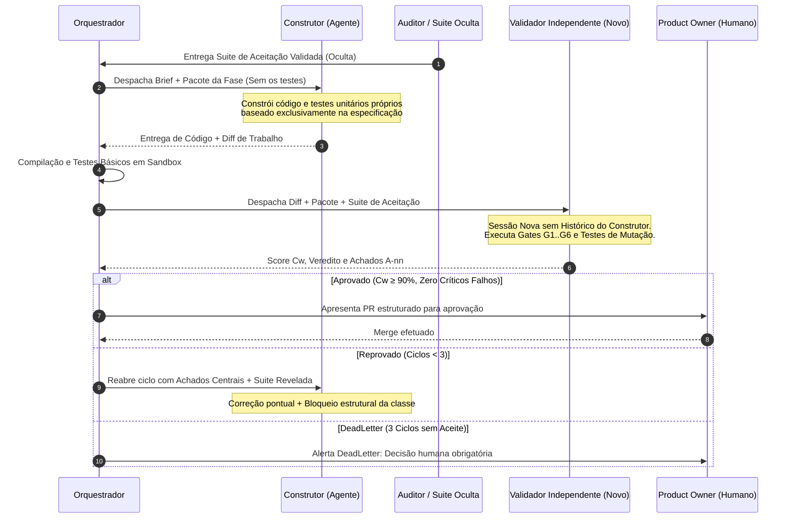
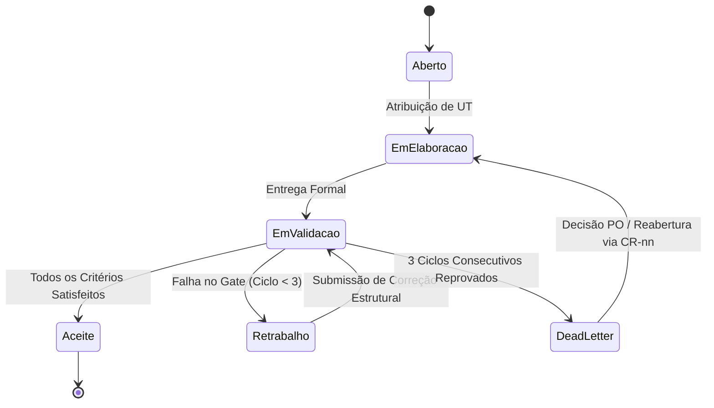

# Processo de Especificação de Requisitos para LLMs & Template Modular
## Guia Mestre de Engenharia de Requisitos Determinística, Arquitetura de Contexto e Implementação Guiada por IA

> **Versão:** 2.1 · **Data:** 2026-10-19 · **Classificação:** Documento Técnico de Referência & Guia Metodológico  
> **Autor:** Agente Especialista em Documentação e Metodologia de Engenharia de Requisitos para LLMs  
> **Repositório:** `Identity-Service` · **Âmbito:** Engenharia de Software Orientada a Modelos de Linguagem (LLM-Driven Software Engineering)  
> **Artefactos Vinculados:**  
> - [01 Processo de Especificação de Requisitos (v2.1)](file:///C:/Users/ACT/Documents/Personal/Identity-Service/Etapa1/01_processo_especificacao_requisitos_llm.md)  
> - [03 Guia de Preenchimento do Template (v2.1)](file:///C:/Users/ACT/Documents/Personal/Identity-Service/Etapa1/03_guia_preenchimento_template.md)  
> - [Conjunto de Modelos (Template Modular)](file:///C:/Users/ACT/Documents/Personal/Identity-Service/Etapa1/template/00-indice.md)  
> - [Caso de Estudo Real Identity-Service (spec-v2)](file:///C:/Users/ACT/Documents/Personal/Identity-Service/Etapa2/spec-v2/00-indice.md)

---

## Sumário Executivo

A geração de software por Modelos de Linguagem de Larga Escala (LLMs) atingiu um limiar crítico: **a incapacidade de gerar sistemas complexos e integrados com alta fidelidade não decorre primariamente de deficiências de raciocínio algorítmico dos modelos de ponta, mas sim da inadequação profunda da especificação de software tradicional quando consumida como prompt por agentes de IA.**

Especificações ágeis e descrições textuais clássicas baseiam-se em pressupostos humanos implícitos, intuição de domínio e resolução ad-hoc durante o desenvolvimento. Quando expostas a LLMs, resultam inevitavelmente em **alucinação silenciosa**, **deriva semântica**, **mistura de regras de negócio entre domínios** e **violações catastróficas de concorrência e segurança**.

Este documento apresenta a formulação teórica, a metodologia operacional em 5 fases, o sistema de 4 gates de qualidade rigorosos, a anatomia do conjunto modular de modelos (templates) e os dados empíricos de validação do **Processo de Especificação de Requisitos para LLMs v2.1**. O processo garante conformidade mensurável $\ge 90\%$ face aos requisitos funcionais e não-funcionais, impondo o princípio epistemológico **Evidence-or-Zero**, orçamentos rígidos de contexto ($\le 60\text{ KiB}$ por pacote de trabalho) e total independência de papéis na validação cega.

---



---

# 1. O Problema e a Filosofia de Engenharia

## 1.1 A Falha da Especificação Tradicional perante LLMs

Historicamente, requisitos de software toleram imprecisões deliberadas. Expressões como *"o sistema deve ser rápido"*, *"tratar falhas adequadamente"* ou *"validar permissões se necessário"* são interpretadas por engenheiros humanos através de contexto cultural corporativo, experiência prévia e diálogo em tempo de execução.

No entanto, quando agentes de IA operam sobre documentos desse tipo, ocorrem disfunções estruturais imediatas:

1. **A LLM não possui contexto implícito:** Uma omissão é uma bifurcação matemática. Diante de uma lacuna, o modelo amostra o caminho estocástico mais plausível segundo o seu treinamento prévio, e não o alinhado ao negócio.
2. **A ilusão da competência textual:** Um código sintaticamente elegante e sem erros de compilação pode estar violando invariantes silenciosas de domínio (ex.: autorizar bypass indevido de tenant sob concorrência).
3. **A fragilidade do monólito de prompt:** Injetar especificações volumosas (> 200 KB) em uma única janela causa degradação de atenção (*needle in a haystack*), perda de instruções no meio do texto e cruzamento espúrio de regras entre subsistemas distintos.

## 1.2 Os 4 Mecanismos de Falha Cognitiva em Modelos de Linguagem

A metodologia v2.1 foi formulada a partir do diagnóstico empírico dos quatro modos primários de falha de LLMs em desenvolvimento de software:



### 1. Degradação de Janela (Context Window Exhaustion & Attention Diffusion)
Apesar de janelas nominais de 128k a 1 milhão de tokens, a fidelidade de recuperação decai acentuadamente quando centenas de regras competem por atenção. Um agente exposto à especificação completa de um sistema mistura regras de endpoints públicos com regras de rotas administrativas.  
> **Contramedida do Processo:** Cada agente recebe estritamente um **Pacote de Contexto Isolado** com teto de **$\le 60\text{ KiB}$** (~15 mil tokens), contendo apenas as interfaces imediatas de dependência.

### 2. Viés de Confirmação e Complacência (*Sycophancy*)
Se o mesmo agente que concebeu ou implementou um código for consultado para validar o seu próprio trabalho (ou se receber o relatório de sucesso de outro agente), ele apresentará uma predisposição esmagadora para confirmar a validade do artefacto, relevando falhas subtis.  
> **Contramedida do Processo:** Princípio P10 (**Validação Independente**). O validador é sempre um agente novo, instanciado em uma sessão estéril, sem acesso ao histórico de chat ou ao relato do construtor, operando em modo de "revisão cega".

### 3. Deriva Semântica (*Semantic Drift*)
O uso de termos polissémicos ou adjetivos qualitativos introduz variação inaceitável. O termo "sessão curta" pode ser traduzido por 5 minutos numa execução e 2 horas noutra. O termo "usuário" misturado a "membro" induz a criação de modelos concorrentes no banco de dados.  
> **Contramedida do Processo:** Vocabulário restrito, lista de termos proibidos (verificada por linter determinístico) e regras de negócio estruturadas em lógica condicional estrita `SE / ENTÃO / SENÃO`.

### 4. Alucinação Silenciosa (*Plausible Fabrication*)
Quando uma interface externa ou regra interna não é completamente especificada, a LLM inventa esquemas plausíveis (ex.: inventar que um endpoint aceita JSON quando aceita apenas query string; supor que uma falha externa devolve 404 quando gera 500 sem efeitos).  
> **Contramedida do Processo:** Princípio do Mundo Fechado e etiquetagem obrigatória de dados com tags de rastreabilidade e scripts executáveis.

---

## 1.3 Princípio do Mundo Fechado (*Closed-World Assumption*)

O processo estabelece uma barreira lógica inegociável:

> [!IMPORTANT]
> **Princípio P1 — Mundo Fechado:**  
> O que não está explicitamente especificado **NÃO DEVE** ser implementado. Perante uma ambiguidade, omissão ou caso imprevisto, o agente **não tem permissão para adivinhar**. O agente deve registrar formalmente uma dúvida (`Q-nn`), adotar a hipótese operacional mais simples e conservadora possível, marcada explicitamente como tal, e solicitar decisão do Product Owner humano (`D-nn`).

Ao retirar da LLM a "autorização para ser criativa" fora dos limites da especificação, neutraliza-se o principal vetor de débitos técnicos e falhas de segurança induzidos por IA.

---

## 1.4 O Princípio "Evidence-or-Zero" e Taxonomia de Evidências

Qualquer declaração técnica a respeito de sistemas existentes, comportamento de banco de dados ou integração externa deve ser acompanhada de uma **etiqueta de evidência imutável**:

| Etiqueta | Significado | Requisito Formal de Validade |
|---|---|---|
| `[MEDIDO]` | Comportamento verificado empiricamente em ambiente real de execução. | **Obriga à citação de um script versionado** na pasta `evidencias/` do repositório da especificação e o respectivo ficheiro de saída gerado. Medições em diretórios temporários ou manuais são **inválidas**. |
| `[CÓDIGO]` | Invariante extraída diretamente de código-fonte inspecionado. | Exige a indicação exata de `repositorio/caminho/arquivo.ext:linha`. |
| `[DOC]` | Informação extraída de manuais, Swagger/OpenAPI ou especificações textuais externas. | Exige citação da fonte e data. Assume-se como suspeita até ser comprovada. |
| `L-nn` | **Lacuna.** Comportamento não verificado empiricamente. | Não pode ser convertida em pressuposto tácito. Gera um item de bloqueio no registo (`90`). |

> [!CAUTION]
> **A Lição do Caso de Referência:** Uma rota de cancelamento documentada em Swagger como `DELETE /recurso/{id}` (`[DOC]`) era na realidade tratada pelo backend legado como `DELETE /recurso?id=`. Se o agente tivesse construído o mock com base na documentação, todos os testes teriam passado com falso-positivo e o sistema teria colapsado em produção. O princípio *Evidence-or-Zero* impediu o desastre ao forçar a medição real em `evidencias/`.

---

# 2. O Ciclo de Vida em 5 Fases

O ciclo de vida do desenvolvimento decompõe o esforço em **Unidades de Trabalho (UT)** atómicas, organizadas em um Grafo Acíclico Dirigido (DAG). O orquestrador (`ORQ`) despacha agentes em paralelo à medida que as dependências de cada UT são satisfeitas e os gates anteriores são aprovados.



---

## 2.1 Fase 1: Fundação do Sistema e Fronteiras Arquiteturais

A Fase 1 visa extirpar ambiguidades estruturais antes do início de qualquer trabalho concorrente.

### Atividades Primárias:
1. **Delimitação Rígida do Âmbito:** Tabela com colunas *Dentro* e *Fora*. O que a documentação ou stakeholders sugeriram mas não faz parte do MVP/release é expressamente listado em *Fora*.
2. **Definição Estrita da Stack:** Nome do framework, versão major e minor, versão exata de drivers e SDKs e lista fechada de dependências autorizadas. Versões móveis ou genéricas (ex.: `v10.x` ou `latest`) são proibidas.
3. **Decisões Arquiteturais com Consequência Obrigatória no Código (ADR):** Um ADR só é válido se declarar a alteração imperativa no código (ex.: *ADR-06: O serviço DEVE expor endpoint JWKS com rota `/jwks.json` e registrar tokens revogados no Redis via chave `denylist:jti:{jti}` com TTL dinâmico*).
4. **Requisitos Não-Funcionais (RNF) Mensuráveis:** Todo RNF declara métrica, unidade, limiar, método de teste e se faz parte da métrica binária do sistema ($CA$) ou não.
5. **Glossário Canónico:** Mapeamento 1:1 entre termo de negócio, entidade de banco, campo JSON e símbolo do código, com lista explícita de sinónimos terminantemente proibidos.
6. **Levantamento Empírico de Sistemas Externos (`EXT-nn`):** Cada integração é exercitada por um script de teste real; detalhes não medidos são marcados como lacuna `L-nn`.
7. **Decomposição Modular e Atribuição Prévia de Faixas de IDs:** Antes de qualquer trabalho paralelo, o arquiteto divide o sistema em módulos coesos e fixa no índice (`00` §4) as faixas exclusivas de IDs (`PRS`, `RN`, `CA`, `Q`, `ERR`, `IF`) para cada agente, impedindo colisão de identificadores.

---

## 2.2 Fase 2: Contratos Partilhados, Modelação de Domínio e Ambiente de Testes

O objetivo da Fase 2 é criar um núcleo comum inviolável. **Duas unidades paralelas nunca podem iniciar trabalho sem que todos os contratos partilhados estejam congelados por hash criptográfico (P8).**

### Atividades Primárias:
1. **Modelo Físico de Dados (`30-dados.md`):** Tipos nativos do SGBD (ex.: `UUID`, `TIMESTAMPTZ`, `CITEXT`), restrições nomeadas (`ck_...`, `uq_...`), nulidade, valores por defeito e obrigatoriedade de `ON DELETE RESTRICT/CASCADE` em todas as Chaves Estrangeiras (FK).
2. **Posse Exclusiva de Tabelas (P9):** Cada tabela possui um **módulo dono**. Somente o módulo dono possui permissão para executar comandos `INSERT`, `UPDATE` ou `DELETE`. Os demais módulos realizam exclusivamente leituras.
3. **Máquinas de Estado:** Tabelas com a enumeração exaustiva das transições de estado permitidas; qualquer transição não catalogada é proibida por definição.
4. **Convenções de API e Formato de Erro Global (`40-contratos.md`):** Formato padrão RFC 9457 (*Problem Details*), cabeçalhos obrigatórios de correlação (`X-Correlation-Id`), convenções de paginação e fusos horários (UTC / ISO 8601).
5. **Mapeamento de Falhas de Infraestrutura vs. Negócio via SQLSTATE:** Distinção matemática entre problemas de conexão/indisponibilidade (503 `ERR-SYS-002`) e erros de restrição do SGBD com significado de negócio (ex.: violação de unicidade `23505` $\to$ 409 `ERR-CTX-005`; violação de isolamento/RLS `42501` $\to$ 403 `ERR-AUTH-010`), garantindo que falhas do motor não se transformem em respostas 500 genéricas.
6. **Ordem Fixa das Camadas de Validação de Entrada:** A verificação dos endpoints segue rigorosamente a cadeia ordenada:
   - Camada 1: Transporte (Tamanho do payload, `Content-Type`, UTF-8).
   - Camada 2: Autenticação (Presença e assinatura do token JWT).
   - Camada 3: Formato e Esquema (Sintaxe JSON, tipos, restrições estruturais de campos).
   - Camada 4: Autorização (Escopos, roles, permissões, tenancy).
   - Camada 5: Existência do Recurso no Banco.
   - Camada 6: Regras de Negócio e Invariantes de Domínio.  
   *A primeira camada que falha encerra o processamento e dita o código de erro retornado.*
7. **Checklist Global de Robustez de Entrada:** Matriz cobrindo corpo vazio, JSON truncado, caracteres NUL, injeção de caracteres de controle, strings gigantes e desvios de Content-Type.
8. **Contrato do Ambiente de Testes (`70-ambiente-teste.md`):** Especificação completa da infraestrutura de validação: Docker Compose fixo, injeção de falhas controladas (ex.: interrupção de contêineres), fakes baseados exclusivamente no comportamento `[MEDIDO]` e relógio desacoplado (`TimeProvider`).
9. **Execução Empírica da Matriz de Isolamento Multi-Tenant:** Script SQL/bash exercitando todas as combinações de isolamento por RLS/filtros contra o banco de dados real em múltiplos modos operacionais, com e sem cláusula `RETURNING`.

---

## 2.3 Fase 3: Decomposição Modular e Redação em Pacotes Isolados

Com os contratos da Fase 2 congelados, os módulos comportamentais (`M-00` a `M-nn`) são especificados em **paralelo absoluto**, com um agente especialista alocado por módulo.



### Regras Operacionais da Fase 3:
- **Orçamento Imutável de Contexto:** O agente construtor do módulo recebe apenas o pacote de contexto estritamente necessário. O tamanho agregado do pacote (brief + núcleo base + fatias de dados + interfaces + testes + módulo) **não pode exceder 60 KiB**. Se ultrapassar, o módulo é considerado excessivamente complexo e o arquiteto procede à sua divisão.
- **Fecho Hermético de Referências:** Cada ID (`ENT-nn`, `IF-nn`, `ERR-nnn`, `RN-nn`) citado dentro do texto do módulo deve ter a sua definição integral contida dentro do pacote de contexto associado. O script `medir-pacotes.py` atua como compilador estático de contexto, emitindo erro fatal se houver referências a artefactos ausentes.
- **Concorrência, Idempotência e Retomada Obrigatórias:** Todo requisito funcional que realize escrita em banco ou acione mensageria deve conter uma tabela descrevendo o comportamento determinístico perante:
  1. Dois pedidos idênticos disparados exatamente no mesmo milissegundo.
  2. Morte súbita do processo a meio da transação.
  3. Perda de resposta de confirmação de broker/sistema externo.
  4. Criação externa concorrente de registro conflitante.
- **Critérios de Aceitação (CA) em Gherkin Canónico:** Cobertura matemática de 100% das regras e exceções, garantindo que todo CA possua dados de partida coerentes com o modelo e contenha, obrigatoriamente, ao menos um cenário de borda com a tag `@borda` ou tabela de `Exemplos`.

---

## 2.4 Fase 4: Validação Independente, Revisão Cega e Índice de Ambiguidade

A Fase 4 submete a especificação ao mais rigoroso crivo de validação analítica antes da geração de qualquer linha de código.

### Princípios da Validação Cega:
- **Independência de Papéis:** O Revisor Independente (`RI`) é um agente **recém-instanciado**, sem memória da sessão do autor e sem acesso aos relatórios do construtor.
- **Identidade de Pacote:** O revisor recebe rigorosamente o mesmo pacote de 60 KiB que o futuro construtor receberá, garantindo a detecção de lacunas reais de informação.

### Etapas da Fase 4:
1. **Lint Léxico Determinístico (Fase 4.1):** Execução de script em Python/regex varrendo 100% dos ficheiros à procura de termos proibidos, vaguezas sintáticas ou marcadores de incompletude (`TODO`, `TBD`, `<<`, `<!--`).
2. **Interrogatório por LLM Alvo (Fase 4.3):** O pacote é injetado no modelo com um prompt neutro de interrogatório:
   ```text
   NÃO gere código. Você vai implementar o módulo descrito abaixo, e este pacote é tudo o que vai receber.
   Liste, numeradas e com o ID do item afetado:
   (a) cada pergunta que precisaria de fazer antes de implementar;
   (b) cada suposição que faria por falta de informação;
   (c) cada contradição;
   (d) cada comportamento com mais de uma implementação razoável;
   (e) cada informação que precisaria de outro documento que não está neste pacote.
   Se uma categoria não tiver itens, escreva "nenhum".
   ```
   > [!NOTE]
   > A categoria **(e)** constitui o sensor direto de integridade do pacote: qualquer item apontado nesta categoria evidencia falha de montagem do pacote de contexto, e não do módulo.
3. **Verificação de Oráculos e Derivação:** Cada valor esperado nas cláusulas `Então` é recalculado formalmente para confirmar se decorre deterministicamente do seed e das regras declaradas.
4. **Consistência Inter-Módulos (UT-4-90):** Auditoria global assegurando que nenhum endpoint ficou órfão e que contratos de eventos entre produtores e consumidores são idênticos em tipagem.
5. **Ensaio Cego de Execução (UT-4-91):** Um agente sem contexto executa os comandos do ambiente de testes e scripts de automação passo a passo; qualquer bloqueio ou inferência manual conta como defeito grave.
6. **Métrica Formal: Índice de Ambiguidade ($IA$):**

$$
IA_m = \frac{D_m}{N_m}, \qquad N_m = |RF| + |RN| + |EP| + |EV| + |CA|
$$

Onde $D_m$ é o total de defeitos pontuais encontrados no módulo $m$.  
O processo exige que o **$IA\text{ Residual}$ seja igual a zero absoluto** antes da liberação para construção.

---

## 2.5 Fase 5: Implementação Guiada por LLMs com Gates de Qualidade

Na Fase 5, o sistema é gerado através de fases atómicas de construção (`F-00` a `F-nn`).



### Regras Críticas de Execução:
1. **F-00 é Sempre o Laço Mínimo:** Constrói a espinha dorsal: Docker Compose, scaffolding de projetos, interceptores de log, middleware de erro RFC 9457, tratamento de JWT e **um fluxo ponta a ponta completo da requisição ao banco**. Todas as fases subsequentes herdam essa base.
2. **Suites Ocultas no 1.º Ciclo:** Para medir a pureza e autosuficiência da especificação ($C_w^{(1)}$), a suite de aceitação é mantida **fora do alcance do construtor**. O agente constrói a solução baseado unicamente no texto da especificação e nos CAs em Gherkin. A suite só é revelada em ciclos de retrabalho.
3. **Barreira "Não Tocar Ainda":** O plano de cada fase lista os ficheiros em que o agente tem permissão para escrever (`Escreve`) e os ficheiros proibidos (`Não tocar ainda`). O validador compara o git diff; qualquer alteração fora do escopo reprova a fase sumariamente.
4. **Retrabalho em Três Dimensões:** Quando uma fase é reprovada, a correção exige:
   - *(a) O conserto pontual da linha com defeito.*
   - *(b) A alteração arquitetural que torna impossível a repetição daquela classe de erro* (ex.: substituição de validação solta por um tipo fortemente tipado ou teste de varredura).
   - *(c) A resolução de débitos técnicos adjacentes.*

---

# 3. O Sistema de Gates de Qualidade e Governança

O processo substitui aprovações subjetivas por **Gates Determinísticos de Qualidade**:



## 3.1 Anatomia dos 4 Gates do Ciclo de Especificação

| Gate | Momento | Condição de Entrada | Condição de Saída & Verificações Obrigatórias | Artefacto Congelado |
|---|---|---|---|---|
| **Gate 1** | Fim da Fase 1 | Rascunhos de escopo e levantamentos. | - Âmbito com coluna "Fora" aprovado pelo PO.<br/>- Stack com versões e dependências exatas fixadas.<br/>- Cada ADR com sua consequência obrigatória no código.<br/>- Sistemas externos com tags `[MEDIDO]` e scripts em `evidencias/`.<br/>- Faixas de IDs distribuídas no índice (`00` §4).<br/>- Nenhuma dúvida `Q-nn` bloqueante em aberto. | `10-nucleo`, `20-externo`, `00-indice` |
| **Gate 2** | Fim da Fase 2 | Gate 1 Aprovado. | - Modelo de dados com tipos físicos nativos, restrições nomeadas e donos de tabela.<br/>- Matriz de autorização cobrindo 100% dos endpoints.<br/>- Mapeamento SQLSTATE para códigos RFC 9457.<br/>- Contrato de teste e fakes em `70` limitados ao medido.<br/>- Matriz de isolamento multi-tenant executada no SGBD real com evidências.<br/>- Script `medir-pacotes.py` confirmando pacotes $\le 60\text{ KiB}$ e fecho de referências.<br/>- Hash SHA-256 gerado em `spec-fundacao.sha256`. | Fundação: `00`, `10`, `20`, `30`, `40`, `70` |
| **Gate 3** | Fim da Fase 3 (Por Módulo) | Gate 2 Aprovado. | - Lint léxico = 0 (zero termos proibidos ou marcadores).<br/>- Cobertura de CAs: caminho feliz, 1 por RN, 1 por EX, autorização negativa e concorrência.<br/>- Pelo menos um caso de borda em cada CA (`@borda`).<br/>- Tabela de concorrência e retomada em todo RF de escrita.<br/>- Endpoints com cadeia de validação de entrada explícita. | Módulos `50-modulos/M-nn.md` |
| **Gate 4** | Fim da Fase 4 | Todos os Gates 3 Aprovados. | - Checklist DoR (Definition of Ready) grupos A a D 100% cumprido.<br/>- $IA\text{ Residual} = 0$ em todos os módulos.<br/>- Interrogatório LLM sem lacunas na categoria (e).<br/>- Ensaio cego por agente sem contexto concluído sem bloqueios.<br/>- Verificação de pins compilada e testada com sucesso.<br/>- Hashes SHA-256 finais de todos os ficheiros registrados no repositório. | Especificação Completa Pronta para Implementação |

---

## 3.2 Critérios de Aceite da Fase de Construção (G1 a G6) e Cláusula de Veto

Na Fase 5, a aprovação de qualquer fase `F-nn` submetida pelo construtor exige o cumprimento simultâneo de **seis condições objetivas**:

| Regra | Condição | Método de Verificação | Tolerância |
|---|---|---|---|
| **G1** | **Compilação e Arranque:** O código compila sem avisos (`TreatWarningsAsErrors`), aplica migrações em banco vazio e inicializa os serviços. | Script determinístico automatizado. | **Zero falhas.** |
| **G2** | **Veto de Falhas Críticas:** 100% dos CAs marcados com a tag `@critico` passam sem exceção. | Suite de aceitação executada pelo Validador. | **Zero tolerância (Veto Absoluto).** |
| **G3** | **Score Ponderado de Conformidade:** $C_w(F) \ge 90\%$. | Cálculo formal sobre os CAs da fase. | Limiar rígido de 90%. |
| **G4** | **Conformidade de Escopo:** Nenhum ficheiro listado em "Não tocar ainda" sofreu alteração. | `git diff --name-only origin/main`. | **Zero modificações indevidas.** |
| **G5** | **Regressão Global:** Todos os CAs aprovados nas fases anteriores continuam passando. | Execução da suite de regressão acumulada. | **Zero regressões.** |
| **G6** | **Robustez de Entrada:** Todos os testes do checklist de robustez nos endpoints da fase passam. | Suite de robustez da fase. | **Zero falhas.** |

> [!WARNING]
> **A Eficácia do Veto G2 na Prática:**  
> A ponderação de notas não pode mascarar violações capitais. No caso de referência inicial, fases com score ponderado de **97% e 99%** foram sumariamente reprovadas e bloqueadas porque falharam em um único CA `@critico` que permitia duplicação de dados sob condições de corrida. A cláusula de veto impediu o vazamento do bug para a branch principal.

---

## 3.3 Oráculos de Teste e Mutações de Validação

A validação de código por LLMs não pode depender de asserções frouxas (ex.: `assert response.status != null`). O processo estabelece que:
- **Oráculos Observáveis:** Toda cláusula `Então` em Gherkin deve afirmar um estado concreto no banco ou um valor literal exato no JSON de resposta, derivado matematicamente das entradas `Dado` e das regras `RN`.
- **Testes de Mutação:** O validador introduz mutações propositais no código do construtor (ex.: inverter uma condição de `>` para `>=`, trocar um código de erro ou suprimir a escrita de uma tabela de auditoria). Se a suite de testes não falhar diante da mutação, a suite é classificada como complacente e o ciclo é reprovado.

---

## 3.4 Limites de Ciclos e Política de DeadLetter

Para evitar ciclos infinitos de retrabalho entre agentes LLM (comum quando um agente tenta corrigir um bug criando outro):
1. **Limite Estrito:** O número máximo de ciclos de retrabalho por fase ou UT é fixado em **3 ciclos**.
2. **Disparo de DeadLetter:** Se ao término do 3.º ciclo a fase não atingir conformidade plena ou violar o veto de críticos, o orquestrador interrompe o pipeline e declara estado de **DeadLetter**.
3. **Escalonamento Humano:** O estado de DeadLetter exige intervenção do Product Owner (`PO`), que pode optar exclusivamente por:
   - *(Opção A)* Dividir a fase em duas fases menores e mais simples.
   - *(Opção B)* Formalizar um pedido de alteração arquitetural na especificação (`CR-nn`).
   - *(Opção C)* Aceitar a entrega excepcionalmente com registro formal de débito técnico mitigado.

---

## 3.5 Governança de Alterações: Separação de Poderes e Formato Obrigatório `CR-nn`

Uma vez congelada a especificação no Gate 2, **nenhum agente tem permissão para alterar arquivos contratuais de forma arbitrária**.


- **O Orquestrador (ORQ) NÃO propõe nem decide alterações** na especificação, nem decide divisão de módulos.
- **O Arquiteto (ARQ)** é a única entidade autorizada a desenhar a proposta técnica e registrar um pedido sob o formato padronizado `CR-nn` (Change Request, com numeração sequencial de dois dígitos: `CR-01`, `CR-02`, etc.).
- **O PO Humano** é a autoridade exclusiva de aprovação através de instrução explícita no chat.
- **Execução Isolada:** Toda alteração contratual é tratada como uma nova UT de retificação, exigindo re-revisão cega das partes impactadas antes de ser incorporada ao código.

---

# 4. Anatomia do Template Modular (Ficheiro a Ficheiro)

O conjunto de modelos (`template/`) foi arquitetado de modo a refletir a separação estrita de responsabilidades e permitir a montagem dinâmica de pacotes que respeitem a barreira de 60 KiB.

```
Etapa1/template/
├── 00-indice.md              # Mapa mestre, orçamentos, faixas de IDs e precedência
├── 10-nucleo.md              # Invariantes, stack pinada, ADRs e catálogo de erros base
├── 20-sistema-existente.md   # Levantamento empírico de legados e integrações (EXT-nn)
├── 30-dados.md               # Modelo físico, SGBD, restrições e donos de tabelas
├── 40-contratos.md           # Camadas de validação, erros, interfaces e tipos partilhados
├── 50-modulos/               # Especificações comportamentais isoladas
│   └── M-nn-modelo.md        # Molde padronizado de módulo (Endpoints, RN, Concorrência, CAs)
├── 60-plano-de-fases.md      # Decomposição sequencial/paralela de implementação (F-00..F-nn)
├── 70-ambiente-teste.md      # Contrato de infraestrutura, Docker, fakes e injeção de falhas
├── 80-orquestracao.md        # Briefs formais por papel e protocolos de instrução
└── 90-registo.md             # Livro-mestre vivo: grafo de UTs, PRS, decisões D-nn e métricas
```

---

## 4.1 Topologia Detalhada dos Artefactos

### `00-indice.md` — Orquestrador de Contexto e Mapa Mestre
- **Papel:** É a bússola do sistema. Define como o conhecimento está fragmentado e como os pacotes de contexto são montados pelo orquestrador.
- **Anatomia Interna:**
  - *Mapa de Documentos:* Tabela com colunas "Documento", "Papel Dono", "Leia quando" (escrita como predicado lógico operacional) e "Hash de Congelamento".
  - *Mapa de Módulos:* Relação de todos os `M-nn` com escopo, tabelas lidas/escritas, interfaces consumidas e o **Orçamento de Pacote Estimado** (validado antes da Fase 3).
  - *Regra Única de Precedência:* Uma fórmula canónica que dita qual artefato prevalece em caso de divergência textual acidental (`Regras Globais do Núcleo > Contratos de Interfaces > Módulos > Comentários`).
  - *Tabela de Faixas Exclusivas de Identificadores (§4):* Mapeamento antecipado de blocos numéricos de identificadores para que agentes em paralelo nunca gerem IDs concorrentes.

---

### `10-nucleo.md` — Invariantes Globais, Stack e Arquitetura Base
- **Papel:** Contém a verdade transversal do sistema. Entra em todos os pacotes de contexto, por isso é redigido de forma hiperconcisa para economizar tokens.
- **Anatomia Interna:**
  - *Instruções Normativas para LLMs (§1):* Comandos anti-alucinação padronizados e a regra inegociável de não inventar respostas.
  - *Stack Tecnológica Pinada:* Versão exata do compilador/runtime, imagem Docker base, pacotes de terceiros permitidos com versão travada.
  - *Decisões Arquiteturais Operacionais (ADR):* Tabela formal exigindo a "Consequência Obrigatória no Código" para cada escolha técnica.
  - *Requisitos Não-Funcionais Mensuráveis (RNF):* Limiares numéricos, ferramentas de medição e classificação binária de inclusão na métrica.
  - *Glossário Canónico e Sinónimos Proibidos:* Tabela com termos aceitos e lista explícita de termos vetados.
  - *Transversais:* Políticas de logging (declarando enfaticamente o que **NÃO DEVE** ser logado: senhas, hashes, tokens, dados sensíveis) e estratégia de migração de banco de dados.

---

### `20-sistema-existente.md` — Sistemas Legados e Integrações Externas
- **Papel:** Isola o comportamento de APIs, bancos legados e sistemas externos com os quais o novo software se comunica.
- **Anatomia Interna:**
  - *Seções por Integração (`EXT-nn`):* Contratos medidos de endpoints externos.
  - *Etiquetagem de Evidência:* Toda afirmação carrega `[MEDIDO]` com script correspondente em `evidencias/` ou `[CÓDIGO]`.
  - *"Comportamentos que Importam":* Registro minucioso de esquisitices do legado (ex.: aceitação de campos nulos em rotas obrigatórias, retornos 500 sem persistência, falta de validação de idempotência).
  - *Catálogo de Lacunas (`L-nn`):* Pontos do sistema externo não verificados formalmente, marcados como riscos com indicação de quem pode saná-los.

---

### `30-dados.md` — Modelo Físico, SGBD e Matriz de Isolamento
- **Papel:** Especificação integral e física da persistência de dados.
- **Anatomia Interna:**
  - *Dicionário de Dados Físico:* Nome de tabela, PK, atributos com tipagem física do banco (sem abstrações genéricas de ORM), nulidade, restrições nomeadas (`CHECK`, `UNIQUE`), valores default e módulo proprietário.
  - *Relações e Integridade Referencial:* Definição explícita de `ON DELETE` em cada Chave Estrangeira (privilegiando `RESTRICT` para evitar cascatas acidentais).
  - *Máquinas de Estado:* Matrizes de transição permitidas para campos enumerados (o que não está na matriz é automaticamente proibido).
  - *Matriz de Isolamento Multi-Tenant Executada:* Resultados práticos de isolamento por Row Level Security (RLS) ou interceptores executados contra o banco real, com e sem cláusula `RETURNING`.

---

### `40-contratos.md` — Convenções Globais, Erros e Interfaces de API
- **Papel:** Define os padrões de comunicação inter-módulos e externos.
- **Anatomia Interna:**
  - *Convenções de Transporte:* Envelope de resposta, tratamento de datas (ISO 8601 UTC), normalização de cabeçalhos e correlação (`X-Correlation-Id`).
  - *Ordem Fixa das Camadas de Validação:* Cadeia de seis camadas ordenadas determinando a prioridade dos erros.
  - *Catálogo Global de Erros:* Códigos imutáveis no formato `ERR-<área>-nnn`, status HTTP, `title` fixo e mapeamento para exceções de infraestrutura vs. `SQLSTATE` de banco.
  - *Tabela Mestra de Interfaces (`EP-nn` e `EV-nn`):* Assinaturas de todos os endpoints e eventos com método, rota, módulo dono e permissão requerida.
  - *Tabela de Tipos Partilhados:* Relação de DTOs comuns, classes e interfaces internas (`IF-nn`), com pasta física de implementação e tipagem exata.

---

### `50-modulos/M-nn.md` — Especificação Comportamental do Módulo
- **Papel:** A unidade atómica de especificação funcional.
- **Anatomia Interna:**
  - *Declaração do Pacote de Contexto:* Cabeçalho declarando exatamente quais secções dos outros ficheiros compõem a sua janela de visão e o tamanho total resultante ($\le 60\text{ KiB}$).
  - *Detalhamento dos Endpoints (`EP-nn`):* Esquema de request/response, ordenação determinística de listas de saída, efeitos colaterais por ordem e garantia transacional.
  - *Requisitos Funcionais (`RF-nn`):* Ator, gatilho, pré-condições, fluxo principal numerado e fluxos de exceção (`EX-nn.m`).
  - *Concorrência, Idempotência e Retomada:* Matriz mandatória para todas as rotas de escrita.
  - *Regras de Negócio (`RN-nn`):* Sintaxe estrita **SE / ENTÃO / SENÃO** com códigos de erro emitidos e parâmetros concretos.
  - *Critérios de Aceitação em Gherkin:* Cenários executáveis com tags `@critico` e `@borda`, contextos isolados e assertivas observáveis.
  - *Rastreabilidade Local:* Matriz cruzando RF $\leftrightarrow$ RN $\leftrightarrow$ EP/EV $\leftrightarrow$ CA $\leftrightarrow$ Fase de Implementação.

---

### `60-plano-de-fases.md` — Decomposição em Fases de Construção
- **Papel:** Planeia a execução serial e paralela da implementação.
- **Anatomia Interna:**
  - *Definição de Cada Fase (`F-nn`):* Objetivo em uma frase, demonstração visual/comportamental entregue, lista de CAs cobertos (cada CA pertence a uma única fase).
  - *Escopo Positivo ("Constrói") vs. Escopo Negativo ("Não tocar ainda"):* Relação explícita de pastas e ficheiros autorizados e proibidos, auditáveis por git diff.
  - *Construtores Concorrentes:* Estratégia de pareamento de agentes paralelos em pastas disjuntas (ex.: um agente constrói a lógica e outro os mocks/fixtures).

---

### `70-ambiente-teste.md` — Contrato Executável de Infraestrutura e Fakes
- **Papel:** Estabelece o contrato que o código deve cumprir para ser testado e auditado.
- **Anatomia Interna:**
  - *Configuração Determinística:* Arquivo Docker Compose unificado, portas fixas e scripts de seed.
  - *Contrato de Fakes:* Mocks de serviços externos implementando rigorosamente o comportamento `[MEDIDO]`.
  - *Mecanismos de Injeção de Falhas:* Hooks para simular queda de banco, interrupção de broker e atrasos de rede.
  - *Isolamento de Tempo e Segredos:* Uso obrigatório de provedores desacoplados de relógio e testes automatizados de varredura contra vazamento de dados fictícios sensíveis.

---

### `80-orquestracao.md` — Modelos de Briefs e Protocolos de Prompting
- **Papel:** Guia de operação do Orquestrador.
- **Anatomia Interna:**
  - *Briefs Padronizados:* Modelos em formato formulário com campos preenchíveis `{ }` para cada agente (AR, RI, CON, VAL, REV, AUD).
  - *Proibição de Poluição de Contexto:* Regras rígidas vetando colar históricos de chat passados ou relatos de construtores em sessões de validadores.
  - *Protocolo Pré-Registrado:* Regras de congelamento de versões de modelos de IA e ferramentas antes do início dos trabalhos.

---

### `90-registo.md` — Livro-Mestre Vivo do Projeto
- **Papel:** A fonte única da verdade sobre o estado do projeto.
- **Anatomia Interna:**
  - *Grafo Vivo de Unidades de Trabalho:* Estado atual de cada UT, agente responsável, ciclos decorridos, score e data.
  - *Tabela de Decisões do PO (`D-nn`):* Histórico datado e formal de todas as deliberações de negócio humanas.
  - *Perguntas em Aberto (`Q-nn`):* Dúvidas com indicação explícita das fases ou UTs que bloqueiam.
  - *Catálogo de Pressupostos (`PRS-nn`):* Hipóteses de fecho autorizadas pelo PO.
  - *Tabela de Pedidos de Alteração (`CR-nn`):* Registro de todas as mutações pós-congelamento.
  - *Registro de Defeitos e Achados (`A-nn`):* Mapeamento de problemas identificados pela validação independente e a linha exata da resolução estrutural.

---

# 5. Rigor Léxico e Semântico: O Linter da Especificação

Um dos pilares mais inovadores da metodologia é a automação da pureza léxica da especificação. **Ambiguidade na especificação é um bug que deve ser compilado e corrigido antes de chegar à LLM.**

## 5.1 Catálogo Oficial de Termos Proibidos e sua Toxicidade Cognitiva

O script de linting (`lint-modulo.py`) atua como barreira sintática, emitindo erro e bloqueando o Gate 3 diante dos seguintes vocábulos:

| Termo Proibido | Por que é tóxico para a LLM | O que o agente deve escrever no lugar |
|---|---|---|
| `adequado` / `apropriado` | A LLM assume qualquer implementação arbitrária como "adequada". | O algoritmo exato, a norma ou o limiar numérico de tolerância. |
| `rápido` / `eficiente` / `performático` | Não fornece critério passível de asserção em teste automatizado. | O RNF com métrica (ex.: "latência $p99 \le 50\text{ ms}$ sob 500 req/s"). |
| `seguro` (sem detalhe) | O modelo inventa requisitos paranoicos ou negligencia práticas essenciais. | A cifra, tamanho de chave, padrão OWASP ou algoritmo obrigatório (ex.: Argon2id). |
| `robusto` / `escalável` | Adjetivo vazio que induz over-engineering alucinatório. | Limiares de carga e a política determinística de timeout / circuit breaker. |
| `flexível` / `amigável` / `intuitivo` | Conceitos puramente subjetivos que variam a cada sessão de prompt. | O fluxo de telas/etapas ou o contrato rígido do payload JSON. |
| `normalmente` / `geralmente` / `tipicamente` | A LLM não sabe como agir no cenário que diverge da normalidade. | A regra condicional exaustiva: `SE x ENTÃO y SENÃO z`. |
| `quando aplicável` / `se necessário` | A LLM deduz que a checagem é opcional e frequentemente a ignora. | O predicado booleano preciso que ativa a execução da verificação. |
| `etc.` / `entre outros` / `...` / `e/ou` | Autoriza formalmente a IA a completar a lista com dados alucinados. | Uma lista fechada e exaustiva de valores permitidos. |
| `similar a` / `como no módulo X` | O módulo referenciado não está no pacote de contexto de 60 KiB. | A especificação completa do comportamento ou o reuso via tipo partilhado. |
| `tratar` (sem objeto) | Verbo vago que esconde decisões de persistência ou erro. | "Persistir na tabela T", "Rejeitar com status 400", "Publicar no tópico K". |
| `gerir` (sem lista de operações) | Não esclarece se inclui delete, soft-delete, auditoria ou purge. | A lista de operações autorizadas: "criar, consultar e desativar". |
| `suportar` (sem limite) | Não define limites de capacidade ou tipos aceitos. | "Processar arquivos de até 10 MB nos formatos .PNG e .PDF". |
| `TBD` / `TODO` / `a definir` / `<< >>` | Marcadores de texto inacabado. | O valor final aprovado ou a abertura de uma pergunta bloqueante `Q-nn`. |

---

## 5.2 O que Nunca Escrever vs. O que Escrever (Guia Prático)

```diff
- ❌ NUNCA ESCREVER:
- "O token de acesso deve expirar em pouco tempo para garantir a segurança."
+ ✅ ESCREVER:
+ "O access_token DEVE ser emitido com a claim exp = iat + 900 segundos."

- ❌ NUNCA ESCREVER:
- "A senha do usuário deve ser forte e segura."
+ ✅ ESCREVER:
+ "A senha DEVE ter de 12 a 128 caracteres e conter pelo menos uma letra maiúscula [A-Z], uma minúscula [a-z], um número [0-9] e um caractere especial fora de [A-Za-z0-9]."

- ❌ NUNCA ESCREVER:
- "Validar devidamente as informações recebidas no corpo da requisição."
+ ✅ ESCREVER:
+ "O endpoint DEVE executar a validação de entrada pela ordem de camadas: 1. Content-Type application/json; 2. Sintaxe JSON; 3. Limites de campos: legal_name de 2 a 200 caracteres, cnpj com 14 dígitos e módulo 11 válido."

- ❌ NUNCA ESCREVER:
- "Usar cache para melhorar a performance de consulta."
+ ✅ ESCREVER:
+ "Ao revogar um token, o serviço DEVE gravar a chave denylist:jti:{jti} no Redis com valor '1' e TTL = exp - now segundos."
```

---

## 5.3 Regras de Negócio Canónicas em SE / ENTÃO / SENÃO

Toda regra de negócio (`RN-nn`) é expressa como uma **função lógica pura** com uma única consequência observável:

| ID | Tipo | Regra Lógica Canónica | Parâmetros Concretos | Código de Erro |
|---|---|---|---|---|
| `RN-03` | Temporal | **SE** a conta acumular `MAX_FAILURES` tentativas consecutivas de login incorreto **ENTÃO** o sistema deve atribuir `user.locked_until = now + LOCK_TIME` **SENÃO** segue fluxo normal. | `MAX_FAILURES = 5`<br/>`LOCK_TIME = 900 s` | — |
| `RN-04` | Autorização | **SE** `user.locked_until > now` **ENTÃO** o endpoint responde 423 sem verificar a senha **SENÃO** autoriza validação de credencial. | — | `ERR-AUTH-003` |
| `RN-05` | Integridade | **SE** o login for concluído com sucesso **ENTÃO** `user.failed_login_attempts` deve ser zerado e `user.locked_until` deve ser definido como `NULL`. | — | — |

---

## 5.4 Critérios de Aceitação em Gherkin com Tags `@critico` e `@borda`

O formato Gherkin atua como ponte formal entre a especificação e a suite automatizada.

```gherkin
# language: pt
Funcionalidade: M-02 — Renovação de Sessão via Refresh Token

  Contexto:
    Dado que existe o tenant "TEN-01" ativo no banco de dados
    E que o usuário "maria@empresa.com" é membro ativo de "TEN-01"
    E que existe uma família de tokens "FAM-99" vinculada ao usuário

  @CA-04.3 @RF-04 @RN-33 @MUST @critico
  Cenário: Detecção de reuso de refresh token consumido invalida toda a família
    Dado que o token "RT-OLD" da família "FAM-99" possui status "CONSUMED"
    E que o token "RT-ACTIVE" da família "FAM-99" possui status "ACTIVE"
    Quando é enviado POST "/api/v1/auth/refresh" com payload:
      """
      { "refresh_token": "RT-OLD" }
      """
    Então o status da resposta é 401
    E o campo "code" da resposta é "ERR-AUTH-006"
    E o campo "title" é "Refresh token reuse detected"
    E todos os registros da tabela "refresh_token" com family_id "FAM-99" passam a ter status "REVOKED"
    E uma chave "denylist:user:{user_id}" é gravada no Redis com TTL de 900 segundos

  @CA-04.4 @RF-04 @MUST @borda
  Esquema do Cenário: Rejeição de tokens malformados ou corrompidos na camada de formato
    Quando é enviado POST "/api/v1/auth/refresh" com payload:
      """
      { "refresh_token": <token_invalido> }
      """
    Então o status da resposta é 400
    E o campo "code" da resposta é "ERR-VAL-001"
    E nenhuma linha é alterada na tabela "refresh_token"

    Exemplos:
      | token_invalido                         | motivo                            |
      | ""                                     | String vazia                      |
      | "abc"                                  | Comprimento inferior a 43 chars   |
      | "a".repeat(300)                        | Comprimento excessivo             |
      | "!@#$%^&*()_+"                         | Caracteres fora de base64url      |
```

---

## 5.5 Automação: O Script `lint-modulo.py`

O script que valida a pureza textual atua como linter determinístico no pipeline de CI/CD e nos gates locais:

```python
# Trecho representativo do verificador de qualidade léxica
import re, sys

PROIBIDOS = [
    r'\badequado\b', r'\bapropriado\b', r'\bse aplic[aá]vel\b',
    r'\betc\b', r'\be/ou\b', r'\btemporariamente\b', r'\brobusto\b',
    r'\beficiente\b', r'\bperform[aá]tico\b', r'\bseguro\b',
    r'\btbd\b', r'\btodo\b', r'\bgeralmente\b', r'\bnormalmente\b'
]
PLACEHOLDERS = [r'<<.*?>>', r'\[\.\.\.\]', r'<!--.*?-->']

def auditar_especificacao(caminho):
    with open(caminho, 'r', encoding='utf-8') as f:
        linhas = f.readlines()
    erros = []
    for num, linha in enumerate(linhas, 1):
        for p in PROIBIDOS:
            m = re.search(p, linha, re.IGNORECASE)
            if m:
                erros.append(f"Linha {num}: Termo proibido '{m.group(0)}'")
        for pl in PLACEHOLDERS:
            m = re.search(pl, linha)
            if m:
                erros.append(f"Linha {num}: Placeholder pendente '{m.group(0)}'")
    return erros
```

---

# 6. Roteiro de Apresentação (Pitch Deck Executivo & Técnico)

Este roteiro organiza os conceitos do processo em uma sequência de **12 slides**, ideal para apresentar a metodologia a Diretorias de Engenharia, Arquitetos-Chefe e Equipes de Desenvolvimento.

```
+-------------------------------------------------------------------------------+
| SLIDE 1: TÍTULO & TESE CENTRAL                                                |
| Engenharia de Requisitos Determinística para Geração de Software por LLMs     |
| "A IA não falha por limitação de código. Falha por indefinição de contexto."   |
+-------------------------------------------------------------------------------+
| SLIDE 2: O DIAGNÓSTICO DO PROBLEMA                                            |
| Os 4 Vilões do Desenvolvimento com IA em Larga Escala:                        |
| 1. Degradação de Janela  2. Viés de Confirmação  3. Deriva  4. Alucinação     |
+-------------------------------------------------------------------------------+
| SLIDE 3: A FILOSOFIA: "EVIDENCE-OR-ZERO" & MUNDO FECHADO                      |
| Se não está especificado, NÃO DEVE existir.                                   |
| Afirmações exigem evidência: [MEDIDO] com script versionado ou é Lacuna L-nn. |
+-------------------------------------------------------------------------------+
| SLIDE 4: O CICLO DE VIDA EM 5 FASES                                           |
| Grafo de Dependências com Paralelismo Real: F1 -> F2 -> (F3 || F4) -> F5      |
| O fim do prompt monolítico: Unidades de Trabalho isoladas e atómicas.         |
+-------------------------------------------------------------------------------+
| SLIDE 5: O SEGREDO DO CONTEXTO: PACOTES FECHADOS ≤ 60 KiB                     |
| Orçamento rígido de ~15k tokens. Verificação automática por script compilador.|
| O agente recebe apenas as interfaces estritas de que necessita.               |
+-------------------------------------------------------------------------------+
| SLIDE 6: CONTRATOS CONGELADOS ANTES DO PARALELISMO                            |
| Gate 2 como pilar: Banco físico real, RFC 9457, SQLSTATE e RLS multi-tenant.  |
| Hash SHA-256 imutável: ninguém altera contratos sem aprovação do PO (CR-nn).  |
+-------------------------------------------------------------------------------+
| SLIDE 7: O LINTER DA ESPECIFICAÇÃO                                            |
| Proibição absoluta de adjetivos vagos ("rápido", "robusto", "adequado").      |
| Regras em SE/ENTÃO/SENÃO e Critérios de Aceitação com tags @critico e @borda. |
+-------------------------------------------------------------------------------+
| SLIDE 8: VALIDAÇÃO CEGA: AUTOR != REVISOR                                     |
| Validador novo a cada ciclo, sem histórico e sem o relato de quem produziu.   |
| Interrogatório em 5 categorias e busca obstinada por Índice de Ambiguidade = 0|
+-------------------------------------------------------------------------------+
| SLIDE 9: IMPLEMENTAÇÃO POR FASES & SUITES OCULTAS                             |
| F-00 (Laço Mínimo) e barreira "Não tocar ainda" checada por git diff.         |
| Suite oculta no 1º ciclo (mede pureza da spec). Retrabalho em 3 dimensões.    |
+-------------------------------------------------------------------------------+
| SLIDE 10: O SISTEMA DE GATES & CLÁUSULA DE VETO                               |
| G1 a G6: compilação estrita, conformidade ≥ 90% e VETO ABSOLUTO em críticos.  |
| 3 ciclos de retrabalho ou DeadLetter. O PO humano no comando das decisões.    |
+-------------------------------------------------------------------------------+
| SLIDE 11: PROVA DE CONCEITO: IDENTITY-SERVICE                                 |
| 15 módulos em paralelo, 106 CAs, Lint 0, 21 testes de isolamento multi-tenant.|
| Zero falhas críticas em produção. 100% dos pacotes validados ≤ 60 KiB.        |
+-------------------------------------------------------------------------------+
| SLIDE 12: ROADMAP DE ADOÇÃO & CONCLUSÃO                                       |
| Como transformar sua organização: do caos de prompts livres à Engenharia     |
| Determinística de Software com IA.                                            |
+-------------------------------------------------------------------------------+
```

---

# 7. Caso Prático / Prova de Conceito: O Projeto Identity-Service

A validade da metodologia v2.1 foi demonstrada empiricamente na migração e especificação completa do projeto de missão crítica **Identity-Service** (`Etapa2/spec-v2/`).

## 7.1 Visão Geral do Caso e Desafio Arquitetural

O Identity-Service é a espinha dorsal de autenticação, autorização e gerenciamento de contexto para uma plataforma agrícola empresarial multi-tenant:
- **Stack Alvo:** .NET 10 (C# 14), ASP.NET Core Minimal APIs, Entity Framework Core 10, PostgreSQL 17 com Row Level Security (RLS) nativo, Redis 7 (revogação stateless e denylist) e Apache Kafka (outbox transactional e publicação de auditoria).
- **Desafio:** Garantir isolamento criptográfico e de dados entre tenants de múltiplos grupos económicos concorrentes, suportando troca rápida de contexto, modo de visualização agregado (`MACRO_GROUP`), impersonation seguro e rotação de refresh tokens sem perda de sessão.

---

## 7.2 A Fundação Congelada e os Scripts de Evidência

Na Fase 2 do projeto, os contratos partilhados foram exercitados e travados com o hash registrado em `spec-fundacao.sha256`:

```
c6cb88755b38234ea72be0a0f8bfdfb6f2fdb4e1dca4fa9154a49db2d5804aa5 *00-indice.md
c8916d8048601d51a6652a9a43a0e98031d33bbd449339e15ce8019b88421876 *10-nucleo.md
3efaaeb3c42878ce5ba0401d8417646543666d6c96899ffc71b6d3a8f1074bf3 *20-sistema-existente.md
d9a8e2cb9988fc00fe4d70b77b73cc1c9b689255ddb8bc7359556e82845c2be9 *30-dados.md
543886f4a7c0d738ff8b26e25539fa0ef7d228d447a2491a92e105e46dd7ae47 *40-contratos.md
b1395fa3379be0f7aa025170d105221975e1dc7f311ebc469b8ef4e11bce5560 *70-ambiente-teste.md
```

### Evidências Empíricas no Repositório (`evidencias/`):
- `medir-postgres.sh` & `matriz-isolamento.sql`: Exercitou 21 cenários contra PostgreSQL real.
  > [!IMPORTANT]
  > **Descoberta Crítica no SGBD:** Identificou-se que comandos `INSERT ... RETURNING` violavam a política de isolamento RLS se a variável de sessão `app.write_tenants` não estivesse explicitamente vinculada à cláusula `WITH CHECK`. A especificação anterior (v1.0) causava bypass silencioso de tenancy que passou despercebido em três revisões humanas!
- `medir-pins.sh`: Restaurou o esqueleto em C# com .NET SDK 10.0.402, EF Core 10.0.13 e IdentityModel 8.23.0 com zero warnings sob `TreatWarningsAsErrors`.

---

## 7.3 A Execução Modular: 15 Módulos, 106 CAs e Lint 0

A Fase 3 desdobrou o sistema em **15 módulos coesos**, redigidos concorrentemente por agentes especializados (instâncias Antigravity "Ipê", "Sabiá", "Jatobá" e Claude Code):

| Módulo | Nome / Domínio | RFs Cobertos | CAs Gerados | CAs `@critico` | Peso $\sum w$ | Lint Léxico | Pacote de Contexto |
|---|---|---|---|---|---|---|---|
| **M-00** | Rotas e Bypass Global | RF-15, RF-17 | 5 | 0 | 7 | **0 erros** | 59.0 KiB $\le$ 60 KiB |
| **M-01** | Login e Bloqueio de Conta | RF-01, RF-02, RF-03 | 8 | 4 | 24 | **0 erros** | 59.3 KiB $\le$ 60 KiB |
| **M-02** | Sessão e Refresh Tokens | RF-04 | 8 | 3 | 24 | **0 erros** | 59.3 KiB $\le$ 60 KiB |
| **M-03** | Troca de Contexto Ativo | RF-02, RF-03 | 8 | 4 | 24 | **0 erros** | 58.9 KiB $\le$ 60 KiB |
| **M-04** | Criação de Tenants | RF-07 | 8 | 0 | 18 | **0 erros** | 59.5 KiB $\le$ 60 KiB |
| **M-05** | Gestão de Membros | RF-08 | 8 | 0 | 18 | **0 erros** | 59.3 KiB $\le$ 60 KiB |
| **M-06** | Impersonation de Suporte | RF-06 | 7 | 3 | 10 | **0 erros** | 58.8 KiB $\le$ 60 KiB |
| **M-07** | Chaves Criptográficas & JWKS | RF-11 | 8 | 0 | 24 | **0 erros** | 59.0 KiB $\le$ 60 KiB |
| **M-08** | Matriz de Acessos & Permissões | RF-18 | 5 | 0 | 8 | **0 erros** | 59.2 KiB $\le$ 60 KiB |
| **M-09** | Logout e Revogação Global | RF-05 | 8 | 0 | 24 | **0 erros** | 58.9 KiB $\le$ 60 KiB |
| **M-10** | Suspensão e Reativação de Usuário | RF-10, RF-13 | 8 | 3 | 24 | **0 erros** | 59.3 KiB $\le$ 60 KiB |
| **M-11** | Esquema, Migrações & Seed | RF-19 | 3 | 0 | 5 | **0 erros** | 59.7 KiB $\le$ 60 KiB |
| **M-12** | Suspensão de Tenant | RF-09, RF-12 | 8 | 0 | 10 | **0 erros** | 59.2 KiB $\le$ 60 KiB |
| **M-13** | Isolamento e Contexto Multi-Tenant | RF-16 | 8 | 0 | 24 | **0 erros** | 59.6 KiB $\le$ 60 KiB |
| **M-14** | Mensageria, Outbox & Eventos Kafka | RF-14 | 8 | 0 | 24 | **0 erros** | 59.0 KiB $\le$ 60 KiB |
| **TOTAL** | **15 Módulos Integrados** | **19 RFs** | **107 CAs** | **21 Críticos** | **267 pts** | **Lint 0** | **100% $\le$ 60 KiB** |

---

## 7.4 Conformidade Estrita do Orçamento de 60 KiB por Pacote

A medição efetuada pelo script `evidencias/medir-pacotes.py` comprovou que todos os pacotes modulares cumprem rigorosamente o orçamento de contexto estipulado:

```
nucleo_base 14.7 KiB | 40 §1-§3 8.5 KiB | 70 comum 3.6 KiB | brief 2.0 KiB
modulo |  10  |  30  |  40  |  70 |  20 |  90 | brief | fixo | teto | ficheiro est. | pacote | fecho
M-00   | 17.9 |  5.6 | 17.0 | 3.6 | 0.4 | 0.5 |  2.0  | 47.0 | 13.0 | 11.7 KiB       | 59.0   | OK
M-01   | 14.7 |  4.9 | 20.5 | 3.6 | 0.0 | 1.5 |  2.0  | 47.3 | 12.7 | 12.8 KiB       | 59.3   | OK
M-02   | 14.7 |  6.1 | 21.2 | 3.6 | 0.0 | 1.6 |  2.0  | 49.3 | 10.7 | 10.8 KiB       | 59.3   | OK
M-03   | 14.7 |  3.5 | 20.2 | 3.6 | 0.0 | 0.9 |  2.0  | 44.9 | 15.1 | 14.3 KiB       | 58.9   | OK
M-04   | 14.7 |  6.1 | 18.3 | 3.6 | 0.0 | 0.8 |  2.0  | 45.5 | 14.5 | 14.5 KiB       | 59.5   | OK
M-05   | 14.7 |  9.9 | 18.3 | 3.6 | 0.0 | 0.8 |  2.0  | 49.3 | 10.7 | 10.9 KiB       | 59.3   | OK
M-06   | 14.7 |  4.9 | 18.5 | 3.6 | 0.0 | 1.2 |  2.0  | 44.8 | 15.2 | 15.5 KiB       | 58.8   | OK
M-07   | 15.4 |  2.0 | 15.6 | 3.6 | 0.0 | 0.3 |  2.0  | 39.0 | 21.0 | 21.4 KiB       | 59.0   | OK
M-08   | 16.8 | 13.1 | 11.6 | 3.6 | 0.4 | 0.7 |  2.0  | 48.2 | 11.8 | 11.1 KiB       | 59.2   | OK
M-09   | 14.7 |  2.7 | 15.7 | 3.6 | 0.0 | 0.2 |  2.0  | 38.9 | 21.1 | 20.6 KiB       | 58.9   | OK
M-10   | 14.7 |  7.7 | 20.2 | 3.6 | 0.0 | 1.0 |  2.0  | 49.3 | 10.7 | 10.9 KiB       | 59.3   | OK
M-11   | 17.5 | 19.6 |  5.3 | 7.8 | 0.5 | 0.0 |  2.0  | 52.7 |  7.3 |  7.2 KiB       | 59.7   | OK
M-12   | 14.7 |  6.1 | 17.9 | 3.6 | 0.0 | 0.9 |  2.0  | 45.2 | 14.8 | 14.8 KiB       | 59.2   | OK
M-13   | 17.4 |  8.7 |  9.0 | 3.6 | 0.5 | 0.3 |  2.0  | 41.6 | 18.4 | 17.2 KiB       | 59.6   | OK
M-14   | 16.7 |  5.3 | 12.4 | 3.6 | 0.4 | 0.5 |  2.0  | 41.0 | 19.0 | 17.4 KiB       | 59.0   | OK
========================================================================================
RESULTADO GLOBAL: 15/15 PACOTES APROVADOS (Tamanho médio: 59.2 KiB | Fecho: 100% VÁLIDO)
```

---

## 7.5 Governança de Alterações Realizada no Caso Real

Durante o refinamento entre ciclos, **16 Pedidos formais de Alteração (`CR-01` a `CR-16`)** foram formulados pelo Arquiteto (`ARQ`) e aprovados pelo Product Owner humano (`PO`, Matheus), incluindo:
- `CR-12`: Divisão do módulo original de tenant em `M-04` (Criação) e `M-12` (Estado), para respeitar o teto de 60 KiB.
- `CR-13`: Separação dos middlewares HTTP (`M-00`) dos interceptores de isolamento de banco (`M-13`).
- `CR-15`: Divisão das chaves criptográficas (`M-07`) e da mensageria Kafka (`M-14`).
- `CR-16`: Formalização do protocolo de citações em pacotes de contexto.

Nenhuma alteração foi realizada ad-hoc por agentes de código. O sistema manteve perfeita rastreabilidade histórica, provando que **é viável orquestrar múltiplos agentes de IA de modelos diferentes em um projeto de alta complexidade sem entropia ou perda de controle.**

---

# 8. Conclusão e Princípios de Adoção

O **Processo de Especificação de Requisitos para LLMs v2.1** e o **Template Modular** encerram a era da "geração ingénua de código por chat". 

A metodologia substitui prompts amorfos por **engenharia de contexto rigorosa**, suposições por **evidências medidas**, validação subjetiva por **gates com veto de criticidade** e desenvolvimento caótico por um **grafo determinístico de unidades de trabalho**.

### Recomendações Finais de Adoção:
1. **Nunca inicie código sem o Gate 2 Congelado:** Se o banco físico e os contratos de API não estiverem travados com hash, os agentes paralelos divergirão e criarão sistemas incompatíveis.
2. **Respeite o Teto de 60 KiB:** Se um módulo não cabe em 60 KiB com suas interfaces essenciais, ele não deve ser expandido — deve ser dividido.
3. **Mantenha o Humano no Leme:** Agentes planejam, analisam, redigem e validam, mas decisões de negócio (`D-nn`), aprovação de exceções e merges em produção pertencem inegociável e exclusivamente ao julgamento humano.
