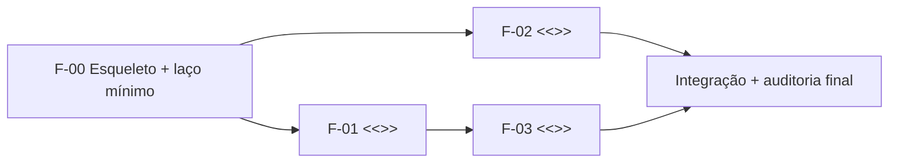

# 60 · Plano de fases de implementação — <<Nome do Sistema>>

> **Conjunto:** [00 Índice](00-indice.md) · **Dono:** <<ARQ>> · **Estado:** <<>> · **Atualizado em:** <<>>
> Escrito na UT-5-00, depois do Gate 4. Cada CA pertence a uma e uma só fase.

## 1. Grafo de fases

## 2. Resumo
| Fase | Módulos / RF | Nº CA | Σw | Depende de | Paralelo com | Construtores | Pacote (KB) |
|---|---|---|---|---|---|---|---|
| F-00 | Transversais + <<RF-nn>> | <<>> | <<>> | — | — | <<1>> | <<>> |
| F-01 | <<M-01>> | <<>> | <<>> | F-00 | <<F-02>> | <<1 \| 2 (código ∥ fakes)>> | <<>> |

**Totais:** CA = <<igual ao total da especificação>> · Σw = <<>>

## 3. Fases

### F-00 · Esqueleto e laço mínimo ponta a ponta
| Campo | Conteúdo |
|---|---|
| Objetivo | Projeto a arrancar, transversais prontos e um fluxo completo do pedido à persistência |
| Demo | <<por exemplo, `docker compose up` + um pedido que grava e devolve o registo>> |
| Constrói | 1. Estrutura e camadas (`10` §3.2) 2. Envelope e erros 3. Autenticação 4. Logging e correlação 5. Migrações 6. Dockerfile e compose (`70`) 7. <<RF-nn>> |
| CA da fase | <<>> |
| Não tocar ainda | <<todos os outros módulos e endpoints>> |
| Depende de | — |
| Paralelo com | — |
| Pacote de contexto | `10`, `30` (<<>>), `40`, `70`, <<M-nn §RF-nn>> |
| Escreve | <<pastas>> |
| Riscos | <<>> |

### F-<<nn>> · <<Nome>>
| Campo | Conteúdo |
|---|---|
| Objetivo | <<>> |
| Demo | <<>> |
| Constrói | <<lista numerada de RF, EP, EV, ENT>> |
| CA da fase | <<>> |
| Não tocar ainda | <<ficheiros, módulos e comportamentos de outras fases>> |
| Depende de | <<F-nn>> |
| Paralelo com | <<F-nn>> |
| Pacote de contexto | `10`, <<M-nn>>, `30` (<<>>), `40` (<<>>), `70`, interfaces do código aceite: <<>> |
| Escreve | <<pastas e ficheiros; disjuntos das fases paralelas>> |
| Construtores paralelos | <<CON-A: código \| CON-B: fakes e fixtures — ficheiros disjuntos>> |
| Riscos | <<>> |
