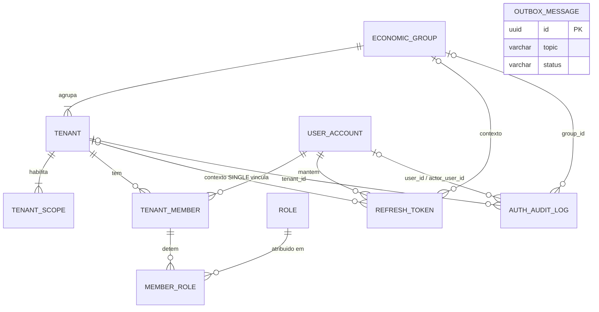

# 30 · Dados — Identity-Service

> **Conjunto:** [00 Índice](00-indice.md) · **Dono:** ARQ (UT-2-01) · **Estado:** Rascunho (ciclo 5; decisões do PO de 2026-10-19 aplicadas) · **Atualizado em:** 2026-10-19
> Contrato partilhado: é congelado no Gate 2. Cada tabela tem **um** módulo dono, o único com código que a escreve. Os outros módulos escrevem só através da interface `IF-nn` do dono (`40`). O esquema inteiro (§3, §5, §6) é criado pela migração do M-11.
> **Nomes de restrições:** `pk_<tabela>`, `fk_<tabela>_<coluna>`, `uq_<tabela>_<colunas>`, `ck_<tabela>_<coluna>` para o CHECK de uma coluna e o nome indicado nos CHECK de tabela. Forma executável e medida de §3, §5 e §6: `evidencias/pg-ddl.sql` (resultado em `evidencias/medir-postgres.out.txt`); uma diferença entre os dois é um defeito e vale este ficheiro.

## 1. Diagrama ER


**Invariantes globais:** nenhum `DELETE` em nenhuma tabela; nenhum `UPDATE` em `auth_audit_log` (PRS-19). Todas as colunas temporais são preenchidas pela aplicação com `TimeProvider` (sem `DEFAULT now()`). Todas as FK são `ON DELETE RESTRICT` (PRS-19).

### 1.1 Mapa de posse (ORQ e validadores; cada ENT indica o seu dono)
| Tabela / estrutura | Módulo dono (escreve) | Interface para outros módulos | Lida diretamente por |
|---|---|---|---|
| ENT-01 `economic_group` | M-04 (nenhum RF escreve na v2; linhas vêm de fora, PRS-13, PRS-49) | Nenhuma | M-04, M-08 |
| ENT-02 `tenant` | M-04 (insere); `status` só por IF-10 | IF-10 (M-12) | M-05, M-08, M-10, M-12 |
| ENT-03 `tenant_scope` | M-04 | Nenhuma | M-05, M-08 |
| ENT-04 `user_account` | M-01 | IF-02 (M-10) | M-05, M-06, M-08, M-10 |
| ENT-05 `tenant_member` | M-05 | IF-12 (M-04: vínculo do criador; M-10: estado dos vínculos no grupo) | M-08, M-10, M-12 (`is_owner` do chamador em EP-08) |
| ENT-06 `role` | M-11 (só o seed da migração; nenhum RF escreve) | Nenhuma | M-05, M-08 |
| ENT-07 `member_role` | M-05 | IF-12 (M-04: papel `GROUP_MANAGER` do criador) | M-08 |
| ENT-08 `refresh_token` | M-02 | IF-01 (M-01, M-03, M-09, M-10, M-12) | M-02 |
| Esquema, migração, `identity_app`, políticas RLS, entidades EF | M-11 | Nenhuma | Todos (`M11Esquema/Persistence/`) |
| ENT-09 `auth_audit_log` | M-00 | IF-03 (M-01 a M-06, M-09, M-10, M-12) | Nenhum RF lê |
| ENT-10 `outbox_message` | M-14 | IF-07 (M-01, M-02, M-04, M-10, M-12) | M-14 |
| Chaves `denylist:*` (§4) | M-00 | IF-04 (escrita: M-01, M-02, M-03, M-09, M-10, M-12; leitura: M-08) | M-00 (middleware) |

M-01, M-02, M-03 e M-06 obtêm estado de utilizador, tenant, vínculos e papéis só pela IF-09 (M-08); não leem ENT-01 a ENT-03 nem ENT-05 a ENT-07.


## 2. Tipos enumerados
Guardados como `VARCHAR` com `CHECK`; em C#, `enum` com os mesmos nomes, convertido para texto (`HasConversion<string>()`).

### ENUM-01 `ENTITY_STATUS` (`economic_group.status`, `tenant.status`, `tenant_member.status`)
| Valor | Significado |
|---|---|
| `ACTIVE` | Pode operar |
| `SUSPENDED` | Bloqueado: impede login no contexto, troca de contexto, refresh e impersonation (RG-03, RG-04) |

#### ENUM-01 · transições (qualquer outra é proibida)
| Tabela | De | Para | Gatilho |
|---|---|---|---|
| `tenant` | `ACTIVE` | `SUSPENDED` | RF-09 |
| `tenant` | `SUSPENDED` | `ACTIVE` | RF-12 |
| `tenant` | `SUSPENDED` | `SUSPENDED` | RF-09 repetido (sem alteração da linha; o módulo define os efeitos) |
| `tenant` | `ACTIVE` | `ACTIVE` | RF-12 repetido (idem) |
| `tenant_member` | `ACTIVE` | `SUSPENDED` | RF-10 por `TENANT_ADMIN`: vínculos do alvo nos tenants do grupo do chamador (D-07, PRS-49) |
| `tenant_member` | `SUSPENDED` | `ACTIVE` | RF-13 por `TENANT_ADMIN`: idem (D-07, PRS-49) |
| `economic_group` | Nenhuma | Nenhuma | Nenhum RF muda o estado; `SUSPENDED` só por carga externa (PRS-49) |

### ENUM-02 `BRANCH_TYPE` (`tenant.branch_type`)
| Valor | Significado |
|---|---|
| `HQ` | Matriz |
| `BRANCH` | Filial |

Sem transições: fixado na criação (RF-07).

### ENUM-03 `OPERATIONAL_SCOPE` (`tenant_scope.scope`, `role.scope`, `refresh_token.active_scope`, claim `active_scope`)
| Valor | Significado |
|---|---|
| `BUYER` | Comprador |
| `SUPPLIER` | Fornecedor |
| `CARRIER` | Transportadora |
| `TENANT_ADMIN` | Gestão corporativa (4.º escopo) |

Sem transições: catálogo fixo (ADR-03).

### ENUM-04 `USER_STATUS` (`user_account.status`)
| Valor | Significado |
|---|---|
| `ACTIVE` | Pode autenticar-se |
| `LOCKED` | Bloqueio temporário por falhas de login até `locked_until` |
| `SUSPENDED` | Suspensão administrativa sem prazo |

#### ENUM-04 · transições
| De | Para | Gatilho |
|---|---|---|
| `ACTIVE` | `LOCKED` | RF-01 (falha que atinge o limite, PRS-31) |
| `LOCKED` | `ACTIVE` | RF-01 (início de EP-01 com `locked_until ≤ agora`); RF-13 (reativação administrativa) |
| `LOCKED` | `LOCKED` | RF-01: tentativa com `locked_until > agora` (linha sem alteração) |
| `ACTIVE` | `SUSPENDED` | RF-10 |
| `LOCKED` | `SUSPENDED` | RF-10 |
| `SUSPENDED` | `ACTIVE` | RF-13 |
| `SUSPENDED` | `SUSPENDED` | RF-10 repetido |
| `ACTIVE` | `ACTIVE` | RF-13 repetido |

`SUSPENDED` → `LOCKED` é proibida: uma conta `SUSPENDED` com palavra-passe errada responde 401 e NÃO soma a `failed_login_attempts` (PRS-83).

### ENUM-05 `REFRESH_TOKEN_STATUS` (`refresh_token.status`)
| Valor | Significado |
|---|---|
| `ACTIVE` | Pode ser usado uma vez em EP-03 |
| `CONSUMED` | Já rodado; reapresentá-lo é reuso |
| `REVOKED` | Invalidado; estado terminal |

#### ENUM-05 · transições
| De | Para | Gatilho |
|---|---|---|
| `ACTIVE` | `CONSUMED` | RF-04 (rotação) |
| `ACTIVE` | `REVOKED` | RF-01 (bloqueio por falhas, D-09, IF-01.4), RF-04 (reuso na família, titular ou contexto bloqueado), RF-05, RF-09, RF-10 |
| `CONSUMED` | `REVOKED` | RF-01 (bloqueio por falhas, D-09, IF-01.4), RF-04 (reuso na família), RF-05, RF-09, RF-10 |

### ENUM-06 `VIEW_MODE` (`refresh_token.view_mode`, claim `view_mode`)
| Valor | Significado |
|---|---|
| `NONE` | Sessão sem contexto (após login); sem operações de domínio |
| `SINGLE` | 1 tenant: `tenant_id` preenchido, `allowed_tenants` com 1 elemento |
| `MACRO_GROUP` | Visão de grupo: `tenant_id = null`, `allowed_tenants` com 1 a 50 tenants do grupo (PRS-35) |

#### ENUM-06 · transições (contexto da família em `refresh_token`)
| De | Para | Gatilho |
|---|---|---|
| `NONE` | `SINGLE` | RF-02 |
| `NONE` | `MACRO_GROUP` | RF-03 |
| `SINGLE` | `SINGLE` | RF-02 |
| `SINGLE` | `MACRO_GROUP` | RF-03 |
| `MACRO_GROUP` | `SINGLE` | RF-02 |
| `MACRO_GROUP` | `MACRO_GROUP` | RF-03 |

`* → NONE` é proibida: só um login novo cria uma família em `NONE`.

### ENUM-07 `PLATFORM_ROLE` (`user_account.platform_role`)
| Valor | Significado |
|---|---|
| `NONE` | Utilizador do Data Plane |
| `SUPPORT_AGENT` | Suporte: pode usar EP-05 |
| `PLATFORM_ADMIN` | Administrador da plataforma: EP-05 a EP-09 sem restrição de grupo |

Sem transições: nenhum RF o altera (PRS-13).

### ENUM-08 `AUDIT_EVENT_TYPE` (`auth_audit_log.event_type`)
`LOGIN_SUCCESS`, `LOGIN_FAILED`, `USER_LOCKED`, `CONTEXT_SWITCHED`, `TOKEN_REFRESHED`, `TOKEN_REUSE_DETECTED`, `LOGOUT`, `IMPERSONATION_STARTED`, `TENANT_CREATED`, `MEMBER_ADDED`, `TENANT_STATUS_CHANGED`, `USER_STATUS_CHANGED`. Significado e colunas por tipo: ENT-09. Sem transições (append-only).

### ENUM-09 `OUTBOX_STATUS` (`outbox_message.status`)
| Valor | Significado |
|---|---|
| `PENDING` | Aguarda publicação |
| `PUBLISHED` | Confirmada pelo broker |
| `FAILED` | Falhou na última tentativa permitida (PRS-43) |

#### ENUM-09 · transições
| De | Para | Gatilho |
|---|---|---|
| `PENDING` | `PENDING` | RF-14: tentativa falhada com `retry_count + 1 < 5`; grava `retry_count = retry_count + 1` |
| `PENDING` | `PUBLISHED` | RF-14: confirmação do broker; `retry_count` não muda |
| `PENDING` | `FAILED` | RF-14: tentativa falhada com `retry_count + 1 = 5`; grava `retry_count = 5` na mesma atualização (`ck_outbox_message_failed_retry`) |

### ENUM-10 `ACTING_SCOPE` (header Kafka e claim `acting_scope` do `context_jws`)
Valores de ENUM-03 mais `NONE` (sem escopo ativo: token `view_mode = NONE` ou evento sem token de entrada). PRS-18. Não é coluna de BD.

## 3. Dicionário de dados
Tipos físicos PostgreSQL 17. "Default: —" = sem default (a aplicação preenche).

### ENT-01 `economic_group`
**Descrição:** grupo económico. **Dono:** M-04 (sem escrita na v2). **Isolamento:** não (PRS-07).

| Coluna | Tipo físico | Nulo | Default | Chave | Restrições | Descrição |
|---|---|---|---|---|---|---|
| `id` | `UUID` | NÃO | — | PK | — | Identificador |
| `name` | `VARCHAR(160)` | NÃO | — | — | `CHECK (char_length(btrim(name)) >= 2)` | Nome do grupo |
| `status` | `VARCHAR(16)` | NÃO | `'ACTIVE'` | — | `CHECK (status IN ('ACTIVE','SUSPENDED'))` | `EntityStatus` |
| `created_at` | `TIMESTAMPTZ` | NÃO | — | — | — | Criação |
| `updated_at` | `TIMESTAMPTZ` | NÃO | — | — | — | Última alteração |

**Índices:** `pk_economic_group (id)` único.

### ENT-02 `tenant`
**Descrição:** pessoa jurídica (CNPJ). **Dono:** M-04; M-12 escreve `status` só por `ITenantStatusWriter`. **Isolamento:** não (PRS-07); a gestão é controlada pela autorização dos endpoints.

| Coluna | Tipo físico | Nulo | Default | Chave | Restrições | Descrição |
|---|---|---|---|---|---|---|
| `id` | `UUID` | NÃO | — | PK | — | Identificador |
| `group_id` | `UUID` | NÃO | — | FK → `economic_group.id`, `ON DELETE RESTRICT` | — | Grupo |
| `cnpj` | `CHAR(14)` | NÃO | — | UQ | `CHECK (cnpj ~ '^[0-9]{14}$')` | 14 dígitos (PRS-11) |
| `legal_name` | `VARCHAR(200)` | NÃO | — | — | `CHECK (char_length(btrim(legal_name)) >= 2)` | Razão social |
| `branch_type` | `VARCHAR(16)` | NÃO | — | — | `CHECK (branch_type IN ('HQ','BRANCH'))` | `BranchType` |
| `geo_lat` | `NUMERIC(9,6)` | NÃO | — | — | `CHECK (geo_lat BETWEEN -90 AND 90)` | Latitude (PRS-22) |
| `geo_lng` | `NUMERIC(9,6)` | NÃO | — | — | `CHECK (geo_lng BETWEEN -180 AND 180)` | Longitude (PRS-22) |
| `status` | `VARCHAR(16)` | NÃO | `'ACTIVE'` | — | `CHECK (status IN ('ACTIVE','SUSPENDED'))` | `EntityStatus` |
| `created_at` | `TIMESTAMPTZ` | NÃO | — | — | — | Criação |
| `updated_at` | `TIMESTAMPTZ` | NÃO | — | — | — | Última alteração |

**Índices:** `pk_tenant (id)` único; `uq_tenant_cnpj (cnpj)` único; `ix_tenant_group_id (group_id)`.

### ENT-03 `tenant_scope`
**Descrição:** escopos habilitados num tenant. **Dono:** M-04. **Isolamento:** sim, `tenant_id` (`ITenantScoped`, RLS §5).

| Coluna | Tipo físico | Nulo | Default | Chave | Restrições | Descrição |
|---|---|---|---|---|---|---|
| `id` | `UUID` | NÃO | — | PK | — | Identificador |
| `tenant_id` | `UUID` | NÃO | — | FK → `tenant.id`, `ON DELETE RESTRICT` | `UQ (tenant_id, scope)` | Tenant |
| `scope` | `VARCHAR(16)` | NÃO | — | — | `CHECK (scope IN ('BUYER','SUPPLIER','CARRIER','TENANT_ADMIN'))` | `OperationalScope` |
| `is_active` | `BOOLEAN` | NÃO | `true` | — | — | Nenhum RF escreve `false` na v2 |
| `created_at` | `TIMESTAMPTZ` | NÃO | — | — | — | Criação |

**Índices:** `pk_tenant_scope (id)` único; `uq_tenant_scope_tenant_id_scope (tenant_id, scope)` único.

### ENT-04 `user_account`
**Descrição:** pessoa física global. **Dono:** M-01; M-10 escreve `status` só por `IUserAccountStatusWriter`. **Isolamento:** não (PRS-07).

| Coluna | Tipo físico | Nulo | Default | Chave | Restrições | Descrição |
|---|---|---|---|---|---|---|
| `id` | `UUID` | NÃO | — | PK | — | Identificador |
| `email` | `VARCHAR(320)` | NÃO | — | UQ | `CHECK (email = lower(btrim(email)) AND char_length(email) >= 5)` | E-mail normalizado (PRS-11) |
| `password_hash` | `VARCHAR(255)` | NÃO | — | — | `CHECK (starts_with(password_hash, '$argon2id$v=19$m=19456,t=2,p=1$'))` | Argon2id `m=19456` KiB, `t=2`, `p=1`, salt 16 bytes, hash 32 bytes, formato PHC `$argon2id$v=19$m=19456,t=2,p=1$<salt_b64>$<hash_b64>` (RNF-01, PRS-21) |
| `name` | `VARCHAR(160)` | NÃO | — | — | `CHECK (char_length(btrim(name)) >= 2)` | Nome |
| `status` | `VARCHAR(16)` | NÃO | `'ACTIVE'` | — | `CHECK (status IN ('ACTIVE','LOCKED','SUSPENDED'))` | `UserStatus` |
| `platform_role` | `VARCHAR(24)` | NÃO | `'NONE'` | — | `CHECK (platform_role IN ('NONE','SUPPORT_AGENT','PLATFORM_ADMIN'))` | `PlatformRole` |
| `failed_login_attempts` | `INTEGER` | NÃO | `0` | — | `CHECK (failed_login_attempts BETWEEN 0 AND 5)` | Falhas consecutivas (PRS-31) |
| `locked_until` | `TIMESTAMPTZ` | SIM | `NULL` | — | `CHECK ((status = 'LOCKED') = (locked_until IS NOT NULL))` | Fim do bloqueio |
| `created_at` | `TIMESTAMPTZ` | NÃO | — | — | — | Criação |
| `updated_at` | `TIMESTAMPTZ` | NÃO | — | — | — | Última alteração |

**Índices:** `pk_user_account (id)` único; `uq_user_account_email (email)` único.

### ENT-05 `tenant_member`
**Descrição:** vínculo utilizador × tenant. **Dono:** M-05; M-04 e M-10 escrevem só por `IMembershipWriter`. **Isolamento:** sim, `tenant_id`.
**Invariantes:** `is_owner = true` aplica RG-01; `MACRO_GROUP` exige `can_view_group = true` em cada tenant, mesmo com `is_owner = true` (PRS-05).

| Coluna | Tipo físico | Nulo | Default | Chave | Restrições | Descrição |
|---|---|---|---|---|---|---|
| `id` | `UUID` | NÃO | — | PK | `UQ (id, tenant_id)` (alvo da FK composta de `member_role`) | Identificador |
| `tenant_id` | `UUID` | NÃO | — | FK → `tenant.id`, `ON DELETE RESTRICT` | `UQ (tenant_id, user_id)` | Tenant |
| `user_id` | `UUID` | NÃO | — | FK → `user_account.id`, `ON DELETE RESTRICT` | — | Utilizador |
| `is_owner` | `BOOLEAN` | NÃO | `false` | — | — | Proprietário |
| `can_view_group` | `BOOLEAN` | NÃO | `false` | — | — | Pode entrar em `MACRO_GROUP` |
| `status` | `VARCHAR(16)` | NÃO | `'ACTIVE'` | — | `CHECK (status IN ('ACTIVE','SUSPENDED'))` | `EntityStatus` |
| `created_at` | `TIMESTAMPTZ` | NÃO | — | — | — | Criação |
| `updated_at` | `TIMESTAMPTZ` | NÃO | — | — | — | Última alteração |

**Índices:** `pk_tenant_member (id)` único; `uq_tenant_member_id_tenant_id (id, tenant_id)` único; `uq_tenant_member_tenant_user (tenant_id, user_id)` único; `ix_tenant_member_user_id (user_id)`.

### ENT-06 `role`
**Descrição:** catálogo de papéis. **Dono:** M-11 (só seed, §6). **Isolamento:** não (PRS-07).

| Coluna | Tipo físico | Nulo | Default | Chave | Restrições | Descrição |
|---|---|---|---|---|---|---|
| `id` | `UUID` | NÃO | — | PK | — | Identificador |
| `name` | `VARCHAR(64)` | NÃO | — | UQ | `CHECK (name ~ '^[A-Z0-9_]{3,64}$')` | Código do papel |
| `scope` | `VARCHAR(16)` | NÃO | — | — | `CHECK (scope IN ('BUYER','SUPPLIER','CARRIER','TENANT_ADMIN'))` | `OperationalScope` |
| `permissions` | `TEXT[]` | NÃO | — | — | `CHECK (cardinality(permissions) >= 1 AND array_to_string(permissions, ',') ~ '^[a-z_]+:[a-z_]+(,[a-z_]+:[a-z_]+)*$' AND char_length(array_to_string(permissions, ',')) - char_length(replace(array_to_string(permissions, ','), ',', '')) = cardinality(permissions) - 1)`; a contagem de vírgulas rejeita elementos com vírgula e elementos `NULL` [MEDIDO] M7b, M7c | Permissões `dominio:acao` (PRS-27) |
| `created_at` | `TIMESTAMPTZ` | NÃO | — | — | — | Criação |

**Índices:** `pk_role (id)` único; `uq_role_name (name)` único; `ix_role_scope (scope)`.

### ENT-07 `member_role`
**Descrição:** papel atribuído a um membro. **Dono:** M-05; M-04 escreve só por `IMembershipWriter`. **Isolamento:** sim, `tenant_id` (cópia de `tenant_member.tenant_id`, garantida pela FK composta).

| Coluna | Tipo físico | Nulo | Default | Chave | Restrições | Descrição |
|---|---|---|---|---|---|---|
| `id` | `UUID` | NÃO | — | PK | — | Identificador |
| `tenant_id` | `UUID` | NÃO | — | FK → `tenant.id`, `ON DELETE RESTRICT` | — | Tenant |
| `tenant_member_id` | `UUID` | NÃO | — | FK `fk_member_role_tenant_member`: `(tenant_member_id, tenant_id)` → `tenant_member (id, tenant_id)`, `ON DELETE RESTRICT` | `UQ (tenant_member_id, role_id)` | Membro |
| `role_id` | `UUID` | NÃO | — | FK → `role.id`, `ON DELETE RESTRICT` | — | Papel |
| `created_at` | `TIMESTAMPTZ` | NÃO | — | — | — | Atribuição |

**Índices:** `pk_member_role (id)` único; `uq_member_role_member_role (tenant_member_id, role_id)` único; `ix_member_role_tenant_id (tenant_id)`.

### ENT-08 `refresh_token`
**Descrição:** token de atualização (só o hash) e contexto ativo da família (PRS-02). **Dono:** M-02. **Isolamento:** não (PRS-07).

| Coluna | Tipo físico | Nulo | Default | Chave | Restrições | Descrição |
|---|---|---|---|---|---|---|
| `id` | `UUID` | NÃO | — | PK | — | Identificador |
| `family_id` | `UUID` | NÃO | — | — | — | Família criada no login |
| `user_id` | `UUID` | NÃO | — | FK → `user_account.id`, `ON DELETE RESTRICT` | — | Titular |
| `token_hash` | `CHAR(64)` | NÃO | — | UQ | `CHECK (token_hash ~ '^[0-9a-f]{64}$')` | SHA-256 hex minúsculo do token (PRS-34) |
| `status` | `VARCHAR(16)` | NÃO | `'ACTIVE'` | — | `CHECK (status IN ('ACTIVE','CONSUMED','REVOKED'))` | `RefreshTokenStatus` |
| `replaced_by_id` | `UUID` | SIM | `NULL` | FK → `refresh_token.id`, `ON DELETE RESTRICT` | — | Token filho da rotação |
| `view_mode` | `VARCHAR(16)` | NÃO | `'NONE'` | — | `CHECK (view_mode IN ('NONE','SINGLE','MACRO_GROUP'))` | `ViewMode` |
| `group_id` | `UUID` | SIM | `NULL` | FK → `economic_group.id`, `ON DELETE RESTRICT` | — | Grupo do contexto |
| `active_tenant_id` | `UUID` | SIM | `NULL` | FK → `tenant.id`, `ON DELETE RESTRICT` | — | Tenant em `SINGLE` |
| `allowed_tenants` | `UUID[]` | NÃO | `'{}'` | — | — | Tenants do contexto, ordem ascendente (PRS-24, PRS-27) |
| `active_scope` | `VARCHAR(16)` | SIM | `NULL` | — | `CHECK (active_scope IS NULL OR active_scope IN ('BUYER','SUPPLIER','CARRIER','TENANT_ADMIN'))` | `OperationalScope` |
| `expires_at` | `TIMESTAMPTZ` | NÃO | — | — | `CHECK (expires_at > created_at)` | `created_at + 604800 s` (PRS-33) |
| `consumed_at` | `TIMESTAMPTZ` | SIM | `NULL` | — | — | Rotação |
| `revoked_at` | `TIMESTAMPTZ` | SIM | `NULL` | — | — | Revogação |
| `created_at` | `TIMESTAMPTZ` | NÃO | — | — | — | Emissão |

**CHECK de tabela:**
- `ck_refresh_token_context`: `(view_mode = 'NONE' AND group_id IS NULL AND active_tenant_id IS NULL AND active_scope IS NULL AND cardinality(allowed_tenants) = 0) OR (view_mode = 'SINGLE' AND group_id IS NOT NULL AND active_tenant_id IS NOT NULL AND active_scope IS NOT NULL AND allowed_tenants = ARRAY[active_tenant_id]) OR (view_mode = 'MACRO_GROUP' AND group_id IS NOT NULL AND active_tenant_id IS NULL AND active_scope IS NOT NULL AND cardinality(allowed_tenants) BETWEEN 1 AND 50)`.
- `ck_refresh_token_status_dates`: `(status <> 'ACTIVE' OR (consumed_at IS NULL AND revoked_at IS NULL)) AND (status <> 'CONSUMED' OR (consumed_at IS NOT NULL AND revoked_at IS NULL)) AND (status <> 'REVOKED' OR revoked_at IS NOT NULL)`.

**Índices:** `pk_refresh_token (id)` único; `uq_refresh_token_token_hash (token_hash)` único; `uq_refresh_token_family_active (family_id) WHERE status = 'ACTIVE'` único parcial (no máximo 1 `ACTIVE` por família; a segunda rotação concorrente falha com violação de unicidade SQLSTATE 23505); `ix_refresh_token_family_id (family_id)`; `ix_refresh_token_user_id_status (user_id, status)`; `ix_refresh_token_allowed_tenants` GIN `(allowed_tenants)`.

### ENT-09 `auth_audit_log`
**Descrição:** auditoria append-only. **Dono:** M-00 (`IAuditLog`). **Isolamento:** não (PRS-07). `identity_app` só tem `SELECT, INSERT` (§5).

| Coluna | Tipo físico | Nulo | Default | Chave | Restrições | Descrição |
|---|---|---|---|---|---|---|
| `id` | `UUID` | NÃO | — | PK | — | Identificador |
| `event_type` | `VARCHAR(32)` | NÃO | — | — | `CHECK (event_type IN ('LOGIN_SUCCESS','LOGIN_FAILED','USER_LOCKED','CONTEXT_SWITCHED','TOKEN_REFRESHED','TOKEN_REUSE_DETECTED','LOGOUT','IMPERSONATION_STARTED','TENANT_CREATED','MEMBER_ADDED','TENANT_STATUS_CHANGED','USER_STATUS_CHANGED'))` | `AuditEventType` |
| `user_id` | `UUID` | SIM | `NULL` | FK → `user_account.id`, `ON DELETE RESTRICT` | — | Ver tabela abaixo |
| `actor_user_id` | `UUID` | SIM | `NULL` | FK → `user_account.id`, `ON DELETE RESTRICT` | — | Ver tabela abaixo |
| `tenant_id` | `UUID` | SIM | `NULL` | FK → `tenant.id`, `ON DELETE RESTRICT` | — | Ver tabela abaixo |
| `group_id` | `UUID` | SIM | `NULL` | FK → `economic_group.id`, `ON DELETE RESTRICT` | — | Ver tabela abaixo |
| `ticket_id` | `VARCHAR(32)` | SIM | `NULL` | — | `CHECK (ticket_id IS NULL OR ticket_id ~ '^[A-Z]{2,10}-[0-9]{1,10}$')` | Chamado (PRS-40) |
| `ip_address` | `VARCHAR(45)` | NÃO | — | — | `CHECK (char_length(ip_address) BETWEEN 2 AND 45)` | IP de origem validado pelo M-00 (PRS-52) |
| `correlation_id` | `UUID` | NÃO | — | — | — | Correlação do pedido (M-00) |
| `metadata` | `JSONB` | NÃO | `'{}'` | — | `CHECK (jsonb_typeof(metadata) = 'object')` | Ver tabela abaixo |
| `created_at` | `TIMESTAMPTZ` | NÃO | — | — | — | Instante do evento |

**Índices:** `pk_auth_audit_log (id)` único; `ix_auth_audit_log_user_id_created_at (user_id, created_at)`; `ix_auth_audit_log_tenant_id_created_at (tenant_id, created_at)`.

**Colunas por `event_type`.** Regra comum: se o token de entrada tiver `act`, `actor_user_id = act.sub` e `ticket_id = act.ticket_id`, sobrepondo-se à coluna `actor_user_id` das tabelas abaixo. Cada tabela pertence ao módulo que produz o evento.

#### AUD.M01 · eventos de auditoria produzidos por M-01
| `event_type` | `user_id` | `actor_user_id` | `tenant_id` | `group_id` | `metadata` |
|---|---|---|---|---|---|
| `LOGIN_SUCCESS` | Utilizador autenticado | `NULL` | `NULL` | `NULL` | `{}` |
| `LOGIN_FAILED` | Utilizador do e-mail; `NULL` se não existir | `NULL` | `NULL` | `NULL` | `{}` |
| `USER_LOCKED` | Utilizador bloqueado | `NULL` | `NULL` | `NULL` | `{}` |

#### AUD.M02 · eventos de auditoria produzidos por M-02
| `event_type` | `user_id` | `actor_user_id` | `tenant_id` | `group_id` | `metadata` |
|---|---|---|---|---|---|
| `TOKEN_REFRESHED` | `refresh_token.user_id` | `NULL` | `active_tenant_id` | `group_id` da família | `{}` |
| `TOKEN_REUSE_DETECTED` | `refresh_token.user_id` | `NULL` | `active_tenant_id` da linha `ACTIVE` da família ou, sem ela, da linha apresentada | `group_id` da linha `ACTIVE` da família ou, sem ela, da linha apresentada | `{}` |

#### AUD.M03 · eventos de auditoria produzidos por M-03
| `event_type` | `user_id` | `actor_user_id` | `tenant_id` | `group_id` | `metadata` |
|---|---|---|---|---|---|
| `CONTEXT_SWITCHED` | `sub` | `NULL` | Novo `tenant_id` (`NULL` em `MACRO_GROUP`) | Novo `group_id` | `{"view_mode": "<ViewMode>", "active_scope": "<OperationalScope>"}` |

#### AUD.M04 · eventos de auditoria produzidos por M-04
| `event_type` | `user_id` | `actor_user_id` | `tenant_id` | `group_id` | `metadata` |
|---|---|---|---|---|---|
| `TENANT_CREATED` | `sub` | `NULL` | Novo tenant | Grupo do novo tenant | `{}` |
| `MEMBER_ADDED` | `sub` (criador, D-04) | `NULL` | Novo tenant | Grupo do novo tenant | `{}` |

#### AUD.M12 · eventos de auditoria produzidos por M-12
| `event_type` | `user_id` | `actor_user_id` | `tenant_id` | `group_id` | `metadata` |
|---|---|---|---|---|---|
| `TENANT_STATUS_CHANGED` | `sub` | `NULL` | Tenant do path | Grupo desse tenant | `{"status": "<EntityStatus>", "reason": "<reason>"}` |

#### AUD.M05 · eventos de auditoria produzidos por M-05
| `event_type` | `user_id` | `actor_user_id` | `tenant_id` | `group_id` | `metadata` |
|---|---|---|---|---|---|
| `MEMBER_ADDED` | `user_id` vinculado | `sub` do chamador | Tenant do path | Grupo desse tenant | `{}` |

#### AUD.M06 · eventos de auditoria produzidos por M-06
| `event_type` | `user_id` | `actor_user_id` | `tenant_id` | `group_id` | `metadata` |
|---|---|---|---|---|---|
| `IMPERSONATION_STARTED` | `target_user_id` | `sub` do chamador | `target_tenant_id` | Grupo desse tenant | `{}`; `ticket_id` = `ticket_id` do pedido |

#### AUD.M09 · eventos de auditoria produzidos por M-09
| `event_type` | `user_id` | `actor_user_id` | `tenant_id` | `group_id` | `metadata` |
|---|---|---|---|---|---|
| `LOGOUT` | `sub` | `act.sub` ou `NULL` | `tenant_id` do token | `group_id` do token | `{}` |

#### AUD.M10 · eventos de auditoria produzidos por M-10
| `event_type` | `user_id` | `actor_user_id` | `tenant_id` | `group_id` | `metadata` |
|---|---|---|---|---|---|
| `USER_STATUS_CHANGED` | `user_id` do path | `sub` do chamador | `NULL` | `NULL` em `GLOBAL`; grupo do chamador em `GROUP` | `{"status": "<UserStatus ou EntityStatus>", "reason": "<reason>", "scope": "GLOBAL" ou "GROUP"}` (D-07) |

### ENT-10 `outbox_message`
**Descrição:** transactional outbox, entrega *at-least-once*. **Dono:** M-14 (`IEventOutbox`). **Isolamento:** não (PRS-07).
**Invariante:** inserida na mesma transação da alteração de negócio, com `status = 'PENDING'`.

| Coluna | Tipo físico | Nulo | Default | Chave | Restrições | Descrição |
|---|---|---|---|---|---|---|
| `id` | `UUID` | NÃO | — | PK | — | Também é o `event_id` |
| `topic` | `VARCHAR(64)` | NÃO | — | — | `CHECK (topic IN ('empresa_cadastrada','tenant_bloqueado','usuario_bloqueado','sessao_comprometida'))` | EV-01 a EV-04 (PRS-42) |
| `partition_key` | `VARCHAR(36)` | NÃO | — | — | `CHECK (partition_key ~ '^[0-9a-f]{8}-[0-9a-f]{4}-[0-9a-f]{4}-[0-9a-f]{4}-[0-9a-f]{12}$')` | UUID em texto (`tenant_id` ou `user_id`, segundo o EV) |
| `headers` | `JSONB` | NÃO | — | — | `CHECK (jsonb_typeof(headers) = 'object')` | Headers Kafka, incluindo `context_jws` |
| `payload` | `JSONB` | NÃO | — | — | `CHECK (jsonb_typeof(payload) = 'object')` | Corpo do evento |
| `status` | `VARCHAR(16)` | NÃO | `'PENDING'` | — | `CHECK (status IN ('PENDING','PUBLISHED','FAILED'))` | `OutboxStatus` |
| `retry_count` | `INTEGER` | NÃO | `0` | — | `CHECK (retry_count BETWEEN 0 AND 5)` | Tentativas falhadas (PRS-43) |
| `created_at` | `TIMESTAMPTZ` | NÃO | — | — | — | Gravação |
| `processed_at` | `TIMESTAMPTZ` | SIM | `NULL` | — | — | Publicação ou falha final |

**CHECK de tabela:** `ck_outbox_message_processed_at`: `(status = 'PENDING') = (processed_at IS NULL)`; `ck_outbox_message_failed_retry`: `(status = 'FAILED') = (retry_count = 5)`.

**Índices:** `pk_outbox_message (id)` único; `ix_outbox_message_pending (created_at) WHERE status = 'PENDING'` parcial.

## 4. Cache e armazenamento volátil (Redis)
Escritas e leituras só por `IDenylist` (M-00). `{id}` = UUID em minúsculas, formato `D`. `agora` = `TimeProvider` em segundos Unix. Um `SET` sobre uma chave existente substitui valor e TTL [MEDIDO] `20` EXT-02.

| Chave | Tipo | Valor | TTL | Escrita por | Lida por |
|---|---|---|---|---|---|
| `denylist:jti:{jti}` | String | `"1"` | `max(1, exp − agora)` s | M-09 (RF-05), M-03 (RF-02, RF-03: `jti` do token de entrada) | M-00 (RG-06) |
| `denylist:user:{user_id}` | String | `agora` em texto decimal | 900 s | M-01 (bloqueio, PRS-32), M-02 (reuso), M-10 (RF-10, só com `PLATFORM_ADMIN`, D-07). Nunca apagada: um token emitido depois tem `iat > V` e passa na RG-07 (PRS-48) | M-00 (RG-07), M-08 (RG-05) |
| `denylist:tenant:{tenant_id}` | String | `"1"` | 900 s (PRS-12) | M-12 (RF-09); `DEL` por M-12 só na transição real `SUSPENDED → ACTIVE` (RF-12) | M-00 (RG-08), M-08 (RG-04), com `MGET` |

Ordem face ao commit da BD: `SET` antes do commit, `DEL` depois do commit (PRS-15). Redis indisponível: PRS-16. `IDenylist` não tem operação para apagar `denylist:user` nem `denylist:jti`.

## 5. Row-Level Security e papel de BD
Criado na migração inicial do M-11, executada com o utilizador de `DB_CONNECTION_STRING` (dono das tabelas).

```sql
DO $$ BEGIN
  IF NOT EXISTS (SELECT 1 FROM pg_roles WHERE rolname = 'identity_app') THEN
    CREATE ROLE identity_app NOLOGIN;
  END IF;
END $$;
GRANT identity_app TO CURRENT_USER;
GRANT SELECT, INSERT, UPDATE ON economic_group, tenant, tenant_scope, user_account, tenant_member,
  role, member_role, refresh_token, outbox_message TO identity_app;
GRANT SELECT, INSERT ON auth_audit_log TO identity_app;
ALTER TABLE tenant_scope ENABLE ROW LEVEL SECURITY;
ALTER TABLE tenant_scope FORCE ROW LEVEL SECURITY;
CREATE POLICY p_tenant_scope_isolation ON tenant_scope
  USING (current_setting('app.auth_flow', true) = 'true'
         OR tenant_id = ANY (string_to_array(current_setting('app.allowed_tenants', true), ',')::uuid[])
         OR tenant_id = ANY (string_to_array(current_setting('app.write_tenants', true), ',')::uuid[]))
  WITH CHECK (current_setting('app.auth_flow', true) = 'true'
         OR tenant_id = ANY (string_to_array(current_setting('app.write_tenants', true), ',')::uuid[]));
```
As mesmas três instruções (`ENABLE`, `FORCE`, `CREATE POLICY`) existem para `tenant_member` (`p_tenant_member_isolation`) e `member_role` (`p_member_role_isolation`), com o mesmo `USING` e `WITH CHECK`. Leitura (`USING`): `app.allowed_tenants` ∪ `app.write_tenants`; o segundo termo é obrigatório porque o EF Core emite `INSERT com RETURNING` (colunas com default na BD) e o `RETURNING` exige que a linha nova passe o `USING`. Escrita (`WITH CHECK`): `app.write_tenants` (conjunto de escrita, PRS-51). O papel e as três variáveis são definidos pelo `RlsConnectionInterceptor` do M-13.

### 5.1 Matriz de isolamento (evidência; só M-13 e validadores)
[MEDIDO] `evidencias/matriz-isolamento.sql`, resultado `evidencias/matriz-isolamento.out.txt` (33 OK, 0 FALHA, 2026-10-19), com `identity_app` e as três variáveis:
| Caso | Modo | Resultado |
|---|---|---|
| I01 a I03 | Bypass (EP-01 a EP-05, `PLATFORM_ADMIN`) | Leitura cruzada e `INSERT com RETURNING` em qualquer tenant |
| I04 a I10 | `SINGLE` | Lê só o tenant ativo; EP-07 com e sem `RETURNING` aceite; `INSERT` noutro tenant e `UPDATE` que move a linha → SQLSTATE 42501; `UPDATE` noutro tenant afeta 0 linhas |
| I11 a I13 | EP-06 por `TENANT_ADMIN` (conjunto de escrita = ativo + novo) | `INSERT` no tenant novo com e sem `RETURNING` aceite; noutro tenant → 42501 |
| I14 a I16 | `MACRO_GROUP` | Lê e escreve nos tenants da lista; fora dela → 42501 |
| I17 | EP-08 (condição C8) | Vínculo do chamador no tenant do path visível |
| I18, I19 | EP-09 (condição C9) | Leitura do tipo de vínculo do alvo no grupo: sem bypass devolve `MEMBER` (alvo dono em A2 invisível a partir de A1); sob `ExecuteWithBypassAsync` (IF-11.3) devolve `OWNER` |
| I20, I21 | Política antiga (`USING` sem `app.write_tenants`) | `INSERT com RETURNING` no tenant novo → 42501: motivo da correção |
| I22 a I28 | EP-09 e `ExecuteWithBypassAsync` (IF-11.3) | UPDATE cruzado sem bypass afeta 0 linhas; sob bypass afeta 1 linha; reposição repõe 0 linhas e leitura só de A1; rollback após erro repõe `auth_flow = 'false'`; reposição antes do commit repõe `auth_flow = 'false'`; em transação abortada a reposição falha com 25P02; sessão nova sem variáveis afeta 0 linhas |
| I29 a I32 | EP-06 por `TENANT_ADMIN` em `tenant_member` e `member_role` | `INSERT com RETURNING` em `tenant_member` e `member_role` num tenant só do conjunto de escrita aceite; fora do conjunto de escrita → 42501 |


## 6. Seed
A migração inicial insere em `role` (com `ON CONFLICT (name) DO NOTHING`), `created_at = '2026-01-01T00:00:00Z'`:

| `id` | `name` | `scope` | `permissions` |
|---|---|---|---|
| `01900000-0000-7000-8000-000000000001` | `BUYER_OPERATOR` | `BUYER` | `{demanda:criar,demanda:listar,leilao:participar,pedido:visualizar}` |
| `01900000-0000-7000-8000-000000000002` | `SUPPLIER_SALES` | `SUPPLIER` | `{estoque:atualizar,fornecimento:publicar,leilao:lance,pedido:confirmar}` |
| `01900000-0000-7000-8000-000000000003` | `CARRIER_DISPATCHER` | `CARRIER` | `{frete:cotar,frete:visualizar,transportadora:configurar}` |
| `01900000-0000-7000-8000-000000000004` | `GROUP_MANAGER` | `TENANT_ADMIN` | `{mapa:visualizar,membro:listar,membro:vincular,tenant:criar,tenant:listar,usuario:suspender}` |

Estas 17 permissões são as únicas existentes. Todo o valor literal de `roles`/`permissions` num CA **DEVE** derivar desta tabela e da RG-01/RG-12. Nenhum outro seed: `economic_group`, `tenant` e `user_account` de teste são criados pelo contrato do ambiente de teste (`70`).

## 7. Cobertura de entrada e dados de referência
Não se aplica: o serviço não importa ficheiros nem dados externos.
