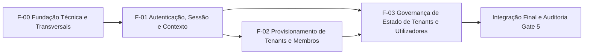

# 60 · Plano de fases de implementação — Identity-Service

> **Conjunto:** [00 Índice](00-indice.md) · **Dono:** ARQ (UT-5-00) · **Estado:** Congelado (Gate 4) · **Atualizado em:** 2026-11-02
> Escrito na UT-5-00, depois do Gate 4. Cada CA pertence a uma e uma só fase.

## 1. Grafo de fases

| Fase | Módulos / RF | Nº CA | Σw | Depende de | Paralelo com | Construtores | Pacote (KiB) |
|---|---|---|---|---|---|---|---|
| F-00 | M-00, M-07, M-08, M-11, M-13, M-14 / RF-11, RF-14, RF-15, RF-16, RF-17, RF-18, RF-19 | 40 | 120 | — | — | 1 ou 2 (código paralelo com testes) | 59.0 |
| F-01 | M-01, M-02, M-03, M-06, M-09 / RF-01, RF-02, RF-03, RF-04, RF-05, RF-06 | 38 | 114 | F-00 | — | 1 ou 2 (código paralelo com testes) | 59.3 |
| F-02 | M-04, M-05 / RF-07, RF-08 | 16 | 48 | F-01 | — | 1 ou 2 (código paralelo com testes) | 59.5 |
| F-03 | M-10, M-12 / RF-09, RF-10, RF-12, RF-13 | 15 | 45 | F-01, F-02 | — | 1 ou 2 (código paralelo com testes) | 59.3 |

**Totais:** CA = 109 · Σw = 327

---

## 2. Detalhe por fase

### F-00 · Fundação Técnica, Esquema, Isolamento, Pipeline, Chaves e Acessos

| Campo | Conteúdo |
|---|---|
| Objetivo | Estabelecer a infraestrutura executável da solução, configuração do host Kestrel, contexto de persistência PostgreSQL EF Core com migrações, políticas de isolamento multi-tenant RLS (camadas 1 a 4), emissão de JWKS, catálogo canônico de acessos, cliente de denylist em Redis e pipeline transacional de Outbox para publicação em tópicos Kafka. |
| Demonstração verificável | A aplicação compila sem avisos nem erros (`dotnet build --warnaserror`), aplica as migrações EF Core criando as 10 tabelas relacionais, a role de banco `identity_app`, as políticas `FORCE ROW LEVEL SECURITY` e o seed determinístico de 4 roles e 17 permissões. Responde com status HTTP 200 em `GET /.well-known/jwks.json` (`EP-10`), impõe isolamento multi-tenant nas camadas 1 a 4, rejeita requisições sem token em rotas protegidas retornando status HTTP 401 com envelope RFC 9457 (`ERR-AUTH-001`) e processa mensagens pendentes da tabela `outbox_message` publicando no broker Kafka com o cabeçalho `context_jws`. |
| Constrói | 1. Solução e projeto .NET 10 (`net10.0`, SDK 10.0.402, `src/IdentityService/IdentityService.csproj`). 2. Pipeline de middleware HTTP em `Program.cs` (correlação com `Guid.TryParseExact(val, "D")`, autenticação JWT RS256, autorização RBAC, logging estruturado JSON e manipulador global de exceções RFC 9457 via `M-00`). 3. Módulo de chaves criptográficas RSA 2048 (`M-07`) e endpoint `GET /.well-known/jwks.json` (`EP-10`). 4. Estrutura relacional, entidades EF Core, `IdentityDbContext`, migrações automáticas e seed de dados (`M-11`). 5. Interceptores e filtros de isolamento multi-tenant em 4 camadas (`M-13`, `IF-11`). 6. Implementação de consultas de permissões e regras globais de acesso (`M-08`, `IF-09`). 7. Tabela `outbox_message`, serviço de publicação em segundo plano e cliente de mensageria Kafka (`M-14`, `IF-07`). |
| CA da fase | 40 CAs (`Σw = 120`): - M-00: `CA-15.1`, `CA-15.2`, `CA-15.3`, `CA-17.1`, `CA-17.2`. - M-07: `CA-11.1`, `CA-11.2`, `CA-11.3`, `CA-11.4`, `CA-11.5`, `CA-11.6`, `CA-11.7`, `CA-11.8`. - M-08: `CA-18.1`, `CA-18.2`, `CA-18.3`, `CA-18.4`, `CA-18.5`. - M-11: `CA-19.1`, `CA-19.2`, `CA-19.3`, `CA-19.4`, `CA-19.5`, `CA-19.6`. - M-13: `CA-16.1`, `CA-16.2`, `CA-16.3`, `CA-16.4`, `CA-16.5`, `CA-16.6`, `CA-16.7`, `CA-16.8`. - M-14: `CA-14.1`, `CA-14.2`, `CA-14.3`, `CA-14.4`, `CA-14.5`, `CA-14.6`, `CA-14.7`, `CA-14.8`. |
| Não tocar ainda | Pastas e arquivos dos módulos: `Modules/M01Login/`, `Modules/M02Refresh/`, `Modules/M03Contexto/`, `Modules/M04Tenants/`, `Modules/M05Membros/`, `Modules/M06Impersonation/`, `Modules/M09Logout/`, `Modules/M10EstadoUsuario/`, `Modules/M12EstadoTenant/`. |
| Depende de | Nenhuma (fase de fundação técnica). |
| Paralelo com | Nenhuma. |
| Pacote de contexto | Documentos `10-nucleo.md`, `20-sistema-existente.md` (`EXT-01`, `EXT-02`, `EXT-03`), `30-dados.md` (§1 a §6), `40-contratos.md` (§1 a §4), `70-ambiente-teste.md`, módulos `M-00`, `M-07`, `M-08`, `M-11`, `M-13`, `M-14`. |
| Escreve | `src/IdentityService/IdentityService.csproj` `src/IdentityService/Program.cs` `src/IdentityService/Modules/M00Transversal/` `src/IdentityService/Modules/M07Chaves/` `src/IdentityService/Modules/M08Acessos/` `src/IdentityService/Modules/M11Esquema/` `src/IdentityService/Modules/M13Isolamento/` `src/IdentityService/Modules/M14Eventos/` `tests/IdentityService.Tests/` |
| Riscos | Falha na execução de migrações EF Core ou permissões insuficientes na criação de roles e políticas RLS no PostgreSQL; incompatibilidade de tipos de dados nos headers Kafka; tempo de resposta do cliente Redis excedendo os limites estipulados sob indisponibilidade. |

---

### F-01 · Autenticação, Sessão, Troca de Contexto, Impersonation e Logout

| Campo | Conteúdo |
|---|---|
| Objetivo | Implementar o núcleo do ciclo de vida de autenticação, rotação de refresh tokens com prevenção contra reuso, seleção dinâmica de perfil ativo e CNPJ (`switch-context`), delegação controlada para suporte técnico e encerramento determinístico de sessões com revogação distribuída. |
| Demonstração verificável | Execução completa e aprovada do fluxo de autenticação: login via `POST /api/v1/auth/login` (`EP-01`) gerando token inicial em modo `view_mode = NONE`, bloqueio de conta após 5 falhas consecutivas com publicação do evento `EV-03: usuario_bloqueado`; troca de contexto via `POST /api/v1/auth/switch-context` (`EP-02`) para modos `SINGLE` e `MACRO_GROUP` com interseção rigorosa de permissões e inclusão do `jti` anterior na denylist do Redis; renovação de credenciais via `POST /api/v1/auth/refresh` (`EP-03`) com detecção de reuso e invalidação de família via `EV-04: sessao_comprometida`; encerramento de sessão via `POST /api/v1/auth/logout` (`EP-04`) com resposta HTTP 204; e delegação via `POST /api/v1/auth/impersonate` (`EP-05`) com emissão de token contendo a claim `act` em conformidade com a RFC 8693. |
| Constrói | 1. `M-01 Login`: Endpoint `EP-01`, verificação de credenciais com Argon2id, controle de tentativas falhadas, bloqueio temporário e emissão do contexto inicial. 2. `M-02 Refresh`: Endpoint `EP-03`, rotação atômica de refresh tokens, controle de famílias de sessão e detecção de reuso. 3. `M-03 Contexto`: Endpoint `EP-02`, validação de vínculos em `tenant_member`, alternância de escopos operacionais e cálculo de permissões efetivas. 4. `M-06 Impersonation`: Endpoint `EP-05`, validação de permissões de suporte, auditoria e emissão de token com claim `act`. 5. `M-09 Logout`: Endpoint `EP-04`, revogação de tokens de acesso na denylist do Redis e invalidação da família de refresh tokens. 6. Registro das rotas `EP-01` a `EP-05` no pipeline HTTP em `Program.cs`. |
| CA da fase | 38 CAs (`Σw = 114`): - M-01: `CA-01.1`, `CA-01.2`, `CA-01.3`, `CA-01.4`, `CA-01.5`, `CA-01.6`, `CA-01.7`. - M-02: `CA-04.1`, `CA-04.2`, `CA-04.3`, `CA-04.4`, `CA-04.5`, `CA-04.6`, `CA-04.7`, `CA-04.8`. - M-03: `CA-02.1`, `CA-02.2`, `CA-02.3`, `CA-02.4`, `CA-03.1`, `CA-03.2`, `CA-03.3`, `CA-03.4`. - M-06: `CA-06.1`, `CA-06.2`, `CA-06.3`, `CA-06.4`, `CA-06.5`, `CA-06.6`, `CA-06.7`. - M-09: `CA-05.1`, `CA-05.2`, `CA-05.3`, `CA-05.4`, `CA-05.5`, `CA-05.6`, `CA-05.7`, `CA-05.8`. |
| Não tocar ainda | Pastas e arquivos dos módulos: `Modules/M04Tenants/`, `Modules/M05Membros/`, `Modules/M10EstadoUsuario/`, `Modules/M12EstadoTenant/`. |
| Depende de | `F-00`. |
| Paralelo com | Nenhuma. |
| Pacote de contexto | Interfaces aceitas em `F-00` (`IF-01`, `IF-02`, `IF-03`, `IF-04`, `IF-05`, `IF-06`, `IF-07`, `IF-08`, `IF-09`, `IF-11`), `10-nucleo.md`, `30-dados.md` (tabelas `user_account`, `refresh_token`, `auth_audit_log`), `40-contratos.md` (endpoints `EP-01` a `EP-05`), módulos `M-01`, `M-02`, `M-03`, `M-06`, `M-09`. |
| Escreve | `src/IdentityService/Modules/M01Login/` `src/IdentityService/Modules/M02Refresh/` `src/IdentityService/Modules/M03Contexto/` `src/IdentityService/Modules/M06Impersonation/` `src/IdentityService/Modules/M09Logout/` `src/IdentityService/Program.cs` (inclusão de mapeamento das rotas `EP-01` a `EP-05`) |
| Riscos | Condições de corrida na rotação simultânea de refresh tokens; inconsistência na revogação distribuída caso o Redis apresente latência; falha na validação de permissões combinadas em visualizações de macro grupo. |

---

### F-02 · Provisionamento de Tenants e Gestão de Membros e Papéis

| Campo | Conteúdo |
|---|---|
| Objetivo | Implementar o provisionamento corporativo de tenants (CNPJs) associados a grupos econômicos, validação de unicidade cadastral, auto-associação de administradores e gerenciamento de membros com atribuição granular de papéis e escopos operacionais. |
| Demonstração verificável | Criação com sucesso de tenant via `POST /api/v1/tenants` (`EP-06`) com validação algorítmica de CNPJ pelo módulo 11, garantia do conjunto de escrita via `AuthorizeTenantWrite`, vinculação automática do criador como `GROUP_MANAGER` quando acionado por `TENANT_ADMIN`, persistência em transação atômica dos escopos e inclusão do evento `EV-01: empresa_cadastrada` na tabela de Outbox. Associação bem-sucedida de membros a tenants com papéis específicos via `POST /api/v1/tenants/{tenant_id}/members` (`EP-07`), com validação rigorosa de compatibilidade entre os escopos do tenant e as permissões atribuídas. |
| Constrói | 1. `M-04 Criar tenant`: Endpoint `EP-06`, validação de CNPJ e dados cadastrais, persistência de registros em `tenant` e `tenant_scope`, enfileiramento de `EV-01` na outbox. 2. `M-05 Membros`: Endpoint `EP-07`, validação de existência do usuário, persistência em `tenant_member` e `member_role`, aplicação do método `IF-12.1`. 3. Registro das rotas `EP-06` e `EP-07` no pipeline HTTP em `Program.cs`. |
| CA da fase | 16 CAs (`Σw = 48`): - M-04: `CA-07.1`, `CA-07.2`, `CA-07.3`, `CA-07.4`, `CA-07.5`, `CA-07.6`, `CA-07.7`, `CA-07.8`. - M-05: `CA-08.1`, `CA-08.2`, `CA-08.3`, `CA-08.4`, `CA-08.5`, `CA-08.6`, `CA-08.7`, `CA-08.8`. |
| Não tocar ainda | Pastas e arquivos dos módulos: `Modules/M10EstadoUsuario/`, `Modules/M12EstadoTenant/`. |
| Depende de | `F-01`. |
| Paralelo com | Nenhuma. |
| Pacote de contexto | Código e interfaces aceitos em `F-00` e `F-01` (`IF-03`, `IF-07`, `IF-08`, `IF-10`, `IF-11`, `IF-12`), `10-nucleo.md`, `30-dados.md` (tabelas `economic_group`, `tenant`, `tenant_scope`, `tenant_member`, `member_role`, `role`), `40-contratos.md` (endpoints `EP-06`, `EP-07` e evento `EV-01`), módulos `M-04`, `M-05`. |
| Escreve | `src/IdentityService/Modules/M04Tenants/` `src/IdentityService/Modules/M05Membros/` `src/IdentityService/Program.cs` (inclusão de mapeamento das rotas `EP-06` e `EP-07`) |
| Riscos | Falha de integridade referencial ao inserir membros em tenants recém-criados antes da confirmação da transação; tentativa de vincular papéis cujos escopos não estejam ativos na organização. |

---

### F-03 · Governança de Estado: Suspensão e Reativação de Tenants e Utilizadores

| Campo | Conteúdo |
|---|---|
| Objetivo | Implementar o controle administrativo e judiciário de ciclo de vida de tenants e usuários, garantindo bloqueio imediato, revogação distribuída de sessões em cache Redis, publicação de eventos de governança e reativação consistente com integridade de dados. |
| Demonstração verificável | Alteração de estado de tenant via `PATCH /api/v1/tenants/{tenant_id}/status` (`EP-08`), resultando em gravação da chave `denylist:tenant` no Redis, invalidação de todas as sessões ativas com contexto no tenant, persistência de auditoria e publicação de `EV-02: tenant_bloqueado`. Alteração de estado de usuário via `PATCH /api/v1/users/{user_id}/status` (`EP-09`), suportando tanto o escopo `GLOBAL` acionado por `PLATFORM_ADMIN` (com bloqueio da conta em `user_account`, inserção em `denylist:user`, revogação de famílias de refresh e publicação de `EV-03: usuario_bloqueado`) quanto o escopo `GROUP` acionado por `TENANT_ADMIN` (suspendendo exclusivamente os vínculos não proprietários no grupo econômico por meio de `ExecuteWithBypassAsync` e revogando apenas as famílias de token nos tenants afetados). |
| Constrói | 1. `M-12 Estado do tenant`: Endpoint `EP-08`, transição de status em `tenant`, gravação de `denylist:tenant`, revogação em cascata e publicação de `EV-02`. 2. `M-10 Estado do utilizador`: Endpoint `EP-09`, diferenciação entre governança global da plataforma e governança restrita ao grupo econômico, aplicação de `ExecuteWithBypassAsync` (`IF-11.3`) e publicação de `EV-03`. 3. Registro das rotas `EP-08` e `EP-09` no pipeline HTTP em `Program.cs`. |
| CA da fase | 15 CAs (`Σw = 45`): - M-10: `CA-10.1`, `CA-10.2`, `CA-10.3`, `CA-10.4`, `CA-10.5`, `CA-13.1`, `CA-13.2`, `CA-13.3`. - M-12: `CA-09.1`, `CA-09.2`, `CA-09.3`, `CA-09.4`, `CA-12.1`, `CA-12.2`, `CA-12.3`. |
| Não tocar ainda | Nenhuma pasta ou módulo (fase final de implementação funcional; o conjunto dos 15 módulos e dos 109 CAs da especificação fica ativo e concluído). |
| Depende de | `F-01`, `F-02`. |
| Paralelo com | Nenhuma. |
| Pacote de contexto | Código e interfaces aceitos em `F-00`, `F-01` e `F-02`, documentos `10-nucleo.md`, `30-dados.md`, `40-contratos.md` (endpoints `EP-08`, `EP-09`, eventos `EV-02`, `EV-03`), módulos `M-10` e `M-12`. |
| Escreve | `src/IdentityService/Modules/M10EstadoUsuario/` `src/IdentityService/Modules/M12EstadoTenant/` `src/IdentityService/Program.cs` (inclusão de mapeamento das rotas `EP-08` e `EP-09`) |
| Riscos | Invalidação incompleta de sessões caso o usuário possua vínculos em múltiplos tenants no momento da suspensão; falha na remoção da denylist no Redis em transições de reativação para o estado ativo. |

---

## 3. Critérios de Saída e Gates de Aceitação por Fase

Cada fase de implementação submete seus entregáveis à verificação formal por agente validador independente antes da realização de merge para a ramificação principal. A aprovação da fase exige cumprimento estrito dos seguintes critérios objetivos:

| Critério | Descrição | Método de Verificação | Condição de Aprovação |
|---|---|---|---|
| **G1 · Compilação** | A solução compila na íntegra sem emissão de avisos ou erros. | `dotnet build --warnaserror` | 0 erros, 0 avisos. |
| **G2 · Conformidade** | O código gerado adota as convenções de nomenclatura e diretrizes do projeto. | Análise estática com linter C# e verificação de regras de arquitetura. | 0 violações de diretrizes. |
| **G3 · Testes de Unidade** | A totalidade dos testes unitários da fase executa com sucesso. | `dotnet test --filter Category=Unit` | 100% dos testes aprovados. |
| **G4 · Suíte de Aceitação** | A suíte de testes de aceitação independente valida os CAs da fase. | Execução dos cenários de teste vinculados aos CAs correspondentes. | Pontuação de conformidade ponderada $\ge 95\%$, com 0 falhas em cenários `@critico`. |
| **G5 · Isolamento de Modificação** | O conjunto de alterações afeta estritamente os arquivos da coluna "Escreve". | `git diff --stat` comparado contra a lista da coluna "Não tocar ainda". | Nenhuma alteração em arquivos de fases futuras ou de outros módulos. |
| **G6 · Registro e Rastreabilidade** | O registro de transição é atualizado com identificadores, métricas e modelo de PR. | Inspeção do arquivo `90-registo.md` e do documento de Pull Request. | Linha da fase devidamente preenchida com hash, autor e pontuação validada. |

---
*Plano de Fases estruturado e congelado na UT-5-00. Qualquer proposta de alteração na ordem de execução ou no agrupamento de módulos requer aprovação prévia do Product Owner através de solicitação formal de mudança (CR).*
