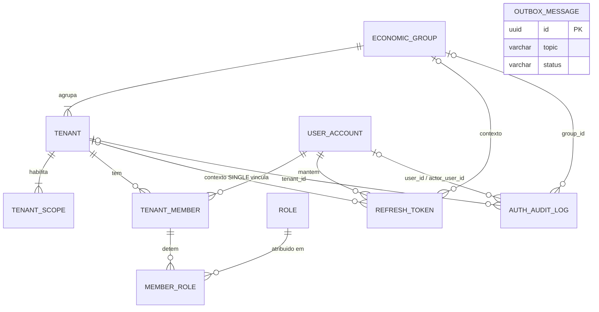

# Pacote de Contexto — M-04

| Ficheiro de origem | Secções incluídas | Tamanho (KiB) |
|---|---|---|
| `10-nucleo.md` | Núcleo base (§1-§2, §3 comum, §4, §6-§10) | 14.7 |
| `30-dados.md` | Comum (§1, §2, §3) + ENT-01, ENT-02, ENT-03, ENUM-01, ENUM-02, ENUM-03, AUD.M04 | 6.0 |
| `40-contratos.md` | §1, §2, §3 + operações/itens de §4 (EP-06, EV-01, IF-03.1, IF-07.1, IF-08.1, IF-08.2, IF-10, IF-10.1, IF-12.1) + tipos partilhados | 18.3 |
| `70-ambiente-teste.md` | Comum §1 | 3.6 |
| `20-sistema-existente.md` | Nenhuma | 0.0 |
| `90-registo.md` | UT-3-04 (§1) + PRS-36, PRS-37 (§2.2) | 0.8 |
| **Total contexto** | **Todas as origens** | **43.4** |

<!-- FIM DO CABECALHO -->

# 10 · Núcleo — Identity-Service

> **Conjunto:** [00 Índice](00-indice.md) · **Dono:** ARQ (UT-1-01) · **Estado:** Congelado (Gate 4) · **Atualizado em:** 2026-11-02
> **Núcleo base** (todos os pacotes): tudo antes da secção final "Extras". Cada extra diz no título em que pacotes entra. Estado dos PRS: `90` §2.

## 1. Instruções obrigatórias para a LLM

1. Implemente **exclusivamente** o que está no seu pacote de contexto. Qualquer endpoint, campo, tabela, dependência ou comportamento que não esteja descrito **NÃO DEVE** ser criado.
2. **DEVE**, **NÃO DEVE**, **DEVERIA**, **NÃO DEVERIA** e **PODE** têm o significado da RFC 2119/8174.
3. Em conflito vale, por ordem: (1) RN do módulo dono e RG (§3.6); (2) CA do módulo dono; (3) contratos (`40` e detalhe do EP no módulo); (4) dados (`30`); (5) restante núcleo; (6) plano de fases e restantes. Uma RN contra uma RG é defeito: registe-o em "Dúvidas", não o resolva por interpretação.
4. Use **apenas** as tecnologias e versões da §4.
5. Respeite **literalmente** os nomes de entidades, colunas, campos JSON, enums, tópicos, chaves de cache e códigos de erro.
6. **Se algo estiver ambíguo ou em falta, NÃO invente.** Registe-o em "Dúvidas" na sua entrega e siga com a hipótese mais simples, marcada como tal. Toda a decisão tomada sem base na especificação vai para "Decisões fora dos docs".
7. Não toque em nada listado em "Não tocar ainda" no seu brief.
8. Cada CA da sua fase tem um teste com o ID no nome (convenção em `70`).
9. Entregue no formato fixo do seu brief (`80`).

## 2. Contexto

### 2.1 Propósito
Autenticar pessoas físicas de um portal B2B multi-CNPJ, emitir JWT RS256 com o contexto ativo (`SINGLE` ou `MACRO_GROUP`) num dos 4 escopos, revogar sessões de imediato pela denylist no Redis e publicar eventos de identidade no Kafka com contexto assinado. [DOC] `Docs/Ideia Base.md`.

### 2.4 Glossário
| Termo | Nome canónico | Sinónimos proibidos |
|---|---|---|
| Grupo Económico | `economic_group` | `Account`, `Holding` |
| Tenant (pessoa jurídica, um CNPJ) | `tenant` | `Company`, `Filial` |
| Escopo operacional | `OperationalScope` | `Profile`, `Persona` |
| Conta de utilizador (pessoa física) | `user_account` | `Person`, `LoginUser` |
| Membro; papel; papel do membro | `tenant_member`; `role`; `member_role` | `Membership`; `Group`; `UserRole` |
| Refresh token; família | `refresh_token`; `family_id` (claim `fid`) | `SessionToken`; `session_id` |
| Modo de visão | `ViewMode` | `ContextMode` |
| Contexto de autenticação | `AuthContext` | `UserContext`, `TenantContext` |
| Auditoria; mensagem de outbox | `auth_audit_log`; `outbox_message` | `AuditTrail`; `EventQueue` |
| Denylist; contexto assinado de evento | `denylist:*`; `context_jws` | `blacklist`; `event_token` |
Classes C# com o nome da tabela em `PascalCase` (`TenantMember`, `RefreshToken`).

## 3. Restrições arquiteturais

### 3.1 ADR
| ID | Decisão | Consequência obrigatória no código | Origem (IB = [DOC] Ideia Base) |
|---|---|---|---|
| ADR-01 | Control Plane separado | `user_account.platform_role` (`NONE`, `SUPPORT_AGENT`, `PLATFORM_ADMIN`); nenhuma `role` concede privilégio de plataforma | IB §2 |
| ADR-02 | `economic_group` → `tenant` | `tenant.group_id NOT NULL`; token com `view_mode ≠ NONE` tem `group_id ≠ null` | IB §2, IB §3.1 |
| ADR-03 | Quatro escopos | `OperationalScope` com 4 valores (`BUYER`, `SUPPLIER`, `CARRIER`, `TENANT_ADMIN`); outro valor → 400 `ERR-VAL-001` | IB §2, IB §3.2 |
| ADR-04 | Troca explícita de contexto | EP-01 emite `view_mode = NONE`; só EP-02 ativa `SINGLE` ou `MACRO_GROUP` | IB §5; PRS-01 |
| ADR-05 | Isolamento em 4 camadas | `tenant_scope`, `tenant_member`, `member_role` são `ITenantScoped`: middleware, filtro de leitura, interceptor de escrita e RLS (detalhe no extra do M-13) | IB §7.2; PRS-07, PRS-17 |
| ADR-06 | JWT RS256 + JWKS + denylist | RSA 2048, `kid` no header; EP-10 publica a chave; middleware aplica RG-06 a RG-08 | IB §2, IB §6.2; PRS-04 |
| ADR-07 | Rotação com deteção de reuso | `refresh_token` guarda só `token_hash`; reapresentar `CONSUMED` revoga a família | IB §6.3 |
| ADR-08 | Impersonation RFC 8693 | Claim `act`; sem `refresh_token`; token com `act` rejeitado em EP-02 e EP-05 | IB §6.4; PRS-08 |
| ADR-09 | Contexto assinado nos eventos | Toda a `outbox_message` leva headers de identidade e `context_jws` | IB §6.5; PRS-09 |
| ADR-10 | Monólito modular | Um projeto (§3.2); um módulo só escreve na sua pasta e nas tabelas de que é dono; chama outro módulo só pelas `IF-nn` (`40`) | ARQ |
| ADR-11 | Um único mecanismo de migração | EF Core Migrations aplicadas no arranque pelo M-11 | ARQ |

### 3.2 Estrutura do projeto
```text
IdentityService.slnx, global.json, .config/dotnet-tools.json, Directory.Build.props, Dockerfile, docker-compose.yml
src/IdentityService/Program.cs   chama AddMnn() e MapMnn() de cada módulo
src/IdentityService/Modules/Mnn<Nome>/   uma pasta por módulo (M-00 a M-14), com Interface/ (tipos públicos) e ModuleRegistration.cs
  M11Esquema/Persistence/: IdentityDbContext, entidades, configurações EF, Migrations/
tests/IdentityService.Tests/Mnn<Nome>/   testes do construtor
tests/IdentityService.Acceptance/   suite do AUD: o construtor NÃO DEVE criá-la nem alterá-la
```
**Dependências:** `Modules/Mxx/` só referencia `Modules/Myy/Interface/`, `Modules/M00Transversal/` e `Modules/M11Esquema/Persistence/`. Endpoints em Minimal APIs. Novos `PackageReference` proibidos: os pacotes são criados uma vez (M-11, F-00).

### 3.3 Convenções
| Item | Convenção |
|---|---|
| Classes / ficheiros | `PascalCase`, um tipo público por ficheiro |
| Tabelas / colunas | `snake_case` singular (`UseSnakeCaseNamingConvention()`); nomes de restrições em `30` |
| JSON | `JsonNamingPolicy.SnakeCaseLower`; `JsonUnmappedMemberHandling.Disallow`; enums como texto |
| Datas | JSON: UTC `yyyy-MM-ddTHH:mm:ssZ` truncado ao segundo; `iat`, `exp` e valores Redis em segundos Unix |
| Tempo | Só `TimeProvider` injetado |
| Identificadores | UUID v7 gerado pela aplicação; texto minúsculo, formato `D` |
| Arrays de saída | Ordem ordinal ascendente em `roles`, `permissions`, `allowed_tenants`, `scopes`, `available_scopes` (PRS-24) |
| Commits | `tipo(Mnn): descrição (RF-nn, CA-nn.m)` |

### 3.4 Comportamentos transversais (donos: M-00; isolamento M-13)
| Aspeto | Especificação |
|---|---|
| Autenticação | EP com token obrigatório (EP-02, EP-04 a EP-09): leitura da chave de `ISigningKey` (indisponível → 503, também sem token), depois RG-06, RG-07, RG-08 por esta ordem |
| Erro | RFC 9457 `application/problem+json; charset=utf-8`: `type` = `https://identity.b2b.local/errors/{code}`, `title` e `status` do §6, `code`, `detail` = `title` (PRS-26), `correlation_id`; sem stack trace |
| Logging | `AddJsonConsole()` para `stdout`. **NÃO DEVE** registar `password`, `password_hash`, `refresh_token`, `token_hash`, `access_token`, `context_jws`, chaves privadas nem corpos de pedido |
| Auditoria | `IAuditLog` insere em `auth_audit_log` na transação da operação, com as colunas dos eventos do módulo (`30`) |
| Denylist | Só `IDenylist` acede a `denylist:*` |
| Escrita em `ITenantScoped` | Um endpoint de gestão só escreve no tenant que a autorização do EP aprovou, declarado por `AuthorizeTenantWrite` antes de abrir a transação (PRS-51). Exceção: EP-09 por `TENANT_ADMIN`, pelo bypass limitado do M-13 (PRS-72) |

### 3.5 Claims do `access_token` e `AuthContext`
Header: `alg = RS256`, `typ = JWT`, `kid = JWT_KEY_ID`. Todas presentes salvo "omitida"; valor nulo = literal JSON `null`. Tipos C# do `AuthContext`: `40`, tipos partilhados.

| Claim | Tipo | Valor | `AuthContext` |
|---|---|---|---|
| `jti` | string | UUID v7 novo | `Jti` |
| `sub` | string | `user_account.id` (impersonation: o alvo) | `UserId` |
| `fid` | string | `family_id`; omitida em impersonation | `FamilyId` |
| `iat`, `exp` | número | Unix; `exp = iat + 900` (PRS-20) | `Iat`, `Exp` |
| `iss`, `aud` | string | `JWT_ISSUER`, `JWT_AUDIENCE` | — |
| `platform_role` | string | `PlatformRole` de `sub` | `PlatformRole` |
| `view_mode` | string | `ViewMode` | `ViewMode` |
| `group_id`, `tenant_id` | string \| `null` | `null` em `NONE`; `tenant_id = null` em `MACRO_GROUP` | `GroupId`, `ActiveTenantId` |
| `allowed_tenants` | array | `[]` em `NONE`; 1 em `SINGLE`; 1 a 50 em `MACRO_GROUP` | `AllowedTenants` |
| `active_scope` | string \| `null` | `OperationalScope`; `null` em `NONE` | `ActiveScope` |
| `roles`, `permissions` | array | RG-01 (`SINGLE`), RG-12 (`MACRO_GROUP`); `[]` em `NONE` | `Roles`, `Permissions` |
| `act` | `{ "sub", "ticket_id" }` | Só em impersonation | `ActorUserId`, `TicketId` |

### 3.6 Catálogo de regras globais (RG)
Nível 1 da precedência (§1). Texto canónico nos extras do núcleo dos donos: RG-01 a RG-05 e RG-10 a RG-13 implementadas só por M-08 (`IAccessQueries`); RG-06 a RG-08 só por M-00; RG-09 só por M-13. Os consumidores aplicam-nas pela interface e indicam o passo da sua ordem de avaliação.

| ID | Resumo | Erro | Dono |
|---|---|---|---|
| RG-01 | Papéis e permissões de `u` em `t` para `S`: dono → todas as `role` de `S`; senão as de `member_role` | – | M-08 |
| RG-02 | Escopo `S` inativo em `t` ou sem papéis | 403 `ERR-CTX-003` | M-08 |
| RG-03 | Sem vínculo `ACTIVE` em `t` | 403 `ERR-CTX-001` | M-08 |
| RG-04 | Tenant ou grupo `SUSPENDED`, ou `denylist:tenant:{t}` | 403 `ERR-CTX-002` | M-08 |
| RG-05 | Utilizador bloqueado. EP-01: só `status = SUSPENDED`, avaliado só depois de a palavra-passe estar correta (D-08, D-11). EP-02: `SUSPENDED` ou `denylist:user` ≥ `iat`. EP-03: `SUSPENDED` ou `denylist:user` ≥ `created_at` do refresh apresentado. EP-05 (alvo): `SUSPENDED` ou qualquer `denylist:user` do alvo (PRS-46) | 403 `ERR-AUTH-004` | M-08 |
| RG-06 | Token ausente, inválido, expirado ou com `denylist:jti` | 401 `ERR-AUTH-002` | M-00 |
| RG-07 | `denylist:user` de `sub` ou `act.sub` com valor ≥ `iat` | 403 `ERR-AUTH-004` | M-00 |
| RG-08 | `denylist:tenant` de algum tenant de `allowed_tenants` | 403 `ERR-CTX-002` | M-00 |
| RG-09 | Escrita ou leitura rejeitada pela camada 3 ou 4 | 403 `ERR-CTX-007` | M-13 |
| RG-10 | Contextos disponíveis no login | – | M-08 |
| RG-11 | `MACRO_GROUP`: lista com 1 a 50 tenants distintos do grupo e `can_view_group = true` em todos | 403 `ERR-CTX-004` | M-08 |
| RG-12 | `MACRO_GROUP`: `roles`/`permissions` = interseção da RG-01 nos tenants | – | M-08 |
| RG-13 | Interseção de `permissions` vazia | 403 `ERR-CTX-003` | M-08 |

## 4. Stack
| Camada | Tecnologia | Versão exata |
|---|---|---|
| SDK / runtime | .NET SDK / ASP.NET Core (`net10.0`, C# 14) | 10.0.402 / 10.0.13 |
| Base de dados / cache / mensageria | PostgreSQL / Redis / Apache Kafka (KRaft) | 17.6 / 7.4.6 / 3.9.1 |
| Contentores | Docker Engine | 29.7.2 |

Pacotes: lista exaustiva no extra de projeto do M-11. Proibido qualquer outro, incluindo `JwtBearer`, `System.IdentityModel.Tokens.Jwt`, `FluentValidation`, `Serilog.*`, `Actuar.*`, `AutoMapper`, `MediatR`, `Newtonsoft.Json`, `Dapper`, `MassTransit`, `Moq`, `FluentAssertions`, `Bogus`. A validação de pedidos é código explícito.

## 6. Catálogo global de erros
| Código | HTTP | `title` (fixo) | Condição |
|---|---|---|---|
| `ERR-VAL-001` | 400 | Pedido inválido ou malformado | JSON inválido, campo obrigatório ausente ou `null`, tipo errado, valor fora do enum, campo desconhecido, formato |
| `ERR-VAL-002` | 422 | Dados de CNPJ ou geolocalização inválidos | M-04 |
| `ERR-VAL-003` | 422 | Formato de e-mail ou política de palavra-passe violada | M-01 |
| `ERR-VAL-004` | 422 | Código de chamado técnico inválido | M-06 |
| `ERR-REQ-001` | 404 | Rota inexistente | Nenhuma rota corresponde |
| `ERR-REQ-002` | 405 | Método não permitido | Path com outro método |
| `ERR-REQ-003` | 413 | Corpo do pedido demasiado grande | Corpo > 65 536 bytes |
| `ERR-REQ-004` | 415 | Tipo de conteúdo não suportado | Corpo com `Content-Type` ≠ `application/json` (`charset` só `utf-8`) |
| `ERR-AUTH-001` | 401 | Credenciais inválidas | M-01 |
| `ERR-AUTH-002` | 401 | Token de acesso ausente, inválido, expirado ou revogado | RG-06; EP-02 com família sem linha `ACTIVE` (PRS-73) |
| `ERR-AUTH-003` | — | `[REMOVIDO]` | Não é devolvido por nenhum EP: a conta `LOCKED` responde 401 `ERR-AUTH-001` (D-08) |
| `ERR-AUTH-004` | 403 | Utilizador suspenso ou revogado globalmente | RG-05, RG-07; alvo `LOCKED` em EP-05 (M-06) |
| `ERR-AUTH-005` | 401 | Refresh token inválido, revogado ou expirado | M-02 |
| `ERR-AUTH-006` | 401 | Reuso de refresh token detetado e sessão revogada | M-02 |
| `ERR-AUTH-010` | 403 | Operação de impersonation não autorizada | M-06 |
| `ERR-CTX-001` | 403 | Utilizador sem vínculo ativo no Tenant solicitado | RG-03 |
| `ERR-CTX-002` | 403 | Tenant ou Grupo Económico suspenso | RG-04, RG-08; grupo `SUSPENDED` em EP-06 (M-04) |
| `ERR-CTX-003` | 403 | Escopo operacional inativo ou papel não atribuído | RG-02, RG-13 |
| `ERR-CTX-004` | 403 | Violação das regras de agregação em visão macro | RG-11 |
| `ERR-CTX-005` | 409 | Conflito de unicidade de registo | M-04, M-05 |
| `ERR-CTX-006` | 422 | Papel incompatível com os escopos ativos do Tenant | M-05 |
| `ERR-CTX-007` | 403 | Violação de isolamento de contexto ou permissão insuficiente | Autorização do EP negada, RG-09, `act` em EP-02 |
| `ERR-CTX-008` | 404 | Recurso de domínio não encontrado | `group_id`, `tenant_id`, `user_id` ou `role_id` inexistente |
| `ERR-SYS-001` | 500 | Erro interno do servidor | Exceção não prevista |
| `ERR-SYS-002` | 503 | Dependência indisponível | PostgreSQL, Redis ou chave indisponível (PRS-16) |

Um módulo **NÃO DEVE** criar códigos: um código em falta é um `CR-nn`.

## 7. Regras por omissão
| Situação não coberta | Comportamento obrigatório |
|---|---|
| Campo de request não listado | 400 `ERR-VAL-001` |
| Autorização não descrita | Negar: 403 `ERR-CTX-007` |
| Rota inexistente / método errado | 404 `ERR-REQ-001` / 405 `ERR-REQ-002` |
| Erro inesperado | 500 `ERR-SYS-001`, transação desfeita |
| PostgreSQL, Redis ou chave indisponível | 503 `ERR-SYS-002`, transação desfeita, salvo um `DEL` posterior ao commit (PRS-15, PRS-16) |
| Escrever tabela de outro módulo | Só pela interface do dono (`40` §4.3) |
| Exceção de BD, Redis ou chave | Tratador global do M-00, pela cadeia de `InnerException`: 42501 → 403 `ERR-CTX-007`; 23505 não tratado → 409 `ERR-CTX-005` |

## 8. Explicitamente proibido
- `refresh_token` em claro; segredos em log.
- Hidratar o `AuthContext` a partir de headers em texto (`X-Tenant-Id`, `X-User-Id`, `X-Group-Id`).
- `HS256` ou RSA com menos de 2048 bits; `refresh_token` em impersonation.
- `DELETE` em qualquer tabela; `UPDATE` em `auth_audit_log` (PRS-19).
- `DateTime.UtcNow`, `DateTimeOffset.UtcNow`, `EnsureCreated`, `Thread.Sleep` em código de produção.

---

# 30 · Dados — Identity-Service

> **Conjunto:** [00 Índice](00-indice.md) · **Dono:** ARQ (UT-2-01) · **Estado:** Congelado (Gate 4) · **Atualizado em:** 2026-11-02
> Contrato partilhado: é congelado no Gate 2. Cada tabela tem **um** módulo dono, o único com código que a escreve. Os outros módulos escrevem só através da interface `IF-nn` do dono (`40`). O esquema inteiro (§3, §5, §6) é criado pela migração do M-11.
> **Nomes de restrições:** `pk_<tabela>`, `fk_<tabela>_<coluna>`, `uq_<tabela>_<colunas>`, `ck_<tabela>_<coluna>` para o CHECK de uma coluna e o nome indicado nos CHECK de tabela. Forma executável e medida de §3, §5 e §6: `evidencias/pg-ddl.sql` (resultado em `evidencias/medir-postgres.out.txt`); uma diferença entre os dois é um defeito e vale este ficheiro.

## 1. Diagrama ER


**Invariantes globais:** nenhum `DELETE` em nenhuma tabela; nenhum `UPDATE` em `auth_audit_log` (PRS-19). Todas as colunas temporais são preenchidas pela aplicação com `TimeProvider` (sem `DEFAULT now()`). Todas as FK são `ON DELETE RESTRICT` (PRS-19).

## 2. Tipos enumerados
Guardados como `VARCHAR` com `CHECK`; em C#, `enum` com os mesmos nomes, convertido para texto (`HasConversion<string>()`).

## 3. Dicionário de dados
Tipos físicos PostgreSQL 17. "Default: —" = sem default (a aplicação preenche).

### ENT-01 `economic_group`
**Descrição:** grupo económico. **Dono:** M-04 (sem escrita na v2). **Isolamento:** não (PRS-07).

| Coluna | Tipo físico | Nulo | Default | Chave | Restrições | Descrição |
|---|---|---|---|---|---|---|
| `id` | `UUID` | NÃO | — | PK | — | Identificador |
| `name` | `VARCHAR(160)` | NÃO | — | — | `CHECK (char_length(btrim(name)) >= 2)` | Nome do grupo |
| `status` | `VARCHAR(16)` | NÃO | `'ACTIVE'` | — | `CHECK (status IN ('ACTIVE','SUSPENDED'))` | `EntityStatus` |
| `created_at` | `TIMESTAMPTZ` | NÃO | — | — | — | Criação |
| `updated_at` | `TIMESTAMPTZ` | NÃO | — | — | — | Última alteração |

**Índices:** `pk_economic_group (id)` único.

### ENT-02 `tenant`
**Descrição:** pessoa jurídica (CNPJ). **Dono:** M-04; M-12 escreve `status` só por `ITenantStatusWriter`. **Isolamento:** não (PRS-07); a gestão é controlada pela autorização dos endpoints.

| Coluna | Tipo físico | Nulo | Default | Chave | Restrições | Descrição |
|---|---|---|---|---|---|---|
| `id` | `UUID` | NÃO | — | PK | — | Identificador |
| `group_id` | `UUID` | NÃO | — | FK → `economic_group.id`, `ON DELETE RESTRICT` | — | Grupo |
| `cnpj` | `CHAR(14)` | NÃO | — | UQ | `CHECK (cnpj ~ '^[0-9]{14}$')` | 14 dígitos (PRS-11) |
| `legal_name` | `VARCHAR(200)` | NÃO | — | — | `CHECK (char_length(btrim(legal_name)) >= 2)` | Razão social |
| `branch_type` | `VARCHAR(16)` | NÃO | — | — | `CHECK (branch_type IN ('HQ','BRANCH'))` | `BranchType` |
| `geo_lat` | `NUMERIC(9,6)` | NÃO | — | — | `CHECK (geo_lat BETWEEN -90 AND 90)` | Latitude (PRS-22) |
| `geo_lng` | `NUMERIC(9,6)` | NÃO | — | — | `CHECK (geo_lng BETWEEN -180 AND 180)` | Longitude (PRS-22) |
| `status` | `VARCHAR(16)` | NÃO | `'ACTIVE'` | — | `CHECK (status IN ('ACTIVE','SUSPENDED'))` | `EntityStatus` |
| `created_at` | `TIMESTAMPTZ` | NÃO | — | — | — | Criação |
| `updated_at` | `TIMESTAMPTZ` | NÃO | — | — | — | Última alteração |

**Índices:** `pk_tenant (id)` único; `uq_tenant_cnpj (cnpj)` único; `ix_tenant_group_id (group_id)`.

### ENT-03 `tenant_scope`
**Descrição:** escopos habilitados num tenant. **Dono:** M-04. **Isolamento:** sim, `tenant_id` (`ITenantScoped`, RLS §5).

| Coluna | Tipo físico | Nulo | Default | Chave | Restrições | Descrição |
|---|---|---|---|---|---|---|
| `id` | `UUID` | NÃO | — | PK | — | Identificador |
| `tenant_id` | `UUID` | NÃO | — | FK → `tenant.id`, `ON DELETE RESTRICT` | `UQ (tenant_id, scope)` | Tenant |
| `scope` | `VARCHAR(16)` | NÃO | — | — | `CHECK (scope IN ('BUYER','SUPPLIER','CARRIER','TENANT_ADMIN'))` | `OperationalScope` |
| `is_active` | `BOOLEAN` | NÃO | `true` | — | — | Nenhum RF escreve `false` na v2 |
| `created_at` | `TIMESTAMPTZ` | NÃO | — | — | — | Criação |

**Índices:** `pk_tenant_scope (id)` único; `uq_tenant_scope_tenant_id_scope (tenant_id, scope)` único.

### ENUM-01 `ENTITY_STATUS` (`economic_group.status`, `tenant.status`, `tenant_member.status`)
| Valor | Significado |
|---|---|
| `ACTIVE` | Pode operar |
| `SUSPENDED` | Bloqueado: impede login no contexto, troca de contexto, refresh e impersonation (RG-03, RG-04) |

### ENUM-02 `BRANCH_TYPE` (`tenant.branch_type`)
| Valor | Significado |
|---|---|
| `HQ` | Matriz |
| `BRANCH` | Filial |

Sem transições: fixado na criação (RF-07).

### ENUM-03 `OPERATIONAL_SCOPE` (`tenant_scope.scope`, `role.scope`, `refresh_token.active_scope`, claim `active_scope`)
| Valor | Significado |
|---|---|
| `BUYER` | Comprador |
| `SUPPLIER` | Fornecedor |
| `CARRIER` | Transportadora |
| `TENANT_ADMIN` | Gestão corporativa (4.º escopo) |

Sem transições: catálogo fixo (ADR-03).

#### AUD.M04 · eventos de auditoria produzidos por M-04
| `event_type` | `user_id` | `actor_user_id` | `tenant_id` | `group_id` | `metadata` |
|---|---|---|---|---|---|
| `TENANT_CREATED` | `sub` | `NULL` | Novo tenant | Grupo do novo tenant | `{}` |
| `MEMBER_ADDED` | `sub` (criador, D-04) | `NULL` | Novo tenant | Grupo do novo tenant | `{}` |

## 1. Convenções globais da API

| Item | Valor |
|---|---|
| Base path | `/api/v1`. Exceção única: EP-10 em `/.well-known/jwks.json` |
| Pedido com corpo | `Content-Type` com tipo `application/json` (sem distinção de maiúsculas), seguido opcionalmente de `;` e do parâmetro `charset=utf-8` (nome e valor sem distinção de maiúsculas; espaços e tabs à volta de `;` e de `=` ignorados, RFC 9110 §8.3.1) e de nenhum outro parâmetro; corpo UTF-8 com no máximo 65 536 bytes (PRS-23) |
| Resposta de sucesso | `application/json; charset=utf-8`, sem envelope. 204 sem corpo |
| Resposta de erro | `10` §3.4 (RFC 9457, 6 campos: `type`, `title`, `status`, `code`, `detail`, `correlation_id`; nenhum outro) |
| Autenticação | `Authorization: Bearer <jwt>`: esquema `Bearer` sem distinção de maiúsculas, um espaço, JWT compacto. Claims em `10` §3.5. EP-01, EP-03 e EP-10 são públicos e ignoram o header `Authorization` |
| Correlação | `X-Correlation-Id` aceite só como UUID no formato `D` (36 caracteres, sem distinção de maiúsculas) e devolvido em minúsculas; outro valor ou ausente → UUID v7 gerado (PRS-52). Presente em todas as respostas, incluindo erros e 204 |
| Cache | `Cache-Control: no-store` nas respostas de EP-01 a EP-05 (com `Pragma: no-cache` exceto EP-04); EP-10: `public, max-age=300` (PRS-44) |
| JSON | `10` §3.3. Raiz do corpo: objeto. Campo desconhecido ou repetido no mesmo objeto → 400 `ERR-VAL-001`. Enums em texto com a grafia exata de `30` §2 (`"buyer"` → 400). Tipos estritos: número em texto, texto em número ou `0`/`1` em booleano → 400 |
| Query string | Nenhum EP define parâmetros de query; são ignorados (PRS-55) |
| Rejeição num módulo | O módulo lança `ApiErrorException(code)` (`M00Transversal/Errors/`); o tratador global de M-00 escreve o corpo com `status` e `title` de `10` §6 e classifica as outras exceções pela cadeia de `InnerException` (PRS-65): 23505 não tratado → 409 `ERR-CTX-005`. Os módulos **NÃO DEVEM** capturar exceções de BD, Redis ou chave; exceção única: o dono de uma restrição única trata o seu 23505 (M-02: `uq_refresh_token_family_active`), procurando a `PostgresException` na cadeia |

## 2. Validação de entrada em camadas (ordem fixa)

Cada pedido percorre as camadas por esta ordem. A primeira que falha determina a resposta; as seguintes não são avaliadas. Nenhuma escrita (BD, Redis, outbox) ocorre antes da camada 6. A autenticação vem antes do formato para que um chamador sem token válido não obtenha informação sobre o corpo (PRS-53).

| # | Camada | Quem | Verificações, por ordem | Resposta |
|---|---|---|---|---|
| 0 | Encaminhamento | ASP.NET Core | Nenhuma rota com o path; path existe com outro método | 404 `ERR-REQ-001`; 405 `ERR-REQ-002` |
| 1 | Transporte | M-00, antes do `AuthContextMiddleware` | (a) Corpo acima de 65 536 bytes (por `Content-Length` ou na leitura); (b) corpo com 1 byte ou mais e `Content-Type` ausente, diferente de `application/json` ou com parâmetro diferente de `charset=utf-8`. Sem corpo, o `Content-Type` não é verificado. EP-10 não lê o corpo: camada não aplicada | 413 `ERR-REQ-003`; 415 `ERR-REQ-004` |
| 2 | Autenticação | M-00 `AuthContextMiddleware`, só nos EP com token obrigatório (EP-02, EP-04 a EP-09) | Primeiro lê a chave de `ISigningKey` (também sem token): indisponível → 503 `ERR-SYS-002` (PRS-71). Depois RG-06, RG-07, RG-08, por esta ordem (tabela abaixo) | 401 `ERR-AUTH-002`; 403 `ERR-AUTH-004`; 403 `ERR-CTX-002` |
| 3 | Formato | Endpoint do módulo dono | (a) Corpo vazio onde o EP exige corpo, bytes não UTF-8, JSON inválido ou raiz que não é objeto; (b) campo desconhecido ou repetido, obrigatório ausente ou `null`, tipo errado, valor fora do enum, texto com U+0000, UUID fora do formato `D`, parâmetro de path fora do formato UUID, limites estruturais da coluna "Request" de §4.1; (c) conteúdo de campo: `email`, `password`; `cnpj`, `geo_lat`, `geo_lng`; `ticket_id` | (a), (b): 400 `ERR-VAL-001`. (c): 422 `ERR-VAL-003`; 422 `ERR-VAL-002`; 422 `ERR-VAL-004` |
| 4 | Autorização | Endpoint, condição da matriz de autorização | Condição do EP falsa. Usa só as claims e, quando a condição o exige, a relação do recurso com o chamador; um recurso inexistente torna a condição falsa | 403 `ERR-CTX-007` (EP-05: 403 `ERR-AUTH-010`) |
| 5 | Existência | Endpoint | Recurso referenciado no pedido inexistente (só nos EP com 404 em §4.1) | 404 `ERR-CTX-008` |
| 6 | Regras de negócio | Módulo dono (ordem de avaliação do EP) e `IAccessQueries` | RN do módulo e RG de `10` §3.6, pela ordem do módulo dono | 401, 403, 409, 422 listados em §4.1 |

Em qualquer camada: dependência indisponível → 503 `ERR-SYS-002`; exceção não prevista → 500 `ERR-SYS-001`. A cardinalidade e os repetidos de `target_tenants` (EP-02) **não** são formato: são RG-11 na camada 6 (403 `ERR-CTX-004`).

**Rejeições do middleware (camada 2, avaliação #8).** RG-06 → 401 `ERR-AUTH-002`; RG-07 (`sub` e, com `act`, `act.sub`) → 403 `ERR-AUTH-004`; RG-08 → 403 `ERR-CTX-002` (`allowed_tenants` vazio nunca rejeita). Aplicam-se a **todos** os EP autenticados (EP-02, EP-04 a EP-09), qualquer que seja o corpo, o escopo, o papel ou a permissão, e constam de cada um como `[A]` em §4.1. Não escrevem na BD nem no Redis. O middleware lê só o Redis e a chave: `SUSPENDED` na BD é verificado na camada 6 (RG-04, RG-05 por `IAccessQueries`).

**Grupos de resposta usados em §4.1.** `[T]` = 413 `ERR-REQ-003`, 415 `ERR-REQ-004`. `[A]` = 401 `ERR-AUTH-002`, 403 `ERR-AUTH-004`, 403 `ERR-CTX-002`. Todos os EP têm ainda 404 `ERR-REQ-001`, 405 `ERR-REQ-002`, 500 `ERR-SYS-001` e 503 `ERR-SYS-002`.

**Erro de dado vs. erro HTTP.** Não há lotes nem importações. Qualquer violação é um erro HTTP do pedido inteiro. Um elemento inválido num array (`scopes`, `role_ids`, `target_tenants`) rejeita o pedido inteiro, sem efeitos parciais.

## 3. Checklist global de entrada malformada

Aplica-se aos EP com corpo (EP-01 a EP-09) e, no R10, a todos os EP. A resposta indicada pressupõe que as camadas anteriores passam (token válido nos EP autenticados). Nenhum destes casos pode devolver 5xx.

| # | Entrada | Resposta esperada |
|---|---|---|
| R1 | Corpo vazio (0 bytes) | EP-01, EP-02, EP-03, EP-05 a EP-09: 400 `ERR-VAL-001`. EP-04: aceite (204). EP-10: corpo ignorado |
| R2 | JSON malformado, truncado ou com raiz que não é objeto (`[]`, `"x"`, `null`, `1`) | 400 `ERR-VAL-001`. EP-04: qualquer corpo diferente de um objeto sem propriedades → 400 `ERR-VAL-001` |
| R3 | `null` dentro de uma lista (`scopes`, `role_ids`, `target_tenants`) | 400 `ERR-VAL-001` |
| R4 | Carácter NUL (`\u0000`) num texto | 400 `ERR-VAL-001` em qualquer campo de texto, antes das validações 422 da camada 3 (c) |
| R5 | Bytes que não são UTF-8 válido | 400 `ERR-VAL-001` |
| R6 | Texto fora do comprimento | `email` fora de 5 a 320 ou `password` fora de 12 a 128 → 422 `ERR-VAL-003`; `cnpj` sem exatamente 14 caracteres → 422 `ERR-VAL-002`; `ticket_id` fora da regex (máximo 21) → 422 `ERR-VAL-004`; `legal_name` fora de 2 a 200, `reason` fora de 5 a 255 (após `trim()`), `refresh_token` sem 43 caracteres → 400 `ERR-VAL-001`; corpo acima de 65 536 bytes → 413 `ERR-REQ-003`. Arrays: `scopes` fora de 1 a 4 ou com repetidos, `role_ids` fora de 1 a 10 ou com repetidos → 400 `ERR-VAL-001`; `target_tenants` fora de 1 a 50 ou com repetidos → 403 `ERR-CTX-004` (RG-11) |
| R7 | `Content-Type` ausente, errado ou com parâmetros vazios | Com corpo: ausente, outro tipo (`text/plain`, `application/xml`, `multipart/form-data`, `application/merge-patch+json`), `charset` diferente de `utf-8`, `charset=` vazio, `;` sem parâmetro ou outro parâmetro → 415 `ERR-REQ-004`. Sem corpo: não verificado |
| R8 | Paginação com valores negativos, zero ou acima do inteiro máximo | Não se aplica: sem paginação. A query string é ignorada (PRS-55): a resposta é a do mesmo pedido sem query |
| R9 | Multipart truncado | Não se aplica: sem upload. `multipart/*` → 415 `ERR-REQ-004` |
| R10 | Header com caracteres não ASCII | `KestrelServerOptions.RequestHeaderEncodingSelector` devolve `Encoding.Latin1` para todos os headers, para que a resposta saia do pipeline (PRS-54). `Authorization` → 401 `ERR-AUTH-002` nos EP autenticados, ignorado nos públicos; `X-Correlation-Id` → ignorado, UUID v7 gerado; `Content-Type` → 415 `ERR-REQ-004` (com corpo); `X-Forwarded-For` → IP de origem: 1.º valor aceite só se for um endereço IP válido com até 45 caracteres; senão o endereço da ligação (PRS-52); outros headers → ignorados |

## 4. Interfaces

### 4.1 Endpoints
Abreviaturas de erro: `VAL-001` = `ERR-VAL-001`, e assim para todas as áreas. `[T]`, `[A]` e os erros comuns a todos os EP: validação em camadas. Autorização exata: matriz de autorização.

| ID | Método e path | Dono (RF) | Autenticação / autorização | Request (resumo) | Sucesso (resumo) | Erros possíveis, além dos comuns |
|---|---|---|---|---|---|---|

### 4.2 Eventos
Publicados por M-14 a partir da outbox (RF-14). Headers, entrega e idempotência: definidos pelo M-14. Mensagem Kafka: chave = `partition_key`; valor = payload JSON UTF-8 (`10` §3.3).

| ID | Tópico | Dono (gatilho) | Chave de partição | Payload |
|---|---|---|---|---|

### 4.3 Interfaces internas
Tipos públicos na pasta indicada; namespace = `IdentityService.Modules.<pasta com . no lugar de />` (por exemplo `IdentityService.Modules.M02Refresh.Interface`). Métodos `Async` recebem ainda `CancellationToken`. **Transação:** as IF de BD usam o `IdentityDbContext` com âmbito do pedido e a transação aberta pelo chamador; inserções ficam no `ChangeTracker` até ao `SaveChangesAsync` do chamador; atualizações em massa executam de imediato dentro dessa transação. Nenhuma IF faz commit. Dependência indisponível: a exceção propaga até ao tratador global do M-00. Argumento que viola o contrato: `ArgumentException` (500).
**Pacotes:** o consumidor recebe a linha da IF na tabela "Interfaces", só as linhas das operações que usa em "Operações" e as linhas de "Tipos partilhados" dos tipos que essas linhas citam; o dono recebe todas as linhas da sua IF.

**Interfaces**
| ID | Interface (pasta) | Dono | Regras comuns |
|---|---|---|---|

**Operações**
| Operação | Assinatura | Efeito e resultado | Consumidores |
|---|---|---|---|

**Tipos partilhados** (registos C# `record` imutáveis; enums com os membros escritos exatamente como abaixo, guardados como texto)
| Tipo | Pasta | Definição |
|---|---|---|
| `BranchType` | idem | `enum { HQ, BRANCH }` |
| `OperationalScope` | idem | `enum { BUYER, SUPPLIER, CARRIER, TENANT_ADMIN }` |
| `UserStatus` | idem | `enum { ACTIVE, LOCKED, SUSPENDED }` |
| `RefreshTokenStatus` | idem | `enum { ACTIVE, CONSUMED, REVOKED }` |
| `ViewMode` | idem | `enum { NONE, SINGLE, MACRO_GROUP }` |
| `PlatformRole` | idem | `enum { NONE, SUPPORT_AGENT, PLATFORM_ADMIN }` |
| `AuditEventType` | idem | `enum { LOGIN_SUCCESS, LOGIN_FAILED, USER_LOCKED, CONTEXT_SWITCHED, TOKEN_REFRESHED, TOKEN_REUSE_DETECTED, LOGOUT, IMPERSONATION_STARTED, TENANT_CREATED, MEMBER_ADDED, TENANT_STATUS_CHANGED, USER_STATUS_CHANGED }` |
| `OutboxStatus` | idem | `enum { PENDING, PUBLISHED, FAILED }` |
| `ActingScope` | idem | `enum { BUYER, SUPPLIER, CARRIER, TENANT_ADMIN, NONE }` |

| EP-06 | `POST /api/v1/tenants` | M-04 (RF-07) | JWT; §5 | `group_id` UUID; `cnpj` texto (14 dígitos, módulo 11, PRS-37); `legal_name` texto (2 a 200 após `trim()`); `branch_type` (`HQ` ou `BRANCH`); `geo_lat` número [-90, 90]; `geo_lng` número [-180, 180]; `scopes` array de 1 a 4 valores distintos de ENUM-03 | 201 (depois da camada 4, o EP declara o `id` novo com a IF-08.2 `AuthorizeTenantWrite`), `Location: /api/v1/tenants/{id}`: `id`, `group_id`, `cnpj`, `legal_name`, `branch_type`, `geo_lat`, `geo_lng`, `status` = `ACTIVE`, `scopes`, `created_at`. EV-01 na outbox. Chamador `TENANT_ADMIN` (não `PLATFORM_ADMIN`): fica membro do tenant novo com `is_owner = false`, `can_view_group = false` (PRS-66) e o papel `GROUP_MANAGER`, pela IF-12.1; se `scopes` não tiver `TENANT_ADMIN`, este escopo é acrescentado e devolvido em `scopes` (D-04, PRS-67) | `[T]`; `[A]`; 400 VAL-001; 422 VAL-002; 403 CTX-007; 404 CTX-008 (`group_id`); 403 CTX-002 (grupo `SUSPENDED`); 409 CTX-005 (`cnpj`) |
| EV-01 | `empresa_cadastrada` | M-14 (M-04, RF-07: EP-06 com 201) | `tenant_id` | `event_id`, `tenant_id`, `group_id`, `cnpj`, `legal_name`, `branch_type`, `geo_lat`, `geo_lng`, `status` = `ACTIVE`, `scopes`, `created_at` |
| IF-03 | `IAuditLog` (`M00Transversal/Audit/`) | M-00 | Colunas por evento na subsecção de `30` dos eventos do módulo; a linha grava-se com o `SaveChangesAsync` do chamador |
| IF-03.1 | `void Append(AuditEventType eventType, Guid? userId, Guid? actorUserId, Guid? tenantId, Guid? groupId, string? ticketId, object? metadata)` | M-00 preenche `id` (UUID v7), `ip_address`, `correlation_id`, `created_at`, `metadata = {}` se `null`; se o token tiver `act`, grava `actor_user_id = act.sub` e `ticket_id = act.ticket_id` | M-01 a M-06, M-09, M-10, M-12 |
| IF-07 | `IEventOutbox` (`M14Eventos/Interface/`) | M-14 | Headers e `context_jws` montados por M-14 a partir do contexto de autenticação do pedido ou de `FamilyContext`; devolve `Guid` `event_id` (= `outbox_message.id`, UUID v7); linha `PENDING` gravada com o `SaveChangesAsync` do chamador |
| IF-07.1 | `Guid EnqueueTenantCreated(TenantCreatedPayload payload)` | EV-01 | M-04 |
| IF-08 | `IAuthContext` (`M00Transversal/Auth/`) | M-00 | Valores por pedido (*scoped*) |
| IF-08.1 | Propriedades de `IAuthContext` (tipos partilhados) | Só leitura. `BypassTenantFilter` = `true` nos pedidos a EP-01 a EP-05 (com ou sem token) e com `platform_role = PLATFORM_ADMIN`; `false` nos restantes | M-02 (`IpAddress`), M-03, M-04, M-05, M-06, M-09, M-10, M-12, M-13, M-14 |
| IF-08.2 | `void AuthorizeTenantWrite(Guid tenantId)` | Acrescenta `tenantId` a `WriteTenants`; chamado depois da camada 4 e antes de abrir a ligação da transação (PRS-51) | M-04 (EP-06), M-05 (EP-07) |
| IF-10 | `ITenantStatusWriter` (`M04Tenants/Interface/`) | M-04 | Transições: `ACTIVE` ↔ `SUSPENDED`; repetir o estado atual é aceite sem efeito no estado |
| IF-10.1 | `Task<TenantStatusChange?> SetStatusAsync(Guid tenantId, EntityStatus status)` | Grava `tenant.status` e `updated_at` (= agora; com o estado repetido nada muda). `null`: tenant inexistente, nada alterado | M-12 |
| IF-12 | `IMembershipWriter` (`M05Membros/Interface/`) | M-05 | Escreve `tenant_member` e `member_role` na transação do chamador |
| IF-12.1 | `void AddCreatorMembership(Guid tenantId, Guid userId)` | Insere `tenant_member` (`is_owner = false`, `can_view_group = false`, `status = ACTIVE`) e `member_role` com o papel `GROUP_MANAGER`; exige `tenantId` no conjunto de escrita (IF-08.2) | M-04 |
## 5. Matriz de autorização

Camada 4 (§2). Em cada EP autenticado, as rejeições `[A]` da camada 2 vêm antes de qualquer célula. Colunas de escopo: token com `platform_role = NONE`, `active_scope` = coluna, sem `act`. Colunas `SUPPORT_AGENT` e `PLATFORM_ADMIN`: `platform_role` = coluna, qualquer `view_mode`. Token com `view_mode = NONE` e `platform_role = NONE` (sem escopo): como a coluna `BUYER`. Token com `act`: avaliado pelas suas claims (`platform_role` do alvo), salvo onde a última coluna diz o contrário.

| EP | Sem token | BUYER | SUPPLIER | CARRIER | TENANT_ADMIN | SUPPORT_AGENT | PLATFORM_ADMIN | Condição exigida |
|---|---|---|---|---|---|---|---|---|

**Consequências que os módulos donos DEVEM respeitar.** (1) C6 a C9 valem em `SINGLE` e em `MACRO_GROUP`. (2) Recurso inexistente torna C6, C7, C8 ou C9 falsa: 403 `ERR-CTX-007`; só `PLATFORM_ADMIN` chega ao 404 `ERR-CTX-008` (avaliação #9; prevalece sobre a ordem do RF-10 da v1.0). (3) Um tenant suspenso fica em `denylist:tenant` e com `SUSPENDED` na BD: um `TENANT_ADMIN` com esse tenant no token recebe 403 `ERR-CTX-002` na camada 2 e não obtém contexto novo nele (RG-04); a reativação desse tenant (RF-12) fica, na prática, para `PLATFORM_ADMIN`. (4) As permissões `tenant:criar`, `membro:vincular` e `usuario:suspender` existem só no papel `GROUP_MANAGER` do seed.

| EP-06 | 401 `ERR-AUTH-002` | 403 `ERR-CTX-007` | 403 `ERR-CTX-007` | 403 `ERR-CTX-007` | Permitido se C6; senão 403 `ERR-CTX-007` | Como o seu `active_scope` | Permitido | `PLATFORM_ADMIN` **OU** C6: `active_scope = TENANT_ADMIN`, `tenant:criar` ∈ `permissions`, `group_id` do token = `group_id` do corpo |
| `ApiErrorException` | `M00Transversal/Errors/` | `class : Exception { string Code }`; construtor `ApiErrorException(string code)` |
| `EntityStatus` | `M11Esquema/Persistence/Enums/` | `enum { ACTIVE, SUSPENDED }` |
| `FamilyContext` | `M14Eventos/Interface/` | `record (Guid UserId, ViewMode ViewMode, Guid? GroupId, Guid? ActiveTenantId, IReadOnlyList<Guid> AllowedTenants, OperationalScope? ActiveScope)` |
| `IAuthContext` | `M00Transversal/Auth/` | `interface`. Claims (`null` = nula ou omitida): `string?` `Jti`, `TicketId`; `Guid?` `UserId`, `FamilyId`, `GroupId`, `ActiveTenantId`, `ActorUserId`; `long?` `Iat`, `Exp`; `PlatformRole? PlatformRole`; `ViewMode? ViewMode`; `OperationalScope? ActiveScope`; `IReadOnlyList<Guid> AllowedTenants`; `IReadOnlyList<string>` `Roles`, `Permissions`. Pedido: `bool` `IsAuthenticated`, `BypassTenantFilter`; `Guid CorrelationId`; `string IpAddress`; `IReadOnlySet<Guid> WriteTenants`; `void AuthorizeTenantWrite(Guid tenantId)`. Sem token: `IsAuthenticated = false`, anuláveis `null`, coleções vazias; com token, `Jti`, `UserId`, `Iat`, `Exp`, `PlatformRole`, `ViewMode` ≠ `null` |
| `ITenantScoped` | `M13Isolamento/Interface/` | `interface { Guid TenantId { get; } }`, implementada pelas entidades de `tenant_scope`, `tenant_member` e `member_role` |
| `IdentityDbContext` | `M11Esquema/Persistence/` | `DbContext` com as propriedades `IAuthContext AuthContext { get; }` (injetada) e `bool TenantIsolationBypass { get; set; }` (`false` ao criar; só `ExecuteWithBypassAsync` a altera) e um `DbSet` por tabela |
| `TenantCreatedPayload` | `M14Eventos/Interface/` | `record (Guid TenantId, Guid GroupId, string Cnpj, string LegalName, BranchType BranchType, decimal GeoLat, decimal GeoLng, IReadOnlyList<OperationalScope> Scopes, DateTimeOffset CreatedAt)`; `status = ACTIVE` é escrito por M-14 |
| `TenantStatusChange` | `M04Tenants/Interface/` | `record (EntityStatus Previous, Guid GroupId, string Cnpj, DateTimeOffset UpdatedAt)`; `UpdatedAt` = `tenant.updated_at` depois da operação |
# 70 · Contrato do ambiente de teste — Identity-Service

> **Conjunto:** [00 Índice](00-indice.md) · **Dono:** AUD (UT-2-03; reconciliado em UT-2-90) · **Estado:** Congelado (Gate 4) · **Atualizado em:** 2026-11-02
> **Medições:** cada `[MEDIDO]` deste ficheiro cita um teste do esqueleto `evidencias/env70/` (`Medicoes.cs`, `Cunhagem.cs`, `Kestrel.cs`), executado por `evidencias/medir-env70.sh` com resultado em `evidencias/medir-env70.out.txt` (UT-2-93; Docker 29.7.2).
> **Parte comum = cabeçalho + §1: entra em todos os pacotes.** Tudo o que obriga o código está na §1; as secções extra só entram nos pacotes da tabela abaixo.

| Secção | Entra em | Bytes |
|---|---|---|
| §2 Arranque e G1 | ORQ, UT-5-01, validadores, M-11 (UT-3-11 e a sua fase) | 4 160 |
| §3 Dados, tokens, relógio, inspeção | UT-5-01, validadores | 3 200 |
| §4 Injeção de falhas | UT-5-01, validadores | 1 900 |
| §5 Convenções da suite | UT-5-01, validadores, ORQ | 900 |
| §6 Lacunas, PRS, pedidos | ORQ (`90`) | 3 100 |

## 1. Contrato para o código (comum)
A suite de aceitação corre **em processo**: `WebApplicationFactory<Program>` com Kestrel (`UseKestrel(0)`), ambiente `Testing`, PostgreSQL, Redis e Kafka reais em Testcontainers (imagens de `10` §4). **Sem fakes:** nenhum sistema externo é chamado pelo serviço; EXT-04 e EXT-05 só consomem. O código **DEVE**:

| # | Obrigação | Uso na suite |
|---|---|---|
| C1 | Ter `public partial class Program;` e ler a configuração só por `IConfiguration` | A suite define as variáveis no processo antes de criar a fábrica |
| C2 | Em `Testing`, usar `JWT_RSA_PRIVATE_KEY_PEM` quando preenchida | Chave RSA 2048 gerada por sessão; a suite cunha tokens com ela |
| C3 | Registar `TimeProvider` como singleton e obtê-lo do DI em todo o código, incluindo a validação de `exp` (`TokenValidationParameters.TimeProvider`), os TTL do Redis e o worker da outbox | A suite substitui-o (`ConfigureServices`) por um relógio que só avança quando ela manda |
| C4 | Migrar uma BD vazia no arranque (M-11); nenhum dado além do seed de `role`; o tráfego de pedidos corre como `identity_app` | Dados de partida por SQL antes de cada cenário; tabelas truncadas entre cenários |
| C5 | Obter `ISigningKey` do DI em cada uso, incluindo a validação de tokens, sem copiar a chave para estado estático | A suite troca `ISigningKey` por uma que lança `CryptographicException` |
| C6 | Responder 503 `ERR-SYS-002` (nunca 500) em ≤ 15 s às falhas de dependência, classificadas pelo tratador global do M-00 pela cadeia de `InnerException` (`10` §7); sem `EnableRetryOnFailure` | A suite para o contentor ou substitui a chave (PRS-16) |
| C7 | Manter o worker da outbox vivo com o Kafka indisponível e retomar quando volta | A suite pausa o contentor Kafka |
| C8 | Expor as interfaces internas com as assinaturas e os tipos exatos de `40` §4.3 | Testes de componente resolvem-nas do DI da fábrica |

**Testes do construtor** (`tests/IdentityService.Tests`): um por CA da fase, `CA_<nn>_<m>_<Descricao>`; bordas `CA_<nn>_<m>_Borda_<Descricao>`. Builders do Testcontainers com a imagem no construtor (`new PostgreSqlBuilder("postgres:17.6")`): o construtor sem parâmetros é obsoleto e falha o build (`CS0618` com `TreatWarningsAsErrors`) [MEDIDO] build de `evidencias/env70`. Esperas só ativas com teto; nunca um atraso fixo como sincronização.

**Dados pessoais proibidos.** E-mail só `@example.test`; CNPJ com raiz `99` e dígitos verificadores válidos (`99000001000101`); nomes `Utilizador Teste NN`; IP de 192.0.2.0/24, 198.51.100.0/24 ou 203.0.113.0/24. Varredura obrigatória antes de cada entrega de código (comando no brief da fase).

| UT-3-04 | D-04: o criador `TENANT_ADMIN` fica membro do tenant novo pela IF-12.1 (`is_owner = false`, `can_view_group = false`, papel `GROUP_MANAGER`; PRS-66, PRS-67). Camada 6 do EP-06, por esta ordem: grupo `SUSPENDED` → 403 `ERR-CTX-002`; `cnpj` já existente → 409 `ERR-CTX-005`. Sucesso numa única transação: `tenant` `ACTIVE`; uma linha `tenant_scope` com `is_active = true` por escopo (incluindo o `TENANT_ADMIN` acrescentado); vínculo do criador; auditoria; EV-01 (IF-07.1). Uma rejeição ou falha não deixa nenhuma destas linhas |
| PRS-36 | EP-06 e EP-08 (forma, campos, autorização) | M-04 (EP-06), M-12 (EP-08) | Aprovado (D-10) |
| PRS-37 | CNPJ módulo 11 e rejeição de dígitos iguais; `legal_name` 2 a 200; `reason` 5 a 255 | M-04 (CNPJ, `legal_name`), M-12 e M-10 (`reason`) | Aprovado (D-10) |
