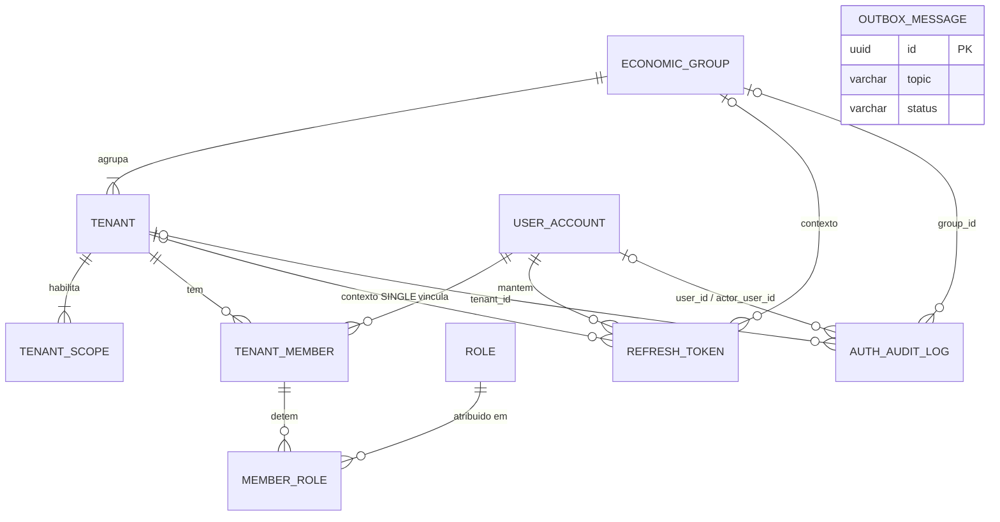

# Pacote de Contexto — M-11

| Ficheiro de origem | Secções incluídas | Tamanho (KiB) |
|---|---|---|
| `10-nucleo.md` | Núcleo base (§1-§2, §3 comum, §4, §6-§10) + extras §3.7, §3.11 | 17.5 |
| `30-dados.md` | Comum (§1, §2, §3) + ENT-01, ENT-02, ENT-03, ENT-04, ENT-05, ENT-06, ENT-07, ENT-08, ENT-09, ENT-10, §5, §6 | 19.6 |
| `40-contratos.md` | Nenhuma + operações/itens de §4 (IF-08.1, IF-11.1, IF-11.2) + tipos partilhados | 5.3 |
| `70-ambiente-teste.md` | Comum §1 + §2 | 7.8 |
| `20-sistema-existente.md` | EXT-01 | 0.5 |
| `90-registo.md` | UT-3-11 (§1) + PRS (§2.2): Nenhum | 0.0 |
| **Total contexto** | **Todas as origens** | **50.7** |

<!-- FIM DO CABECALHO -->

# 10 · Núcleo — Identity-Service

> **Conjunto:** [00 Índice](00-indice.md) · **Dono:** ARQ (UT-1-01) · **Estado:** Rascunho (ciclo 5, UT-2-91) · **Atualizado em:** 2026-10-19
> **Núcleo base** (todos os pacotes): tudo antes da secção final "Extras". Cada extra diz no título em que pacotes entra. Estado dos PRS: `90` §2.

## 1. Instruções obrigatórias para a LLM

1. Implemente **exclusivamente** o que está no seu pacote de contexto. Qualquer endpoint, campo, tabela, dependência ou comportamento que não esteja descrito **NÃO DEVE** ser criado.
2. **DEVE**, **NÃO DEVE**, **DEVERIA**, **NÃO DEVERIA** e **PODE** têm o significado da RFC 2119/8174.
3. Em conflito vale, por ordem: (1) RN do módulo dono e RG (§3.6); (2) CA do módulo dono; (3) contratos (`40` e detalhe do EP no módulo); (4) dados (`30`); (5) restante núcleo; (6) plano de fases e restantes. Uma RN contra uma RG é defeito: registe-o em "Dúvidas", não o resolva por interpretação.
4. Use **apenas** as tecnologias e versões da §4.
5. Respeite **literalmente** os nomes de entidades, colunas, campos JSON, enums, tópicos, chaves de cache e códigos de erro.
6. **Se algo estiver ambíguo ou em falta, NÃO invente.** Registe-o em "Dúvidas" na sua entrega e siga com a hipótese mais simples, marcada como tal. Toda a decisão tomada sem base na especificação vai para "Decisões fora dos docs".
7. Não toque em nada listado em "Não tocar ainda" no seu brief.
8. Cada CA da sua fase tem um teste com o ID no nome (convenção em `70`).
9. Entregue no formato fixo do seu brief (`80`).

## 2. Contexto

### 2.1 Propósito
Autenticar pessoas físicas de um portal B2B multi-CNPJ, emitir JWT RS256 com o contexto ativo (`SINGLE` ou `MACRO_GROUP`) num dos 4 escopos, revogar sessões de imediato pela denylist no Redis e publicar eventos de identidade no Kafka com contexto assinado. [DOC] `Docs/Ideia Base.md`.

### 2.4 Glossário
| Termo | Nome canónico | Sinónimos proibidos |
|---|---|---|
| Grupo Económico | `economic_group` | `Account`, `Holding` |
| Tenant (pessoa jurídica, um CNPJ) | `tenant` | `Company`, `Filial` |
| Escopo operacional | `OperationalScope` | `Profile`, `Persona` |
| Conta de utilizador (pessoa física) | `user_account` | `Person`, `LoginUser` |
| Membro; papel; papel do membro | `tenant_member`; `role`; `member_role` | `Membership`; `Group`; `UserRole` |
| Refresh token; família | `refresh_token`; `family_id` (claim `fid`) | `SessionToken`; `session_id` |
| Modo de visão | `ViewMode` | `ContextMode` |
| Contexto de autenticação | `AuthContext` | `UserContext`, `TenantContext` |
| Auditoria; mensagem de outbox | `auth_audit_log`; `outbox_message` | `AuditTrail`; `EventQueue` |
| Denylist; contexto assinado de evento | `denylist:*`; `context_jws` | `blacklist`; `event_token` |
Classes C# com o nome da tabela em `PascalCase` (`TenantMember`, `RefreshToken`).

## 3. Restrições arquiteturais

### 3.1 ADR
| ID | Decisão | Consequência obrigatória no código | Origem (IB = [DOC] Ideia Base) |
|---|---|---|---|
| ADR-01 | Control Plane separado | `user_account.platform_role` (`NONE`, `SUPPORT_AGENT`, `PLATFORM_ADMIN`); nenhuma `role` concede privilégio de plataforma | IB §2 |
| ADR-02 | `economic_group` → `tenant` | `tenant.group_id NOT NULL`; token com `view_mode ≠ NONE` tem `group_id ≠ null` | IB §2, IB §3.1 |
| ADR-03 | Quatro escopos | `OperationalScope` com 4 valores (`BUYER`, `SUPPLIER`, `CARRIER`, `TENANT_ADMIN`); outro valor → 400 `ERR-VAL-001` | IB §2, IB §3.2 |
| ADR-04 | Troca explícita de contexto | EP-01 emite `view_mode = NONE`; só EP-02 ativa `SINGLE` ou `MACRO_GROUP` | IB §5; PRS-01 |
| ADR-05 | Isolamento em 4 camadas | `tenant_scope`, `tenant_member`, `member_role` são `ITenantScoped`: middleware, filtro de leitura, interceptor de escrita e RLS (detalhe no extra do M-13) | IB §7.2; PRS-07, PRS-17 |
| ADR-06 | JWT RS256 + JWKS + denylist | RSA 2048, `kid` no header; EP-10 publica a chave; middleware aplica RG-06 a RG-08 | IB §2, IB §6.2; PRS-04 |
| ADR-07 | Rotação com deteção de reuso | `refresh_token` guarda só `token_hash`; reapresentar `CONSUMED` revoga a família | IB §6.3 |
| ADR-08 | Impersonation RFC 8693 | Claim `act`; sem `refresh_token`; token com `act` rejeitado em EP-02 e EP-05 | IB §6.4; PRS-08 |
| ADR-09 | Contexto assinado nos eventos | Toda a `outbox_message` leva headers de identidade e `context_jws` | IB §6.5; PRS-09 |
| ADR-10 | Monólito modular | Um projeto (§3.2); um módulo só escreve na sua pasta e nas tabelas de que é dono; chama outro módulo só pelas `IF-nn` (`40`) | ARQ |
| ADR-11 | Um único mecanismo de migração | EF Core Migrations aplicadas no arranque pelo M-11 | ARQ |

### 3.2 Estrutura do projeto
```text
IdentityService.slnx, global.json, .config/dotnet-tools.json, Directory.Build.props, Dockerfile, docker-compose.yml
src/IdentityService/Program.cs   chama AddMnn() e MapMnn() de cada módulo
src/IdentityService/Modules/Mnn<Nome>/   uma pasta por módulo (M-00 a M-14), com Interface/ (tipos públicos) e ModuleRegistration.cs
  M11Esquema/Persistence/: IdentityDbContext, entidades, configurações EF, Migrations/
tests/IdentityService.Tests/Mnn<Nome>/   testes do construtor
tests/IdentityService.Acceptance/   suite do AUD: o construtor NÃO DEVE criá-la nem alterá-la
```
**Dependências:** `Modules/Mxx/` só referencia `Modules/Myy/Interface/`, `Modules/M00Transversal/` e `Modules/M11Esquema/Persistence/`. Endpoints em Minimal APIs. Novos `PackageReference` proibidos: os pacotes são criados uma vez (M-11, F-00).

### 3.3 Convenções
| Item | Convenção |
|---|---|
| Classes / ficheiros | `PascalCase`, um tipo público por ficheiro |
| Tabelas / colunas | `snake_case` singular (`UseSnakeCaseNamingConvention()`); nomes de restrições em `30` |
| JSON | `JsonNamingPolicy.SnakeCaseLower`; `JsonUnmappedMemberHandling.Disallow`; enums como texto |
| Datas | JSON: UTC `yyyy-MM-ddTHH:mm:ssZ` truncado ao segundo; `iat`, `exp` e valores Redis em segundos Unix |
| Tempo | Só `TimeProvider` injetado |
| Identificadores | UUID v7 gerado pela aplicação; texto minúsculo, formato `D` |
| Arrays de saída | Ordem ordinal ascendente em `roles`, `permissions`, `allowed_tenants`, `scopes`, `available_scopes` (PRS-24) |
| Commits | `tipo(Mnn): descrição (RF-nn, CA-nn.m)` |

### 3.4 Comportamentos transversais (donos: M-00; isolamento M-13)
| Aspeto | Especificação |
|---|---|
| Autenticação | EP com token obrigatório (EP-02, EP-04 a EP-09): leitura da chave de `ISigningKey` (indisponível → 503, também sem token), depois RG-06, RG-07, RG-08 por esta ordem |
| Erro | RFC 9457 `application/problem+json; charset=utf-8`: `type` = `https://identity.b2b.local/errors/{code}`, `title` e `status` do §6, `code`, `detail` = `title` (PRS-26), `correlation_id`; sem stack trace |
| Logging | `AddJsonConsole()` para `stdout`. **NÃO DEVE** registar `password`, `password_hash`, `refresh_token`, `token_hash`, `access_token`, `context_jws`, chaves privadas nem corpos de pedido |
| Auditoria | `IAuditLog` insere em `auth_audit_log` na transação da operação, com as colunas dos eventos do módulo (`30`) |
| Denylist | Só `IDenylist` acede a `denylist:*` |
| Escrita em `ITenantScoped` | Um endpoint de gestão só escreve no tenant que a autorização do EP aprovou, declarado por `AuthorizeTenantWrite` antes de abrir a transação (PRS-51). Exceção: EP-09 por `TENANT_ADMIN`, pelo bypass limitado do M-13 (PRS-72) |

### 3.5 Claims do `access_token` e `AuthContext`
Header: `alg = RS256`, `typ = JWT`, `kid = JWT_KEY_ID`. Todas presentes salvo "omitida"; valor nulo = literal JSON `null`. Tipos C# do `AuthContext`: `40`, tipos partilhados.

| Claim | Tipo | Valor | `AuthContext` |
|---|---|---|---|
| `jti` | string | UUID v7 novo | `Jti` |
| `sub` | string | `user_account.id` (impersonation: o alvo) | `UserId` |
| `fid` | string | `family_id`; omitida em impersonation | `FamilyId` |
| `iat`, `exp` | número | Unix; `exp = iat + 900` (PRS-20) | `Iat`, `Exp` |
| `iss`, `aud` | string | `JWT_ISSUER`, `JWT_AUDIENCE` | — |
| `platform_role` | string | `PlatformRole` de `sub` | `PlatformRole` |
| `view_mode` | string | `ViewMode` | `ViewMode` |
| `group_id`, `tenant_id` | string \| `null` | `null` em `NONE`; `tenant_id = null` em `MACRO_GROUP` | `GroupId`, `ActiveTenantId` |
| `allowed_tenants` | array | `[]` em `NONE`; 1 em `SINGLE`; 1 a 50 em `MACRO_GROUP` | `AllowedTenants` |
| `active_scope` | string \| `null` | `OperationalScope`; `null` em `NONE` | `ActiveScope` |
| `roles`, `permissions` | array | RG-01 (`SINGLE`), RG-12 (`MACRO_GROUP`); `[]` em `NONE` | `Roles`, `Permissions` |
| `act` | `{ "sub", "ticket_id" }` | Só em impersonation | `ActorUserId`, `TicketId` |

### 3.6 Catálogo de regras globais (RG)
Nível 1 da precedência (§1). Texto canónico nos extras do núcleo dos donos: RG-01 a RG-05 e RG-10 a RG-13 implementadas só por M-08 (`IAccessQueries`); RG-06 a RG-08 só por M-00; RG-09 só por M-13. Os consumidores aplicam-nas pela interface e indicam o passo da sua ordem de avaliação.

| ID | Resumo | Erro | Dono |
|---|---|---|---|
| RG-01 | Papéis e permissões de `u` em `t` para `S`: dono → todas as `role` de `S`; senão as de `member_role` | – | M-08 |
| RG-02 | Escopo `S` inativo em `t` ou sem papéis | 403 `ERR-CTX-003` | M-08 |
| RG-03 | Sem vínculo `ACTIVE` em `t` | 403 `ERR-CTX-001` | M-08 |
| RG-04 | Tenant ou grupo `SUSPENDED`, ou `denylist:tenant:{t}` | 403 `ERR-CTX-002` | M-08 |
| RG-05 | Utilizador bloqueado. EP-01: só `status = SUSPENDED`, avaliado só depois de a palavra-passe estar correta (D-08, D-11). EP-02: `SUSPENDED` ou `denylist:user` ≥ `iat`. EP-03: `SUSPENDED` ou `denylist:user` ≥ `created_at` do refresh apresentado. EP-05 (alvo): `SUSPENDED` ou qualquer `denylist:user` do alvo (PRS-46) | 403 `ERR-AUTH-004` | M-08 |
| RG-06 | Token ausente, inválido, expirado ou com `denylist:jti` | 401 `ERR-AUTH-002` | M-00 |
| RG-07 | `denylist:user` de `sub` ou `act.sub` com valor ≥ `iat` | 403 `ERR-AUTH-004` | M-00 |
| RG-08 | `denylist:tenant` de algum tenant de `allowed_tenants` | 403 `ERR-CTX-002` | M-00 |
| RG-09 | Escrita ou leitura rejeitada pela camada 3 ou 4 | 403 `ERR-CTX-007` | M-13 |
| RG-10 | Contextos disponíveis no login | – | M-08 |
| RG-11 | `MACRO_GROUP`: lista com 1 a 50 tenants distintos do grupo e `can_view_group = true` em todos | 403 `ERR-CTX-004` | M-08 |
| RG-12 | `MACRO_GROUP`: `roles`/`permissions` = interseção da RG-01 nos tenants | – | M-08 |
| RG-13 | Interseção de `permissions` vazia | 403 `ERR-CTX-003` | M-08 |

## 4. Stack
| Camada | Tecnologia | Versão exata |
|---|---|---|
| SDK / runtime | .NET SDK / ASP.NET Core (`net10.0`, C# 14) | 10.0.402 / 10.0.13 |
| Base de dados / cache / mensageria | PostgreSQL / Redis / Apache Kafka (KRaft) | 17.6 / 7.4.6 / 3.9.1 |
| Contentores | Docker Engine | 29.7.2 |

Pacotes: lista exaustiva no extra de projeto do M-11. Proibido qualquer outro, incluindo `JwtBearer`, `System.IdentityModel.Tokens.Jwt`, `FluentValidation`, `Serilog.*`, `Actuar.*`, `AutoMapper`, `MediatR`, `Newtonsoft.Json`, `Dapper`, `MassTransit`, `Moq`, `FluentAssertions`, `Bogus`. A validação de pedidos é código explícito.

## 6. Catálogo global de erros
| Código | HTTP | `title` (fixo) | Condição |
|---|---|---|---|
| `ERR-VAL-001` | 400 | Pedido inválido ou malformado | JSON inválido, campo obrigatório ausente ou `null`, tipo errado, valor fora do enum, campo desconhecido, formato |
| `ERR-VAL-002` | 422 | Dados de CNPJ ou geolocalização inválidos | M-04 |
| `ERR-VAL-003` | 422 | Formato de e-mail ou política de palavra-passe violada | M-01 |
| `ERR-VAL-004` | 422 | Código de chamado técnico inválido | M-06 |
| `ERR-REQ-001` | 404 | Rota inexistente | Nenhuma rota corresponde |
| `ERR-REQ-002` | 405 | Método não permitido | Path com outro método |
| `ERR-REQ-003` | 413 | Corpo do pedido demasiado grande | Corpo > 65 536 bytes |
| `ERR-REQ-004` | 415 | Tipo de conteúdo não suportado | Corpo com `Content-Type` ≠ `application/json` (`charset` só `utf-8`) |
| `ERR-AUTH-001` | 401 | Credenciais inválidas | M-01 |
| `ERR-AUTH-002` | 401 | Token de acesso ausente, inválido, expirado ou revogado | RG-06; EP-02 com família sem linha `ACTIVE` (PRS-73) |
| `ERR-AUTH-003` | — | `[REMOVIDO]` | Não é devolvido por nenhum EP: a conta `LOCKED` responde 401 `ERR-AUTH-001` (D-08) |
| `ERR-AUTH-004` | 403 | Utilizador suspenso ou revogado globalmente | RG-05, RG-07; alvo `LOCKED` em EP-05 (M-06) |
| `ERR-AUTH-005` | 401 | Refresh token inválido, revogado ou expirado | M-02 |
| `ERR-AUTH-006` | 401 | Reuso de refresh token detetado e sessão revogada | M-02 |
| `ERR-AUTH-010` | 403 | Operação de impersonation não autorizada | M-06 |
| `ERR-CTX-001` | 403 | Utilizador sem vínculo ativo no Tenant solicitado | RG-03 |
| `ERR-CTX-002` | 403 | Tenant ou Grupo Económico suspenso | RG-04, RG-08; grupo `SUSPENDED` em EP-06 (M-04) |
| `ERR-CTX-003` | 403 | Escopo operacional inativo ou papel não atribuído | RG-02, RG-13 |
| `ERR-CTX-004` | 403 | Violação das regras de agregação em visão macro | RG-11 |
| `ERR-CTX-005` | 409 | Conflito de unicidade de registo | M-04, M-05 |
| `ERR-CTX-006` | 422 | Papel incompatível com os escopos ativos do Tenant | M-05 |
| `ERR-CTX-007` | 403 | Violação de isolamento de contexto ou permissão insuficiente | Autorização do EP negada, RG-09, `act` em EP-02 |
| `ERR-CTX-008` | 404 | Recurso de domínio não encontrado | `group_id`, `tenant_id`, `user_id` ou `role_id` inexistente |
| `ERR-SYS-001` | 500 | Erro interno do servidor | Exceção não prevista |
| `ERR-SYS-002` | 503 | Dependência indisponível | PostgreSQL, Redis ou chave indisponível (PRS-16) |

Um módulo **NÃO DEVE** criar códigos: um código em falta é um `CR-nn`.

## 7. Regras por omissão
| Situação não coberta | Comportamento obrigatório |
|---|---|
| Campo de request não listado | 400 `ERR-VAL-001` |
| Autorização não descrita | Negar: 403 `ERR-CTX-007` |
| Rota inexistente / método errado | 404 `ERR-REQ-001` / 405 `ERR-REQ-002` |
| Erro inesperado | 500 `ERR-SYS-001`, transação desfeita |
| PostgreSQL, Redis ou chave indisponível | 503 `ERR-SYS-002`, transação desfeita, salvo um `DEL` posterior ao commit (PRS-15, PRS-16) |
| Escrever tabela de outro módulo | Só pela interface do dono (`40` §4.3) |
| Exceção de BD, Redis ou chave | Tratador global do M-00, pela cadeia de `InnerException`: 42501 → 403 `ERR-CTX-007`; 23505 não tratado → 409 `ERR-CTX-005` |

## 8. Explicitamente proibido
- `refresh_token` em claro; segredos em log.
- Hidratar o `AuthContext` a partir de headers em texto (`X-Tenant-Id`, `X-User-Id`, `X-Group-Id`).
- `HS256` ou RSA com menos de 2048 bits; `refresh_token` em impersonation.
- `DELETE` em qualquer tabela; `UPDATE` em `auth_audit_log` (PRS-19).
- `DateTime.UtcNow`, `DateTimeOffset.UtcNow`, `EnsureCreated`, `Thread.Sleep` em código de produção.

---

### 3.7 Configuração e produtor Kafka (extra: M-00, M-07, M-11, M-14, F-00, `70`)
| Aspeto | Especificação |
|---|---|
| Configuração | Obrigatórias (ausente → código de saída ≠ 0): `DB_CONNECTION_STRING`, `REDIS_CONNECTION_STRING`, `KAFKA_BOOTSTRAP_SERVERS`. Com default: `JWT_ISSUER` = `identity-service`, `JWT_AUDIENCE` = `b2b-platform`, `JWT_KEY_ID` = `key-2026-01`, `OUTBOX_POLLING_INTERVAL_MS` = `500`. `JWT_RSA_PRIVATE_KEY_PEM` (PKCS#8 RSA 2048): vazia só com `ASPNETCORE_ENVIRONMENT` ∈ {`Development`, `Testing`}, gerando um par em memória; vazia noutro ambiente → código ≠ 0 (PRS-25) |
| Produtor Kafka (M-14) | `Confluent.Kafka` com `MessageTimeoutMs = 3000` e `Acks = All`; o resto por omissão (PRS-63) |

### 3.11 Projeto, migrações, contentores e pacotes (extra: M-11, F-00, `70`)
| Aspeto | Especificação |
|---|---|
| Ficheiros de raiz | `IdentityService.slnx` (formato criado por `dotnet new sln` no SDK 10.0.402); `global.json` `{"sdk":{"version":"10.0.402","rollForward":"disable"}}`; `.config/dotnet-tools.json` com `dotnet-ef` 10.0.13; `Directory.Build.props` com `net10.0`, `Nullable`, `ImplicitUsings`, `TreatWarningsAsErrors`. Referência executável: `evidencias/pins/` |
| Migrações | Único mecanismo: EF Core Migrations em `M11Esquema/Persistence/Migrations/`, geradas com `dotnet tool run dotnet-ef`. Antes de `app.Run()`, `Program.cs` cria um `IdentityDbContext` com `new DbContextOptionsBuilder<IdentityDbContext>().UseNpgsql(DB_CONNECTION_STRING).UseSnakeCaseNamingConvention().Options` (sem `AddInterceptors`) e executa `Database.MigrateAsync()`. A migração inicial cria todo o `30` §3, e por `migrationBuilder.Sql` o `30` §5 e §6. Proibidos: `EnsureCreated`, SQL fora das migrações, `dotnet ef database update` no README |
| Contentores | `Dockerfile` multi-stage `mcr.microsoft.com/dotnet/sdk:10.0.402` → `mcr.microsoft.com/dotnet/aspnet:10.0.13`, porta 8080, `ENTRYPOINT ["dotnet", "IdentityService.dll"]`. `docker-compose.yml` = texto fixo de `70` §2 (imagens `postgres:17.6`, `redis:7.4.6`, `apache/kafka:3.9.1`; health checks e `service_healthy`), copiado sem alterações; `70` §2 entra no pacote do M-11 |
| Pacotes (exaustivo) | `src`: `Microsoft.IdentityModel.JsonWebTokens@8.23.0`, `Microsoft.EntityFrameworkCore.Relational@10.0.13`, `Npgsql.EntityFrameworkCore.PostgreSQL@10.0.3`, `EFCore.NamingConventions@10.0.1`, `Microsoft.EntityFrameworkCore.Design@10.0.13` (`PrivateAssets="all"`), `StackExchange.Redis@2.13.17`, `Confluent.Kafka@2.16.0`, `Konscious.Security.Cryptography.Argon2@1.3.1`. `tests`: `Microsoft.NET.Test.Sdk@18.11.0`, `xunit@2.9.3`, `xunit.runner.visualstudio@3.1.5`, `Microsoft.AspNetCore.Mvc.Testing@10.0.13`, `Testcontainers.PostgreSql@4.16.0`, `Testcontainers.Redis@4.16.0`, `Testcontainers.Kafka@4.16.0` |

# 30 · Dados — Identity-Service

> **Conjunto:** [00 Índice](00-indice.md) · **Dono:** ARQ (UT-2-01) · **Estado:** Rascunho (ciclo 5; decisões do PO de 2026-10-19 aplicadas) · **Atualizado em:** 2026-10-19
> Contrato partilhado: é congelado no Gate 2. Cada tabela tem **um** módulo dono, o único com código que a escreve. Os outros módulos escrevem só através da interface `IF-nn` do dono (`40`). O esquema inteiro (§3, §5, §6) é criado pela migração do M-11.
> **Nomes de restrições:** `pk_<tabela>`, `fk_<tabela>_<coluna>`, `uq_<tabela>_<colunas>`, `ck_<tabela>_<coluna>` para o CHECK de uma coluna e o nome indicado nos CHECK de tabela. Forma executável e medida de §3, §5 e §6: `evidencias/pg-ddl.sql` (resultado em `evidencias/medir-postgres.out.txt`); uma diferença entre os dois é um defeito e vale este ficheiro.

## 1. Diagrama ER


**Invariantes globais:** nenhum `DELETE` em nenhuma tabela; nenhum `UPDATE` em `auth_audit_log` (PRS-19). Todas as colunas temporais são preenchidas pela aplicação com `TimeProvider` (sem `DEFAULT now()`). Todas as FK são `ON DELETE RESTRICT` (PRS-19).

## 2. Tipos enumerados
Guardados como `VARCHAR` com `CHECK`; em C#, `enum` com os mesmos nomes, convertido para texto (`HasConversion<string>()`).

## 3. Dicionário de dados
Tipos físicos PostgreSQL 17. "Default: —" = sem default (a aplicação preenche).

### ENT-01 `economic_group`
**Descrição:** grupo económico. **Dono:** M-04 (sem escrita na v2). **Isolamento:** não (PRS-07).

| Coluna | Tipo físico | Nulo | Default | Chave | Restrições | Descrição |
|---|---|---|---|---|---|---|
| `id` | `UUID` | NÃO | — | PK | — | Identificador |
| `name` | `VARCHAR(160)` | NÃO | — | — | `CHECK (char_length(btrim(name)) >= 2)` | Nome do grupo |
| `status` | `VARCHAR(16)` | NÃO | `'ACTIVE'` | — | `CHECK (status IN ('ACTIVE','SUSPENDED'))` | `EntityStatus` |
| `created_at` | `TIMESTAMPTZ` | NÃO | — | — | — | Criação |
| `updated_at` | `TIMESTAMPTZ` | NÃO | — | — | — | Última alteração |

**Índices:** `pk_economic_group (id)` único.

### ENT-02 `tenant`
**Descrição:** pessoa jurídica (CNPJ). **Dono:** M-04; M-12 escreve `status` só por `ITenantStatusWriter`. **Isolamento:** não (PRS-07); a gestão é controlada pela autorização dos endpoints.

| Coluna | Tipo físico | Nulo | Default | Chave | Restrições | Descrição |
|---|---|---|---|---|---|---|
| `id` | `UUID` | NÃO | — | PK | — | Identificador |
| `group_id` | `UUID` | NÃO | — | FK → `economic_group.id`, `ON DELETE RESTRICT` | — | Grupo |
| `cnpj` | `CHAR(14)` | NÃO | — | UQ | `CHECK (cnpj ~ '^[0-9]{14}$')` | 14 dígitos (PRS-11) |
| `legal_name` | `VARCHAR(200)` | NÃO | — | — | `CHECK (char_length(btrim(legal_name)) >= 2)` | Razão social |
| `branch_type` | `VARCHAR(16)` | NÃO | — | — | `CHECK (branch_type IN ('HQ','BRANCH'))` | `BranchType` |
| `geo_lat` | `NUMERIC(9,6)` | NÃO | — | — | `CHECK (geo_lat BETWEEN -90 AND 90)` | Latitude (PRS-22) |
| `geo_lng` | `NUMERIC(9,6)` | NÃO | — | — | `CHECK (geo_lng BETWEEN -180 AND 180)` | Longitude (PRS-22) |
| `status` | `VARCHAR(16)` | NÃO | `'ACTIVE'` | — | `CHECK (status IN ('ACTIVE','SUSPENDED'))` | `EntityStatus` |
| `created_at` | `TIMESTAMPTZ` | NÃO | — | — | — | Criação |
| `updated_at` | `TIMESTAMPTZ` | NÃO | — | — | — | Última alteração |

**Índices:** `pk_tenant (id)` único; `uq_tenant_cnpj (cnpj)` único; `ix_tenant_group_id (group_id)`.

### ENT-03 `tenant_scope`
**Descrição:** escopos habilitados num tenant. **Dono:** M-04. **Isolamento:** sim, `tenant_id` (`ITenantScoped`, RLS §5).

| Coluna | Tipo físico | Nulo | Default | Chave | Restrições | Descrição |
|---|---|---|---|---|---|---|
| `id` | `UUID` | NÃO | — | PK | — | Identificador |
| `tenant_id` | `UUID` | NÃO | — | FK → `tenant.id`, `ON DELETE RESTRICT` | `UQ (tenant_id, scope)` | Tenant |
| `scope` | `VARCHAR(16)` | NÃO | — | — | `CHECK (scope IN ('BUYER','SUPPLIER','CARRIER','TENANT_ADMIN'))` | `OperationalScope` |
| `is_active` | `BOOLEAN` | NÃO | `true` | — | — | Nenhum RF escreve `false` na v2 |
| `created_at` | `TIMESTAMPTZ` | NÃO | — | — | — | Criação |

**Índices:** `pk_tenant_scope (id)` único; `uq_tenant_scope_tenant_id_scope (tenant_id, scope)` único.

### ENT-04 `user_account`
**Descrição:** pessoa física global. **Dono:** M-01; M-10 escreve `status` só por `IUserAccountStatusWriter`. **Isolamento:** não (PRS-07).

| Coluna | Tipo físico | Nulo | Default | Chave | Restrições | Descrição |
|---|---|---|---|---|---|---|
| `id` | `UUID` | NÃO | — | PK | — | Identificador |
| `email` | `VARCHAR(320)` | NÃO | — | UQ | `CHECK (email = lower(btrim(email)) AND char_length(email) >= 5)` | E-mail normalizado (PRS-11) |
| `password_hash` | `VARCHAR(255)` | NÃO | — | — | `CHECK (starts_with(password_hash, '$argon2id$v=19$m=19456,t=2,p=1$'))` | Argon2id `m=19456` KiB, `t=2`, `p=1`, salt 16 bytes, hash 32 bytes, formato PHC `$argon2id$v=19$m=19456,t=2,p=1$<salt_b64>$<hash_b64>` (RNF-01, PRS-21) |
| `name` | `VARCHAR(160)` | NÃO | — | — | `CHECK (char_length(btrim(name)) >= 2)` | Nome |
| `status` | `VARCHAR(16)` | NÃO | `'ACTIVE'` | — | `CHECK (status IN ('ACTIVE','LOCKED','SUSPENDED'))` | `UserStatus` |
| `platform_role` | `VARCHAR(24)` | NÃO | `'NONE'` | — | `CHECK (platform_role IN ('NONE','SUPPORT_AGENT','PLATFORM_ADMIN'))` | `PlatformRole` |
| `failed_login_attempts` | `INTEGER` | NÃO | `0` | — | `CHECK (failed_login_attempts BETWEEN 0 AND 5)` | Falhas consecutivas (PRS-31) |
| `locked_until` | `TIMESTAMPTZ` | SIM | `NULL` | — | `CHECK ((status = 'LOCKED') = (locked_until IS NOT NULL))` | Fim do bloqueio |
| `created_at` | `TIMESTAMPTZ` | NÃO | — | — | — | Criação |
| `updated_at` | `TIMESTAMPTZ` | NÃO | — | — | — | Última alteração |

**Índices:** `pk_user_account (id)` único; `uq_user_account_email (email)` único.

### ENT-05 `tenant_member`
**Descrição:** vínculo utilizador × tenant. **Dono:** M-05; M-04 e M-10 escrevem só por `IMembershipWriter`. **Isolamento:** sim, `tenant_id`.
**Invariantes:** `is_owner = true` aplica RG-01; `MACRO_GROUP` exige `can_view_group = true` em cada tenant, mesmo com `is_owner = true` (PRS-05).

| Coluna | Tipo físico | Nulo | Default | Chave | Restrições | Descrição |
|---|---|---|---|---|---|---|
| `id` | `UUID` | NÃO | — | PK | `UQ (id, tenant_id)` (alvo da FK composta de `member_role`) | Identificador |
| `tenant_id` | `UUID` | NÃO | — | FK → `tenant.id`, `ON DELETE RESTRICT` | `UQ (tenant_id, user_id)` | Tenant |
| `user_id` | `UUID` | NÃO | — | FK → `user_account.id`, `ON DELETE RESTRICT` | — | Utilizador |
| `is_owner` | `BOOLEAN` | NÃO | `false` | — | — | Proprietário |
| `can_view_group` | `BOOLEAN` | NÃO | `false` | — | — | Pode entrar em `MACRO_GROUP` |
| `status` | `VARCHAR(16)` | NÃO | `'ACTIVE'` | — | `CHECK (status IN ('ACTIVE','SUSPENDED'))` | `EntityStatus` |
| `created_at` | `TIMESTAMPTZ` | NÃO | — | — | — | Criação |
| `updated_at` | `TIMESTAMPTZ` | NÃO | — | — | — | Última alteração |

**Índices:** `pk_tenant_member (id)` único; `uq_tenant_member_id_tenant_id (id, tenant_id)` único; `uq_tenant_member_tenant_user (tenant_id, user_id)` único; `ix_tenant_member_user_id (user_id)`.

### ENT-06 `role`
**Descrição:** catálogo de papéis. **Dono:** M-11 (só seed, §6). **Isolamento:** não (PRS-07).

| Coluna | Tipo físico | Nulo | Default | Chave | Restrições | Descrição |
|---|---|---|---|---|---|---|
| `id` | `UUID` | NÃO | — | PK | — | Identificador |
| `name` | `VARCHAR(64)` | NÃO | — | UQ | `CHECK (name ~ '^[A-Z0-9_]{3,64}$')` | Código do papel |
| `scope` | `VARCHAR(16)` | NÃO | — | — | `CHECK (scope IN ('BUYER','SUPPLIER','CARRIER','TENANT_ADMIN'))` | `OperationalScope` |
| `permissions` | `TEXT[]` | NÃO | — | — | `CHECK (cardinality(permissions) >= 1 AND array_to_string(permissions, ',') ~ '^[a-z_]+:[a-z_]+(,[a-z_]+:[a-z_]+)*$' AND char_length(array_to_string(permissions, ',')) - char_length(replace(array_to_string(permissions, ','), ',', '')) = cardinality(permissions) - 1)`; a contagem de vírgulas rejeita elementos com vírgula e elementos `NULL` [MEDIDO] M7b, M7c | Permissões `dominio:acao` (PRS-27) |
| `created_at` | `TIMESTAMPTZ` | NÃO | — | — | — | Criação |

**Índices:** `pk_role (id)` único; `uq_role_name (name)` único; `ix_role_scope (scope)`.

### ENT-07 `member_role`
**Descrição:** papel atribuído a um membro. **Dono:** M-05; M-04 escreve só por `IMembershipWriter`. **Isolamento:** sim, `tenant_id` (cópia de `tenant_member.tenant_id`, garantida pela FK composta).

| Coluna | Tipo físico | Nulo | Default | Chave | Restrições | Descrição |
|---|---|---|---|---|---|---|
| `id` | `UUID` | NÃO | — | PK | — | Identificador |
| `tenant_id` | `UUID` | NÃO | — | FK → `tenant.id`, `ON DELETE RESTRICT` | — | Tenant |
| `tenant_member_id` | `UUID` | NÃO | — | FK `fk_member_role_tenant_member`: `(tenant_member_id, tenant_id)` → `tenant_member (id, tenant_id)`, `ON DELETE RESTRICT` | `UQ (tenant_member_id, role_id)` | Membro |
| `role_id` | `UUID` | NÃO | — | FK → `role.id`, `ON DELETE RESTRICT` | — | Papel |
| `created_at` | `TIMESTAMPTZ` | NÃO | — | — | — | Atribuição |

**Índices:** `pk_member_role (id)` único; `uq_member_role_member_role (tenant_member_id, role_id)` único; `ix_member_role_tenant_id (tenant_id)`.

### ENT-08 `refresh_token`
**Descrição:** token de atualização (só o hash) e contexto ativo da família (PRS-02). **Dono:** M-02. **Isolamento:** não (PRS-07).

| Coluna | Tipo físico | Nulo | Default | Chave | Restrições | Descrição |
|---|---|---|---|---|---|---|
| `id` | `UUID` | NÃO | — | PK | — | Identificador |
| `family_id` | `UUID` | NÃO | — | — | — | Família criada no login |
| `user_id` | `UUID` | NÃO | — | FK → `user_account.id`, `ON DELETE RESTRICT` | — | Titular |
| `token_hash` | `CHAR(64)` | NÃO | — | UQ | `CHECK (token_hash ~ '^[0-9a-f]{64}$')` | SHA-256 hex minúsculo do token (PRS-34) |
| `status` | `VARCHAR(16)` | NÃO | `'ACTIVE'` | — | `CHECK (status IN ('ACTIVE','CONSUMED','REVOKED'))` | `RefreshTokenStatus` |
| `replaced_by_id` | `UUID` | SIM | `NULL` | FK → `refresh_token.id`, `ON DELETE RESTRICT` | — | Token filho da rotação |
| `view_mode` | `VARCHAR(16)` | NÃO | `'NONE'` | — | `CHECK (view_mode IN ('NONE','SINGLE','MACRO_GROUP'))` | `ViewMode` |
| `group_id` | `UUID` | SIM | `NULL` | FK → `economic_group.id`, `ON DELETE RESTRICT` | — | Grupo do contexto |
| `active_tenant_id` | `UUID` | SIM | `NULL` | FK → `tenant.id`, `ON DELETE RESTRICT` | — | Tenant em `SINGLE` |
| `allowed_tenants` | `UUID[]` | NÃO | `'{}'` | — | — | Tenants do contexto, ordem ascendente (PRS-24, PRS-27) |
| `active_scope` | `VARCHAR(16)` | SIM | `NULL` | — | `CHECK (active_scope IS NULL OR active_scope IN ('BUYER','SUPPLIER','CARRIER','TENANT_ADMIN'))` | `OperationalScope` |
| `expires_at` | `TIMESTAMPTZ` | NÃO | — | — | `CHECK (expires_at > created_at)` | `created_at + 604800 s` (PRS-33) |
| `consumed_at` | `TIMESTAMPTZ` | SIM | `NULL` | — | — | Rotação |
| `revoked_at` | `TIMESTAMPTZ` | SIM | `NULL` | — | — | Revogação |
| `created_at` | `TIMESTAMPTZ` | NÃO | — | — | — | Emissão |

**CHECK de tabela:**
- `ck_refresh_token_context`: `(view_mode = 'NONE' AND group_id IS NULL AND active_tenant_id IS NULL AND active_scope IS NULL AND cardinality(allowed_tenants) = 0) OR (view_mode = 'SINGLE' AND group_id IS NOT NULL AND active_tenant_id IS NOT NULL AND active_scope IS NOT NULL AND allowed_tenants = ARRAY[active_tenant_id]) OR (view_mode = 'MACRO_GROUP' AND group_id IS NOT NULL AND active_tenant_id IS NULL AND active_scope IS NOT NULL AND cardinality(allowed_tenants) BETWEEN 1 AND 50)`.
- `ck_refresh_token_status_dates`: `(status <> 'ACTIVE' OR (consumed_at IS NULL AND revoked_at IS NULL)) AND (status <> 'CONSUMED' OR (consumed_at IS NOT NULL AND revoked_at IS NULL)) AND (status <> 'REVOKED' OR revoked_at IS NOT NULL)`.

**Índices:** `pk_refresh_token (id)` único; `uq_refresh_token_token_hash (token_hash)` único; `uq_refresh_token_family_active (family_id) WHERE status = 'ACTIVE'` único parcial (no máximo 1 `ACTIVE` por família; a segunda rotação concorrente falha com violação de unicidade SQLSTATE 23505); `ix_refresh_token_family_id (family_id)`; `ix_refresh_token_user_id_status (user_id, status)`; `ix_refresh_token_allowed_tenants` GIN `(allowed_tenants)`.

### ENT-09 `auth_audit_log`
**Descrição:** auditoria append-only. **Dono:** M-00 (`IAuditLog`). **Isolamento:** não (PRS-07). `identity_app` só tem `SELECT, INSERT` (§5).

| Coluna | Tipo físico | Nulo | Default | Chave | Restrições | Descrição |
|---|---|---|---|---|---|---|
| `id` | `UUID` | NÃO | — | PK | — | Identificador |
| `event_type` | `VARCHAR(32)` | NÃO | — | — | `CHECK (event_type IN ('LOGIN_SUCCESS','LOGIN_FAILED','USER_LOCKED','CONTEXT_SWITCHED','TOKEN_REFRESHED','TOKEN_REUSE_DETECTED','LOGOUT','IMPERSONATION_STARTED','TENANT_CREATED','MEMBER_ADDED','TENANT_STATUS_CHANGED','USER_STATUS_CHANGED'))` | `AuditEventType` |
| `user_id` | `UUID` | SIM | `NULL` | FK → `user_account.id`, `ON DELETE RESTRICT` | — | Ver tabela abaixo |
| `actor_user_id` | `UUID` | SIM | `NULL` | FK → `user_account.id`, `ON DELETE RESTRICT` | — | Ver tabela abaixo |
| `tenant_id` | `UUID` | SIM | `NULL` | FK → `tenant.id`, `ON DELETE RESTRICT` | — | Ver tabela abaixo |
| `group_id` | `UUID` | SIM | `NULL` | FK → `economic_group.id`, `ON DELETE RESTRICT` | — | Ver tabela abaixo |
| `ticket_id` | `VARCHAR(32)` | SIM | `NULL` | — | `CHECK (ticket_id IS NULL OR ticket_id ~ '^[A-Z]{2,10}-[0-9]{1,10}$')` | Chamado (PRS-40) |
| `ip_address` | `VARCHAR(45)` | NÃO | — | — | `CHECK (char_length(ip_address) BETWEEN 2 AND 45)` | IP de origem validado pelo M-00 (PRS-52) |
| `correlation_id` | `UUID` | NÃO | — | — | — | Correlação do pedido (M-00) |
| `metadata` | `JSONB` | NÃO | `'{}'` | — | `CHECK (jsonb_typeof(metadata) = 'object')` | Ver tabela abaixo |
| `created_at` | `TIMESTAMPTZ` | NÃO | — | — | — | Instante do evento |

**Índices:** `pk_auth_audit_log (id)` único; `ix_auth_audit_log_user_id_created_at (user_id, created_at)`; `ix_auth_audit_log_tenant_id_created_at (tenant_id, created_at)`.

**Colunas por `event_type`.** Regra comum: se o token de entrada tiver `act`, `actor_user_id = act.sub` e `ticket_id = act.ticket_id`, sobrepondo-se à coluna `actor_user_id` das tabelas abaixo. Cada tabela pertence ao módulo que produz o evento.

### ENT-10 `outbox_message`
**Descrição:** transactional outbox, entrega *at-least-once*. **Dono:** M-14 (`IEventOutbox`). **Isolamento:** não (PRS-07).
**Invariante:** inserida na mesma transação da alteração de negócio, com `status = 'PENDING'`.

| Coluna | Tipo físico | Nulo | Default | Chave | Restrições | Descrição |
|---|---|---|---|---|---|---|
| `id` | `UUID` | NÃO | — | PK | — | Também é o `event_id` |
| `topic` | `VARCHAR(64)` | NÃO | — | — | `CHECK (topic IN ('empresa_cadastrada','tenant_bloqueado','usuario_bloqueado','sessao_comprometida'))` | EV-01 a EV-04 (PRS-42) |
| `partition_key` | `VARCHAR(36)` | NÃO | — | — | `CHECK (partition_key ~ '^[0-9a-f]{8}-[0-9a-f]{4}-[0-9a-f]{4}-[0-9a-f]{4}-[0-9a-f]{12}$')` | UUID em texto (`tenant_id` ou `user_id`, segundo o EV) |
| `headers` | `JSONB` | NÃO | — | — | `CHECK (jsonb_typeof(headers) = 'object')` | Headers Kafka, incluindo `context_jws` |
| `payload` | `JSONB` | NÃO | — | — | `CHECK (jsonb_typeof(payload) = 'object')` | Corpo do evento |
| `status` | `VARCHAR(16)` | NÃO | `'PENDING'` | — | `CHECK (status IN ('PENDING','PUBLISHED','FAILED'))` | `OutboxStatus` |
| `retry_count` | `INTEGER` | NÃO | `0` | — | `CHECK (retry_count BETWEEN 0 AND 5)` | Tentativas falhadas (PRS-43) |
| `created_at` | `TIMESTAMPTZ` | NÃO | — | — | — | Gravação |
| `processed_at` | `TIMESTAMPTZ` | SIM | `NULL` | — | — | Publicação ou falha final |

**CHECK de tabela:** `ck_outbox_message_processed_at`: `(status = 'PENDING') = (processed_at IS NULL)`; `ck_outbox_message_failed_retry`: `(status = 'FAILED') = (retry_count = 5)`.

**Índices:** `pk_outbox_message (id)` único; `ix_outbox_message_pending (created_at) WHERE status = 'PENDING'` parcial.

## 5. Row-Level Security e papel de BD
Criado na migração inicial do M-11, executada com o utilizador de `DB_CONNECTION_STRING` (dono das tabelas).

```sql
DO $$ BEGIN
  IF NOT EXISTS (SELECT 1 FROM pg_roles WHERE rolname = 'identity_app') THEN
    CREATE ROLE identity_app NOLOGIN;
  END IF;
END $$;
GRANT identity_app TO CURRENT_USER;
GRANT SELECT, INSERT, UPDATE ON economic_group, tenant, tenant_scope, user_account, tenant_member,
  role, member_role, refresh_token, outbox_message TO identity_app;
GRANT SELECT, INSERT ON auth_audit_log TO identity_app;
ALTER TABLE tenant_scope ENABLE ROW LEVEL SECURITY;
ALTER TABLE tenant_scope FORCE ROW LEVEL SECURITY;
CREATE POLICY p_tenant_scope_isolation ON tenant_scope
  USING (current_setting('app.auth_flow', true) = 'true'
         OR tenant_id = ANY (string_to_array(current_setting('app.allowed_tenants', true), ',')::uuid[])
         OR tenant_id = ANY (string_to_array(current_setting('app.write_tenants', true), ',')::uuid[]))
  WITH CHECK (current_setting('app.auth_flow', true) = 'true'
         OR tenant_id = ANY (string_to_array(current_setting('app.write_tenants', true), ',')::uuid[]));
```
As mesmas três instruções (`ENABLE`, `FORCE`, `CREATE POLICY`) existem para `tenant_member` (`p_tenant_member_isolation`) e `member_role` (`p_member_role_isolation`), com o mesmo `USING` e `WITH CHECK`. Leitura (`USING`): `app.allowed_tenants` ∪ `app.write_tenants`; o segundo termo é obrigatório porque o EF Core emite `INSERT com RETURNING` (colunas com default na BD) e o `RETURNING` exige que a linha nova passe o `USING`. Escrita (`WITH CHECK`): `app.write_tenants` (conjunto de escrita, PRS-51). O papel e as três variáveis são definidos pelo `RlsConnectionInterceptor` do M-13.

## 6. Seed
A migração inicial insere em `role` (com `ON CONFLICT (name) DO NOTHING`), `created_at = '2026-01-01T00:00:00Z'`:

| `id` | `name` | `scope` | `permissions` |
|---|---|---|---|
| `01900000-0000-7000-8000-000000000001` | `BUYER_OPERATOR` | `BUYER` | `{demanda:criar,demanda:listar,leilao:participar,pedido:visualizar}` |
| `01900000-0000-7000-8000-000000000002` | `SUPPLIER_SALES` | `SUPPLIER` | `{estoque:atualizar,fornecimento:publicar,leilao:lance,pedido:confirmar}` |
| `01900000-0000-7000-8000-000000000003` | `CARRIER_DISPATCHER` | `CARRIER` | `{frete:cotar,frete:visualizar,transportadora:configurar}` |
| `01900000-0000-7000-8000-000000000004` | `GROUP_MANAGER` | `TENANT_ADMIN` | `{mapa:visualizar,membro:listar,membro:vincular,tenant:criar,tenant:listar,usuario:suspender}` |

Estas 17 permissões são as únicas existentes. Todo o valor literal de `roles`/`permissions` num CA **DEVE** derivar desta tabela e da RG-01/RG-12. Nenhum outro seed: `economic_group`, `tenant` e `user_account` de teste são criados pelo contrato do ambiente de teste (`70`).

## 4. Interfaces

### 4.1 Endpoints
Abreviaturas de erro: `VAL-001` = `ERR-VAL-001`, e assim para todas as áreas. `[T]`, `[A]` e os erros comuns a todos os EP: validação em camadas. Autorização exata: matriz de autorização.

| ID | Método e path | Dono (RF) | Autenticação / autorização | Request (resumo) | Sucesso (resumo) | Erros possíveis, além dos comuns |
|---|---|---|---|---|---|---|

### 4.2 Eventos
Publicados por M-14 a partir da outbox (RF-14). Headers, entrega e idempotência: definidos pelo M-14. Mensagem Kafka: chave = `partition_key`; valor = payload JSON UTF-8 (`10` §3.3).

| ID | Tópico | Dono (gatilho) | Chave de partição | Payload |
|---|---|---|---|---|

### 4.3 Interfaces internas
Tipos públicos na pasta indicada; namespace = `IdentityService.Modules.<pasta com . no lugar de />` (por exemplo `IdentityService.Modules.M02Refresh.Interface`). Métodos `Async` recebem ainda `CancellationToken`. **Transação:** as IF de BD usam o `IdentityDbContext` com âmbito do pedido e a transação aberta pelo chamador; inserções ficam no `ChangeTracker` até ao `SaveChangesAsync` do chamador; atualizações em massa executam de imediato dentro dessa transação. Nenhuma IF faz commit. Dependência indisponível: a exceção propaga até ao tratador global do M-00. Argumento que viola o contrato: `ArgumentException` (500).
**Pacotes:** o consumidor recebe a linha da IF na tabela "Interfaces", só as linhas das operações que usa em "Operações" e as linhas de "Tipos partilhados" dos tipos que essas linhas citam; o dono recebe todas as linhas da sua IF.

**Interfaces**
| ID | Interface (pasta) | Dono | Regras comuns |
|---|---|---|---|

**Operações**
| Operação | Assinatura | Efeito e resultado | Consumidores |
|---|---|---|---|

**Tipos partilhados** (registos C# `record` imutáveis; enums com os membros escritos exatamente como abaixo, guardados como texto)
| Tipo | Pasta | Definição |
|---|---|---|
| `BranchType` | idem | `enum { HQ, BRANCH }` |
| `OperationalScope` | idem | `enum { BUYER, SUPPLIER, CARRIER, TENANT_ADMIN }` |
| `UserStatus` | idem | `enum { ACTIVE, LOCKED, SUSPENDED }` |
| `RefreshTokenStatus` | idem | `enum { ACTIVE, CONSUMED, REVOKED }` |
| `ViewMode` | idem | `enum { NONE, SINGLE, MACRO_GROUP }` |
| `PlatformRole` | idem | `enum { NONE, SUPPORT_AGENT, PLATFORM_ADMIN }` |
| `AuditEventType` | idem | `enum { LOGIN_SUCCESS, LOGIN_FAILED, USER_LOCKED, CONTEXT_SWITCHED, TOKEN_REFRESHED, TOKEN_REUSE_DETECTED, LOGOUT, IMPERSONATION_STARTED, TENANT_CREATED, MEMBER_ADDED, TENANT_STATUS_CHANGED, USER_STATUS_CHANGED }` |
| `OutboxStatus` | idem | `enum { PENDING, PUBLISHED, FAILED }` |
| `ActingScope` | idem | `enum { BUYER, SUPPLIER, CARRIER, TENANT_ADMIN, NONE }` |

| IF-08 | `IAuthContext` (`M00Transversal/Auth/`) | M-00 | Valores por pedido (*scoped*) |
| IF-08.1 | Propriedades de `IAuthContext` (tipos partilhados) | Só leitura. `BypassTenantFilter` = `true` nos pedidos a EP-01 a EP-05 (com ou sem token) e com `platform_role = PLATFORM_ADMIN`; `false` nos restantes | M-02 (`IpAddress`), M-03, M-04, M-05, M-06, M-09, M-10, M-12, M-13, M-14 |
| IF-11 | `ITenantIsolation` (`M13Isolamento/Interface/`) | M-13 | Registo no DI: `ITenantIsolation` *singleton*; os interceptores *scoped* (leem o `IAuthContext` do pedido). `IdentityDbContext` registado com `AddDbContext` (*scoped*), sem *pooling* |
| IF-11.1 | `void ApplyQueryFilters(ModelBuilder modelBuilder, IdentityDbContext context)` | Camada 2: para cada entidade `ITenantScoped`, filtro `e => context.AuthContext.BypassTenantFilter \|\| context.TenantIsolationBypass \|\| context.AuthContext.AllowedTenants.Contains(e.TenantId)`; a referência à instância `context` faz o EF parametrizar o filtro por pedido. Chamado no `OnModelCreating` | M-11 |
| IF-11.2 | `IReadOnlyList<IInterceptor> CreateInterceptors(IServiceProvider requestServices)` | Devolve o `TenantSaveChangesInterceptor` (camada 3) e o `RlsConnectionInterceptor` (camada 4) do âmbito do pedido; o M-11 chama-o em `AddDbContext<IdentityDbContext>((sp, o) => o.AddInterceptors(isolation.CreateInterceptors(sp)))`; nunca no contexto de migração | M-11 |
| `EntityStatus` | `M11Esquema/Persistence/Enums/` | `enum { ACTIVE, SUSPENDED }` |
| `IAuthContext` | `M00Transversal/Auth/` | `interface`. Claims (`null` = nula ou omitida): `string?` `Jti`, `TicketId`; `Guid?` `UserId`, `FamilyId`, `GroupId`, `ActiveTenantId`, `ActorUserId`; `long?` `Iat`, `Exp`; `PlatformRole? PlatformRole`; `ViewMode? ViewMode`; `OperationalScope? ActiveScope`; `IReadOnlyList<Guid> AllowedTenants`; `IReadOnlyList<string>` `Roles`, `Permissions`. Pedido: `bool` `IsAuthenticated`, `BypassTenantFilter`; `Guid CorrelationId`; `string IpAddress`; `IReadOnlySet<Guid> WriteTenants`; `void AuthorizeTenantWrite(Guid tenantId)`. Sem token: `IsAuthenticated = false`, anuláveis `null`, coleções vazias; com token, `Jti`, `UserId`, `Iat`, `Exp`, `PlatformRole`, `ViewMode` ≠ `null` |
| `ITenantScoped` | `M13Isolamento/Interface/` | `interface { Guid TenantId { get; } }`, implementada pelas entidades de `tenant_scope`, `tenant_member` e `member_role` |
| `IdentityDbContext` | `M11Esquema/Persistence/` | `DbContext` com as propriedades `IAuthContext AuthContext { get; }` (injetada) e `bool TenantIsolationBypass { get; set; }` (`false` ao criar; só `ExecuteWithBypassAsync` a altera) e um `DbSet` por tabela |
# 70 · Contrato do ambiente de teste — Identity-Service

> **Conjunto:** [00 Índice](00-indice.md) · **Dono:** AUD (UT-2-03; reconciliado em UT-2-90) · **Estado:** Rascunho (ciclo 5, UT-2-91) · **Atualizado em:** 2026-10-19
> **Medições:** cada `[MEDIDO]` deste ficheiro cita um teste do esqueleto `evidencias/env70/` (`Medicoes.cs`, `Cunhagem.cs`, `Kestrel.cs`), executado por `evidencias/medir-env70.sh` com resultado em `evidencias/medir-env70.out.txt` (UT-2-93; Docker 29.7.2).
> **Parte comum = cabeçalho + §1: entra em todos os pacotes.** Tudo o que obriga o código está na §1; as secções extra só entram nos pacotes da tabela abaixo.

| Secção | Entra em | Bytes |
|---|---|---|
| §2 Arranque e G1 | ORQ, UT-5-01, validadores, M-11 (UT-3-11 e a sua fase) | 4 160 |
| §3 Dados, tokens, relógio, inspeção | UT-5-01, validadores | 3 200 |
| §4 Injeção de falhas | UT-5-01, validadores | 1 900 |
| §5 Convenções da suite | UT-5-01, validadores, ORQ | 900 |
| §6 Lacunas, PRS, pedidos | ORQ (`90`) | 3 100 |

## 1. Contrato para o código (comum)
A suite de aceitação corre **em processo**: `WebApplicationFactory<Program>` com Kestrel (`UseKestrel(0)`), ambiente `Testing`, PostgreSQL, Redis e Kafka reais em Testcontainers (imagens de `10` §4). **Sem fakes:** nenhum sistema externo é chamado pelo serviço; EXT-04 e EXT-05 só consomem. O código **DEVE**:

| # | Obrigação | Uso na suite |
|---|---|---|
| C1 | Ter `public partial class Program;` e ler a configuração só por `IConfiguration` | A suite define as variáveis no processo antes de criar a fábrica |
| C2 | Em `Testing`, usar `JWT_RSA_PRIVATE_KEY_PEM` quando preenchida | Chave RSA 2048 gerada por sessão; a suite cunha tokens com ela |
| C3 | Registar `TimeProvider` como singleton e obtê-lo do DI em todo o código, incluindo a validação de `exp` (`TokenValidationParameters.TimeProvider`), os TTL do Redis e o worker da outbox | A suite substitui-o (`ConfigureServices`) por um relógio que só avança quando ela manda |
| C4 | Migrar uma BD vazia no arranque (M-11); nenhum dado além do seed de `role`; o tráfego de pedidos corre como `identity_app` | Dados de partida por SQL antes de cada cenário; tabelas truncadas entre cenários |
| C5 | Obter `ISigningKey` do DI em cada uso, incluindo a validação de tokens, sem copiar a chave para estado estático | A suite troca `ISigningKey` por uma que lança `CryptographicException` |
| C6 | Responder 503 `ERR-SYS-002` (nunca 500) em ≤ 15 s às falhas de dependência, classificadas pelo tratador global do M-00 pela cadeia de `InnerException` (`10` §7); sem `EnableRetryOnFailure` | A suite para o contentor ou substitui a chave (PRS-16) |
| C7 | Manter o worker da outbox vivo com o Kafka indisponível e retomar quando volta | A suite pausa o contentor Kafka |
| C8 | Expor as interfaces internas com as assinaturas e os tipos exatos de `40` §4.3 | Testes de componente resolvem-nas do DI da fábrica |

**Testes do construtor** (`tests/IdentityService.Tests`): um por CA da fase, `CA_<nn>_<m>_<Descricao>`; bordas `CA_<nn>_<m>_Borda_<Descricao>`. Builders do Testcontainers com a imagem no construtor (`new PostgreSqlBuilder("postgres:17.6")`): o construtor sem parâmetros é obsoleto e falha o build (`CS0618` com `TreatWarningsAsErrors`) [MEDIDO] build de `evidencias/env70`. Esperas só ativas com teto; nunca um atraso fixo como sincronização.

**Dados pessoais proibidos.** E-mail só `@example.test`; CNPJ com raiz `99` e dígitos verificadores válidos (`99000001000101`); nomes `Utilizador Teste NN`; IP de 192.0.2.0/24, 198.51.100.0/24 ou 203.0.113.0/24. Varredura obrigatória antes de cada entrega de código (comando no brief da fase).

## 2. Arranque e G1
**`docker-compose.yml`** (texto fixo e normativo, referido por `10` §3.11; escrito na raiz pelo construtor da fase do M-11). Validado com o esqueleto de pins: todos `healthy` em 29 s [MEDIDO] `evidencias/env70/docker-compose.yml`, 2026-10-19.
```yaml
name: identity-service
services:
  postgres:
    image: postgres:17.6
    environment: { POSTGRES_DB: identity, POSTGRES_USER: identity, POSTGRES_PASSWORD: identity-test }
    healthcheck: { test: ["CMD-SHELL", "pg_isready -U identity -d identity"], interval: 2s, timeout: 2s, retries: 30 }
  redis:
    image: redis:7.4.6
    healthcheck: { test: ["CMD", "redis-cli", "ping"], interval: 2s, timeout: 2s, retries: 30 }
  kafka:
    image: apache/kafka:3.9.1
    environment:
      KAFKA_NODE_ID: 1
      KAFKA_PROCESS_ROLES: broker,controller
      KAFKA_LISTENERS: PLAINTEXT://:9092,CONTROLLER://:9093
      KAFKA_ADVERTISED_LISTENERS: PLAINTEXT://kafka:9092
      KAFKA_CONTROLLER_LISTENER_NAMES: CONTROLLER
      KAFKA_LISTENER_SECURITY_PROTOCOL_MAP: CONTROLLER:PLAINTEXT,PLAINTEXT:PLAINTEXT
      KAFKA_CONTROLLER_QUORUM_VOTERS: 1@kafka:9093
      KAFKA_OFFSETS_TOPIC_REPLICATION_FACTOR: 1
      KAFKA_TRANSACTION_STATE_LOG_REPLICATION_FACTOR: 1
      KAFKA_TRANSACTION_STATE_LOG_MIN_ISR: 1
    healthcheck: { test: ["CMD-SHELL", "/opt/kafka/bin/kafka-broker-api-versions.sh --bootstrap-server localhost:9092 > /dev/null"], interval: 5s, timeout: 10s, retries: 24 }
  identity-service:
    build: .
    environment:
      ASPNETCORE_ENVIRONMENT: Testing
      DB_CONNECTION_STRING: Host=postgres;Port=5432;Database=identity;Username=identity;Password=identity-test
      REDIS_CONNECTION_STRING: redis:6379
      KAFKA_BOOTSTRAP_SERVERS: kafka:9092
    ports: ["8080:8080"]
    depends_on:
      postgres: { condition: service_healthy }
      redis: { condition: service_healthy }
      kafka: { condition: service_healthy }
    healthcheck:
      test: ["CMD", "bash", "-c", "exec 3<>/dev/tcp/127.0.0.1/8080 && printf 'GET /.well-known/jwks.json HTTP/1.1\\r\\nHost: localhost\\r\\nConnection: close\\r\\n\\r\\n' >&3 && head -n 1 <&3 | grep -q ' 200 '"]
      interval: 2s
      timeout: 3s
      retries: 60
```
Só a porta 8080 é publicada no anfitrião. Pronto quando: `identity-service` `healthy`, isto é, EP-10 = 200 (o health check está fora do âmbito; a imagem `aspnet:10.0.13` tem `bash` e não tem `curl` [MEDIDO] `evidencias/env70/docker-compose.yml`). EP-10 só responde depois de `MigrateAsync()` (`10` §3.11).

**Comando de G1** (raiz do repositório, bash; teto 300 s):
```bash
docker compose down -v --remove-orphans && docker compose up -d --build --wait --wait-timeout 300 && test "$(docker compose exec -T postgres psql -U identity -d identity -tAc 'SELECT count(*) FROM role')" = 4 && docker compose down -v
```
Cobre build da imagem (`Dockerfile` de `10` §3.11), arranque, migração numa BD vazia (volume apagado) e seed (`30` §6).

**Suite.** Projeto `tests/IdentityService.Acceptance/` com os mesmos `PackageReference` de teste de `10` §4 e `ProjectReference` para `src/IdentityService`; no ciclo 1 o ORQ copia-o para o worktree só depois da entrega. Requer Docker; corre com o compose em baixo.
```bash
dotnet test tests/IdentityService.Acceptance/IdentityService.Acceptance.csproj -c Release --filter "Fase=F01" --blame-hang-timeout 5m --logger "trx;LogFileName=F01.trx"
```
Regressão (G5): `--filter "Fase=F00|Fase=F01"`.

**Variáveis definidas pela suite** (no processo, antes de criar a fábrica):
| Variável | Valor de teste |
|---|---|
| `DB_CONNECTION_STRING` | `GetConnectionString()` do PostgreSQL (utilizador `postgres`, superutilizador e dono das tabelas) |
| `REDIS_CONNECTION_STRING` | `GetConnectionString()` do Redis |
| `KAFKA_BOOTSTRAP_SERVERS` | `127.0.0.1:<porta>`: a suite retira o prefixo `plaintext://` e a `/` final que `GetBootstrapAddress()` devolve [MEDIDO] `Medicoes.L03_Kafka` |
| Ambiente | `UseEnvironment("Testing")` (a fábrica usa `Development` por omissão) |
| `JWT_RSA_PRIVATE_KEY_PEM` | `RSA.Create(2048).ExportPkcs8PrivateKeyPem()`, nova por sessão; nunca gravada em ficheiro |
| `JWT_ISSUER`, `JWT_AUDIENCE`, `JWT_KEY_ID`, `OUTBOX_POLLING_INTERVAL_MS` | Não definidas: valem os defaults de `10` §3.7 |

## EXT-01 · PostgreSQL 17.6

| Campo | Valor |
|---|---|
| O que é | Base de dados centralizada (Ideia Base §1, ADR-05) |
| Usado pelos módulos | M-11 (esquema, políticas, `identity_app`), M-13 (interceptores das camadas 2 a 4) e os módulos com escrita ou leitura em tabelas |
| Ambiente onde foi medido | Contentor `postgres:17.6` (`PostgreSQL 17.6 (Debian 17.6-2.pgdg13+1)`), 2026-10-19 |
| Autenticação | Utilizador e palavra-passe (variável `POSTGRES_PASSWORD` da imagem) [MEDIDO] `medir-postgres.sh` |

