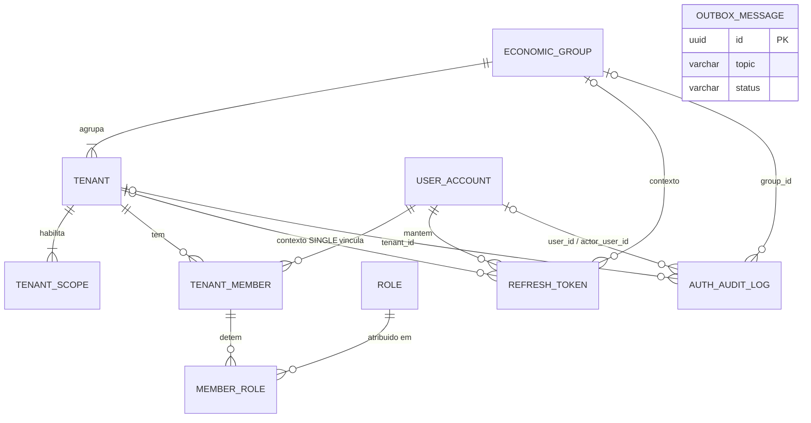

# Pacote de Contexto — M-14

| Ficheiro de origem | Secções incluídas | Tamanho (KiB) |
|---|---|---|
| `10-nucleo.md` | Núcleo base (§1-§2, §3 comum, §4, §6-§10) + extras §3.7, §5 | 16.7 |
| `30-dados.md` | Comum (§1, §2, §3) + ENT-10, ENUM-03, ENUM-06, ENUM-09, ENUM-09 (transições), ENUM-10 | 5.3 |
| `40-contratos.md` | §1, §6 + operações/itens de §4 (EV-01, EV-02, EV-03, EV-04, IF-05.1, IF-07, IF-07.1, IF-07.2, IF-07.3, IF-07.4, IF-07.5, IF-08.1) + tipos partilhados | 12.4 |
| `70-ambiente-teste.md` | Comum §1 | 3.6 |
| `20-sistema-existente.md` | EXT-03 | 0.4 |
| `90-registo.md` | UT-3-14 (§1) + PRS-09, PRS-42, PRS-43 (§2.2) | 0.5 |
| **Total contexto** | **Todas as origens** | **39.0** |

<!-- FIM DO CABECALHO -->

# 10 · Núcleo — Identity-Service

> **Conjunto:** [00 Índice](00-indice.md) · **Dono:** ARQ (UT-1-01) · **Estado:** Rascunho (ciclo 5, UT-2-91) · **Atualizado em:** 2026-10-19
> **Núcleo base** (todos os pacotes): tudo antes da secção final "Extras". Cada extra diz no título em que pacotes entra. Estado dos PRS: `90` §2.

## 1. Instruções obrigatórias para a LLM

1. Implemente **exclusivamente** o que está no seu pacote de contexto. Qualquer endpoint, campo, tabela, dependência ou comportamento que não esteja descrito **NÃO DEVE** ser criado.
2. **DEVE**, **NÃO DEVE**, **DEVERIA**, **NÃO DEVERIA** e **PODE** têm o significado da RFC 2119/8174.
3. Em conflito vale, por ordem: (1) RN do módulo dono e RG (§3.6); (2) CA do módulo dono; (3) contratos (`40` e detalhe do EP no módulo); (4) dados (`30`); (5) restante núcleo; (6) plano de fases e restantes. Uma RN contra uma RG é defeito: registe-o em "Dúvidas", não o resolva por interpretação.
4. Use **apenas** as tecnologias e versões da §4.
5. Respeite **literalmente** os nomes de entidades, colunas, campos JSON, enums, tópicos, chaves de cache e códigos de erro.
6. **Se algo estiver ambíguo ou em falta, NÃO invente.** Registe-o em "Dúvidas" na sua entrega e siga com a hipótese mais simples, marcada como tal. Toda a decisão tomada sem base na especificação vai para "Decisões fora dos docs".
7. Não toque em nada listado em "Não tocar ainda" no seu brief.
8. Cada CA da sua fase tem um teste com o ID no nome (convenção em `70`).
9. Entregue no formato fixo do seu brief (`80`).

## 2. Contexto

### 2.1 Propósito
Autenticar pessoas físicas de um portal B2B multi-CNPJ, emitir JWT RS256 com o contexto ativo (`SINGLE` ou `MACRO_GROUP`) num dos 4 escopos, revogar sessões de imediato pela denylist no Redis e publicar eventos de identidade no Kafka com contexto assinado. [DOC] `Docs/Ideia Base.md`.

### 2.4 Glossário
| Termo | Nome canónico | Sinónimos proibidos |
|---|---|---|
| Grupo Económico | `economic_group` | `Account`, `Holding` |
| Tenant (pessoa jurídica, um CNPJ) | `tenant` | `Company`, `Filial` |
| Escopo operacional | `OperationalScope` | `Profile`, `Persona` |
| Conta de utilizador (pessoa física) | `user_account` | `Person`, `LoginUser` |
| Membro; papel; papel do membro | `tenant_member`; `role`; `member_role` | `Membership`; `Group`; `UserRole` |
| Refresh token; família | `refresh_token`; `family_id` (claim `fid`) | `SessionToken`; `session_id` |
| Modo de visão | `ViewMode` | `ContextMode` |
| Contexto de autenticação | `AuthContext` | `UserContext`, `TenantContext` |
| Auditoria; mensagem de outbox | `auth_audit_log`; `outbox_message` | `AuditTrail`; `EventQueue` |
| Denylist; contexto assinado de evento | `denylist:*`; `context_jws` | `blacklist`; `event_token` |
Classes C# com o nome da tabela em `PascalCase` (`TenantMember`, `RefreshToken`).

## 3. Restrições arquiteturais

### 3.1 ADR
| ID | Decisão | Consequência obrigatória no código | Origem (IB = [DOC] Ideia Base) |
|---|---|---|---|
| ADR-01 | Control Plane separado | `user_account.platform_role` (`NONE`, `SUPPORT_AGENT`, `PLATFORM_ADMIN`); nenhuma `role` concede privilégio de plataforma | IB §2 |
| ADR-02 | `economic_group` → `tenant` | `tenant.group_id NOT NULL`; token com `view_mode ≠ NONE` tem `group_id ≠ null` | IB §2, IB §3.1 |
| ADR-03 | Quatro escopos | `OperationalScope` com 4 valores (`BUYER`, `SUPPLIER`, `CARRIER`, `TENANT_ADMIN`); outro valor → 400 `ERR-VAL-001` | IB §2, IB §3.2 |
| ADR-04 | Troca explícita de contexto | EP-01 emite `view_mode = NONE`; só EP-02 ativa `SINGLE` ou `MACRO_GROUP` | IB §5; PRS-01 |
| ADR-05 | Isolamento em 4 camadas | `tenant_scope`, `tenant_member`, `member_role` são `ITenantScoped`: middleware, filtro de leitura, interceptor de escrita e RLS (detalhe no extra do M-13) | IB §7.2; PRS-07, PRS-17 |
| ADR-06 | JWT RS256 + JWKS + denylist | RSA 2048, `kid` no header; EP-10 publica a chave; middleware aplica RG-06 a RG-08 | IB §2, IB §6.2; PRS-04 |
| ADR-07 | Rotação com deteção de reuso | `refresh_token` guarda só `token_hash`; reapresentar `CONSUMED` revoga a família | IB §6.3 |
| ADR-08 | Impersonation RFC 8693 | Claim `act`; sem `refresh_token`; token com `act` rejeitado em EP-02 e EP-05 | IB §6.4; PRS-08 |
| ADR-09 | Contexto assinado nos eventos | Toda a `outbox_message` leva headers de identidade e `context_jws` | IB §6.5; PRS-09 |
| ADR-10 | Monólito modular | Um projeto (§3.2); um módulo só escreve na sua pasta e nas tabelas de que é dono; chama outro módulo só pelas `IF-nn` (`40`) | ARQ |
| ADR-11 | Um único mecanismo de migração | EF Core Migrations aplicadas no arranque pelo M-11 | ARQ |

### 3.2 Estrutura do projeto
```text
IdentityService.slnx, global.json, .config/dotnet-tools.json, Directory.Build.props, Dockerfile, docker-compose.yml
src/IdentityService/Program.cs   chama AddMnn() e MapMnn() de cada módulo
src/IdentityService/Modules/Mnn<Nome>/   uma pasta por módulo (M-00 a M-14), com Interface/ (tipos públicos) e ModuleRegistration.cs
  M11Esquema/Persistence/: IdentityDbContext, entidades, configurações EF, Migrations/
tests/IdentityService.Tests/Mnn<Nome>/   testes do construtor
tests/IdentityService.Acceptance/   suite do AUD: o construtor NÃO DEVE criá-la nem alterá-la
```
**Dependências:** `Modules/Mxx/` só referencia `Modules/Myy/Interface/`, `Modules/M00Transversal/` e `Modules/M11Esquema/Persistence/`. Endpoints em Minimal APIs. Novos `PackageReference` proibidos: os pacotes são criados uma vez (M-11, F-00).

### 3.3 Convenções
| Item | Convenção |
|---|---|
| Classes / ficheiros | `PascalCase`, um tipo público por ficheiro |
| Tabelas / colunas | `snake_case` singular (`UseSnakeCaseNamingConvention()`); nomes de restrições em `30` |
| JSON | `JsonNamingPolicy.SnakeCaseLower`; `JsonUnmappedMemberHandling.Disallow`; enums como texto |
| Datas | JSON: UTC `yyyy-MM-ddTHH:mm:ssZ` truncado ao segundo; `iat`, `exp` e valores Redis em segundos Unix |
| Tempo | Só `TimeProvider` injetado |
| Identificadores | UUID v7 gerado pela aplicação; texto minúsculo, formato `D` |
| Arrays de saída | Ordem ordinal ascendente em `roles`, `permissions`, `allowed_tenants`, `scopes`, `available_scopes` (PRS-24) |
| Commits | `tipo(Mnn): descrição (RF-nn, CA-nn.m)` |

### 3.4 Comportamentos transversais (donos: M-00; isolamento M-13)
| Aspeto | Especificação |
|---|---|
| Autenticação | EP com token obrigatório (EP-02, EP-04 a EP-09): leitura da chave de `ISigningKey` (indisponível → 503, também sem token), depois RG-06, RG-07, RG-08 por esta ordem |
| Erro | RFC 9457 `application/problem+json; charset=utf-8`: `type` = `https://identity.b2b.local/errors/{code}`, `title` e `status` do §6, `code`, `detail` = `title` (PRS-26), `correlation_id`; sem stack trace |
| Logging | `AddJsonConsole()` para `stdout`. **NÃO DEVE** registar `password`, `password_hash`, `refresh_token`, `token_hash`, `access_token`, `context_jws`, chaves privadas nem corpos de pedido |
| Auditoria | `IAuditLog` insere em `auth_audit_log` na transação da operação, com as colunas dos eventos do módulo (`30`) |
| Denylist | Só `IDenylist` acede a `denylist:*` |
| Escrita em `ITenantScoped` | Um endpoint de gestão só escreve no tenant que a autorização do EP aprovou, declarado por `AuthorizeTenantWrite` antes de abrir a transação (PRS-51). Exceção: EP-09 por `TENANT_ADMIN`, pelo bypass limitado do M-13 (PRS-72) |

### 3.5 Claims do `access_token` e `AuthContext`
Header: `alg = RS256`, `typ = JWT`, `kid = JWT_KEY_ID`. Todas presentes salvo "omitida"; valor nulo = literal JSON `null`. Tipos C# do `AuthContext`: `40`, tipos partilhados.

| Claim | Tipo | Valor | `AuthContext` |
|---|---|---|---|
| `jti` | string | UUID v7 novo | `Jti` |
| `sub` | string | `user_account.id` (impersonation: o alvo) | `UserId` |
| `fid` | string | `family_id`; omitida em impersonation | `FamilyId` |
| `iat`, `exp` | número | Unix; `exp = iat + 900` (PRS-20) | `Iat`, `Exp` |
| `iss`, `aud` | string | `JWT_ISSUER`, `JWT_AUDIENCE` | — |
| `platform_role` | string | `PlatformRole` de `sub` | `PlatformRole` |
| `view_mode` | string | `ViewMode` | `ViewMode` |
| `group_id`, `tenant_id` | string \| `null` | `null` em `NONE`; `tenant_id = null` em `MACRO_GROUP` | `GroupId`, `ActiveTenantId` |
| `allowed_tenants` | array | `[]` em `NONE`; 1 em `SINGLE`; 1 a 50 em `MACRO_GROUP` | `AllowedTenants` |
| `active_scope` | string \| `null` | `OperationalScope`; `null` em `NONE` | `ActiveScope` |
| `roles`, `permissions` | array | RG-01 (`SINGLE`), RG-12 (`MACRO_GROUP`); `[]` em `NONE` | `Roles`, `Permissions` |
| `act` | `{ "sub", "ticket_id" }` | Só em impersonation | `ActorUserId`, `TicketId` |

### 3.6 Catálogo de regras globais (RG)
Nível 1 da precedência (§1). Texto canónico nos extras do núcleo dos donos: RG-01 a RG-05 e RG-10 a RG-13 implementadas só por M-08 (`IAccessQueries`); RG-06 a RG-08 só por M-00; RG-09 só por M-13. Os consumidores aplicam-nas pela interface e indicam o passo da sua ordem de avaliação.

| ID | Resumo | Erro | Dono |
|---|---|---|---|
| RG-01 | Papéis e permissões de `u` em `t` para `S`: dono → todas as `role` de `S`; senão as de `member_role` | – | M-08 |
| RG-02 | Escopo `S` inativo em `t` ou sem papéis | 403 `ERR-CTX-003` | M-08 |
| RG-03 | Sem vínculo `ACTIVE` em `t` | 403 `ERR-CTX-001` | M-08 |
| RG-04 | Tenant ou grupo `SUSPENDED`, ou `denylist:tenant:{t}` | 403 `ERR-CTX-002` | M-08 |
| RG-05 | Utilizador bloqueado. EP-01: só `status = SUSPENDED`, avaliado só depois de a palavra-passe estar correta (D-08, D-11). EP-02: `SUSPENDED` ou `denylist:user` ≥ `iat`. EP-03: `SUSPENDED` ou `denylist:user` ≥ `created_at` do refresh apresentado. EP-05 (alvo): `SUSPENDED` ou qualquer `denylist:user` do alvo (PRS-46) | 403 `ERR-AUTH-004` | M-08 |
| RG-06 | Token ausente, inválido, expirado ou com `denylist:jti` | 401 `ERR-AUTH-002` | M-00 |
| RG-07 | `denylist:user` de `sub` ou `act.sub` com valor ≥ `iat` | 403 `ERR-AUTH-004` | M-00 |
| RG-08 | `denylist:tenant` de algum tenant de `allowed_tenants` | 403 `ERR-CTX-002` | M-00 |
| RG-09 | Escrita ou leitura rejeitada pela camada 3 ou 4 | 403 `ERR-CTX-007` | M-13 |
| RG-10 | Contextos disponíveis no login | – | M-08 |
| RG-11 | `MACRO_GROUP`: lista com 1 a 50 tenants distintos do grupo e `can_view_group = true` em todos | 403 `ERR-CTX-004` | M-08 |
| RG-12 | `MACRO_GROUP`: `roles`/`permissions` = interseção da RG-01 nos tenants | – | M-08 |
| RG-13 | Interseção de `permissions` vazia | 403 `ERR-CTX-003` | M-08 |

## 4. Stack
| Camada | Tecnologia | Versão exata |
|---|---|---|
| SDK / runtime | .NET SDK / ASP.NET Core (`net10.0`, C# 14) | 10.0.402 / 10.0.13 |
| Base de dados / cache / mensageria | PostgreSQL / Redis / Apache Kafka (KRaft) | 17.6 / 7.4.6 / 3.9.1 |
| Contentores | Docker Engine | 29.7.2 |

Pacotes: lista exaustiva no extra de projeto do M-11. Proibido qualquer outro, incluindo `JwtBearer`, `System.IdentityModel.Tokens.Jwt`, `FluentValidation`, `Serilog.*`, `Actuar.*`, `AutoMapper`, `MediatR`, `Newtonsoft.Json`, `Dapper`, `MassTransit`, `Moq`, `FluentAssertions`, `Bogus`. A validação de pedidos é código explícito.

## 6. Catálogo global de erros
| Código | HTTP | `title` (fixo) | Condição |
|---|---|---|---|
| `ERR-VAL-001` | 400 | Pedido inválido ou malformado | JSON inválido, campo obrigatório ausente ou `null`, tipo errado, valor fora do enum, campo desconhecido, formato |
| `ERR-VAL-002` | 422 | Dados de CNPJ ou geolocalização inválidos | M-04 |
| `ERR-VAL-003` | 422 | Formato de e-mail ou política de palavra-passe violada | M-01 |
| `ERR-VAL-004` | 422 | Código de chamado técnico inválido | M-06 |
| `ERR-REQ-001` | 404 | Rota inexistente | Nenhuma rota corresponde |
| `ERR-REQ-002` | 405 | Método não permitido | Path com outro método |
| `ERR-REQ-003` | 413 | Corpo do pedido demasiado grande | Corpo > 65 536 bytes |
| `ERR-REQ-004` | 415 | Tipo de conteúdo não suportado | Corpo com `Content-Type` ≠ `application/json` (`charset` só `utf-8`) |
| `ERR-AUTH-001` | 401 | Credenciais inválidas | M-01 |
| `ERR-AUTH-002` | 401 | Token de acesso ausente, inválido, expirado ou revogado | RG-06; EP-02 com família sem linha `ACTIVE` (PRS-73) |
| `ERR-AUTH-003` | — | `[REMOVIDO]` | Não é devolvido por nenhum EP: a conta `LOCKED` responde 401 `ERR-AUTH-001` (D-08) |
| `ERR-AUTH-004` | 403 | Utilizador suspenso ou revogado globalmente | RG-05, RG-07; alvo `LOCKED` em EP-05 (M-06) |
| `ERR-AUTH-005` | 401 | Refresh token inválido, revogado ou expirado | M-02 |
| `ERR-AUTH-006` | 401 | Reuso de refresh token detetado e sessão revogada | M-02 |
| `ERR-AUTH-010` | 403 | Operação de impersonation não autorizada | M-06 |
| `ERR-CTX-001` | 403 | Utilizador sem vínculo ativo no Tenant solicitado | RG-03 |
| `ERR-CTX-002` | 403 | Tenant ou Grupo Económico suspenso | RG-04, RG-08; grupo `SUSPENDED` em EP-06 (M-04) |
| `ERR-CTX-003` | 403 | Escopo operacional inativo ou papel não atribuído | RG-02, RG-13 |
| `ERR-CTX-004` | 403 | Violação das regras de agregação em visão macro | RG-11 |
| `ERR-CTX-005` | 409 | Conflito de unicidade de registo | M-04, M-05 |
| `ERR-CTX-006` | 422 | Papel incompatível com os escopos ativos do Tenant | M-05 |
| `ERR-CTX-007` | 403 | Violação de isolamento de contexto ou permissão insuficiente | Autorização do EP negada, RG-09, `act` em EP-02 |
| `ERR-CTX-008` | 404 | Recurso de domínio não encontrado | `group_id`, `tenant_id`, `user_id` ou `role_id` inexistente |
| `ERR-SYS-001` | 500 | Erro interno do servidor | Exceção não prevista |
| `ERR-SYS-002` | 503 | Dependência indisponível | PostgreSQL, Redis ou chave indisponível (PRS-16) |

Um módulo **NÃO DEVE** criar códigos: um código em falta é um `CR-nn`.

## 7. Regras por omissão
| Situação não coberta | Comportamento obrigatório |
|---|---|
| Campo de request não listado | 400 `ERR-VAL-001` |
| Autorização não descrita | Negar: 403 `ERR-CTX-007` |
| Rota inexistente / método errado | 404 `ERR-REQ-001` / 405 `ERR-REQ-002` |
| Erro inesperado | 500 `ERR-SYS-001`, transação desfeita |
| PostgreSQL, Redis ou chave indisponível | 503 `ERR-SYS-002`, transação desfeita, salvo um `DEL` posterior ao commit (PRS-15, PRS-16) |
| Escrever tabela de outro módulo | Só pela interface do dono (`40` §4.3) |
| Exceção de BD, Redis ou chave | Tratador global do M-00, pela cadeia de `InnerException`: 42501 → 403 `ERR-CTX-007`; 23505 não tratado → 409 `ERR-CTX-005` |

## 8. Explicitamente proibido
- `refresh_token` em claro; segredos em log.
- Hidratar o `AuthContext` a partir de headers em texto (`X-Tenant-Id`, `X-User-Id`, `X-Group-Id`).
- `HS256` ou RSA com menos de 2048 bits; `refresh_token` em impersonation.
- `DELETE` em qualquer tabela; `UPDATE` em `auth_audit_log` (PRS-19).
- `DateTime.UtcNow`, `DateTimeOffset.UtcNow`, `EnsureCreated`, `Thread.Sleep` em código de produção.

---

### 3.7 Configuração e produtor Kafka (extra: M-00, M-07, M-11, M-14, F-00, `70`)
| Aspeto | Especificação |
|---|---|
| Configuração | Obrigatórias (ausente → código de saída ≠ 0): `DB_CONNECTION_STRING`, `REDIS_CONNECTION_STRING`, `KAFKA_BOOTSTRAP_SERVERS`. Com default: `JWT_ISSUER` = `identity-service`, `JWT_AUDIENCE` = `b2b-platform`, `JWT_KEY_ID` = `key-2026-01`, `OUTBOX_POLLING_INTERVAL_MS` = `500`. `JWT_RSA_PRIVATE_KEY_PEM` (PKCS#8 RSA 2048): vazia só com `ASPNETCORE_ENVIRONMENT` ∈ {`Development`, `Testing`}, gerando um par em memória; vazia noutro ambiente → código ≠ 0 (PRS-25) |
| Produtor Kafka (M-14) | `Confluent.Kafka` com `MessageTimeoutMs = 3000` e `Acks = All`; o resto por omissão (PRS-63) |

### 5. Requisitos não funcionais (extra: M-01, M-13, M-14; os CA de RNF de cada módulo vão no brief)
| ID | Categoria | Requisito | Limiar | Verificação | Na métrica |
|---|---|---|---|---|---|
| RNF-01 | Segurança | Hash Argon2id (PRS-21) | `m=19456` KiB, `t=2`, `p=1`, salt 16 B, hash 32 B, PHC `$argon2id$v=19$m=19456,t=2,p=1$<salt>$<hash>` | Prefixo de `password_hash` | Sim: CA em M-01 |
| RNF-02 | Segurança | RS256 em JWT e `context_jws` | RSA 2048; `kid` igual no JWT e no JWKS | Verificar só com a chave de EP-10 | Sim: CA em M-07 |
| RNF-03 | Segurança | Vida dos tokens | `exp − iat = 900`; `expires_at − created_at = 604800 s` (PRS-33); tolerância 0 | Claims e colunas | Sim: CA em M-01, M-02 |
| RNF-04 | Desempenho | Latência (PRS-50) | p95 ≤ 150 ms (EP-02, EP-03); ≤ 400 ms (EP-01) | Contentor local | Fora: depende do hardware, sem resultado binário reprodutível |
| RNF-05 | Confiabilidade | Outbox | `PENDING` → `PUBLISHED` e mensagem no tópico em ≤ 3 s (PRS-43) | Kafka real, espera ativa com teto | Sim: CA em M-14 |
| RNF-06 | Segurança | Isolamento | 100 % das operações em `ITenantScoped` fora do permitido rejeitadas pelas camadas 2, 3 e 4 | Um teste `@critico` por camada | Sim: CA em M-13 |

# 30 · Dados — Identity-Service

> **Conjunto:** [00 Índice](00-indice.md) · **Dono:** ARQ (UT-2-01) · **Estado:** Rascunho (ciclo 5; decisões do PO de 2026-10-19 aplicadas) · **Atualizado em:** 2026-10-19
> Contrato partilhado: é congelado no Gate 2. Cada tabela tem **um** módulo dono, o único com código que a escreve. Os outros módulos escrevem só através da interface `IF-nn` do dono (`40`). O esquema inteiro (§3, §5, §6) é criado pela migração do M-11.
> **Nomes de restrições:** `pk_<tabela>`, `fk_<tabela>_<coluna>`, `uq_<tabela>_<colunas>`, `ck_<tabela>_<coluna>` para o CHECK de uma coluna e o nome indicado nos CHECK de tabela. Forma executável e medida de §3, §5 e §6: `evidencias/pg-ddl.sql` (resultado em `evidencias/medir-postgres.out.txt`); uma diferença entre os dois é um defeito e vale este ficheiro.

## 1. Diagrama ER


**Invariantes globais:** nenhum `DELETE` em nenhuma tabela; nenhum `UPDATE` em `auth_audit_log` (PRS-19). Todas as colunas temporais são preenchidas pela aplicação com `TimeProvider` (sem `DEFAULT now()`). Todas as FK são `ON DELETE RESTRICT` (PRS-19).

## 2. Tipos enumerados
Guardados como `VARCHAR` com `CHECK`; em C#, `enum` com os mesmos nomes, convertido para texto (`HasConversion<string>()`).

## 3. Dicionário de dados
Tipos físicos PostgreSQL 17. "Default: —" = sem default (a aplicação preenche).

### ENT-10 `outbox_message`
**Descrição:** transactional outbox, entrega *at-least-once*. **Dono:** M-14 (`IEventOutbox`). **Isolamento:** não (PRS-07).
**Invariante:** inserida na mesma transação da alteração de negócio, com `status = 'PENDING'`.

| Coluna | Tipo físico | Nulo | Default | Chave | Restrições | Descrição |
|---|---|---|---|---|---|---|
| `id` | `UUID` | NÃO | — | PK | — | Também é o `event_id` |
| `topic` | `VARCHAR(64)` | NÃO | — | — | `CHECK (topic IN ('empresa_cadastrada','tenant_bloqueado','usuario_bloqueado','sessao_comprometida'))` | EV-01 a EV-04 (PRS-42) |
| `partition_key` | `VARCHAR(36)` | NÃO | — | — | `CHECK (partition_key ~ '^[0-9a-f]{8}-[0-9a-f]{4}-[0-9a-f]{4}-[0-9a-f]{4}-[0-9a-f]{12}$')` | UUID em texto (`tenant_id` ou `user_id`, segundo o EV) |
| `headers` | `JSONB` | NÃO | — | — | `CHECK (jsonb_typeof(headers) = 'object')` | Headers Kafka, incluindo `context_jws` |
| `payload` | `JSONB` | NÃO | — | — | `CHECK (jsonb_typeof(payload) = 'object')` | Corpo do evento |
| `status` | `VARCHAR(16)` | NÃO | `'PENDING'` | — | `CHECK (status IN ('PENDING','PUBLISHED','FAILED'))` | `OutboxStatus` |
| `retry_count` | `INTEGER` | NÃO | `0` | — | `CHECK (retry_count BETWEEN 0 AND 5)` | Tentativas falhadas (PRS-43) |
| `created_at` | `TIMESTAMPTZ` | NÃO | — | — | — | Gravação |
| `processed_at` | `TIMESTAMPTZ` | SIM | `NULL` | — | — | Publicação ou falha final |

**CHECK de tabela:** `ck_outbox_message_processed_at`: `(status = 'PENDING') = (processed_at IS NULL)`; `ck_outbox_message_failed_retry`: `(status = 'FAILED') = (retry_count = 5)`.

**Índices:** `pk_outbox_message (id)` único; `ix_outbox_message_pending (created_at) WHERE status = 'PENDING'` parcial.

### ENUM-03 `OPERATIONAL_SCOPE` (`tenant_scope.scope`, `role.scope`, `refresh_token.active_scope`, claim `active_scope`)
| Valor | Significado |
|---|---|
| `BUYER` | Comprador |
| `SUPPLIER` | Fornecedor |
| `CARRIER` | Transportadora |
| `TENANT_ADMIN` | Gestão corporativa (4.º escopo) |

Sem transições: catálogo fixo (ADR-03).

### ENUM-06 `VIEW_MODE` (`refresh_token.view_mode`, claim `view_mode`)
| Valor | Significado |
|---|---|
| `NONE` | Sessão sem contexto (após login); sem operações de domínio |
| `SINGLE` | 1 tenant: `tenant_id` preenchido, `allowed_tenants` com 1 elemento |
| `MACRO_GROUP` | Visão de grupo: `tenant_id = null`, `allowed_tenants` com 1 a 50 tenants do grupo (PRS-35) |

### ENUM-09 `OUTBOX_STATUS` (`outbox_message.status`)
| Valor | Significado |
|---|---|
| `PENDING` | Aguarda publicação |
| `PUBLISHED` | Confirmada pelo broker |
| `FAILED` | Falhou na última tentativa permitida (PRS-43) |

#### ENUM-09 · transições
| De | Para | Gatilho |
|---|---|---|
| `PENDING` | `PENDING` | RF-14: tentativa falhada com `retry_count + 1 < 5`; grava `retry_count = retry_count + 1` |
| `PENDING` | `PUBLISHED` | RF-14: confirmação do broker; `retry_count` não muda |
| `PENDING` | `FAILED` | RF-14: tentativa falhada com `retry_count + 1 = 5`; grava `retry_count = 5` na mesma atualização (`ck_outbox_message_failed_retry`) |

### ENUM-10 `ACTING_SCOPE` (header Kafka e claim `acting_scope` do `context_jws`)
Valores de ENUM-03 mais `NONE` (sem escopo ativo: token `view_mode = NONE` ou evento sem token de entrada). PRS-18. Não é coluna de BD.

## 1. Convenções globais da API

| Item | Valor |
|---|---|
| Base path | `/api/v1`. Exceção única: EP-10 em `/.well-known/jwks.json` |
| Pedido com corpo | `Content-Type` com tipo `application/json` (sem distinção de maiúsculas), seguido opcionalmente de `;` e do parâmetro `charset=utf-8` (nome e valor sem distinção de maiúsculas; espaços e tabs à volta de `;` e de `=` ignorados, RFC 9110 §8.3.1) e de nenhum outro parâmetro; corpo UTF-8 com no máximo 65 536 bytes (PRS-23) |
| Resposta de sucesso | `application/json; charset=utf-8`, sem envelope. 204 sem corpo |
| Resposta de erro | `10` §3.4 (RFC 9457, 6 campos: `type`, `title`, `status`, `code`, `detail`, `correlation_id`; nenhum outro) |
| Autenticação | `Authorization: Bearer <jwt>`: esquema `Bearer` sem distinção de maiúsculas, um espaço, JWT compacto. Claims em `10` §3.5. EP-01, EP-03 e EP-10 são públicos e ignoram o header `Authorization` |
| Correlação | `X-Correlation-Id` aceite só como UUID no formato `D` (36 caracteres, sem distinção de maiúsculas) e devolvido em minúsculas; outro valor ou ausente → UUID v7 gerado (PRS-52). Presente em todas as respostas, incluindo erros e 204 |
| Cache | `Cache-Control: no-store` nas respostas de EP-01 a EP-05 (com `Pragma: no-cache` exceto EP-04); EP-10: `public, max-age=300` (PRS-44) |
| JSON | `10` §3.3. Raiz do corpo: objeto. Campo desconhecido ou repetido no mesmo objeto → 400 `ERR-VAL-001`. Enums em texto com a grafia exata de `30` §2 (`"buyer"` → 400). Tipos estritos: número em texto, texto em número ou `0`/`1` em booleano → 400 |
| Query string | Nenhum EP define parâmetros de query; são ignorados (PRS-55) |
| Rejeição num módulo | O módulo lança `ApiErrorException(code)` (`M00Transversal/Errors/`); o tratador global de M-00 escreve o corpo com `status` e `title` de `10` §6 e classifica as outras exceções pela cadeia de `InnerException` (PRS-65): 23505 não tratado → 409 `ERR-CTX-005`. Os módulos **NÃO DEVEM** capturar exceções de BD, Redis ou chave; exceção única: o dono de uma restrição única trata o seu 23505 (M-02: `uq_refresh_token_family_active`), procurando a `PostgresException` na cadeia |

## 4. Interfaces

### 4.1 Endpoints
Abreviaturas de erro: `VAL-001` = `ERR-VAL-001`, e assim para todas as áreas. `[T]`, `[A]` e os erros comuns a todos os EP: validação em camadas. Autorização exata: matriz de autorização.

| ID | Método e path | Dono (RF) | Autenticação / autorização | Request (resumo) | Sucesso (resumo) | Erros possíveis, além dos comuns |
|---|---|---|---|---|---|---|

### 4.2 Eventos
Publicados por M-14 a partir da outbox (RF-14). Headers, entrega e idempotência: definidos pelo M-14. Mensagem Kafka: chave = `partition_key`; valor = payload JSON UTF-8 (`10` §3.3).

| ID | Tópico | Dono (gatilho) | Chave de partição | Payload |
|---|---|---|---|---|

### 4.3 Interfaces internas
Tipos públicos na pasta indicada; namespace = `IdentityService.Modules.<pasta com . no lugar de />` (por exemplo `IdentityService.Modules.M02Refresh.Interface`). Métodos `Async` recebem ainda `CancellationToken`. **Transação:** as IF de BD usam o `IdentityDbContext` com âmbito do pedido e a transação aberta pelo chamador; inserções ficam no `ChangeTracker` até ao `SaveChangesAsync` do chamador; atualizações em massa executam de imediato dentro dessa transação. Nenhuma IF faz commit. Dependência indisponível: a exceção propaga até ao tratador global do M-00. Argumento que viola o contrato: `ArgumentException` (500).
**Pacotes:** o consumidor recebe a linha da IF na tabela "Interfaces", só as linhas das operações que usa em "Operações" e as linhas de "Tipos partilhados" dos tipos que essas linhas citam; o dono recebe todas as linhas da sua IF.

**Interfaces**
| ID | Interface (pasta) | Dono | Regras comuns |
|---|---|---|---|

**Operações**
| Operação | Assinatura | Efeito e resultado | Consumidores |
|---|---|---|---|

**Tipos partilhados** (registos C# `record` imutáveis; enums com os membros escritos exatamente como abaixo, guardados como texto)
| Tipo | Pasta | Definição |
|---|---|---|
| `BranchType` | idem | `enum { HQ, BRANCH }` |
| `OperationalScope` | idem | `enum { BUYER, SUPPLIER, CARRIER, TENANT_ADMIN }` |
| `UserStatus` | idem | `enum { ACTIVE, LOCKED, SUSPENDED }` |
| `RefreshTokenStatus` | idem | `enum { ACTIVE, CONSUMED, REVOKED }` |
| `ViewMode` | idem | `enum { NONE, SINGLE, MACRO_GROUP }` |
| `PlatformRole` | idem | `enum { NONE, SUPPORT_AGENT, PLATFORM_ADMIN }` |
| `AuditEventType` | idem | `enum { LOGIN_SUCCESS, LOGIN_FAILED, USER_LOCKED, CONTEXT_SWITCHED, TOKEN_REFRESHED, TOKEN_REUSE_DETECTED, LOGOUT, IMPERSONATION_STARTED, TENANT_CREATED, MEMBER_ADDED, TENANT_STATUS_CHANGED, USER_STATUS_CHANGED }` |
| `OutboxStatus` | idem | `enum { PENDING, PUBLISHED, FAILED }` |
| `ActingScope` | idem | `enum { BUYER, SUPPLIER, CARRIER, TENANT_ADMIN, NONE }` |

| EV-01 | `empresa_cadastrada` | M-14 (M-04, RF-07: EP-06 com 201) | `tenant_id` | `event_id`, `tenant_id`, `group_id`, `cnpj`, `legal_name`, `branch_type`, `geo_lat`, `geo_lng`, `status` = `ACTIVE`, `scopes`, `created_at` |
| EV-02 | `tenant_bloqueado` | M-14 (M-12, RF-09) | `tenant_id` | `event_id`, `tenant_id`, `group_id`, `cnpj`, `status` = `SUSPENDED`, `reason`, `blocked_by_user_id` (`sub` do chamador), `blocked_at` |
| EV-03 | `usuario_bloqueado` | M-14 (M-01, RF-01: bloqueio `LOCKED`; M-10, RF-10) | `user_id` | `event_id`, `user_id`, `status` (`LOCKED` ou `SUSPENDED`), `locked_until` (texto em `LOCKED`; `null` em `SUSPENDED`), `reason` (`SUSPENDED`: `reason` do pedido; `LOCKED`: `"Excesso de tentativas consecutivas de login com palavra-passe incorreta"`, PRS-60), `blocked_at` |
| EV-04 | `sessao_comprometida` | M-14 (M-02, RF-04: reuso) | `user_id` | `event_id`, `user_id`, `family_id`, `reused_refresh_token_id`, `ip_address`, `detected_at` |
| IF-05 | `ISigningKey` (`M00Transversal/Auth/`) | M-00 | Lida em cada uso (nunca copiada para estado estático); sem chave válida no arranque o processo termina com código ≠ 0; uma falha em uso lança exceção (→ 503) |
| IF-05.1 | Propriedades `string KeyId` (= `JWT_KEY_ID`), `RsaSecurityKey SigningKey` (privada, 2048 bits), `string Modulus`, `string Exponent` (base64url) | Material de assinatura, de validação e de EP-10 | M-00 (validação), M-07, M-14 |
| IF-07 | `IEventOutbox` (`M14Eventos/Interface/`) | M-14 | Headers e `context_jws` montados por M-14 a partir do contexto de autenticação do pedido ou de `FamilyContext`; devolve `Guid` `event_id` (= `outbox_message.id`, UUID v7); linha `PENDING` gravada com o `SaveChangesAsync` do chamador |
| IF-07.1 | `Guid EnqueueTenantCreated(TenantCreatedPayload payload)` | EV-01 | M-04 |
| IF-07.2 | `Guid EnqueueTenantBlocked(TenantBlockedPayload payload)` | EV-02 | M-12 |
| IF-07.3 | `Guid EnqueueUserLocked(Guid userId, DateTimeOffset lockedUntil, DateTimeOffset blockedAt)` | EV-03 com `status = LOCKED` | M-01 |
| IF-07.4 | `Guid EnqueueUserSuspended(Guid userId, string reason, DateTimeOffset blockedAt)` | EV-03 com `status = SUSPENDED` | M-10 |
| IF-07.5 | `Guid EnqueueSessionCompromised(SessionCompromisedPayload payload, FamilyContext family)` | EV-04 | M-02 |
| IF-08 | `IAuthContext` (`M00Transversal/Auth/`) | M-00 | Valores por pedido (*scoped*) |
| IF-08.1 | Propriedades de `IAuthContext` (tipos partilhados) | Só leitura. `BypassTenantFilter` = `true` nos pedidos a EP-01 a EP-05 (com ou sem token) e com `platform_role = PLATFORM_ADMIN`; `false` nos restantes | M-02 (`IpAddress`), M-03, M-04, M-05, M-06, M-09, M-10, M-12, M-13, M-14 |
## 6. Eventos: headers e semântica comuns

**Headers Kafka** (valor em texto UTF-8; UUID em minúsculas, formato `D`). Um header sem valor fica **ausente**: nunca `""`, nunca `"null"`, nunca um valor fora do tipo (PRS-56). Nenhum outro header. `outbox_message.headers` (ENT-10) guarda só as chaves presentes, com valor texto.

| Header | Tipo | Presença |
|---|---|---|
| `event_id` | UUID | Sempre; = `outbox_message.id` = `event_id` do payload |
| `tenant_id` | UUID | Só com valor (tabela abaixo) |
| `group_id` | UUID | Só com valor |
| `initiator_user_id` | UUID | Sempre |
| `actor_user_id` | UUID | Só com valor |
| `acting_scope` | `ActingScope` | Sempre; `NONE` sem escopo ativo (PRS-18) |
| `correlation_id` | UUID | Sempre; correlação do pedido que gravou a mensagem (`10` §3.4) |
| `context_jws` | JWS compacto | Sempre; header JWS `alg = RS256`, `kid` = IF-05 `KeyId`; claims `event_id`, `tenant_id`, `group_id`, `initiator_user_id`, `actor_user_id`, `acting_scope`, `view_mode` (`ViewMode`), `allowed_tenants` (ordenado), `correlation_id`, `iat`, `exp = iat + 300` (PRS-09). Todas as claims presentes; sem valor → literal JSON `null` |

**Valores por gatilho**
| Gatilho | `tenant_id` | `group_id` | `initiator_user_id` | `actor_user_id` | `acting_scope` | `view_mode`, `allowed_tenants` (JWS) |
|---|---|---|---|---|---|---|
| EV-01 (EP-06) | Novo tenant | Grupo do novo tenant | `sub` | `act.sub`; ausente sem `act` | `active_scope` do token; `NONE` se `null` | Do token |
| EV-02 (EP-08) | Tenant do path | Grupo desse tenant | `sub` | `act.sub`; ausente sem `act` | `active_scope` do token; `NONE` se `null` | Do token |
| EV-03 (EP-01, bloqueio) | Ausente | Ausente | Utilizador bloqueado | Ausente | `NONE` | `NONE`, `[]` |
| EV-03 (EP-09) | `tenant_id` do token; ausente se `null` | `group_id` do token; ausente se `null` | Utilizador alvo | `act.sub` se o token tiver `act`; senão `sub` | `active_scope` do token; `NONE` se `null` | Do token |
| EV-04 (EP-03, reuso) | `active_tenant_id` da família; ausente se `null` | `group_id` da família; ausente se `null` | `refresh_token.user_id` | Ausente | `active_scope` da família; `NONE` se `null` | Da família |

| Item | Valor |
|---|---|
| Semântica de entrega | *At-least-once* pela outbox (ENT-10, RF-14, PRS-43): a mensagem é inserida na transação da alteração de negócio e publicada depois do commit; `PUBLISHED` só após confirmação do broker. Uma falha entre a confirmação e a atualização para `PUBLISHED` repete a publicação. `FAILED` não é reprocessada (fora do âmbito) |
| Ordem | Sem garantia entre mensagens (uma retentativa pode sair depois de mensagens mais recentes). Os consumidores **NÃO DEVEM** depender da ordem |
| Idempotência no consumidor | Chave: header `event_id` (igual a `event_id` do payload). Deduplicação e validação de `context_jws` pelos consumidores (com EP-10): fora do âmbito (PRS-14, L-02) |

| `ApiErrorException` | `M00Transversal/Errors/` | `class : Exception { string Code }`; construtor `ApiErrorException(string code)` |
| `FamilyContext` | `M14Eventos/Interface/` | `record (Guid UserId, ViewMode ViewMode, Guid? GroupId, Guid? ActiveTenantId, IReadOnlyList<Guid> AllowedTenants, OperationalScope? ActiveScope)` |
| `IAuthContext` | `M00Transversal/Auth/` | `interface`. Claims (`null` = nula ou omitida): `string?` `Jti`, `TicketId`; `Guid?` `UserId`, `FamilyId`, `GroupId`, `ActiveTenantId`, `ActorUserId`; `long?` `Iat`, `Exp`; `PlatformRole? PlatformRole`; `ViewMode? ViewMode`; `OperationalScope? ActiveScope`; `IReadOnlyList<Guid> AllowedTenants`; `IReadOnlyList<string>` `Roles`, `Permissions`. Pedido: `bool` `IsAuthenticated`, `BypassTenantFilter`; `Guid CorrelationId`; `string IpAddress`; `IReadOnlySet<Guid> WriteTenants`; `void AuthorizeTenantWrite(Guid tenantId)`. Sem token: `IsAuthenticated = false`, anuláveis `null`, coleções vazias; com token, `Jti`, `UserId`, `Iat`, `Exp`, `PlatformRole`, `ViewMode` ≠ `null` |
| `ITenantScoped` | `M13Isolamento/Interface/` | `interface { Guid TenantId { get; } }`, implementada pelas entidades de `tenant_scope`, `tenant_member` e `member_role` |
| `IdentityDbContext` | `M11Esquema/Persistence/` | `DbContext` com as propriedades `IAuthContext AuthContext { get; }` (injetada) e `bool TenantIsolationBypass { get; set; }` (`false` ao criar; só `ExecuteWithBypassAsync` a altera) e um `DbSet` por tabela |
| `SessionCompromisedPayload` | `M14Eventos/Interface/` | `record (Guid UserId, Guid FamilyId, Guid ReusedRefreshTokenId, string IpAddress, DateTimeOffset DetectedAt)` |
| `TenantBlockedPayload` | `M14Eventos/Interface/` | `record (Guid TenantId, Guid GroupId, string Cnpj, string Reason, Guid BlockedByUserId, DateTimeOffset BlockedAt)` |
| `TenantCreatedPayload` | `M14Eventos/Interface/` | `record (Guid TenantId, Guid GroupId, string Cnpj, string LegalName, BranchType BranchType, decimal GeoLat, decimal GeoLng, IReadOnlyList<OperationalScope> Scopes, DateTimeOffset CreatedAt)`; `status = ACTIVE` é escrito por M-14 |
# 70 · Contrato do ambiente de teste — Identity-Service

> **Conjunto:** [00 Índice](00-indice.md) · **Dono:** AUD (UT-2-03; reconciliado em UT-2-90) · **Estado:** Rascunho (ciclo 5, UT-2-91) · **Atualizado em:** 2026-10-19
> **Medições:** cada `[MEDIDO]` deste ficheiro cita um teste do esqueleto `evidencias/env70/` (`Medicoes.cs`, `Cunhagem.cs`, `Kestrel.cs`), executado por `evidencias/medir-env70.sh` com resultado em `evidencias/medir-env70.out.txt` (UT-2-93; Docker 29.7.2).
> **Parte comum = cabeçalho + §1: entra em todos os pacotes.** Tudo o que obriga o código está na §1; as secções extra só entram nos pacotes da tabela abaixo.

| Secção | Entra em | Bytes |
|---|---|---|
| §2 Arranque e G1 | ORQ, UT-5-01, validadores, M-11 (UT-3-11 e a sua fase) | 4 160 |
| §3 Dados, tokens, relógio, inspeção | UT-5-01, validadores | 3 200 |
| §4 Injeção de falhas | UT-5-01, validadores | 1 900 |
| §5 Convenções da suite | UT-5-01, validadores, ORQ | 900 |
| §6 Lacunas, PRS, pedidos | ORQ (`90`) | 3 100 |

## 1. Contrato para o código (comum)
A suite de aceitação corre **em processo**: `WebApplicationFactory<Program>` com Kestrel (`UseKestrel(0)`), ambiente `Testing`, PostgreSQL, Redis e Kafka reais em Testcontainers (imagens de `10` §4). **Sem fakes:** nenhum sistema externo é chamado pelo serviço; EXT-04 e EXT-05 só consomem. O código **DEVE**:

| # | Obrigação | Uso na suite |
|---|---|---|
| C1 | Ter `public partial class Program;` e ler a configuração só por `IConfiguration` | A suite define as variáveis no processo antes de criar a fábrica |
| C2 | Em `Testing`, usar `JWT_RSA_PRIVATE_KEY_PEM` quando preenchida | Chave RSA 2048 gerada por sessão; a suite cunha tokens com ela |
| C3 | Registar `TimeProvider` como singleton e obtê-lo do DI em todo o código, incluindo a validação de `exp` (`TokenValidationParameters.TimeProvider`), os TTL do Redis e o worker da outbox | A suite substitui-o (`ConfigureServices`) por um relógio que só avança quando ela manda |
| C4 | Migrar uma BD vazia no arranque (M-11); nenhum dado além do seed de `role`; o tráfego de pedidos corre como `identity_app` | Dados de partida por SQL antes de cada cenário; tabelas truncadas entre cenários |
| C5 | Obter `ISigningKey` do DI em cada uso, incluindo a validação de tokens, sem copiar a chave para estado estático | A suite troca `ISigningKey` por uma que lança `CryptographicException` |
| C6 | Responder 503 `ERR-SYS-002` (nunca 500) em ≤ 15 s às falhas de dependência, classificadas pelo tratador global do M-00 pela cadeia de `InnerException` (`10` §7); sem `EnableRetryOnFailure` | A suite para o contentor ou substitui a chave (PRS-16) |
| C7 | Manter o worker da outbox vivo com o Kafka indisponível e retomar quando volta | A suite pausa o contentor Kafka |
| C8 | Expor as interfaces internas com as assinaturas e os tipos exatos de `40` §4.3 | Testes de componente resolvem-nas do DI da fábrica |

**Testes do construtor** (`tests/IdentityService.Tests`): um por CA da fase, `CA_<nn>_<m>_<Descricao>`; bordas `CA_<nn>_<m>_Borda_<Descricao>`. Builders do Testcontainers com a imagem no construtor (`new PostgreSqlBuilder("postgres:17.6")`): o construtor sem parâmetros é obsoleto e falha o build (`CS0618` com `TreatWarningsAsErrors`) [MEDIDO] build de `evidencias/env70`. Esperas só ativas com teto; nunca um atraso fixo como sincronização.

**Dados pessoais proibidos.** E-mail só `@example.test`; CNPJ com raiz `99` e dígitos verificadores válidos (`99000001000101`); nomes `Utilizador Teste NN`; IP de 192.0.2.0/24, 198.51.100.0/24 ou 203.0.113.0/24. Varredura obrigatória antes de cada entrega de código (comando no brief da fase).

## EXT-03 · Apache Kafka 3.9.1

| Campo | Valor |
|---|---|
| O que é | Barramento de eventos (Ideia Base §1, §7.1) |
| Usado pelos módulos | M-14 (publicação) |
| Ambiente onde foi medido | Contentor `apache/kafka:3.9.1`, KRaft de nó único, configuração por omissão da imagem, 2026-10-19 |
| Autenticação | Nenhuma: listener `PLAINTEXT` em `localhost:9092` [MEDIDO] K1, `medir-kafka.sh` |

| UT-3-14 | `MessageTimeoutMs = 3000` e `Acks = All` (PRS-63); RNF-05. Worker: a cada `OUTBOX_POLLING_INTERVAL_MS` ms (500 por omissão) lê até 50 mensagens `PENDING` por ordem de `created_at` e `id` e tenta publicar cada uma; cada falha soma 1 a `retry_count`; à 5.ª falha passa a `FAILED` (PRS-43) |
| PRS-09 | Claims de `context_jws`, `exp = iat + 300` | M-14 | Aprovado (D-12) |
| PRS-42 | Nomes dos tópicos EV-01 a EV-04 | M-14 | Aprovado (D-10) |
| PRS-43 | Outbox: 500 ms, lotes de 50, 5 tentativas, ≤ 3 s | M-14 | Aprovado (D-10) |
